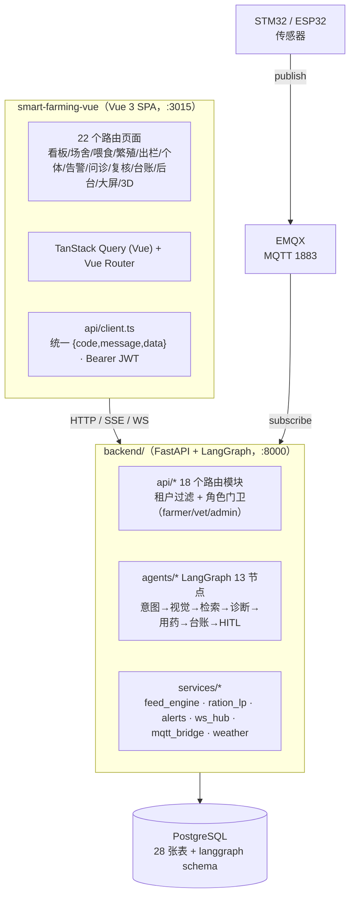
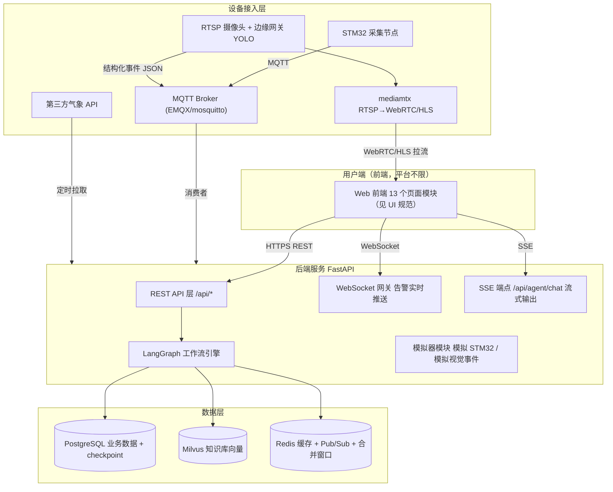
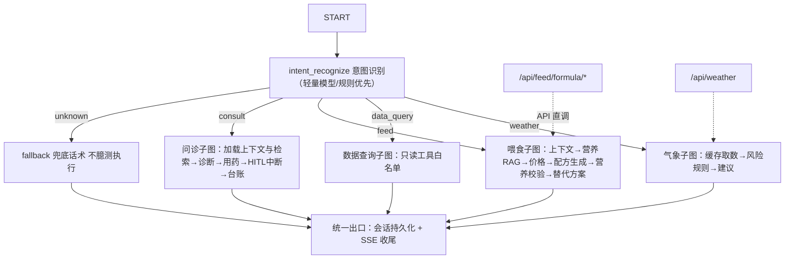

# 智慧养殖多智能体平台 — 系统架构设计文档

- 文档版本：**V2.0**
- 编制日期：2026-10-09 · 本版校准日期：**2026-10-23**
- 依据文档：《智慧养殖多智能体平台 PRD》V1.8 + **2026-10-23 代码实况核对**（`backend/` 全量、`smart-farming-project/src/` 全量、`docker-compose.yml`、`docs/08`）
- **V2.0 变更（单轨化收口，必读）**：
  1. **浏览器内核已下线**（2026-10-16）——`lib/mock-backend.ts` 与 `USE_MOCK` 开关全部移除，第一章按单轨现状重写；
  2. **浏览器造数引擎已删除**（2026-10-23）——`lib/sensor-engine.ts` 及其"模拟注入"入口整体移除，环境数据只来自 MQTT 桥接或设备直连；
  3. **新增 MQTT 桥接**（`services/mqtt_bridge.py`）——订阅 EMQX 后与 HTTP 直连共用同一条 `ingest_payload()` 校验链；
  4. **Alembic 归档**——baseline 与模型漂移（27 vs 28 表）且启动路径不经过它，`create_all` 为唯一建表事实源；
  5. 新增 `docs/08-遗留问题与风险登记.md`，代码注释里的 `docs/08 C-xx` 引用自此有落点。
  - ⚠️ **本文件第二至第十四章保留 V1.x 的历史叙述**，其中出现的 `mock-backend.ts` / `USE_MOCK` / "双轨"等表述均为当时实况，**不再代表当前代码**。判断现状以第一章、`docs/08` 与代码为准。
- V1.9 变更（E 批次：剩余 mock 域收口，见 3.7）：
  1. **`/vision/*` 实装**——新建 `camera_ai_results` 表 + 七步消费链（去重/回表/枚举/低置信丢弃/分级告警），level 与中文标签读侧派生、bbox 不外泄、停用设备仍入库、death 不自动扣存栏；
  2. **`/ws/alerts` 实装**——`after_commit` 才推（回滚不推）、`scope=ws` 5 分钟短令牌经子协议头传输（**C-03 关闭**）、按 `farm.user_id` 分片；前端新增 `lib/alert-stream.ts`，两处 `subscribeAlerts` 调用点零签名改动；
  3. **KB 契约对齐**——补 `content_md`/`DELETE`/`PUT /admin/kb/{id}` 路径，营养类写入侧归 low，长度违规改为报错而非静默截断，`is_enable` 走业务码；
  4. **两项认知纠正**：`/dashboard/summary` 在 mock 里从来没有路由（看板是前端聚合）、`/scene/analyze-photo` 一直是真 AI（`client.ts` 特例转发），二者不需要"移植"（C-11 已更正）；
  5. 视觉三常量从 `mock-backend.ts` 提到 `lib/vision-constants.ts`（引擎是过渡形态，常量不能随它一起删）；
  6. 新增遗留 **C-21**（并行加列未补 `_PENDING_COLUMNS` 导致 `/kb/list` 500，已修，纪律入文）；
  7. 新增冒烟 `smoke_vision_kb.py`（39 项）与 `smoke_ws.py`（14 项，含三项负向用例）。
- V1.8 变更（喂食计算内核 D1/D2 + B4/B5 收尾回写）：
  1. 新增 3.6「喂食计算内核」——**配方从"查表"改为"LP 求解"**（`scipy` 最小成本配料，24 条营养标准可解 21 条，育肥猪 5.08→4.77 元/头/天），并记录预混料锁死、粗饲料软约束降级、区间阶梯余量三条实测口径；
  2. **原料行情改为 LLM 联网采集 + 本地四道核验**（`price_sync`）：明确"模型不能当数据源，只能当检索搬运工"，摘录回查 / 本地单位换算 / 边界+时效 / 站点名核验；`feed_prices` 增 `price_source`/`source_site`/`confidence`；
  3. 更正 3.5 末尾已过期的"未覆盖"段落——`feed`/`data_query`/`weather` 三个意图已不再走兜底话术（`data_query_dispatch`、`weather_answer` 已入图，喂食与气象域已服务端化）；
  4. 修两个真缺陷：羊/牛通用替代方案同名（标签现带替代物名）、写死"稻谷最旧"的排序断言（改动态不变式）；
  5. 新增遗留 **C-19**（B5 向量检索绕过 EX-04 与风险判级，安全回归，含实测分数）与 **C-20**（行情无法独立核源，DashScope compatible-mode 不回传检索 URL）。
- V1.7 变更（P2 收尾，F05/F10 补齐 + 运行期配套）：
  1. 3.5 节图结构 10 → **11 节点**（新增 `vision_describe`，FR-11 图像问诊接进图内，此前只有 HTTP 端点、图里没人调）；
  2. **首字延迟治理**：规则正文先行 + `ai_analysis` 独立段追加，实测 3391ms → **57ms**；明确记录"不做模型 token 直透"的白名单理由；
  3. **EX-06 角标补实**：`/record/list` 与 CSV 导出读侧派生「未经兽医复核」（此前真后端完全缺失该标注），台账保持 append-only 不回写；
  4. 运行期：`core/logging.py` request_id 贯穿、lifespan 周期任务（超时降级 + checkpoint 清理，替代未安装的 APScheduler/loguru）、`prune_checkpoints()` 按可恢复性而非时间清理；
  5. `ledger_records.vet_review_id` 补真列（G-08 关闭，配幂等 `ensure columns`）；导出列序与类型中文标签按 PRD 3.6 对齐 mock（C-15 关闭）；
  6. `backend/seed_story.py`：三天养殖故事的真后端等价物（A-1 关闭）；
  7. 新增风险记录：**后端用消息 ts 记心跳 → 补报历史数据会秒判离线**（并入 C-09）。
- V1.6 变更（P2 切真：F05/F10 LangGraph 实装回写）：
  1. 新增 3.5「LangGraph 问诊工作流（已实装）」——记录图结构、thread 模型、interrupt 副作用纪律、Windows 事件循环约束；
  2. 差距矩阵中「AI 问诊编排」「HITL」两行由"未实现/状态位"改为**已实装**（规则管道 → 真图 + checkpoint）；
  3. 新增阻塞项 G-07（asyncpg 未装导致后端起不来，已修）、G-08（台账 vet_review_id 暂寄 record_ext）；
  4. 第十三节安全表补记：养殖户业务路由统一挂 `require_farmer` 角色门卫（此前 backend 只有租户过滤，vet/admin 可调用养殖户接口，已由 smoke_agent 组 7 捕获并修复）。
- 本版变更（as-built 校准，评审前置）：
  1. **本文分为两部分**：第一部分「实现现状（as-built）」是 2026-10-14 代码真相；第二部分「目标架构（to-be）」保留原 V1.0~V1.4 设计，作为切真终点。**改代码前先读第一部分**，规划切真时对照第二部分。
  2. 新增第一章「双轨结构」——澄清当前是"前端 mock 内核 + 后端部分切真"两条腿，而非文档原描述的单一 FastAPI 后端。
  3. 新增第四、五章——差距矩阵、切真批次路线、功能编号（F13~F17）与文档索引现状（含 **F14 编号冲突**勘误）。
  4. 原第三、四节目录结构与工作流设计标注为「目标形态」，不再作为现状陈述。

> **为什么需要这次校准**：原 V1.0~V1.4 本文描述的是"设计目标"，而实现走了「前端骨架先行 + 契约先行」的纵切路线（《04-开发计划》变更表 2026-10-09 用户确认）。两者都正确，但混在一份文档里会让后续开发者照一份过时图纸干活。本文自此对两者负责。

---

# 第一部分 · 实现现状（as-built，2026-10-23 校准）

## 一、单轨结构：现在只有一条链路

**浏览器内核已下线。** `src/lib/mock-backend.ts`（7079 行、71 个接口路由）于 2026-10-16 整体移除，
存档在 `_archive/mock-retired-20261016/`；`src/api/client.ts` 里的 `USE_MOCK` 开关一并删除。
**现在页面上的每一个数字都来自 FastAPI + PostgreSQL**，没有第二条取数路径。

**后端 `backend/` 承担全部职责**：认证与租户隔离、场舍存栏、台账、设备接入（HTTP + MQTT 桥接）、
告警治理与 WebSocket 推送、繁殖/出栏/休药期、喂食中心（LP 配方）、气象、知识库（F16）、
LangGraph 问诊工作流（F05）与 HITL 复核（F10）、视觉事件消费（F09）、3D 场景（F15）。
共 28 张表、约 60 个端点。

**环境数据只来自真实设备**：`services/mqtt_bridge.py` 订阅 EMQX 后走 `ingest_payload()`，
与设备 `X-Device-Key` 直连 `/device/ingest` 共用同一条校验链。2026-10-23 删除了浏览器造数引擎
（原 `lib/sensor-engine.ts`，每 4s 向真库写随机读数且默认开启），无设备时看板曲线为空态。

**建表只有一条路径**：`models.py` + `core/db.py` 的幂等 DDL。并存的 Alembic 配置因 baseline
与模型漂移（27 vs 28 张表）且启动路径不经过它，已归档到 `_archive/alembic-retired-20261023/`。



**三句话总结现状**

1. **产品能力齐了，且全部落在真后端**：F01~F17 的功能语义（告警闭环、问诊链路、休药期拦截、HITL 复核、数据查询 Agent、个体耳标对账、一畜一档）都由 FastAPI + PostgreSQL 承接，前端不再有 mock 分支，也没有第二条取数路径。
2. **架构层能力已实装**：LangGraph 13 节点工作流 + PostgresSaver checkpoint、Milvus 向量检索（失败回退关键词计分）、MQTT 桥接（订阅 EMQX）、WebSocket 告警推送、去重/防抖/合并窗口/限流/广播经 Redis 跨进程共享（`core/statestore.py`，不可达时降级进程内存）、真 JWT（HS256 + bcrypt）、6 组冒烟脚本 396 项断言。**仍缺**：pytest 单测体系、EMQX ACL 固化（C-27）——均已登记在 `docs/08`。
3. **多物种配置化是真做到了**：物种/品种/阈值/生命周期参数走配置数据（[lib/species-data.ts](file:///E:/FEISI/%E6%99%BA%E6%85%A7%E5%85%BB%E6%AE%96%E5%A4%9A%E6%99%BA%E8%83%BD%E4%BD%93%E5%B9%B3%E5%8F%B0/smart-farming-project/src/lib/species-data.ts) + `env_threshold`/`climate_risk` 规则），F12 羊牛横向复制实测零逻辑改动。

## 二、前端：路由、状态与取数

> **2026-10-26 迁移说明**：业务前端已整体从 React 19 迁到 Vue 3（`smart-farming-vue/`），页面、文案、接口契约、查询键与交互逐一对齐；旧 `smart-farming-project/`（React）停止使用，仅留作对照。下文 2.1~2.7 保留 mock 时代的分层分析作为设计依据，当前代码地图以 `smart-farming-vue/src/` 为准（`views/` + `components/` + `api/` + `composables/`）。

技术栈实际选型（[package.json](file:///E:/FEISI/%E6%99%BA%E6%85%A7%E5%85%BB%E6%AE%96%E5%A4%9A%E6%99%BA%E8%83%BD%E4%BD%93%E5%B9%B3%E5%8F%B0/smart-farming-vue/package.json)）：Vue 3.5 + Vite 7 + **Vue Router 显式路由表** + TanStack Query (Vue) + Pinia + Tailwind v4 + ECharts + three.js（F15 3D 场景）。图标 lucide-vue-next。

### 2.1 分层与真实代码地图

```
smart-farming-project/src/
├── routes/                    22 个路由（_layout.* 业务页 + login/onboarding/screen/showcase3d）
├── api/                       14 个领域 API 封装（auth/farm/device/breeding/individual/
│                                feed/record/agent/vet/vision/weather/kb/scene + client.ts）
├── lib/
│   ├── mock-backend.ts        ★ 业务内核 7079 行：实体+分发器+服务层+告警管道+对话流
│   ├── knowledge-data.ts      兽药库种子 + 猪病知识条目（切真时直接切片灌 Milvus）
│   ├── species-data.ts        物种/品种配置（三物种 + 通用兜底）
│   ├── feed-data.ts           原料价/营养档/配方模板 753 行
│   ├── weather-service.ts     高德天气 REST + 缓存 + EX-02 降级 674 行
│   ├── sensor-engine.ts       协议层传感器模拟（4s 采集 / 5s 离线扫描）
│   └── region-data.ts         省市区 adcode
├── components/                layout（Sidebar/TopBar）+ showcase3d + ui（shadcn）
├── contexts/auth.tsx          登录态与角色
└── hooks/use-farm-data.ts     跨页数据装配
```

**分层规则现状**：`routes` 只做展示与交互，一律经 `api/*` → `client.ts` 取数，**没有任何页面直接读 `data/mock.ts`**（`grep` 全量确认为零引用，该文件是 M0 骨架期遗留，可删）。业务校验、事务、台账写入全部在 `mock-backend.ts` 内，与目标架构"api 只校验、service 持事务、台账只在 service 层写"的分层纪律**语义一致，只是宿主进程不同**。

### 2.2 接口层：契约先行，切真时只改 base

[handleApiRequest](file:///E:/FEISI/%E6%99%BA%E6%85%A7%E5%85%BB%E6%AE%96%E5%A4%9A%E6%99%BA%E8%83%BD%E4%BD%93%E5%B9%B3%E5%8F%B0/smart-farming-project/src/lib/mock-backend.ts#L986-L1166) 是一份按《03-API接口设计》同路径、同 `{code,message,data}` 结构写出的**同步分发器**，71 个路由按功能域分组注释（F02/F03/F04/F05/F06/F07/F08/F09/F10/F14/F16/F17）。三个刻意的设计：

- **角色门卫写在入口**（[mock-backend.ts:1003](file:///E:/FEISI/%E6%99%BA%E6%85%A7%E5%85%BB%E6%AE%96%E5%A4%9A%E6%99%BA%E8%83%BD%E4%BD%93%E5%B9%B3%E5%8F%B0/smart-farming-project/src/lib/mock-backend.ts#L1003)）：`vet`/`admin` 命中养殖户业务路径前缀直接 40301，与 `/vet/*`、`/admin/*` 自带的角色校验构成"授权面最小化"两面。
- **台账不可篡改**：注释里明确不提供 `PUT/DELETE /record`，请求落兜底 40401（TC-R04 口径）。
- **演示注入入口标注了切真移除**：`POST /vision/simulate` 是唯一带「切真移除」注释的路由。

### 2.3 数据层：localStorage 上的迁移链

`DB_KEY = 'sf_mock_db_v1'`，25 个 `Db*` 实体（用户/场/圈/存栏流水/台账/设备/告警/兽药/会话与消息/复核/配方/原料价/饲喂/称重/出栏/母畜/生命周期事件/提醒/个体/个体事件/视觉事件/知识库文档…）。[migrateLegacy](file:///E:/FEISI/%E6%99%BA%E6%85%A7%E5%85%BB%E6%AE%96%E5%A4%9A%E6%99%BA%E8%83%BD%E4%BD%93%E5%B9%B3%E5%8F%B0/smart-farming-project/src/lib/mock-backend.ts#L600) 支持 v1→v6 惰性升级——**这就是当前唯一的"迁移机制"**，对应 Alembic 缺位（见 C-04/第四章）。

### 2.4 告警链路：协议层模拟是做到了的

[sensor-engine.ts](file:///E:/FEISI/%E6%99%BA%E6%85%A7%E5%85%BB%E6%AE%96%E5%A4%9A%E6%99%BA%E8%83%BD%E4%BD%93%E5%B9%B3%E5%8F%B0/smart-farming-project/src/lib/sensor-engine.ts) 造出的 payload 结构与《07-硬件通信协议》三节**完全同构**（`msg_id`/`device_id`/`ts`/`metrics`），经 `engineIngest` 走与真实硬件一致的消费管道：去重→归属校验（device_sn 回表）→schema 校验→入库→缓存→防抖（3 次）→双档分级（warn=mid / critical=high）→1h 合并窗口→告警落库→事件总线推前端。

演示口径与生产口径的差异被注释显式记录了：采集 4s（协议 10~300s）、离线判定 90s（协议 5 分钟）。**切真时这两个数值改回协议值，管道代码不动**——这是"在协议层模拟"原则的实际兑现程度：结构与管道一致，只有时钟不同。

推送侧：`subscribeAlerts()` 进程内订阅替代 WebSocket（[TopBar.tsx:32](file:///E:/FEISI/%E6%99%BA%E6%85%A7%E5%85%BB%E6%AE%96%E5%A4%9A%E6%99%BA%E8%83%BD%E4%BD%93%E5%B9%B3%E5%8F%B0/smart-farming-project/src/components/layout/TopBar.tsx#L32)、[_layout.alerts.tsx:103](file:///E:/FEISI/%E6%99%BA%E6%85%A7%E5%85%BB%E6%AE%96%E5%A4%9A%E6%99%BA%E8%83%BD%E4%BD%93%E5%B9%B3%E5%8F%B0/smart-farming-project/src/routes/_layout.alerts.tsx#L103)），调用方语义已是"订阅→失效重取"，切真换成 WS 消息触发同一回调即可。

### 2.5 对话链路：规则管道是主体，LLM 是叠加层

[mockAgentChatStream](file:///E:/FEISI/%E6%99%BA%E6%85%A7%E5%85%BB%E6%AE%96%E5%A4%9A%E6%99%BA%E8%83%BD%E4%BD%93%E5%B9%B3%E5%8F%B0/smart-farming-project/src/lib/mock-backend.ts#L3490) 是 AsyncGenerator，产出**与切真后 SSE 同格式的帧**（`intent`/`token`/`section`/`done`/`error`，见第二部分第六节）。内部是纯规则实现：

| 环节 | 现状实现 | 与目标差距 |
|------|----------|-----------|
| 意图识别 | 四组关键词表（[mock-backend.ts:2977-3003](file:///E:/FEISI/%E6%99%BA%E6%85%A7%E5%85%BB%E6%AE%96%E5%A4%9A%E6%99%BA%E8%83%BD%E4%BD%93%E5%B9%B3%E5%8F%B0/smart-farming-project/src/lib/mock-backend.ts#L2977-L3003)）判 consult/feed/data_query/weather，未命中→unknown 兜底 | 未命中且已配 LLM 时叠加 `POST /api/ai/intent` 二次判定 |
| RAG | `knowledge-data.ts` 静态条目按关键词命中，返回带 `source` 溯源 | 无向量检索、无 Milvus；条目已按可切片结构组织 |
| 诊断 | 规则拼装症状→疑似病→风险分级，`high` 进 HITL 挂起 | 已配 LLM 时叠加 `POST /api/ai/diagnose` 增强文案 |
| 用药 | 查 `medicine_lib` 种子，违禁拦截、休药期强制输出 | 与目标一致（本就该是库校验，不该交给模型） |
| 澄清链 | F14（代码口径）物种动态话术 + 同会话补位合并重诊 + 断链收养 | 目标架构未写这一层，属实现期新增 |
| HITL | `vet_review` 表 + 复核 API + 24h/48h 超时降级（服务层直落台账，不 resume） | **无 LangGraph checkpoint**，挂起是"状态位"而非"图状态" |

**LLM 叠加层的降级纪律值得保留到切真后**：`sf_llm_base` 未配置 / 超时 12s / 响应不合规 / 结构异常 → `llmPost` 返回 `null`，调用方静默回退规则管道，永不抛出（[mock-backend.ts:3446-3470](file:///E:/FEISI/%E6%99%BA%E6%85%A7%E5%85%BB%E6%AE%96%E5%A4%9A%E6%99%BA%E8%83%BD%E4%BD%93%E5%B9%B3%E5%8F%B0/smart-farming-project/src/lib/mock-backend.ts#L3446-L3470)）。合规句用**逐字锚点**替换而非信任模型自觉（`RULE_DIAGNOSIS_DISCLAIMER` / `LLM_DIAGNOSIS_DISCLAIMER`）。

### 2.6 数据查询 Agent（F11）

四把只读工具函数 + `switch` 白名单派发（[mock-backend.ts:3369-3372](file:///E:/FEISI/%E6%99%BA%E6%85%A7%E5%85%BB%E6%AE%96%E5%A4%9A%E6%99%BA%E8%83%BD%E4%BD%93%E5%B9%B3%E5%8F%B0/smart-farming-project/src/lib/mock-backend.ts#L3369-L3372)）。白名单外**无实现函数**=物理禁写，与 PRD 3.5.5 口径一致；写指令走 `isWriteReject` 拒绝并引导页面，查不到如实明说不编数。

### 2.7 认证现状（**切真前必须知道的不一致**）

| 项 | mock | backend | 后果 |
|----|------|---------|------|
| token | 三段式，签名是 `${user_id}.${exp}.mock` 的 base64，**非密码学安全** | PyJWT HS256，密钥来自 `.env` | 两边 token 互不通用；mock 侧不可用于生产 |
| 密码 | 双哈希 djb2 变体 + 固定盐（`mock$…`） | bcrypt rounds=10 | 切真后**所有 mock 账号密码不可迁移**，需重置或重注册 |
| 禁用生效 | — | `get_current_user` 命中 `is_enable=false` 即拦（F10 RK-6） | 后端更强 |

## 三、后端 `backend/`：两个角色，四十九个端点

实际结构（约 3589 行，无子包分层 beyond api/core/services/models）：

```
backend/app/
├── main.py                 挂载 8 个路由 · CORS 白名单 3015 · lifespan: init_db() + 兽药库种子
├── models.py               16 张表（单文件，非 models/ 包）
├── core/{config,db,security,response}.py
├── api/{auth,farm,individual,records,device,breeding,species,rules,ai}.py
└── services/llm.py         OpenAI 兼容 chat 封装（含多模态 content part、enable_thinking 兼容重试）
```

**角色一 · LLM 网关**（`/api/ai/*`，3 端点）：`intent` 意图兜底、`diagnose` 诊断增强、`vision` 图像问诊（FR-11，`qwen-vl-max-latest`）。Key 只在服务端进程内存，前端只拿地址——**没有泄钥路径**。多模态消息结构已按 PRD 3.5.9/架构 4.6 的预留落地（`services/llm.py:30-33`）。

**角色二 · 业务切真主链路**（46 端点，已覆盖 F01 注册登录 / F02 场圈存栏转群 / F03 设备+`/device/ingest`+告警+传感器历史 / F04 台账查询导出 / F07 母畜+生命周期+提醒+用药+出栏休药期 / F14+F17 个体档案与事件 / species+variety 配置）。

**关键差异**：数据上行用 `POST /api/device/ingest`（HTTP）承担，**MQTT 消费者不存在**；这是切真路线上的一个可接受中间态（协议层语义一致，只差传输层）。

**已实装**：`app/agents/`（LangGraph 问诊工作流 + PostgreSQL checkpoint，见 3.5）。
**仍不存在**（对照第二部分目标架构）：`app/rag/`（Milvus 向量检索）、`app/mq/`（MQTT 消费/定时任务）、`app/simulator/`、`alembic/`、`tests/`（pytest）、WebSocket 端点、APScheduler 依赖。基础设施容器（Redis/EMQX/Milvus/mediamtx）在 compose 里**起着但没接线**。

### 3.5 LangGraph 问诊工作流（P2 已实装，2026-10-14）

F05 问诊链路与 F10 HITL 复核已从"前端规则管道"落到真图 + 真 checkpoint。文件：
`app/agents/{state,kb,prompts,nodes,graph}.py`、`app/api/{agent,vet,admin}.py`、`core/logging.py`、`seed_story.py`。

**图结构**（11 节点，架构文档点名的 4 个核心节点为 intent_recognize / load_context_retrieve / diagnose / medication_check）：

```
START → intent_recognize ─(非 consult / 违禁诱导 / 写指令)→ fallback_reply → END
              ├─(consult 无图)→ load_context_retrieve ─(定位失败)→ clarify_reply → END
              ├─(consult 有图)→ vision_describe → load_context_retrieve
              │                              └─(EX-04 / EX-C4)→ kb_reply → END
              └────────────────────────────→ diagnose → medication_check → record
                                                     │
                            (low/mid) ───────────────┴→ END
                            (high) → hitl_gate(interrupt) → record_review → END
```

| 设计点 | 实现口径 |
|--------|----------|
| 意图识别成本 | **规则关键词命中即返回，不调 LLM**；仅 unknown 且非写指令时才走 `/api/ai/intent` 同款 prompt（F05 决策 2）。`state.intent_source` 记 rule/llm 供成本观测 |
| RAG | `kb_seed.json`（32 条，由 `scripts/export_kb_seed.ts` 从前端 `knowledge-data.ts` 机械导出，导出时自检"推荐药都在兽药库内且物种一致"）+ 关键词计分 + 物种隔离。**Milvus 的占位实现**，B5 换向量检索时 diagnose 节点零改动 |
| LLM 边界 | 模型只增强"症状理解/鉴别/饲养建议"表述；**风险分级由 `kb.max_risk` 确定性推导，用药由兽药库查询生成，模型都碰不到**；候选外疾病名白名单过滤；任何失败静默回退规则文案 |
| **正文先行（延迟治理）** | `diagnose` 先把**规则诊断正文**整段发出，LLM 增强作为**独立段落** `ai_analysis` 追加。实测首字 **57ms**（改造前等模型返回是 3391ms），AI 段 ~6s 到达。**不做模型 token 直透**：诊断 prompt 要求模型输出 JSON 且疾病名必须过候选白名单，直透等于把无法过滤的文本吐给养殖户 |
| **图像问诊（FR-11）** | `vision_describe` 节点把 `describe_vision` 产出的**可见征象词**并入检索文本，疾病判定仍走知识库；模型没把握时输出"未能识别出明确体征"后继续文字问诊，**不硬猜**（架构 4.6 安全底线实测生效） |
| **角标派生** | 「未经兽医复核」是**读侧派生**：`/record/list` 按 `vet_review_id` 关联出 `vet_review_status`，导出 CSV 摘要追加后缀；**原 disease 台账不回写**（append-only，TC-R04 口径） |
| checkpoint | `AsyncPostgresSaver` + `AsyncConnectionPool`，独立 schema `langgraph`（4 张表由 `saver.setup()` 建），与业务表隔离 |
| **thread 模型** | **每轮一个 thread_id**（`c-{session_id}-{rand}`），不按会话复用。实测同 thread 的 run 结束后再 invoke 会从 START 重跑，第二轮问题若落在未恢复的 checkpoint 上会撞坏挂起状态。多轮上下文由 API 层从 `agent_messages` 显式装配进 state（checkpoint 只承担"可恢复"，不承担"记忆"）——与架构文档 9.4「thread_id = session_id」的偏离，已在此定稿 |
| **interrupt 副作用纪律** | 实测 **resume 时只有含 `interrupt()` 的节点从头重跑**，已完成节点不重跑 → 建复核单必须放在 hitl_gate 之前的 `record` 节点；`hitl_gate` 内零副作用（不写库、不发帧） |
| 恢复 | `POST /api/vet/review` → 校验（角色/状态/必填/兽药库）→ `graph.aget_state()` 确认仍挂在 hitl_gate → `Command(resume=复核结果)` → `record_review` 落 vet_review 留痕台账 → 返回 `ledger_record_id` |
| 超时降级 | EX-06 **不走 resume**：`sweep_timeout_reviews()` 惰性把 ≥48h 的 pending 置 timeout，checkpoint 弃用。disease 台账在问诊时已落，"未经兽医复核"角标读侧派生 |
| SSE | `astream(stream_mode="custom")`，节点内 `get_stream_writer()` 直接推帧（intent/section/token/done/error），API 层只做帧序列化——帧形状由节点全权决定，不把内部状态泄给前端 |

**运行约束（Windows，踩过两次）**：psycopg 异步模式不支持 ProactorEventLoop，`python -m uvicorn` 会让 checkpoint 连接池 30s 超时。**必须用 `python run.py` 启动**（内部把循环换成 SelectorEventLoop），两个启动 bat 已改。同一约束适用于任何在进程内调 psycopg 异步的脚本——`smoke_agent.py` 组 19 最初就用默认循环跑 `prune_checkpoints()`，直接 pool timeout。

**运行期配套**：`core/logging.py` 以 stdlib + ContextVar 实现 request_id 贯穿（环境无 loguru，不为一行格式加依赖），`X-Request-ID` 双向透传；SSE 响应体在中间件返回后才逐帧生成，故流内自行回填同一 id。lifespan 挂一个 asyncio 周期任务（每 10 分钟）做超时降级扫描 + checkpoint 清理，**替代 APScheduler**（未装，不为此加依赖；装上后整块替换即可，行为口径不变）。`prune_checkpoints()` 的判据是**可恢复性而非时间**——只删 thread 不属于 pending 复核单的行，因为 LangGraph 标准表没有 created_at 列，"按保留期清理"做不了（实测 292 行/45 线程 → 28 行/4 线程）。

**演示数据**：`backend/seed_story.py` 是 mock 版 `seedStoryDemoData` 的真后端等价物（同租户 13000000010、同场同圈同数值），全程走 HTTP 接口层编排、幂等（已有场即跳过）。**注意别用历史 ts 注入**：后端以消息 ts 记心跳，按"Day1=2 天前"发数据会让设备秒判离线并多出一条 `device_offline` 告警（补报判定基准未定，见 08 文档 C-09）。

**验证**：`backend/smoke_agent.py` **81 项**（含 interrupt 挂起后 done 之后无帧、resume 双路径、修改方案过兽药库、AI 补充段与历史回看段落一致、EX-06 角标三处派生、导出列序与中文标签、checkpoint 清理不变量、越权与角色矩阵）；`backend/smoke_backend.py` 87 项、`.smoke/` 369 项回归全绿；前端 typecheck 通过；实测首字 57ms / resume 32ms。

**2026-10-15 更新（原"未覆盖"段落已过期）**：`feed` / `data_query` / `weather` 三个意图已不再是兜底话术——`data_query_dispatch`（F11 四个只读工具：存栏汇总 / 传感摘要 / 告警摘要 / 复核状态，全部打真库）与 `weather_answer` 已作为节点接入 `route_after_intent`，喂食域与气象域的服务端实装见 3.6。仍在前端 mock 层的只剩 `/vision/events`、`/vision/simulate`、`/dashboard/summary`、`/kb/list`+`/admin/kb` 契约、`/scene/analyze-photo`、`/ws/alerts`（见第四节差距矩阵）。因此**仍不要整体翻 `USE_MOCK`**，用 `client.ts` 的按域开关（`VITE_REAL_API_BASE` + `VITE_REAL_API_PREFIXES`）只切已实装的域，且 `/auth`、`/user` 必须与业务域同批切（两套凭据互不通用，G-04）。

### 3.6 喂食计算内核（D1 行情采集 + D2 最小成本配方，2026-10-15）

用户提出的质疑成立：**默认配方比例与 `feed_seed.json` 的模板逐字相同**——原来的"配方大脑"是查表 + 换算，不是计算。本轮把它改成"算得出"并补上行情来源。

**D2 最小成本配方**（`app/services/ration_lp.py`，`scipy.optimize.linprog` / HiGHS）：
变量为原料百分比，目标 `min Σ xᵢ·单价ᵢ`，约束 `Σx=100` + 每条营养指标按 `nutrition_lib.indicators`
的区间（`max=null` 视为仅下限，与 `nutrition_check` 同口径）。三条口径是踩出来的，不是设计出来的：

| 设计点 | 结论（含实测） |
|--------|----------------|
| 预混料必须锁死 | 锁在标准模板自身的比例。放开会让 LP 用"钙 12% / 赖氨酸 6% 且单价低"的预混料去堆指标，解出实操不存在的配方 |
| 牛羊粗饲料下限取模板自身值 | 不另编数字。作为**软约束**：无解时先丢它重解，并把"丢了哪条"写进 `basis`（项目既有降级纪律） |
| 营养区间留**阶梯余量** | `BOUND_MARGINS=(0, .004, .008, .012, .015)`，取第一个"舍入到 1 位小数后仍达标"的解。LP 最优常正好压边界（消化能 13.0→舍入 12.99 判不达标）；而一上来固定留 1.5% 会把贴着数据上限的下限直接判无解（排除豆粕时消化能可达 13.19 < 要求 13.195） |
| 舍入后终检不过 → 整体不返回 | 宁回退模板，绝不输出"解出来了但营养不达标"的配方 |
| 单料上限 `CAP_PCT` | **演示参数，非国标**，已写入 `basis` 文案待配方师复核 |

覆盖度实测：**24 条营养标准里 21 条能解出 LP**，均比模板省（育肥猪 5.08→4.77、犊牛 9.43→8.63、育肥羊 3.65→2.92 元/头/天）。
剩 3 条无解全是"排除豆粕后的保育猪/仔猪/妊娠母猪"——现有原料池 + 单料上限下**数学上确实无解**（DE≥13.5 需大量玉米，而玉米上限 70%），
此时系统回退模板并如实标注未达标项，不假装最优。`build_candidates(std, exclude, prices)` 现在返回三元组
`(label, items, note)`，LP 方案排首位；`generate` 取首方案，`alternatives` 全列。

**D1 原料行情采集**（`app/services/price_sync.py`）：定位是"演示期比静态内置价更真"，不是实时交易价。
关键判断——**大模型不能当数据源，只能当检索搬运工**：实测不带检索时 qwen3.8-flash 直接回「我没有联网」或给
训练记忆里的陈旧价；带 `enable_search` 时确实注入了网页正文（prompt_tokens 4884/6761）但索引滞后 1~3 天。
两段式：① 逐品种并行检索（一次问全 7 种召回极差，实测 11s 空手；拆开后 15~25s 拿到 3~4 个品种），
要求模型**逐字摘录** `品种|价格|地区|日期|站点`；② 本地 `parse_lines` 解析（比再叫一次模型可靠，
兜底才用 LLM 结构化）。数字从不经过第二次模型生成。四道本地校验：摘录回查 / `元/吨→元/公斤` 本地换算 /
数量级边界 + 30 天时效 / 站点名核验（实测出现来源=「你的知识库」，即模型未联网，必须丢）。
`feed_prices` 增 `price_source`/`source_site`/`confidence` 三列（走 `_PENDING_COLUMNS` 幂等 ALTER），
取不到的原料保留 `builtin` 价并在 `missed` 里报告。入口：`POST /api/feed/price/sync`（点火即返回，
实测 15~190s 不能挂请求上）+ `GET /api/feed/price/sync-status`；自动每日跑需 `PRICE_SYNC_ENABLED=true`
（默认关，多一项出网与 token 成本），由 `_maintenance_loop` 在 `PRICE_SYNC_HOUR` 后触发一次。

**验证**：`smoke_feeding.py` 77 项全绿（新增 10 项覆盖 LP 上链、可行域最优、来源四道校验）。
顺带修掉两个真缺陷：① 羊/牛走通用替代时两套方案同名 `方案一（豆粕替代）/方案二（豆粕替代）`，
标签现带替代物名；② 断言"稻谷最旧置顶"被真行情打破——写死 fixture 顺序的测试本身是错的，已改为动态校验排序不变式。
**遗留**：C-19（B5 向量检索绕过 EX-04 与风险判级，安全回归）、C-20（行情无法独立核源，接口不回传检索 URL）。

### 3.7 剩余 mock 域收口（E 批次，2026-10-15）

用户要求"把仍是 mock 的域全改成真实数据"。先测绘契约再动手，结果**推翻了清单里的两项**：

| 域 | 实际状态 | 处理 |
|----|----------|------|
| `/vision/*` | 真缺（后端无表无路由） | **新建** `camera_ai_results` 表 + `api/vision.py`：GET `/vision/events`、POST `/vision/simulate` |
| `/ws/alerts` | 前后端都没有（mock 是进程内 pub/sub，前端零 WebSocket 代码） | **新建** `services/ws_hub.py` + `api/ws.py` + 前端 `lib/alert-stream.ts` |
| `/kb/list` + `/admin/kb` | 后端已有，但契约不一致且**缺 DELETE、路径不匹配、列表少 content_md** | 对齐（见下） |
| `/dashboard/summary` | **mock 里从来没有这个路由**——看板是前端从 `/pen/list`+`/feeding/overview`+`/alert/list`+`/lifecycle/reminders` 聚合的；`avg_temperature` 来自传感器卡本地 state | 无需移植，只需切前缀（C-11 已更正） |
| `/scene/analyze-photo` | **一直是真 AI**：`client.ts:97` 特例转发到 `/api/ai/scene`，后端 `api/ai.py:114` + `prompts.analyze_scene` 已实装 | 只是"看起来像 mock"，标记为已实装 |

**视觉事件（F09）三条容易被省略的口径**，都按 mock 逐条对齐并有断言：

- **表里不存 level**：`level`/`event_label` 在读侧由 `event_type + confidence` 现算，改分级规则不回刷历史；
- **七步校验链丢弃是引擎观测、不是 HTTP 错误**：`bad_payload`（缺 msg_id/device_id/ts/confidence 越界/缺 event_type）→
  `dup_msg_id`（QoS1 重发，TTL 2h）→ `bad_device`（回表须 camera 且 topic 前缀与设备归属交叉验证）→
  `bad_event_type` → `low_confidence`（<0.5 不入库不告警）；
- **停用设备仍入库**（事实数据要留），只跳过告警判定；**death 不自动扣存栏**（F09 决策 3），文案引导人工核实后去"调整存栏"登记。

**告警实时通道三条设计约束**：

1. **提交后才推**——`create_alert` 只把待发消息挂 `session.info`，真正发送挂在 SQLAlchemy `after_commit`；
   否则事务回滚时客户端角标 +1 却查不到（比不推更糟）；
2. **凭据走子协议头**——`POST /auth/ws-token` 发 5 分钟 `scope=ws` 短令牌，用 `new WebSocket(url, [token])`
   的 `Sec-WebSocket-Protocol` 传输，**握手 URL 里没有任何凭据**（C-03 关闭）；服务端 accept 时必须回显该子协议，
   否则 Chrome 判握手失败。业务 24h token 直连 WS 被拒；
3. **推送按 `farm.user_id` 分片**，且广播异常一律吞掉并摘除连接——告警落库永不因推送失败而回滚。

**KB 契约对齐**（六处不一致，全部按 mock/前端为准修后端）：`/kb/list` 与 `/admin/kb` 补 `content_md`
（阅读页 `_layout.kb.tsx:45` 直接 `d.content_md.toLowerCase()`）；启停路径从 `/admin/kb/{id}/enable` 改为
前端实际调用的 `PUT /admin/kb/{id}`；补 `DELETE /admin/kb/{id}`（软删 + 立即摘向量）；营养类**写入侧**就归
`risk_level=low` 并清空推荐药（原来只在检索侧压缩，导致管理页回显一个"看起来会致病"的 high）；关键词/推荐药
接受分隔串并去重，单关键词 >20 字与 `feed_advice` >500 字**报错而非静默截断**（原来悄悄砍到 10 个 / 6 个）；
`is_enable` 非布尔走业务码 42201 而不是 FastAPI 框架 422（默认错误体没有 `{code,message}`，前端会当网络异常）。

**踩到的新风险（C-21）**：并行改动给 `KbDocument` 加了五个文件列却没加 `_PENDING_COLUMNS`，
`create_all` 不 ALTER 已有表 → 老库上 `/kb/list` 直接 500，且炸在读路径。已补幂等 ALTER。
在 Alembic（C-17）落地前，"模型加列 = 同批改 `_PENDING_COLUMNS`"是硬约束。

**前端**：视觉三常量（`VISION_EVENT_TYPES/META/DISCLAIMER`，RK-4 要求三处逐字一致）从 `mock-backend.ts`
提到 `lib/vision-constants.ts`——引擎是过渡形态，常量不能跟着它一起被删；`subscribeAlerts` 的两处调用点
改指 `lib/alert-stream.ts`，该模块按域开关自动在"mock 进程内广播"与"真 WS"间切换，重连前重新签发短令牌、
连上先补一次列表重取。`npx tsc --noEmit` 通过。

**验证**：新增 `smoke_vision_kb.py` 39 项、`smoke_ws.py` 14 项，连同 `smoke_feeding.py` 77 项、
`smoke_backend.py` 87 项全绿。`smoke_ws.py` 含负向用例（业务 token 直连被拒、无凭据握手 403、未鉴权签发 40101）。
**UI 未做浏览器实测**：切换后的域都指向 8000 演示实例，而它仍是重启前的旧进程（无 vision 路由、无 kb 附件列、
`feed_prices` 为空），必须先重启 8000 才能验前端表现。

### 3.8 mock 残留全量清扫（2026-10-15 复核）

用户追问"还有哪些是 mock 数据"。这次不按文档清单查，而是**从前端调用点反向枚举**：
`apiFetch('METHOD', path)` 全量扫描 `src/**`（78 条去重后的方法+路径）逐条比对真后端 openapi 与切真前缀表。
中途两次口径纠偏值得记录：第一版按分发器 `if (method === … && route === …)` 正则只抓到 49 条（mock 实有 71 条），
脚本自检 `len < 60` 直接拒绝下结论；域级聚合又会把模板串（`/kb/list${qs}`、`/weather${farmId}`）误报成未实现。
**最终：78 条调用点全部有真后端实现且已切真，路由层面 mock 数据源为 0。**

真正的残留不是路由，是**页面上的"演示数据注入"按钮仍在写 localStorage** —— 域切真后页面读的是真库，
这些按钮变成"提示成功但什么都看不到"的假动作。六处逐个处置：

| 位置 | mock 行为 | 现在 |
|------|-----------|------|
| 喂食中心「载入演示数据」 | `seedFeedingDemoData` 写 localStorage | 新增 **`POST /feeding/seed-demo`**：计划量由 `calc_daily_plan` 现算（生效配方→标准→无计划），10 天饲喂 + 3 次称重，每条 `remark=演示数据（喂食中心载入）` 并落台账，幂等跳过已有记录的圈 |
| 繁殖育成「演示档案」 | 写 localStorage | 切真时提示改用 `backend/seed_story.py`（它 POST 的是同一批 `/breeding-female`+`/lifecycle/event`） |
| 设置页「角色演示账号」 | 写 localStorage | 切真时指向后台「用户管理」（`POST /admin/user` 已实切真），并说明管理员号需配 `ADMIN_SEED_PHONE/PASSWORD` |
| 设置页「三天故事数据」 | 写 localStorage | 切真时指向 `backend/seed_story.py` |
| 设置页「气象连通自检」 | 用浏览器里填的 key 自测 | 切真时直接探 `GET /weather`，报服务端 `source=live/cache`+`degraded`，并**明说本卡填的 key 不参与真后端请求**（key 已按 G-03 移入服务端） |
| 登录页「重置演示数据」 | 只清 localStorage | 真 token 模式下提示语改为"已清本机缓存与登录态，服务端数据未做任何删除"——不再假装清了后端 |

两点刻意不做：**演示注入不塞出栏记录**（真出栏要过休药期拦截与耳标选择，绕过它就是造假台账；
`feed-conversion` 因此如实返回 `reason=批次未出栏`，冒烟有断言）；**称重不写台账**（真 `/feeding/weight`
本来就不写，库里也没有 `weight` 这个 record_type，不能因为做 demo 就无中生有）。

顺带补上两处**角色门卫缺失**：`/feeding` 与 `/weather` 只挂了 `get_current_user`，而 mock 分发器的正则
明确把 `feeding|weather|…` 对 vet/admin 关闭（40301）。现补 `require_farmer`，与 mock 对齐。

**最隐蔽的一处残留：传感器模拟引擎**。`lib/sensor-engine.ts` 每 4 秒产一次读数，但它调的是 `engineIngest`
（mock 内核的进程内管道，写 localStorage）——域切真后曲线读的是真库，于是**数据一直在生成、页面永远看不到，
环境曲线不再往前走**。现按 `isRealPath('/device/ingest')` 分流：切真时 `POST /device/ingest`
（payload 与真实 STM32 消息同构，字段完全对得上），设备清单也改从 `GET /device/list` 取真库的
（否则沿用 mock 列表会空转）；切真时不再起前端离线扫描定时器（服务端 `offline_scan` 已在 ingest 与告警列表里做）。
vet/admin 登录时直接不启动这条轮询——上报接口是 farmer 专属，否则每 4 秒一个必然 40301 的请求，日志噪音掩盖真问题。
**边界要说清**：这只是把模拟器的落点换成真库，数据本身仍是浏览器造的（`source='sim'`）；真设备上行属 B3
（MQTT/Redis）范畴，且 `/device/ingest` 目前挂在 farmer 鉴权下，真实硬件侧要另做设备凭据。

**核查后确认不是残留的**：引导态 `getGuideDone`/`verifyToken` —— `_layout.tsx` 与 `onboarding.tsx` 的守卫
已是双口径，真 token 模式走 `apiMe().guide_done`（PostgreSQL"名下有场"），mock 分支只在未切真时生效；
页面里剩下的 `ApiError`/`isValidPhone`/`RECORD_TYPE_LABEL` 等 mock 导入是**错误类型与标签常量**，不是数据来源
（`RECORD_TYPE_LABEL` 与视觉常量同问题，退役 mock 前要一并提出，但它不产生假数据）。

**验证**：`smoke_backend` 87 + `smoke_feeding` 85（新增 8 项覆盖 seed-demo 的引擎口径、演示标注落库、幂等、
不注入出栏）+ `smoke_vision_kb` 39 + `smoke_ws` 14 = **225 项全绿**；`npx tsc --noEmit` 通过。
**8000 已被重启，本轮实测纠正**：`openapi` 里 `/api/vision/events`、`/vision/simulate`、
`/api/feed/price/sync`、`/api/feeding/seed-demo`、`/api/admin/kb/{doc_id}` 全部存在；`smart_farm` 已有
`feed_prices.price_source` 列与 `camera_ai_results` 表；对演示账号实跑 `POST /auth/ws-token` +
`ws://…/api/ws/alerts` 握手成功，收到 `{"event":"connected",…}` 与 `pong` 帧——**告警实时通道在演示后端上是活的**。
演示库现状：`feed_prices` 9 条且 `price_source` 全为 `builtin`（尚未在演示库跑行情采集）、
`camera_ai_results` 0 条（视觉时间线为空是事实，mock 侧本来也没有种子）。
仍未做的只有浏览器点开页面：Vite 需重启才会读新的 `.env` 前缀表。

### 3.9 问诊检索评测（黄金集 + 空库/漂移检查，2026-10-15）

冒烟测**契约**（状态码、字段、权限），测不出**效果**。C-19 就是证明：225 项冒烟全绿的同时，
EX-04 拒答其实已经完全失效。这一节补的是"效果可度量"。

**黄金集**（`scripts/gen_golden_set.py` → `golden_consult_cases.json`，94 例 = 64 正 / 30 负）：
全部从 `kb_seed.json` 机械生成——正例用疾病自带的 `symptom_keywords` 拼自然语句、期望值取该条自己的
`risk_level`，**不手标、不另抄领域数据**。两个防自欺设计：期望是**集合**（`expected_any/names`，
"咳嗽/减食"天然属于多条疾病，要求必中某一条具体疾病是错的，命中集合内任一即算召回）；
负例措辞与该物种关键词必须**零交集**，生成时断言校验，将来加关键词撞上就报错而不是悄悄变绿。

**跑分**（`scripts/eval_consult.py`，指标 recall@5 / 误召回率 / 风险准确率 / 分数分布）实测：

| 通路 | recall@5 | 误召回率（负例） | 风险准确率 |
|------|----------|------------------|------------|
| 向量（现状，vector-first） | 1.0 | **1.0 ← EX-04 完全失效** | **0.406** |
| 关键词（B5 之前的路径） | 1.0 | 0.0 | 0.828 |
| 向量 + 关键词交集门（候选修法） | 1.0 | 0.0 | 0.828 |

分数分布证明**调阈值救不了**：正例 top 0.634~0.916、负例 top 0.587~0.721，重叠 0.087。
C-19 因此从"要不要改检索语义"变成一条已量化的命令：`--mode vector --gate`。

顺带量出第二个问题（C-22）：风险取 `max_risk(top5)` 时准确率 0.828，取最佳命中那条自己的 `risk_level`
时 **1.0**（召回与误召回不变）；向量通路下 0.406。因为 F10 只在 high 建复核单，这不是"显示不准"而是
**凭空产生高危复核任务**。`--risk-from set|top1` 可复现，选哪个是产品决策（保守高估 vs 分级准确）。

**Schema 漂移检查**：`app/core.db.schema_drift()` + `scripts/check_schema_drift.py`，比对 models.py 声明列
与 `information_schema` 真实列，缺列退出码 1；同时是 `smoke_vision_kb.py` 的**第一条**断言
（其余各组会被同一根因连锁炸掉，先报它才少绕弯路）。这正是 C-21 那类事故的机器化拦截。

两处**评测自己先踩的坑**，记下来免得重犯：向量通路返回的条目**不带 `disease_id`**（只有 `disease_name`），
最初按 id 匹配把 recall 算成 0.0；以及打印语句里嵌 ASCII 引号导致语法错误。前者是真实的接口不对称
（下游目前无人按 `disease_id` 取，故不是活 bug，但值得在 `kb.py` 里补齐）。

## 四、差距矩阵与切真路线

### 4.1 按能力域

| 能力域 | 现状 | 目标（第二部分） | 切真动作量 | 阻塞项 |
|--------|------|------------------|-----------|--------|
| 账户/鉴权 | mock 全 + backend 全 | 同 | 小（切 `USE_MOCK`） | 密码不可迁移、token 体系不同 |
| 场舍/存栏/转群 | 两边都有 | 同 | 小 | 无 |
| 设备/告警闭环 | mock 管道完整；backend 有 ingest+alert | MQTT 消费者 + Redis 缓存/去重 + WS | **中偏大** | 传输层、WS、Redis 键规划 |
| 台账 | 两边都有 | 同 | 小 | 表名/字段对齐 |
| AI 问诊编排 | **已实装**：LangGraph 10 节点图 + AsyncPostgresSaver checkpoint（见 3.5） | LangGraph 主图 + 4 子图 | 余量：feed/data_query/weather 三子图 | 无 |
| RAG | `kb_seed.json` 关键词计分 + 物种隔离（占位实现） | Milvus + embedding + 溯源 | 大 | 无 `rag/`、无 embedding 调用 |
| 喂食中心 | 仅 mock（71 路由内） | backend service + feed 子图 | 中 | backend 零实现 |
| 气象 | 前端直连高德（VITE_ key） | 后端定时拉取 + Redis 6h 缓存 | 中 | **key 打进前端产物**（见 4.3） |
| 视觉 | mock 事件注入 + `/ai/vision` | MQTT event topic + mediamtx | 中 | compose 缺 ICE 端口（C-01） |
| HITL | **已实装**：真 `interrupt()` + checkpoint + `Command(resume)`，超时惰性降级不 resume | 同 | 余量：APScheduler 定时扫描替代惰性扫描 | 无 |
| 数据查询 Agent | 前端白名单工具 | 同语义搬到 backend tools | 中 | 无 |
| 大屏/3D | 前端已交付 | — | 无 | — |

### 4.2 建议批次（每批独立可回退、系统保持可演示）

- **B1 配置类只读切真**：species/variety/兽药库/原料价/营养档 → backend 出数，前端逐域翻开关。**最低风险，先建立"切真不崩"的信心**。
- **B2 写入主链路切真**：F01/F02/F04/F07/F14/F17（backend 已实现，属"接通"而非"重写"）+ 一次性密码重置策略。**切完后业务数据落在真 PG**。
- **B3 告警链路切真**：`/device/ingest` → MQTT 消费者 + Redis（去重/防抖计数/最新值/合并窗口），`subscribeAlerts` → WebSocket。这一批做完，模拟器才能按计划换成独立进程（PRD 3.3.4 的收益才成立）。
- **B4 气象/喂食后端化**：定时任务 + 缓存降级搬服务端，`AMAP_WEATHER_KEY` 从前端移到后端环境变量。
- **B5 AI 内核**：**F05 问诊图 + F10 HITL 已于 2026-10-14 提前实装**（见 3.5），余量三块——① Milvus 灌库替换 `agents/kb.py` 的关键词检索（`kb_seed.json` 条目直接切片入库，零浪费）；② feed / data_query / weather 三个子图后端化；③ 数据查询工具白名单从前端搬到 `agents/tools/`。

每批验收沿用现有纪律：`.smoke/` 对应切片 + `backend/smoke_backend.py` 扩面，**两轮全绿**（先旧回归再新模块）。

### 4.3 契约对齐阻塞项（切真前必须逐个拍板）

| 编号 | 事项 | 现状冲突 | 建议 |
|------|------|----------|------|
| G-01 | **表名与主键命名** | 《02-数据库设计》单数（`farm_info`/`pen`/`species`…，PK `SERIAL`）；backend 复数（`farms`/`pens`/`users`…，`user_id`） | 定一个方向再写 Alembic 初始迁移；建议以 backend 实际为准回写 02 文档，避免迁移两次 |
| G-02 | **建表方式** | `init_db()` create_all（main.py 注释已声明"生产换 Alembic"） | B2 前补 Alembic，否则第一张真表上线就没有迁移史 |
| G-03 | **气象 Key 打进 bundle** | `smart-farming-project/.env` 用 `VITE_AMAP_WEATHER_KEY`，注释自陈"仅限演示用途" | B4 移到后端 `AMAP_WEATHER_KEY`；演示期内需评估 key 是否泄露可被刷量 |
| G-04 | **登录凭据不可迁移** | mock 自签 token + 非 bcrypt 密码散列 | B2 时强制改密或重注册，禁止把 mock 散列写进真库 |
| G-05 | **compose 缺 backend/frontend 服务** | C-01 未闭合，且 mediamtx 缺 `8189/udp` ICE 映射 | B3 一并补（本地用 bat 起、生产用 compose 起，要统一） |
| G-06 | **JWT 密钥默认值** | `config.py` 内置 `sf-dev-secret-change-me-…` 兜底 | 上线前改为未配置即拒绝启动，别静默用默认值 |
| G-07 | **依赖未装导致后端起不来** | `requirements.txt` 声明 asyncpg，但环境里没装 → `import app.main` 直接 ModuleNotFoundError（`ai-server.log` 那次成功启动是更早的环境）。2026-10-14 已 `pip install asyncpg` 修复 | 建虚拟环境 + `pip install -r requirements.txt`，别用全局 anaconda 环境跑后端；langgraph/psycopg 同批入册 |
| G-08 | **台账溯源外键缺真列** | `ledger_records` 无 `vet_review_id` 列（02-数据库 DDL 有），F10 留痕暂寄 `record_ext.vet_review_id` | 第一个 Alembic 迁移补真列；`create_all` 不会给已存在的表加列，别指望它 |
| G-09 | **checkpoint 无清理策略** | 每轮一个 thread_id，`langgraph.checkpoints` 单调增长（单次冒烟即 132 行） | 定保留期（建议 30 天）+ 定时清理任务，随 B3 的 APScheduler 一起做 |

## 五、功能编号与文档索引现状（含勘误）

**F14 编号冲突（本次核对发现，需你裁决）**：[docs/23-功能PRD-F14-个体耳标档案.md](file:///E:/FEISI/%E6%99%BA%E6%85%A7%E5%85%BB%E6%AE%96%E5%A4%9A%E6%99%BA%E8%83%BD%E4%BD%93%E5%B9%B3%E5%8F%B0/docs/23-%E5%8A%9F%E8%83%BDPRD-F14-%E4%B8%AA%E4%BD%93%E8%80%B3%E6%A0%87%E6%A1%A3%E6%A1%88.md) 把 F14 定义为「个体耳标档案」，而代码与冒烟里 [f14-smoke.ts](file:///E:/FEISI/%E6%99%BA%E6%85%A7%E5%85%BB%E6%AE%96%E5%A4%9A%E6%99%BA%E8%83%BD%E4%BD%93%E5%B9%B3%E5%8F%B0/smart-farming-project/.smoke/f14-smoke.ts) 与 `.smoke/README.md` 的 F14 是「问诊澄清链路」，个体耳标在 backend 里对应 `individual.py`。同一编号两种含义。建议：把「问诊澄清」改号（如 F18 或 F05.1，它本质是 F05 问诊链路的补丁），F14 保留给个体耳标——因为 PRD 文档已发布、03-API 十六节已按其展开。

代码里有、主 PRD 与功能 PRD 索引里没有的：**F13** LLM 切真第一步、**F15** 场景照片识别（3D 圈舍，`/scene/analyze-photo` + `showcase3d`）、**F16** 知识库管理（`/admin/kb` CRUD + 检索池接入）、**F17** 个体档案详情（有 docs/24）。F13/F15/F16 **缺 PRD 文档**，建议补，否则三个月后没人知道 `/vision/simulate` 和 3D 场景该不该切真。

验证体系现状：`.smoke/` 12 个冒烟切片（esbuild bundle 到 Node 跑，末行 `PASS/FAIL`，退出码即结论）+ `backend/smoke_backend.py`（真库联调）+ 根目录 `tmp-*.cjs`（一次性探针，非资产，建议清理或收进 `.smoke/`）。**没有 pytest、没有 CI**。

---

# 第二部分 · 目标架构（to-be，V1.0~V1.4 原设计保留）

> 以下内容是切真终点的设计，V1.5 起仅作目标陈述，**不代表当前实现**。与第一部分冲突处，以第一部分为现状、以本部分为目标。

## 六、总体架构

系统采用四层架构：**用户端 → AI 多智能体层 → 数据层 → 设备接入层**。



**架构核心原则**

1. **在协议层模拟，不在功能层模拟**：模拟器向 MQTT 发送与真实硬件完全相同的消息，平台端对数据来源无感知。（现状：前端引擎已做到结构同构，传输层待换成 MQTT，见 2.4）
2. **配置化多物种**：物种/品种/阈值/生命周期参数全部存库，新增物种不改 Agent 代码。（现状：配置数据在前端 `species-data.ts`，未入库）
3. **告警单通道汇聚**：四类风险统一进告警链路服务层做多源合并，出口唯一（`alert_log` + WebSocket）。
4. **台账自动落**：所有关键动作由后端服务层统一写 `breeding_record`，业务代码只调服务不直接写台账。

## 七、技术栈与选型

| 层 | 选型 | 说明 |
|----|------|------|
| 前端 | 实际落地 Vue 3.5 + Vue Router + TanStack Query (Vue) + Pinia + Tailwind v4 + ECharts（UI 规范为平台无关设计） | 图表用 ECharts，3D 用 three.js |
| 后端框架 | FastAPI | 异步、原生 SSE/WebSocket、Pydantic 校验 |
| 工作流 | LangGraph + PostgresSaver | HITL 中断/恢复，checkpoint 持久化 PostgreSQL |
| LLM | OpenAI 兼容（现用 DashScope qwen3.8-flash / qwen-vl-max-latest） | 统一封装 `services/llm.py`，多模态 content part 已支持 |
| 向量库 | Milvus standalone（现 compose 已起未接线） | 集合按 doc_type 分 disease / nutrition，metadata 过滤 species_code |
| 关系库 | PostgreSQL 15+ | 业务表 + checkpoint 共库不同 schema |
| 缓存/消息 | Redis（已起未接） | ①传感器最新值 ②气象 6h ③告警合并窗口 ④Pub/Sub→WS ⑤MQTT msg_id 去重 |
| MQTT Broker | EMQX 5.8（已起未接） | QoS 1 |
| 流媒体 | mediamtx | RTSP→WebRTC（低延迟）/HLS（兼容）；**缺 8189/udp ICE 映射，见 G-05** |
| ORM/迁移 | SQLAlchemy 2.0 async（已用）+ Alembic（**未用，见 G-02**） | 当前 `create_all` |

## 八、后端模块划分（目标结构）

```
backend/app/
├── main.py  core/{config,security,deps,errors}.py
├── models/  schemas/  api/（auth user species farm pen lifecycle slaughter feeding device
│            sensor alert agent record vet admin）
├── services/        台账写入、休药期校验、存栏更新、提醒生成
├── agents/          graph.py 主图编排 · state.py · nodes/ · tools/（只读白名单）· prompts/
├── rag/             ingest.py 切片入库（记录来源与整理人）· retriever.py Milvus 检索
├── mq/              consumer.py MQTT 消费（入库/缓存/防抖/离线）· weather.py 定时任务
└── simulator/       sensor_sim.py 模拟 STM32 · vision_sim.py 模拟视觉事件
```

**分层规则**：api 只做参数校验与调用；service 持事务边界；台账写入只出现在 service 层；agents 工具只读。

## 九、LangGraph 工作流设计（主图调度 + 业务子图）

### 9.1 总体结构



### 9.2 状态设计：主图公共状态 + 子图私有状态

```python
class MainState(TypedDict):
    session_id: str
    user_id: int            # 多租户过滤依据
    messages: list
    intent: str             # consult / feed / data_query / weather / unknown
    payload: dict           # 槽位（圈舍/症状/查询条件/配方限制…）

class ConsultState(TypedDict):
    main: MainState
    species_code: str
    variety_code: str | None
    pen_context: dict       # 性别构成/生长阶段/体重/存栏
    rag_docs: list          # 含溯源来源
    diagnosis: dict         # 疑似疾病 + risk_level
    medication: dict        # 兽药库校验后
    risk_level: str
    review_result: dict | None
```

### 9.3 子图明细

| 子图 | 节点序列 | 对话入口 | 独立 API 入口 |
|------|----------|----------|----------------|
| 问诊 consult | load_context_retrieve → disease_agent → medication_agent → **hitl_gate(interrupt)** → record | `/api/agent/chat` | **无**（防绕过 HITL 与兽药库校验） |
| 喂食 feed | load_context → nutrition_rag → price_lookup → formula_gen → nutrition_check → alternatives → activate | ✅ | `/api/feed/formula/*` |
| 数据查询 | tool_dispatch（只读白名单）→ answer_format | ✅ | 无 |
| 气象 weather | fetch_or_cache → climate_risk_match → advice | ✅ | `/api/weather` |

### 9.4 HITL 中断粒度

| 决策点 | 结论 |
|--------|------|
| 中断点数量 | **全系统唯一 1 个**：问诊子图 `hitl_gate` |
| checkpoint | PostgresSaver，`thread_id = session_id` |
| 恢复 | 兽医复核 API → `Command(resume=复核结果)` → 续跑 record 落台账 |
| 超时降级 | **不走 resume**：后台扫 pending>48h，服务层按原诊断直接落台账并标注"未经兽医复核"，checkpoint 弃用——避免唤醒旧工作流造成双写 |
| 流式输出 | 各节点 `astream` 逐段写 SSE，首字 ≤3s |

> 现状对照：上述语义在 mock 里已用"状态位 + 服务层降级"完整实现并通过 f10 冒烟；切真时替换的是**挂起载体**（状态位 → 图 checkpoint），**行为口径不变**，因此 f10 冒烟可直接作为切真验收基线。

### 9.5 告警产生链路（非对话链路）

- 环境：传感器超标 → MQTT 消费者防抖（连续 3 次）→ `species.env_threshold` 双档（warn=mid / critical=high）→ `alert_log(pending)` → Redis Pub/Sub → WebSocket
- 视觉：MQTT event topic → confidence 分级（<0.5 丢弃 / 0.5~0.7 low / ≥0.7 mid，death≥0.5→high）→ `alert_log`
- 气象：定时拉取 → `climate_risk` 规则 → `alert_log`
- 多源合并：服务层规则代码，同类 1h 窗口合并；三联动归因升级（采食降 + 增重缓 + 视觉/传感器告警同现）
- 三类均为**规则判定，不进 LLM**，保证 ≤30s 且不依赖 LLM 可用性
- QoS1 重发/断网补报按 `msg_id` 去重（`mqtt:dedup:{msg_id}`，TTL 2h）

### 9.6 图片问诊（V1.1 实装，V1.0 预留）

路线 A 多模态大模型（不训练专用模型）。V1.0 预留：chat 请求图片字段、`agent_message.meta.image_url`、LLM Client 多模态消息结构、免责文案占位。
**现状：`services/llm.py` 的多模态 content part 与 `/api/ai/vision` 已实装，超出 V1.0 预留口径**——预留项已提前落地。

## 十、数据层设计要点

### 10.1 PostgreSQL

业务 schema `public`；checkpoint schema `langgraph`（PostgresSaver 专用，勿手工操作）；连接池 `pool_size=10, max_overflow=20`。
**表名/主键命名与《02-数据库设计》的冲突见 G-01，须在写第一个 Alembic 迁移前定稿。**

### 10.2 Milvus 集合

| 集合 | 用途 | 关键字段 |
|------|------|----------|
| kb_disease | 疫病诊疗 | vector(1024) + species_code, variety_code(空=通用), doc_type, source, chunk_text |
| kb_nutrition | 饲养营养 | 同上，doc_type=nutrition |

Embedding：OpenAI 兼容或本地 bge-m3，统一 1024 维；检索 `species_code == 当前物种 OR "all"`，top_k=5，返回 source。
入库：人工整理 markdown → 按标题层级切片（300~500 token，重叠 50）。**现状 `knowledge-data.ts` 条目已是结构化形态（含 source），切真时可零浪费灌库（B5）。**

### 10.3 Redis 键规划

| Key | 类型 | 用途 | TTL | 实装情况 |
|-----|------|------|-----|---|
| `sensor:latest:{device_id}` | Hash | 最新值 | 永久（心跳刷新） | **刻意未做**：最新值直接查 `sensor_readings`，演示规模下多一层缓存只是多一份不一致 |
| `sensor:debounce:{device_id}:{metric}` | String | 防抖计数 | 10 分钟 | `sf:deb:{device_sn}:{metric}`——`INCR` + 每次超标续期 |
| `device:hb:{device_id}` | String | 最近心跳 | 10 分钟 | `sf:hb:{device_sn}`——TTL 取离线阈值×2；键过期后扫描自动回退库里的 `last_heartbeat`，两者由同一次上报写入同一时间戳，回退无损 |
| `weather:{adcode}` | String(JSON) | 气象缓存含取数时间 | 6 小时 | **改落 PostgreSQL**（`weather_cache`，主键 adcode）：缓存要跨重启存活、并按 adcode 天然共享给同区养殖户 |
| `alert:merge:{type}:{pen_id}` | String | 同类合并窗口 | 1 小时 | `sf:merge:{key}`——`SET NX PX` 原子占位。key 刻意比规划多带维度：气象带 `risk_type:level`、视觉带 `event_type:level`，否则 mid→high 升级被窗口吞掉 |
| `channel:alert:{user_id}` | Pub/Sub | 推 WS | — | 单一 `sf:ws` channel + 消息内带 `user_id`：订阅数与用户数解耦，各进程只在握有该用户连接时才真正发送 |
| `mqtt:dedup:{msg_id}` | String | QoS1 去重 | 2 小时 | `sf:dedup:{device_sn}:{msg_id}`（传感器）/ `sf:vdedup:{msg_id}`（视觉）——按设备隔离，不同设备撞 msg_id 不该互相吞消息 |

> 实装落点：`backend/app/core/statestore.py`（2026-10-28，关闭 docs/08 C-26）。全部键统一 `sf:` 命名空间，Redis 不可达时整层一次性退回进程内存、键语义不变。与规划的三处偏离（`sensor:latest` 不做、`weather` 换存储、merge/dedup 键加维度）都是刻意的，理由就在上表。

## 十一、实时通信设计

| 通道 | 协议 | 场景 |
|------|------|------|
| AI 问诊输出 | SSE `POST /api/agent/chat` | 事件 `intent`/`token`/`section`/`done`/`error` |
| 告警推送 | WebSocket `/ws/alerts?token=JWT` | Redis Pub/Sub 转发；前端断线指数退避重连 |
| 监控预览 | WebRTC 优先 / HLS 兜底 | mediamtx 转流 |

```
event: intent
data: {"intent":"consult","species_code":"pig"}

event: token
data: {"text":"根据症状描述..."}

event: section
data: {"section":"medication"}

event: done
data: {"alert_id":123,"record_id":456}
```

> 现状：SSE 帧格式已被 `mockAgentChatStream` 逐字采用（切真时前端渲染层零改动）；WS 用进程内 `subscribeAlerts` 等价替代（见 2.4）。

## 十二、部署架构

**开发（现状可跑）**：`docker-compose.yml` 起 postgres/redis/emqx/etcd/minio/milvus/mediamtx（端口仅绑 127.0.0.1，Redis 因 vmnat 占 6379 改 16379）；backend 与前端用根目录 `启动项目.bat` 一键拉起（检测端口→起服务→健康检查），日志落 `backend/ai-server.log`。
**目标**：compose 内补 `backend`、`frontend` 服务与 mediamtx `8189/udp`（G-05）。

**演示/生产（腾讯云轻量 2C2G 约束）**：Milvus 与 LLM 推理不在低配机本地跑——Milvus 用托管或 Zilliz 免费层，LLM 走云端 API；服务器只跑 PostgreSQL、Redis、EMQX（轻量）、FastAPI、mediamtx；传感器数据批量异步消费，`sensor_data` 按月分区预留。

## 十三、安全设计

| 项 | 方案 | 现状 |
|----|------|------|
| 鉴权 | JWT Bearer，24h，刷新 V1.0 不做 | backend 已实装；mock 为伪 token（G-04） |
| 多租户 | deps 注入当前用户，强制 `farm_info.user_id`；查询 Agent 工具内部同样过滤。**角色例外**：vet 仅待复核病例（最小字段集，不按 farm 遍历）；admin 仅全局配置库与用户，业务数据仍隔离 | **2026-10-14 修复**：此前 backend 只有租户过滤、没有角色门卫，vet/admin 能调养殖户业务接口（返回空列表，未泄露数据但授权面过宽）。现 `core/security.py:require_farmer` 挂在 farm/device/records/breeding/individual/agent 六个路由上，与 mock 分发器入口的门卫对齐；smoke_agent 组 7 断言 |
| 密码 | bcrypt | backend 已用；mock 非 bcrypt（G-04） |
| Prompt 注入 | 用户输入包裹分隔符；工具调用前参数白名单；查询 Agent 禁写 | 工具白名单已实装；分隔符约束在 prompt 层，待 B5 落地 |
| 越权 | service 层统一 `pen→farm→user` 回溯 | 两边都有 |
| 免责合规 | AI 输出固定追加免责声明（三处位置）；用药强制输出休药期 | mock 逐字锚点已保证；冒烟断言逐字一致（RK-4 同款纪律） |

**待处理**：G-03 气象 key 打进前端产物、G-06 JWT 默认密钥兜底、C-03 WS token 走 query string 进访问日志（签发短时效 ws token 或脱敏）。

## 十四、可观测与运维（轻量）

结构化日志 loguru + request_id 贯穿 API→Agent→台账；指标打点（告警端到端耗时、SSE 首字延迟、LLM 失败率、MQTT 消费延迟）先日志后 Prometheus；健康检查 `GET /health` 查 PG/Redis/MQTT/Milvus 连通性。
**现状**：仅有 `GET /api/health`（返回 model / key_configured / db 主机，不泄凭据）；**loguru 与 request_id 贯穿未实装**，backend 目前靠 uvicorn 默认日志。切真到 B3 前建议先把 request_id 打通，否则告警链路端到端延迟无法归因。

## 十五、异常处理落地对照（EX-01~EX-17）

| 异常 | 目标实现位置 | 现状 |
|------|--------------|------|
| EX-01 设备离线 | `mq/consumer.py` 心跳扫描（每分钟） | mock 管道已实现（90s 演示口径） |
| EX-02 气象降级 | `mq/weather.py` 缓存回退 | 前端 `weather-service.ts` 已实现 live→cache→50003 三态 |
| EX-03 LLM 失败 | LLM Client 重试 2 次 → 友好错误，不落脏台账 | 现状是"静默降级规则管道"（不重试），纪律更严 |
| EX-04 RAG 无结果 | 检索分数阈值 → "知识库暂无该病症资料" | 关键词命中失败即拒绝，口径一致 |
| EX-05/06 复核超时 | APScheduler 扫描 | mock 服务层已实现 24h 置顶 / 48h 降级不 resume |
| EX-10 存栏负数 | service 校验 + DB CHECK | service 已校验；**DB CHECK 未建**（C-04） |
| EX-11 休药期拦截 | `services/withdrawal.py` | mock + backend 出栏路由均已拦截（三要素 + force 留痕） |
| EX-12 状态非法跳变 | lifecycle service 状态机 | mock + backend 均 40003 |
| EX-14/15/16/17 | feeding/weight/formula 校验 | 仅 mock 实现（喂食中心整体未切真，见第四章） |

---

## 十六、变更记录

| 版本 | 日期 | 变更摘要 |
|------|------|----------|
| V1.0 | 2026-10-09 | 初稿：四层架构、后端模块划分、LangGraph 工作流、数据层、实时通信、部署、安全 |
| V1.1 | 2026-10-09 | 4.3 扩为告警产生链路（补视觉/气象与 msg_id 去重）；第八节补 vet/admin 跨租户角色例外 |
| V1.2 | 2026-10-09 | 第四节重构：主图只调度，按业务域拆 4 子图，喂食/气象支持 API 直调；HITL 中断粒度定稿（唯一中断点、超时降级不 resume） |
| V1.3 | 2026-10-10 | load_context_retrieve 合并三步；风险汇总移出对话链路入告警链路服务层（见 4.5） |
| V1.4 | 2026-10-10 | 新增 4.6 图片问诊预留（路线 A 多模态，V1.0 只留口子） |
| **V1.5** | **2026-10-14** | **as-built 校准：文档分为「实现现状」与「目标架构」两部分；新增双轨结构图、前端业务内核（71 路由/25 实体/localStorage 迁移链/规则管道+LLM 叠加层降级纪律）、后端 49 端点与 LLM 网关实况、差距矩阵与 B1~B5 切真批次、契约对齐阻塞项 G-01~G-06、功能编号勘误（F14 冲突、F13/F15/F16 缺 PRD）、EX 对照补现状列** |
| **V1.6** | **2026-10-14** | **P2 切真实装回写：F05 问诊链路落 LangGraph（10 节点图 + AsyncPostgresSaver，schema langgraph）、F10 HITL 落真 interrupt/Command(resume)、新增 3.5 节（含 thread 按轮生成与 interrupt 副作用纪律两条实测结论）、Windows 必须用 run.py 启动（psycopg 不支持 ProactorEventLoop）、差距矩阵 AI 编排/HITL 两行转已实装、补 G-07~G-09、安全表补记 require_farmer 角色门卫修复** |
| **V1.7** | **2026-10-14** | **P2 收尾：图加 `vision_describe`（FR-11 接进图内，11 节点）；规则正文先行把首字 3391ms 压到 57ms（并记录不做 token 直透的白名单理由）；补 EX-06「未经兽医复核」读侧派生与导出列序对齐；`ledger_records.vet_review_id` 补真列；request_id 日志 + lifespan 周期任务（降级/checkpoint 清理）替代未装的 APScheduler+loguru；新增 `seed_story.py` 真库版三天故事；冒烟 64 → 81 项** |

---

> 本文档为设计参考。第一部分对 2026-10-14 代码负责，第二部分对 V1.0 切真终点负责。实施时如与 PRD 冲突以 PRD 为准并回写变更记录。
