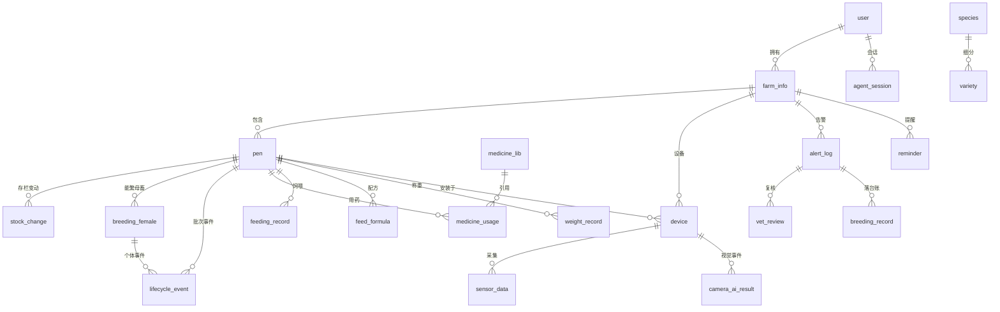

# 智慧养殖多智能体平台 — 数据库设计文档

- 文档版本：V1.7
- 依据文档：PRD V1.7 第四章（在其基础上补全索引、约束、缺失表与初始化数据）
- V1.7 变更（2026-10-16 端到端审计收口）：① 3.5 `feed_price` 增 `user_id`（C-18 租户维度，NULL=共享参考价）与 `idx_price_user_name`；② 3.5 `device` 增 `device_secret_hash`（C-24 设备上行凭证，明文只回传一次）；③ 3.6 `alert_log` 三枚举补 CHECK（C-04，`status` 补 `false_alarm`），库里以 NOT VALID 添加。三项均已同步 `core/db.py` 的幂等 `_PENDING_COLUMNS`，`check_schema_drift.py` 27 表一致；Alembic baseline 已生成但**未 stamp 在用小库**（C-17）
- V1.6 变更（2026-10-14 数据真实性校准）：5.3 feed_price 内置参考价按当日真实行情多源交叉校准（玉米 2.6→2.20、豆粕 3.8→3.35、麸皮 2.0→1.50、菜籽粕 2.9→2.48、稻谷 2.4→2.50、鱼粉 9.0→19.0，预混料/青贮/干草粉维持并标注口径），表内逐行标数据来源与采集日期；补校准说明（seed_caliber 标定戳 + 惰性迁移刷新判据 + 生效配方成本联动重算）
- V1.5 变更（F09 实施回写，承接《17-功能PRD-F09》文档同步项②）：3.5 camera_ai_result 补「confidence 分级与 risk_level 由应用层计算（纯函数，death≥0.5→high 待确认①已采纳）」注释，表内不落 level 字段
- V1.4 变更（F07 实施回写，承接《15-功能PRD-F07》文档同步项②⑥）：3.7 reminder 补幂等去重唯一口径（farm_id+reminder_type+female_id+remind_date）；3.6 feed_nutrition_lib 补母猪妊娠/哺乳分档选取口径（在栏状态驱动，收口 F06 遗留项①）
- V1.3 变更（F06 实施回写，承接《14-功能PRD-F06》文档同步项②）：feed_formula.is_active 补候选/生效两态注释（generate 落候选态、activate 置真，与部分唯一索引对应关系）
- V1.2 变更（评审修复）：device 增加 device_sn（MQTT topic 回表依据）；breeding_record 补 alert_id/lifecycle_event_id/medicine_usage_id 溯源外键；planned_kg 计算优先级定稿（配方优先、营养库兜底）；lifecycle_params 补 vaccination_program 结构；字段口径表补 parity/妊娠细分推导/存栏归属
- V1.1 变更：feeding_record 加计划快照（planned_kg/as_planned）；stock_change 支持转群（transfer_out/in + related_change_id）；device 加 source；batch_stage 补牛育成期、animal_stage 标记废弃；env_threshold 升级 warn/critical 双档；字段口径表补出栏三表联动等（MQTT msg_id 去重键见 01 架构文档 5.3 Redis 键规划）
- 数据库：PostgreSQL 15+

---

## 一、设计总则

1. 所有业务表主键统一 `SERIAL`（自增）；对外暴露的 ID 均为主键，不混淆。
2. 档案性质数据（养殖场、圈舍、设备、台账）一律**逻辑删除**（`is_deleted`），历史数据保留。
3. 金额/重量字段用 `NUMERIC`，禁用浮点。
4. 多租户：所有用户数据入口从 `farm_info.user_id` 回溯，查询链路 `pen → farm → user`。
5. 状态字段用 VARCHAR 枚举 + 应用层校验，关键状态流转加 DB 约束或触发器兜底。
6. 时间字段统一 `TIMESTAMP`（无时区，系统统一东八区）；日期字段用 `DATE`。

---

## 二、ER 关系图



**PRD 之外的补充表（3 张，原因如下）**

| 表 | 补充原因 |
|----|----------|
| agent_session | PRD 有 `/api/agent/sessions` 接口（会话历史），但第四章无对应存储表 |
| reminder | 预产期/断奶/免疫提醒需要持久化状态（生成/已读/已处理），避免每次实时计算 |
| kb_document | PRD 3.5.1 要求知识库整理稿"记录来源与整理人"、管理员上传触发重建索引，需文档管理表 |

---

## 三、完整建表 SQL

> 与 PRD 第四章一致的部分原样保留；`-- [补]` 标记为本文档新增的索引/约束/字段说明。

### 3.1 账户与配置

```sql
-- 用户表
CREATE TABLE "user" (
    user_id SERIAL PRIMARY KEY,
    phone VARCHAR(16) UNIQUE NOT NULL,
    password_hash VARCHAR(128) NOT NULL,
    nickname VARCHAR(64),
    role VARCHAR(16) NOT NULL DEFAULT 'farmer',
    main_species_code VARCHAR(32),
    is_enable BOOLEAN DEFAULT true,
    create_time TIMESTAMP DEFAULT now()
);
-- [补] 角色取值约束
ALTER TABLE "user" ADD CONSTRAINT chk_user_role CHECK (role IN ('farmer','vet','admin'));

-- 物种表
CREATE TABLE species (
    species_id SERIAL PRIMARY KEY,
    species_code VARCHAR(32) UNIQUE NOT NULL,
    species_name VARCHAR(64) NOT NULL,
    category VARCHAR(32) NOT NULL,            -- 畜禽/水产
    env_threshold JSONB,                      -- warn/critical 双档：{"temperature":{"min":16,"max":28,"critical_min":10,"critical_max":33},...}
    climate_risk JSONB,                       -- {"heat_stress":{"temp_gt":35},...}
    doc_filter_code VARCHAR(32) NOT NULL,
    lifecycle_params JSONB,                   -- 见第七节初始化数据
    description TEXT
);

-- 细分品种表
CREATE TABLE variety (
    variety_id SERIAL PRIMARY KEY,
    variety_code VARCHAR(32) UNIQUE NOT NULL,
    variety_name VARCHAR(64) NOT NULL,
    species_code VARCHAR(32) NOT NULL REFERENCES species(species_code),
    feed_param JSONB,                         -- 含标准日增重 standard_daily_gain_kg、各阶段补饲量
    record_ext_fields JSONB,                  -- 台账扩展字段定义 [{"field":"litter_size","label":"产仔数"}]
    is_enable BOOLEAN DEFAULT true
);
```

### 3.2 场舍与存栏

```sql
CREATE TABLE farm_info (
    farm_id SERIAL PRIMARY KEY,
    user_id INT NOT NULL REFERENCES "user"(user_id),
    farm_name VARCHAR(128) NOT NULL,
    address VARCHAR(256),
    province VARCHAR(32),
    city VARCHAR(32),
    county VARCHAR(32),
    adcode VARCHAR(16),
    contact_person VARCHAR(64),
    phone VARCHAR(32),
    is_deleted BOOLEAN DEFAULT false,
    create_time TIMESTAMP DEFAULT now()
);
-- [补] 多租户查询主索引
CREATE INDEX idx_farm_user ON farm_info(user_id) WHERE is_deleted = false;

CREATE TABLE pen (
    pen_id SERIAL PRIMARY KEY,
    farm_id INT NOT NULL REFERENCES farm_info(farm_id),
    pen_name VARCHAR(64),
    species_code VARCHAR(32),
    variety_code VARCHAR(32),
    male_count INT DEFAULT 0,
    female_count INT DEFAULT 0,
    batch_stage VARCHAR(16),      -- nursing哺乳/weaning保育(猪羊)/growing育成(牛)/fattening育肥/sold已出栏
    animal_stage VARCHAR(32),     -- [废弃保留] 早期字段，生长阶段以 batch_stage 为权威，新代码禁用
    is_deleted BOOLEAN DEFAULT false,
    create_time TIMESTAMP DEFAULT now(),
    -- [补] 存栏不得为负（EX-10 数据库层兜底）
    CONSTRAINT chk_pen_count CHECK (male_count >= 0 AND female_count >= 0)
);
CREATE INDEX idx_pen_farm ON pen(farm_id) WHERE is_deleted = false;

CREATE TABLE stock_change (
    change_id SERIAL PRIMARY KEY,
    pen_id INT NOT NULL REFERENCES pen(pen_id),
    change_type VARCHAR(16) NOT NULL,   -- birth/death/sale/purchase/manual/transfer_out/transfer_in
    male_delta INT DEFAULT 0,
    female_delta INT DEFAULT 0,
    related_change_id INT REFERENCES stock_change(change_id), -- [补] 转群联动：transfer_out 与 transfer_in 互指
    remark TEXT,
    create_time TIMESTAMP DEFAULT now(),
    CONSTRAINT chk_stock_type CHECK (change_type IN ('birth','death','sale','purchase','manual','transfer_out','transfer_in'))
);
CREATE INDEX idx_stock_pen_time ON stock_change(pen_id, create_time);
```

### 3.3 全生命周期管理

```sql
CREATE TABLE breeding_female (
    female_id SERIAL PRIMARY KEY,
    pen_id INT NOT NULL REFERENCES pen(pen_id),
    tag_no VARCHAR(64),
    variety_code VARCHAR(32),
    parity INT DEFAULT 0,
    breed_status VARCHAR(16) NOT NULL DEFAULT 'open',
    -- open/bred/pregnant/nursing/culled（状态机流转见应用层校验，EX-12）
    breed_date DATE,
    due_date DATE,
    remark TEXT,
    is_deleted BOOLEAN DEFAULT false,
    create_time TIMESTAMP DEFAULT now()
);
CREATE INDEX idx_bfemale_pen_status ON breeding_female(pen_id, breed_status) WHERE is_deleted = false;
-- [补] 预产期提醒扫描索引
CREATE INDEX idx_bfemale_due ON breeding_female(due_date) WHERE is_deleted = false AND breed_status = 'pregnant';

CREATE TABLE lifecycle_event (
    event_id SERIAL PRIMARY KEY,
    female_id INT REFERENCES breeding_female(female_id),
    pen_id INT REFERENCES pen(pen_id),
    event_type VARCHAR(16) NOT NULL,
    -- breeding/pregnancy_check/abortion/birth/weaning/castration/dehorning/stage_change/slaughter/cull
    event_date DATE NOT NULL,
    detail JSONB,
    create_time TIMESTAMP DEFAULT now(),
    -- [补] 事件必须归属个体或批次其一
    CONSTRAINT chk_event_owner CHECK (female_id IS NOT NULL OR pen_id IS NOT NULL)
);
CREATE INDEX idx_levent_pen_date ON lifecycle_event(pen_id, event_date);
CREATE INDEX idx_levent_female_date ON lifecycle_event(female_id, event_date);

CREATE TABLE medicine_usage (
    usage_id SERIAL PRIMARY KEY,
    pen_id INT NOT NULL REFERENCES pen(pen_id),
    med_id INT NOT NULL REFERENCES medicine_lib(med_id),
    usage_date DATE NOT NULL,
    dosage TEXT,
    withdrawal_until DATE,          -- = usage_date + medicine_lib.withdrawal_period，应用层写入
    operator_note TEXT,
    create_time TIMESTAMP DEFAULT now()
);
-- [补] 休药期校验查询索引（出栏登记时查近 90 天用药）
CREATE INDEX idx_musage_pen_until ON medicine_usage(pen_id, withdrawal_until);

CREATE TABLE feeding_record (
    feed_record_id SERIAL PRIMARY KEY,
    pen_id INT NOT NULL REFERENCES pen(pen_id),
    feed_date DATE NOT NULL,
    feed_type VARCHAR(16) NOT NULL,   -- concentrate/roughage/silage/other
    amount_kg NUMERIC(10,2) NOT NULL,
    planned_kg NUMERIC(10,2),         -- [补] 登记时刻的当日计划量快照（存栏/配方变化后历史对照不被改写）
    as_planned BOOLEAN DEFAULT false, -- [补] 按计划一键打卡标记（实际=计划）
    remark TEXT,
    create_time TIMESTAMP DEFAULT now()
);
CREATE INDEX idx_feeding_record_pen_date ON feeding_record(pen_id, feed_date);
```

### 3.4 喂食中心

```sql
CREATE TABLE feed_formula (
    formula_id SERIAL PRIMARY KEY,
    pen_id INT REFERENCES pen(pen_id),
    species_code VARCHAR(32) NOT NULL,
    variety_code VARCHAR(32),
    stage VARCHAR(32),
    sex_type VARCHAR(16) DEFAULT 'all',
    ingredients JSONB NOT NULL,       -- [{"name":"玉米","ratio_pct":60,"daily_kg_per_head":1.2}]
    feeds_per_day INT DEFAULT 2,
    cost_per_head_day NUMERIC(10,2),
    source VARCHAR(16) DEFAULT 'ai',  -- ai/manual
    is_active BOOLEAN DEFAULT false,  -- [补 V1.3 两态口径] false=候选态（generate/alternatives 生成即落库，F06 两段式）→ true=生效（activate 置真，同圈旧配方自动置 false 并落 feed 台账）；部分唯一索引 uq_formula_active_per_pen 只约束生效态
    create_time TIMESTAMP DEFAULT now()
);
-- [补] 同一圈舍同时只允许一条生效配方（部分唯一索引）
CREATE UNIQUE INDEX uq_formula_active_per_pen ON feed_formula(pen_id) WHERE is_active = true AND pen_id IS NOT NULL;

CREATE TABLE feed_price (
    price_id SERIAL PRIMARY KEY,
    user_id INT REFERENCES "user"(user_id),  -- [补 V1.7] C-18 租户维度：NULL=全平台共享参考价（内置种子/行情采集），非空=该农户自己的改价覆盖
    ingredient_name VARCHAR(64) NOT NULL,
    unit_price NUMERIC(10,2) NOT NULL,
    price_date DATE NOT NULL,
    is_builtin BOOLEAN DEFAULT false,
    create_time TIMESTAMP DEFAULT now()
);
-- [补] 取每种原料最新价的查询索引
CREATE INDEX idx_price_name_date ON feed_price(ingredient_name, price_date DESC);
-- [补 V1.7] 生效价口径：本人覆盖行 > 全局参考行（桶内取 (price_date, price_id) 最大），
-- 别人的覆盖行不参与。此前无 user_id，甲改玉米价会重算并改写乙的生效配方成本（mock 时代每人
-- 一份 localStorage 天然隔离，切真后丢了这层）；配套 devices 侧写已加 user 过滤，见 08 C-18
CREATE INDEX idx_price_user_name ON feed_price(user_id, ingredient_name);

CREATE TABLE weight_record (
    weight_id SERIAL PRIMARY KEY,
    pen_id INT NOT NULL REFERENCES pen(pen_id),
    weigh_date DATE NOT NULL,
    avg_weight_kg NUMERIC(10,2) NOT NULL,
    sample_count INT,
    daily_gain_kg NUMERIC(6,4),       -- 应用层计算：(本次均重-上次均重)/间隔天数
    remark TEXT,
    create_time TIMESTAMP DEFAULT now()
);
CREATE INDEX idx_weight_record_pen_date ON weight_record(pen_id, weigh_date);
```

### 3.5 设备与数据采集

```sql
CREATE TABLE device (
    device_id SERIAL PRIMARY KEY,
    farm_id INT NOT NULL REFERENCES farm_info(farm_id),
    pen_id INT NOT NULL REFERENCES pen(pen_id),
    device_type VARCHAR(32) NOT NULL,   -- sensor/camera
    device_name VARCHAR(128),
    device_sn VARCHAR(64) UNIQUE NOT NULL,  -- [补 V1.2] 设备序列号（如 DEV001），MQTT topic 中的 device_id 即此字段，消费者按 sn 回表校验归属
    source VARCHAR(16) DEFAULT 'real',  -- [补] real真实硬件/sim模拟（PRD 3.3.4 模拟期标记，设备管理页展示"来源"列）
    device_secret_hash VARCHAR(64) DEFAULT '',  -- [补 V1.7] C-24 设备上行凭证：存 sha256(密钥)，明文只在创建/轮换时返回一次；空=未签发，只能走农户 JWT
    mqtt_topic VARCHAR(128),
    rtsp_url VARCHAR(256),
    online_status VARCHAR(16) DEFAULT 'offline',
    last_heartbeat TIMESTAMP,
    is_enable BOOLEAN DEFAULT true,
    is_deleted BOOLEAN DEFAULT false,
    install_time TIMESTAMP DEFAULT now()
);
CREATE INDEX idx_device_pen ON device(pen_id) WHERE is_deleted = false;
CREATE INDEX idx_device_online ON device(online_status) WHERE is_deleted = false AND is_enable = true;

CREATE TABLE sensor_data (
    data_id SERIAL PRIMARY KEY,
    device_id INT NOT NULL REFERENCES device(device_id),
    pen_id INT NOT NULL REFERENCES pen(pen_id),
    metric VARCHAR(16) NOT NULL,   -- temperature/humidity/nh3/co2
    value NUMERIC(10,2) NOT NULL,
    collect_time TIMESTAMP NOT NULL,
    create_time TIMESTAMP DEFAULT now()
);
CREATE INDEX idx_sensor_data_pen_metric_time ON sensor_data(pen_id, metric, collect_time);
-- [补] 按月分区（部署到云服务器后启用，演示期可不分区）
-- CREATE TABLE sensor_data_2026_10 PARTITION OF sensor_data FOR VALUES FROM ('2026-10-01') TO ('2026-11-01');

CREATE TABLE camera_ai_result (
    result_id SERIAL PRIMARY KEY,
    device_id INT REFERENCES device(device_id),
    collect_time TIMESTAMP,
    pen_id INT,
    vision_json JSONB,   -- {"event_type":"huddle","confidence":0.87,"ts":"..."}
    -- [补] confidence 分级（level）与 risk_level 由应用层计算（纯函数：[0.5,0.7)→low / ≥0.7→mid / death≥0.5→high，
    --      F09 待确认①已采纳），表内不落 level 字段；列表响应的 level 为读侧计算值
    create_time TIMESTAMP DEFAULT now()
);
CREATE INDEX idx_vision_pen_time ON camera_ai_result(pen_id, collect_time);
```

### 3.6 兽药 / 营养 / 告警 / 复核 / 台账

```sql
CREATE TABLE medicine_lib (
    med_id SERIAL PRIMARY KEY,
    species_code VARCHAR(32) NOT NULL,
    disease_name VARCHAR(128),
    med_name VARCHAR(128) NOT NULL,
    med_code VARCHAR(64),
    usage TEXT,
    withdrawal_period INT,
    is_forbidden BOOLEAN DEFAULT false,
    contraindication TEXT,
    risk_level VARCHAR(16)
);
CREATE INDEX idx_med_species_disease ON medicine_lib(species_code, disease_name);

CREATE TABLE feed_nutrition_lib (
    feed_id SERIAL PRIMARY KEY,
    species_code VARCHAR(32) NOT NULL,
    variety_code VARCHAR(32),
    stage VARCHAR(32),
    sex_type VARCHAR(16) DEFAULT 'all',
    min_weight NUMERIC,
    max_weight NUMERIC,
    nutrition JSONB,
    formula TEXT,
    weather_adjust JSONB   -- {"high_temp":{"reduce_concentrate_pct":10}}
);
-- [补 V1.4] 母猪（pig_sow）分档选取口径（F07 PRD FR-07）：妊娠/哺乳两条种子由应用层按
-- breeding_female 在栏状态选取（nursing→哺乳档，其余→妊娠档），收口 F06 已知可接受项①
-- （原实现恒取分档第一条=妊娠档，哺乳档不可达）；妊娠前后期为应用层推导值（口径 457），
-- 猪营养库当前为妊娠单档，early/late 均回落该档；羊/牛前后期分档种子随横向复制阶段补。

CREATE TABLE alert_log (
    alert_id SERIAL PRIMARY KEY,
    farm_id INT REFERENCES farm_info(farm_id),
    pen_id INT REFERENCES pen(pen_id),
    alert_type VARCHAR(32),       -- sensor/climate/vision/disease/device_offline
    risk_level VARCHAR(16),
    alert_content TEXT,
    status VARCHAR(16) DEFAULT 'pending',   -- pending/acknowledged/resolved/false_alarm
    handled_note TEXT,
    handled_time TIMESTAMP,
    create_time TIMESTAMP DEFAULT now(),
    -- [补 V1.7] C-04：三枚举补 CHECK（此前只有 vet_review 有）。库里以 NOT VALID 添加，
    -- 不追检历史脏行、只约束新写入；加列/加约束仍走 core/db.py 幂等 DDL（Alembic 见 C-17）
    CONSTRAINT chk_alert_type CHECK (alert_type IN ('sensor','climate','vision','disease','device_offline')),
    CONSTRAINT chk_alert_risk_level CHECK (risk_level IN ('low','mid','high')),
    CONSTRAINT chk_alert_status CHECK (status IN ('pending','acknowledged','resolved','false_alarm'))
);
CREATE INDEX idx_alert_farm_status ON alert_log(farm_id, status, create_time);

CREATE TABLE vet_review (
    review_id SERIAL PRIMARY KEY,
    alert_id INT NOT NULL REFERENCES alert_log(alert_id),
    vet_user_id INT NOT NULL REFERENCES "user"(user_id),
    original_diagnosis TEXT,
    review_opinion TEXT,
    revised_diagnosis TEXT,
    revised_med TEXT,
    review_status VARCHAR(16) NOT NULL DEFAULT 'pending',  -- pending/approved/rejected/timeout
    review_time TIMESTAMP,
    create_time TIMESTAMP DEFAULT now(),
    CONSTRAINT chk_review_status CHECK (review_status IN ('pending','approved','rejected','timeout'))
);
CREATE INDEX idx_vreview_pending ON vet_review(review_status, create_time);

CREATE TABLE breeding_record (
    record_id SERIAL PRIMARY KEY,
    farm_id INT REFERENCES farm_info(farm_id),
    pen_id INT REFERENCES pen(pen_id),
    record_type VARCHAR(32),
    -- sensor/climate/vision/disease/medicine/feed/stock_change/vet_review/lifecycle/slaughter
    disease_name TEXT,
    med_suggest TEXT,
    feed_suggest TEXT,
    alert_info TEXT,
    record_ext JSONB,             -- [补] 物种/品种扩展字段统一入口（羊产羔数等），导出时动态生成列
    stock_change_id INT REFERENCES stock_change(change_id),
    vet_review_id INT REFERENCES vet_review(review_id),
    -- [补 V1.2] 溯源外键（台账完整性 100% 可自动核验）：
    alert_id INT REFERENCES alert_log(alert_id),                      -- 告警/告警处理类台账指向来源告警
    lifecycle_event_id INT REFERENCES lifecycle_event(event_id),      -- lifecycle 类台账指向生命周期事件
    medicine_usage_id INT REFERENCES medicine_usage(usage_id),        -- medicine 类台账指向用药记录
    create_time TIMESTAMP DEFAULT now()
);
CREATE INDEX idx_record_farm_time ON breeding_record(farm_id, record_type, create_time);
```

### 3.7 补充表：会话 / 提醒 / 知识库文档

```sql
-- AI 会话表（支撑 /api/agent/sessions）
CREATE TABLE agent_session (
    session_id SERIAL PRIMARY KEY,
    user_id INT NOT NULL REFERENCES "user"(user_id),
    title VARCHAR(128),                    -- 取首条用户消息截断
    intent VARCHAR(16),
    create_time TIMESTAMP DEFAULT now(),
    update_time TIMESTAMP DEFAULT now()
);
CREATE INDEX idx_session_user ON agent_session(user_id, update_time DESC);

CREATE TABLE agent_message (
    message_id SERIAL PRIMARY KEY,
    session_id INT NOT NULL REFERENCES agent_session(session_id),
    role VARCHAR(16) NOT NULL,             -- user/assistant
    content TEXT NOT NULL,
    meta JSONB,                            -- {"risk_level":"high","record_id":...}
    create_time TIMESTAMP DEFAULT now()
);
CREATE INDEX idx_message_session ON agent_message(session_id, create_time);

-- 提醒表（预产期/断奶/免疫，PRD 3.1.4-5）
-- [补 V1.4] 幂等去重唯一口径（F07 PRD 决策 1）：同 farm_id+reminder_type+female_id+remind_date
-- 只生成一条（任何状态）；mock 期查询时惰性扫描生成，切真后同一去重逻辑搬进每日定时任务。
-- due_date 类不自动过期（过期未分娩持续置顶，EX-13），由 birth/abortion/cull 事件办结；
-- weaning/vaccine 类超过 remind_date 未处理 → expired，错过的提醒不复活。
CREATE TABLE reminder (
    reminder_id SERIAL PRIMARY KEY,
    farm_id INT NOT NULL REFERENCES farm_info(farm_id),
    pen_id INT REFERENCES pen(pen_id),
    female_id INT REFERENCES breeding_female(female_id),
    reminder_type VARCHAR(16) NOT NULL,    -- due_date预产期/weaning断奶/vaccine免疫
    remind_date DATE NOT NULL,             -- 应提醒日
    title VARCHAR(128) NOT NULL,
    content TEXT,
    status VARCHAR(16) DEFAULT 'pending',  -- pending/done/expired
    create_time TIMESTAMP DEFAULT now()
);
CREATE INDEX idx_reminder_farm ON reminder(farm_id, remind_date) WHERE status = 'pending';

-- 知识库文档管理（PRD 3.5.1 来源与整理人留痕）
CREATE TABLE kb_document (
    doc_id SERIAL PRIMARY KEY,
    doc_name VARCHAR(256) NOT NULL,
    doc_type VARCHAR(16) NOT NULL,         -- disease/nutrition
    species_code VARCHAR(32),              -- 空=all 公共法规文档
    variety_code VARCHAR(32),
    source VARCHAR(256) NOT NULL,          -- 出处（书名/规范名）
    organizer VARCHAR(64) NOT NULL,        -- 整理人
    chunk_count INT,
    indexed_at TIMESTAMP,
    is_deleted BOOLEAN DEFAULT false,
    create_time TIMESTAMP DEFAULT now()
);

-- F14 个体耳标档案（强关联对账：在栏个体数 == 圈舍存栏快照；快照仍只由 stock_change 驱动）
CREATE TABLE animal_individual (
    individual_id SERIAL PRIMARY KEY,
    farm_id INT NOT NULL REFERENCES farm(farm_id),
    pen_id INT NOT NULL REFERENCES pen(pen_id),   -- 转群时随流水迁移（active 个体）
    ear_tag_no VARCHAR(32) NOT NULL,              -- 场内唯一（含全部状态个体，终身身份不复用）
    gender VARCHAR(8) NOT NULL CHECK (gender IN ('male','female')),
    variety_code VARCHAR(32),                     -- 建档时继承圈舍品种
    birth_date DATE,
    source VARCHAR(32) NOT NULL DEFAULT '人工建档', -- 初始建档/分娩自动建档/一键补齐/购入入栏…
    status VARCHAR(16) NOT NULL DEFAULT 'active'
        CHECK (status IN ('active','sold','dead','removed')),  -- 在栏/已出栏/已死淘/已调减
    exit_note VARCHAR(128) DEFAULT '',            -- 离栏说明（变动类型+备注/去向）
    exit_time TIMESTAMP,
    remark VARCHAR(128) DEFAULT '',
    is_deleted BOOLEAN DEFAULT false,             -- 仅纠错场景（在栏且未离栏可删档）
    create_time TIMESTAMP DEFAULT now(),
    UNIQUE (farm_id, ear_tag_no)                  -- 场内唯一（部分唯一索引需排除 is_deleted，切真时调整）
);
CREATE INDEX idx_individual_pen ON animal_individual(pen_id, status) WHERE is_deleted = false;

-- F17 个体档案事件（一畜一档时间线；事件寄存器模型，U-LITS LER 同构）
-- 流水联动（register/rename/transfer/exit）只增不删；手动（weight/immunization/treatment/note）可纠错删除
CREATE TABLE individual_event (
    event_id SERIAL PRIMARY KEY,
    individual_id INT NOT NULL REFERENCES animal_individual(individual_id),
    event_type VARCHAR(16) NOT NULL
        CHECK (event_type IN ('register','rename','transfer','exit','weight','immunization','treatment','note')),
    event_date DATE NOT NULL,                    -- ≤ 今天，≥ 个体出生日期（已填时）
    payload JSONB NOT NULL DEFAULT '{}',         -- 按类型：weight_kg / vaccine_name / symptom / old_no / new_no…
    create_time TIMESTAMP DEFAULT now()
);
CREATE INDEX idx_event_individual ON individual_event(individual_id, event_date DESC);
-- 法规依据：《畜禽标识和养殖档案管理办法》发病/诊疗/免疫/换标留痕要求；
-- 保存期限：商品猪禽 2 年、牛 20 年、羊 10 年、种畜长期（切真后按物种配归档策略）
```

---

## 四、字段口径说明（易错点）

| 字段 | 口径 |
|------|------|
| pen.male_count / female_count | 只能由 stock_change 驱动更新（manual 兜底同样生成变动记录），禁止 UPDATE 绕过 |
| 存栏归属（V1.2 定稿） | 分娩仔猪 birth 存栏加在母猪所在圈，能繁母猪圈不参与 batch_stage 配方匹配；仔猪断奶转批次圈必须显式 transfer，weaning 事件不隐式搬动仔猪存栏 |
| medicine_usage.withdrawal_until | 服务端计算写入 = usage_date + medicine_lib.withdrawal_period，前端不传 |
| weight_record.daily_gain_kg | (本次 avg_weight − 上次 avg_weight) ÷ 间隔天数，保留 4 位小数 |
| breeding_female.parity | 已完成分娩胎次（V1.2 定稿）：建档时填已有胎次，weaning 事件 +1；abortion 不变 |
| 妊娠阶段细分（V1.2 定稿） | breed_status 不区分妊娠前后期；应用层按"配种日期 + 物种妊娠期参数"动态推导（如羊妊娠后期 = 妊娠第 91~150 天），feed_nutrition_lib.stage 匹配使用推导值 |
| feeding_record.planned_kg | **计算优先级（V1.2 定稿）**：①圈舍有生效配方 → Σ(配方原料 daily_kg_per_head × 存栏)，再按 weather_adjust 气象调整；②无生效配方 → 按 feed_nutrition_lib 阶段补饲标准兜底；登记时刻实时计算并快照；planned_kg IS NULL 表示无生效配方且营养库无匹配标准时的手工登记 |
| feed_formula.cost_per_head_day | Σ(原料 ratio 对应 kg × feed_price.unit_price)，改价后重算，不实时 join |
| feed_formula.is_active | 两态口径（V1.3 定稿）：候选（false，generate/alternatives 生成即落库）→ 生效（true，activate 置真）→ 失效（被同圈新配方替换）；生效唯一由部分唯一索引 + 激活序列保证，激活落 feed 台账 |
| stock_change 转群 | transfer_out（源圈负增量）与 transfer_in（目标圈正增量）两笔联动，related_change_id 互指，同一事务提交，各生成一条台账 |
| 出栏动作三表联动 | 出栏 service 一次事务生成：stock_change(sale) + lifecycle_event(slaughter) + breeding_record(record_type=slaughter，含休药期校验结果与 force 留痕) |
| pen.batch_stage / animal_stage | 生长阶段权威字段为 batch_stage（含牛 growing）；animal_stage 为早期遗留字段，仅历史数据兼容，新代码禁用 |
| alert_log.status | pending → acknowledged → resolved 单向流转，resolved 必须有 handled_note |
| breeding_female.breed_status | 仅 lifecycle_event 事件驱动流转，禁止直接 PUT 修改（EX-12） |
| breeding_record.record_ext | 扩展字段 JSON，导出 Excel 时按 variety.record_ext_fields 顺序动态生成列 |

---

## 五、初始化数据（猪先行）

> 初始化脚本 `scripts/init_data.py`；猪知识库先灌，牛羊后补。数值来源 PRD 附录 D。

### 5.1 species（三条全建，知识库按实施顺序灌）

```json
// pig
{
  "gestation_days": 114, "lactation_days": 28, "market_weight_kg": 120,
  "stages": ["哺乳期","保育期","育肥期"], "estrus_cycle_days": 21,
  "castration_age": "7~15日龄",
  "vaccination_program": [   // [补 V1.2] 免疫程序（PRD 3.1.4-5），admin 后台可维护
    {"vaccine":"猪瘟兔化弱毒苗","timing_day":30,"target":"仔猪","anchor":"birth","note":"30 日龄首免"},
    {"vaccine":"口蹄疫O型灭活苗","timing_day":55,"target":"仔猪","anchor":"birth","note":"55 日龄二免"},
    {"vaccine":"大肠杆菌K88/K99","timing_day":-21,"target":"妊娠母猪","anchor":"due_date","note":"产前 21 天免疫（母源抗体）"}
  ]
}
// timing_day 语义：anchor=birth 为日龄（正数）；anchor=due_date 为距预产期天数（负数=提前）
// sheep / cattle 按 PRD 附录 D 同格式灌入
```

env_threshold 示例（育肥猪舍，warn/critical 双档 → 告警分级 warn=mid、critical=high）：

`{"temperature":{"min":16,"max":28,"critical_min":10,"critical_max":33},"humidity":{"min":50,"max":80},"nh3":{"max":25,"critical_max":50},"co2":{"max":3000,"critical_max":5000}}`

### 5.2 variety（猪先行示例）

| variety_code | 名称 | feed_param 要点 |
|--------------|------|-----------------|
| pig_fattening | 育肥猪 | standard_daily_gain_kg: 0.75（30~110kg 阶段均值），各阶段补饲量按 NY/T 饲养标准 |
| pig_sow | 母猪 | 妊娠/哺乳分档营养 |
| pig_piglet | 仔猪 | 保育期参数 |

### 5.3 feed_price 内置参考价（2026-10-14 按真实行情校准；用户可改价，成本核算以最新价为准）

| 原料 | 参考价（元/kg） | 数据来源（2026-10-13/14） |
|------|-----------------|---------------------------|
| 玉米 | 2.20 | 农业农村部 500 县集贸监测 2.43 / 行情宝 2.392 / 生意社 2.171 / Mysteel 指数 2.098，取批发中枢 |
| 豆粕 | 3.35 | 生意社 3.408 / 行情宝 3.223 / 沿海现货 3.30~3.36 |
| 麸皮 | 1.50 | Mysteel 全国粉企汇总：河北 1.32~1.48、河南 1.41~1.54 |
| 菜籽粕 | 2.48 | 生意社 2.482 |
| 稻谷 | 2.50 | 湖北省粮局中晚籼收购 2.478 / 早籼 2.511；国家托市底价 2.58 |
| 鱼粉 | 19.00 | 卓创资讯：国产 65%+ 蛋白 18.5~19.0、进口超级蒸汽 23.6~23.9（秘鲁 B 季减产预期下急涨） |
| 预混料 | 6.50 | 4% 猪用预混料市面 6~15 元/kg 区间取入门档（配方商差异大，演示参考值） |
| 青贮玉米 | 0.80 | 全株青贮地头收储常见 0.6~0.9 |
| 干草粉 | 1.30 | 无全国统一行情（苜蓿 1.5~2.5、禾草/秸秆粉 0.6~1.0），取中间参考值 |

> 校准说明：原种子为开发期估算值（玉米 2.6/豆粕 3.8/麸皮 2.0/鱼粉 9.0 等），2026-10-14 经多源
> 交叉核对修正——鱼粉原值偏离真实行情 2 倍以上，其余 4 项偏高 13%~33%。mock 层以
> `seed_caliber=2026-10-14` 标定戳做惰性迁移刷新（仅刷新"当前生效价恰为旧种子值"的内置行，
> 用户改价追加行零篡改），并联动重算生效配方 cost_per_head_day。
> 初始化数据中的药目均为演示参考值，实际使用由管理员维护。

### 5.4 medicine_lib（猪，示例行）

| med_name | disease_name | withdrawal_period | is_forbidden |
|----------|--------------|-------------------|--------------|
| 阿莫西林可溶性粉 | 细菌性呼吸道病 | 7 | false |
| 氟苯尼考注射液 | 猪喘气病继发感染 | 28 | false |
| 瘦肉精（克伦特罗） | — | — | **true（违禁拦截用例）** |

> 初始化数据中的价格、药目均为演示参考值，实际使用由管理员维护。

---

## 六、数据保留与清理策略

| 数据 | 策略 |
|------|------|
| 台账 breeding_record | 永久保留（档案性质） |
| sensor_data | 明细保留 180 天，之后按天聚合归档（聚合表 V1.1 视量再做） |
| camera_ai_result | 保留 90 天 |
| agent_message | 保留 180 天 |
| checkpoint（langgraph schema） | 会话结束 7 天后清理 |

---

> 本文档为技术设计参考，具体实施请结合公司合规与法务要求确认。
