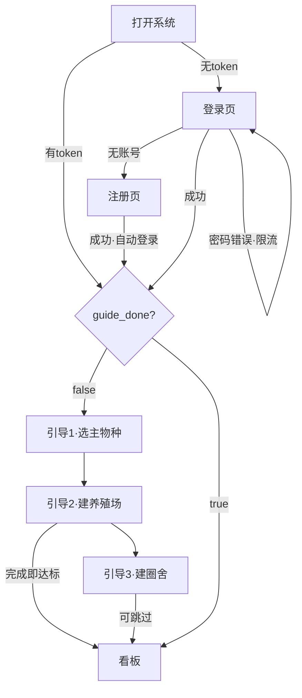

# 智慧养殖多智能体平台 — 功能 PRD：F01 账户与首登引导

- 文档版本：V1.0
- 编制日期：2026-10-11
- 编制角色：产品经理（司南）
- 依据文档：主 PRD V1.7（第 3.0/3.1 节）、《03-API接口设计》V1.1（第 2/3/4 节）、《02-数据库设计》（user / farm_info / pen 表）、《04-开发计划》V1.2 阶段 1、《06-UI页面设计规范》V1.4（4.1/4.13 节）
- 对应里程碑：**M1**（能注册能登录，引导流畅走完）；前置 M0（前端骨架，已完成 7/13 页）
- 合规声明：本方案为产品设计参考，具体实施请结合公司合规与法务要求确认

---

## 一、文档信息

| 版本 | 日期 | 变更 | 评审记录 |
|------|------|------|---------|
| V1.0 | 2026-10-11 | 首次出稿（阶段 1 纵切功能 PRD） | 待评审 |

## 二、背景与目标

- **背景**：开发策略已确认"前端骨架先行、逐功能填真"（变更记录 2026-10-09 已生效）。前端 13 页骨架中 7 页已建成并接 mock 数据，现在开始第一刀纵切：把"注册 → 登录 → 引导 → 进看板"这条用户进系统的第一链路做成真的。养殖户是三农群体，第一眼留不住就没有后续，账户链路必须一次走通、少填字段、可跳过。
- **要解决的问题**：① 用户无法真实注册登录（当前无后端）；② 新用户首次进入看到的是空数据，没有引导会直接流失；③ 主物种、密码等账户基础能力缺失。
- **成功指标与口径**：

| 指标 | 目标值 | 口径 |
|------|--------|------|
| 引导完成率 | ≥ 90% | 新注册用户中，首次会话内完成第 1、2 步引导的比例（估算目标值，上线后按埋点修正） |
| 引导完成时长 | ≤ 2 分钟 | 注册成功 → 进入看板的耗时中位数（估算） |
| 登录成功率 | ≥ 99% | 排除用户输错密码的成功登录占比 |
| 注册→登录→调接口全链路 | 100% 可用 | 验收用例全通过 |

## 三、名词与术语

| 术语 | 定义 |
|------|------|
| 纵切 | 一个阶段内同时打通前端页面 → 接口 → 数据库 → 独立验收，系统始终保持完整可运行 |
| 首登引导 | 新用户注册后强制进入的三步向导：选主物种 → 建养殖场 → 建圈舍 |
| guide_done | 引导完成标记。**不落库**，按"名下存在未删除养殖场"计算得出（沿用 03-API 已定口径） |
| 主物种 | 用户的主营养殖物种（猪/牛/羊 单选），决定知识库、品种、阈值等配置的路由 |

## 四、需求范围

**包含**：
1. 手机号注册 / 登录（bcrypt + JWT）
2. JWT 鉴权中间件与前端路由守卫
3. 首登引导三步（前端向导页 + 三个接口对接）
4. 个人中心：改主物种、改密码（前端已有 mock 页切真）
5. 退出登录（前端本地清除 token）

**不包含（本期不做）**：
- 短信验证码 / 手机号验证（需费用与资质，主 PRD 已列为后续版本）
- 微信 / 第三方登录
- 改密码后强制全端下线（token 黑名单机制，记入遗留问题，见十四节）
- 兽医 / 管理员账号创建入口（阶段 10）
- 后台用户管理页

## 五、方案对比与选型

**决策 1：会话方案 — JWT（无状态）vs 服务端 Session**

| 方案 | 成本 | 复杂度 | 体验 | 风险 | 结论 |
|------|------|--------|------|------|------|
| JWT（HS256，24h） | 低 | 低 | 好（无会话表查询） | 无法主动吊销单个 token | **推荐**：单人开发、无强制下线诉求，03-API 已按此定义 |
| 服务端 Session + Redis | 中 | 中 | 一般 | 低 | 备选：如后续要做"改密全端下线"再迁移 |

**决策 2：引导完成判定 — 落 guide_done 字段 vs 计算判定**

| 方案 | 说明 | 结论 |
|------|------|------|
| 计算判定 | `guide_done = EXISTS(farm_info WHERE user_id=? AND is_deleted=false)`，与 03-API 登录响应口径一致 | **推荐（沿用已定口径）**：删除养殖场后引导不会"复活"，逻辑自洽 |
| 落字段 | user 表加 guide_done BOOLEAN | 不采用：多一个状态源，易与农场数据不一致 |

**决策 3：改密码后的 token 处理** — V1.0 改密码后**当前会话保持有效，不强制其他端下线**（JWT 无状态，做全端失效需 user 表加 token_version 字段）。作为安全增强项记入十四节遗留问题。

## 六、用户角色与使用场景

| 角色 | 本功能内的场景 | 权限边界 |
|------|--------------|---------|
| farmer（养殖户，主角色） | 注册、登录、走引导、改主物种/密码 | 只能操作自己的账户与名下养殖场 |
| vet / admin | 仅可登录（账号由管理员创建，阶段 10 开放入口） | 引导向导对非 farmer 角色不强制（admin 创建账号时已带物种配置）；V1.0 vet/admin 登录后直达看板 |

**主流程**：打开系统 → 未登录跳登录页 → 无账号去注册 → 注册成功自动登录 → guide_done=false 强制进引导 → 三步（可跳过第 3 步）→ 进入看板。

**分支流程**：① 已有账号直接登录；② 第 2 步省市区加载失败可手动重选（06 规范 4.1 状态）；③ 第 3 步"跳过，稍后添加"直接进看板（圈舍为空时场舍页引导创建）。

**异常流程**：手机号已注册、密码错误、token 过期、接口失败 —— 全部见十二节异常处理清单。

## 七、功能需求

> 密码强度规则为**本次新增约定**（主 PRD 未定义，采纳后需同步主 PRD）：长度 ≥8 位且同时含字母与数字。标注「待确认」项见十四节。

### FR-01 手机号注册

- 规则：手机号 11 位大陆号段格式校验；密码满足强度规则；昵称选填（默认取手机号脱敏形式）；bcrypt 哈希存储（cost ≥10）；手机号唯一。
- 接口：`POST /auth/register`（03-API 2.1），响应 `user_id / phone / first_login`。
- 验收标准（Given/When/Then）：
  - Given 未注册手机号，When 提交合法手机号+合规密码，Then 注册成功返回 user_id 且 first_login=true，密码以 bcrypt 哈希落库（库内无明文）
  - Given 已注册手机号，When 再次注册，Then 返回 40901（建议新增，见十二节），前端定位到手机号字段提示"该手机号已注册，请直接登录"
  - Given 密码仅 6 位纯数字，When 提交，Then 前端拦截并提示"密码需 ≥8 位且同时包含字母和数字"，不发起请求

### FR-02 登录

- 规则：账号（手机号）或密码错误时**统一提示"手机号或密码错误"**，不泄露账号是否存在；成功返回 `token`（有效期 86400 秒）与 user 概要（role / main_species_code / guide_done）。
- 接口：`POST /auth/login`（03-API 2.2）。
- 验收标准：
  - Given 正确账密，When 登录，Then 返回 token 且 guide_done 与名下养殖场实况一致
  - Given 密码错误 3 次内，When 登录，Then 返回 40102（建议新增），提示统一话术
  - Given 同一账号连续输错 ≥5 次，When 继续尝试，Then 触发限流（同一手机号 15 分钟内锁定登录，见 FR-03 安全项），提示"尝试次数过多，请 15 分钟后重试"

### FR-03 JWT 鉴权与路由守卫

- 规则：除 `/auth/register`、`/auth/login` 外所有接口要求 `Authorization: Bearer <token>`，无效/过期返回 **40101（HTTP 401）**（03-API 已有错误码）；登录限流基于 Redis 计数（手机号维度，5 次/15 分钟）。
- 前端：TanStack Router `beforeLoad` 全局守卫——无 token 跳 `/login`；`guide_done=false` 且目标不是引导页时跳 `/onboarding`；token 过期收到 40101 统一清 token 跳登录。
- 验收标准：
  - Given 未登录，When 直接访问 /dashboard，Then 重定向到 /login
  - Given token 过期后调用任意接口，When 收到 40101，Then 前端清除本地凭证并跳登录页
  - Given 新注册用户 guide_done=false，When 登录成功，Then 强制进入引导向导，无法通过改 URL 绕过

### FR-04 引导第 1 步：选主物种

- 规则：猪/牛/羊三大卡片单选（06 规范 4.1：选中 primary-500 描边 + primary-50 底 + 右上角 ✓）；未选不可下一步；选定调 `PUT /user/main-species`（03-API 2.3）。
- 验收标准：
  - Given 未选择物种，When 点击下一步，Then 按钮禁用或提示"请先选择主物种"
  - Given 选择"猪"并下一步，Then main_species_code=pig 落库，刷新页面回退到本步时回显选中态

### FR-05 引导第 2 步：创建养殖场

- 规则：表单字段 = 养殖场名称（必填）+ 省市区级联选择器（必填，选完自动带出 adcode 只读展示）+ 详细地址（选填）+ 联系人/电话（选填，默认取注册手机号）；调用 `POST /farm`（03-API 4.1）；省市区数据源为静态行政区划数据（前端内置，不依赖外部 API，避免引导链路被第三方可用性绑架）。
- 验收标准：
  - Given 完整填写，When 提交，Then farm_info 落库且 adcode 非空，进入第 3 步
  - Given 省市区接口/数据异常，When 用户操作，Then 提供手动重选入口，不让用户卡死（对应 06 规范 4.1 状态项）

### FR-06 引导第 3 步：创建圈舍（可跳过）

- 规则：品种下拉联动物种（`GET /variety/list?species_code=pig`）；公/母数量步进器（非负整数，前端拦截负数，EX-10 前端表达）；生长阶段选填；提供「跳过，稍后添加」次按钮；调用 `POST /pen`（03-API 4.2，species_code 继承主物种不可改）。
- 验收标准：
  - Given 选猪，When 打开品种下拉，Then 仅展示 pig 下品种（含"通用"兜底项）
  - Given 母数输入 -5，When 操作步进器或键盘输入，Then 值被钳制为 0，禁止负数
  - Given 点击"跳过，稍后添加"，Then 进入看板且场舍页显示"去创建圈舍"引导（空态）

### FR-07 引导完成判定与跳转

- 规则：`guide_done = 名下存在未删除养殖场`（服务端计算，见五节决策 2）；完成第 1、2 步即视为达标（04-计划 1.2 验收口径），第 3 步可跳过；引导完成后登录响应中 guide_done=true，此后不再强制进入向导。
- 验收标准：
  - Given 完成第 2 步后退出重登，When 登录，Then guide_done=true 直达看板，引导不再出现
  - Given 用户删除名下唯一养殖场（后续阶段功能），When 重新登录，Then guide_done 重新变为 false（计算判定的自洽性）

### FR-08 个人中心：改主物种

- 规则：复用 `PUT /user/main-species`；改动前确认弹窗，文案明确"历史数据保留，仅影响新建圈舍的默认品种"（06 规范 4.13）；改后**历史数据零变动**（EX-08）。
- 验收标准：
  - Given 用户已有猪场数据，When 改主物种为牛，Then 历史圈舍/台账/告警等数据不变（EX-08），仅后续新建圈舍默认物种变化
  - Given 弹窗确认取消，When 取消，Then main_species_code 不变

### FR-09 个人中心：改密码

- 规则：`PUT /user/password`（03-API 2.4），需校验旧密码；新密码满足 FR-01 强度规则；新旧密码不得相同；成功后**当前会话保持有效**（五节决策 3）。
- 验收标准：
  - Given 旧密码错误，When 提交，Then 返回 40103（建议新增），提示"当前密码不正确"
  - Given 新旧密码相同，When 提交，Then 前端拦截提示"新密码不能与当前密码相同"
  - Given 合法修改，When 成功，Then 用新密码可重新登录，旧密码失效

### FR-10 退出登录

- 规则：V1.0 前端本地清除 token 并跳登录页；服务端不设登出接口（JWT 无状态，与五节决策 1 一致）。
- 验收标准：Given 已登录，When 点击退出，Then 本地凭证清除，刷新页面后访问受保护路由被守卫拦截回登录页。

## 八、非功能需求

| 项 | 要求 | 口径 |
|----|------|------|
| 性能 | 登录/注册接口 P95 ≤ 500ms | 服务端处理耗时（不含网络），压测环境单机 |
| 性能 | 引导每步提交 P95 ≤ 500ms | 同上 |
| 安全 | 密码存储 bcrypt cost ≥10，禁止明文/可逆加密 | 库内核验 |
| 安全 | JWT 密钥从环境变量注入，禁止硬编码 | 代码审查 |
| 安全 | 登录限流 5 次/15 分钟/手机号 | Redis INCR + EXPIRE |
| 安全 | token 有效期 24h（86400s），payload 不含敏感信息（仅 user_id/role） | 与 03-API 一致 |
| 兼容 | 登录/引导页适配 <768px 单栏（06 规范响应式断点表） | 浏览器 DevTools 逐档验证 |
| 无障碍 | 表单错误定位到具体字段并给修正建议（06 规范自检清单）；控件键盘可达 | Tab 键走查 |

## 九、业务流程与状态流转

**用户引导状态机**（单字段不落库，由数据推导）：

| 状态 | 判定条件 | 允许操作 | 迁移 |
|------|---------|---------|------|
| 未引导 | 有 token 且名下无未删除养殖场 | 仅可访问引导页相关请求 | 创建首个养殖场 → 已引导 |
| 已引导 | 名下存在未删除养殖场 | 全部功能 | 删除全部养殖场 → 未引导（自愈） |

## 十、数据与埋点

- **数据落库**：user（注册写入）、farm_info（引导第 2 步）、pen（引导第 3 步）；create_time 均由数据库 now() 生成。
- **最小数据能力**：V1.0 无埋点系统，用 create_time 差值近似统计"注册→建场"转化（引导完成率 = 当日建场用户数 ÷ 当日注册用户数，T+1 手工 SQL 核验）。正式埋点（分步流失）记入后续版本池。
- **指标口径**：注册用户 = user 表新增行数；引导完成 = farm_info 新增且非删除行数；两者按 user_id 关联去重。

## 十一、权限与安全要求

- **PII 处理**：手机号属个人信息，前端展示一律脱敏（138\*\*\*\*6688）；注册接口日志禁止打印密码与完整手机号（测试数据使用虚构号码）。
- **权限模型**：本功能不引入新角色；数据归属校验沿用 40302（访问他人养殖场数据返回无权限）。
- **JWT 密钥**：环境变量注入；算法固定 HS256，不接受 header 中 alg 协商（防混淆攻击）。

## 十二、异常处理清单

| 编号 | 异常 | 处理 | 用户可见文案 | 状态 |
|------|------|------|------------|------|
| EX-A1 | 手机号已注册 | 拦截注册，引导去登录 | "该手机号已注册，请直接登录" | 需新增错误码 **40901** |
| EX-A2 | 账号或密码错误 | 统一话术，不泄露账号存在性 | "手机号或密码错误" | 需新增错误码 **40102** |
| EX-A3 | 登录限流触发 | 锁定 15 分钟 | "尝试次数过多，请 15 分钟后重试" | 复用 40102 + Retry-After 头，或新增 40902（二选一，评审定） |
| EX-A4 | 旧密码错误 | 改密码拦截 | "当前密码不正确" | 需新增错误码 **40103** |
| EX-A5 | token 无效/过期 | 清凭证跳登录 | 跳转登录页 | 复用已有 **40101** |
| EX-A6 | 访问他人数据 | 拦截 | "无权限访问" | 复用已有 **40302** |
| EX-A7 | 省市区数据加载失败 | 手动重选入口 | "加载失败，请重试或手动选择" | 前端内置数据，风险低 |
| EX-A8 | 引导表单提交网络失败 | 表单数据本地保留，可重试 | "网络异常，请重试" | 通用 |

> 以上建议新增错误码（40901/40102/40103，及可选 40902）评审通过后需同步《03-API接口设计》1.3 错误码表，避免文档漂移。

## 十三、上线计划、依赖与验证

- **依赖评估**：

| 依赖项 | 所属 | 就绪状态 | 分级 | 说明 |
|--------|------|---------|------|------|
| PG 数据库 + user/farm_info/pen 建表 | 阶段 0（0.1/0.2） | docker-compose 已有，建表脚本待执行 | 阻塞 | 最晚就绪：开发第 1 天 |
| FastAPI 骨架 + 统一响应/错误码 | 阶段 0（0.3） | 待搭 | 阻塞 | JWT 中间件挂载点 |
| Redis | 阶段 0（0.1） | docker-compose 已有 | 并行 | 仅登录限流用，不可用则降级为进程内计数 |
| 前端 profile 页 | 已完成 | 已就绪 | 可绕过 | 切真接口即可 |
| 登录页 / 引导向导页 | 本阶段 | 未建（13 页清单内） | 阻塞 | 按 06 规范 4.1 实现 |

- **实施顺序**：后端注册/登录/JWT（1.1）→ 引导三接口对接（1.2）→ 前端登录页+向导页新建并接真（1.3）→ profile 页切真（1.4）。
- **验证步骤**：① Swagger 手工调通注册/登录/引导接口；② 新手机号全流程走通（注册→引导→看板→改物种→改密码→重登）；③ 按 FR-01~FR-10 的 GWT 逐条验收；④ 异常清单 EX-A1~A8 逐条触发验证；⑤ 演示："新手机号 2 分钟从注册到看板"。
- **回滚**：本功能纯增量（新增页面/接口），回滚 = 前端摘除路由守卫与登录入口，无存量数据迁移。

## 十四、风险与遗留问题

| 编号 | 风险/遗留 | 类别 | 概率×影响 | 等级 | 应对 |
|------|----------|------|----------|------|------|
| RK-1 | 改密码无法全端下线，旧 token 24h 内仍有效 | 安全 | 3×3 | 中 | 遗留：后续加 user.token_version；当前接受（单农户多端风险低） |
| RK-2 | 建议新增错误码未同步 03 文档导致前后端口径漂移 | 需求 | 3×4 | 中 | 评审通过当天同步文档，纳入变更管理表 |
| RK-3 | 密码强度规则为本次新增约定，与主 PRD 未对齐 | 需求 | 2×2 | 低 | 待用户确认后回写主 PRD |
| RK-4 | 前端骨架尚缺 6 页（繁殖/出栏/设备/待复核/台账/后台/引导），引导页需新建 | 进度 | 3×3 | 中 | 引导页是 M1 阻塞依赖，优先建；其余 5 页不在本功能范围 |
| RK-5 | 无验证码注册可能被批量灌号 | 安全 | 2×3 | 中 | V1.0 接受（内测/演示阶段）；开放注册前必须补短信验证（后续版本） |

**待确认项（评审时拍板）**：① 密码强度规则（FR-01）是否采纳；② EX-A3 限流错误码方案（40102+Retry-After 还是新增 40902）；③ 手机号是否需要格式白名单外的额外校验。

## 十五、附录

### 15.1 需求追踪矩阵（RTM）

| 需求编号 | 需求描述 | PRD 章节 | 前端 | 后端接口 | 测试用例（建议） | 状态 |
|---------|---------|---------|------|---------|----------------|------|
| FR-01 | 手机号注册 | 七 | 注册页（新建） | POST /auth/register | TC-A01~03 | 待开发 |
| FR-02 | 登录 | 七 | 登录页（新建） | POST /auth/login | TC-A04~06 | 待开发 |
| FR-03 | JWT 鉴权与守卫 | 七 | 路由守卫 | 中间件 | TC-A07~09 | 待开发 |
| FR-04 | 引导 1 选主物种 | 七 | 向导页第 1 步 | PUT /user/main-species | TC-A10 | 待开发 |
| FR-05 | 引导 2 建养殖场 | 七 | 向导页第 2 步 | POST /farm | TC-A11~12 | 待开发 |
| FR-06 | 引导 3 建圈舍 | 七 | 向导页第 3 步 | GET /variety/list、POST /pen | TC-A13~15 | 待开发 |
| FR-07 | 引导完成判定 | 七 | 跳转逻辑 | guide_done 计算 | TC-A16~17 | 待开发 |
| FR-08 | 改主物种 | 七 | profile 页切真 | PUT /user/main-species | TC-A18（EX-08） | 待开发 |
| FR-09 | 改密码 | 七 | profile 页切真 | PUT /user/password | TC-A19~21 | 待开发 |
| FR-10 | 退出登录 | 七 | TopBar | —（前端清除） | TC-A22 | 待开发 |

### 15.2 接口字段引用

注册/登录/主物种/密码接口的请求响应字段以《03-API接口设计》2.1~2.4 为准，本文档不重复定义；farm/pen 字段以 03 文档 4.1/4.2 与《02-数据库设计》3.2 为准。

### 15.3 合规声明

本方案为产品设计参考，具体实施请结合公司合规与法务要求确认。文档中手机号示例均为虚构脱敏数据。
