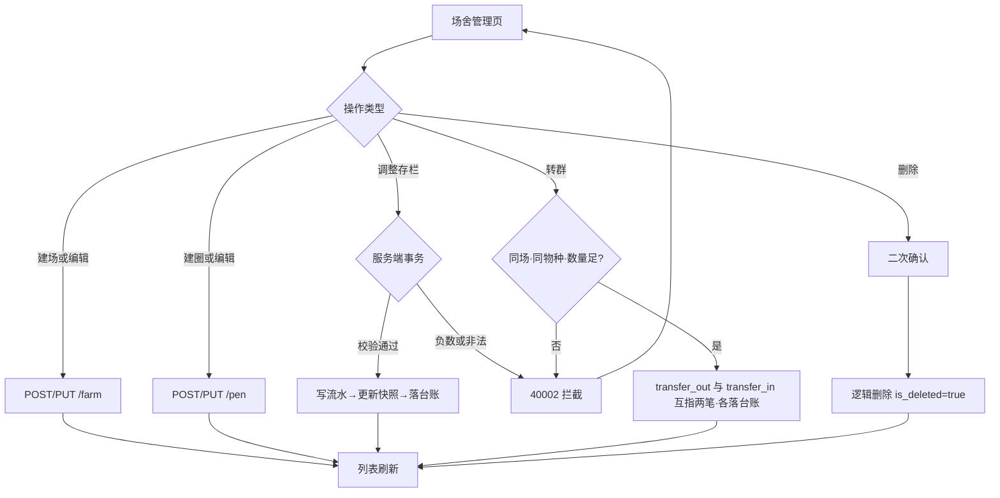

# 智慧养殖多智能体平台 — 功能 PRD：F02 养殖场 / 圈舍 / 存栏管理

- 文档版本：V1.1
- 编制日期：2026-10-11
- 编制角色：产品经理（司南）
- 依据文档：主 PRD V1.7（第 3.1.1/3.1.2 节）、《03-API接口设计》V1.1（第 4.1~4.4 节）、《02-数据库设计》（farm_info / pen / stock_change 表）、《04-开发计划》V1.2 阶段 2、《05-测试计划》V1.2（TC-P01~P07）、《06-UI页面设计规范》V1.4（4.3 节）
- 对应里程碑：**M2**（场舍存栏账实一致）；前置 M1（F01 账户与首登引导）
- 合规声明：本方案为产品设计参考，具体实施请结合公司合规与法务要求确认

---

## 一、文档信息

| 版本 | 日期 | 变更 | 评审记录 |
|------|------|------|---------|
| V1.0 | 2026-10-11 | 首次出稿（阶段 2 纵切功能 PRD） | 待评审 |
| V1.1 | 2026-10-11 | 自查修订：① 建圈初始存栏自动补 purchase 流水（修复账实公式对引导建圈不成立的口径漏洞）；② 建圈 batch_stage 排除 sold；③ 调整存栏弹窗类型去掉"出栏"（与入口占位对齐）；④ EX-B7 错误语义改可测表述；⑤ FR-07 补字段名差异说明 | 第 1 轮自查通过 |

## 二、背景与目标

- **背景**：F01（账户与引导）打通后，用户在引导第 3 步已能建第一个圈舍。本功能把"场—圈—存栏"变成日常可管理的完整能力：养殖户日常最高频的操作就是"调存栏"（产仔、死淘、购入、转群），这些数字是喂食配方、出栏校验、看板指标的数据地基——**存栏错一分，后面全错**。
- **要解决的问题**：① 场舍页当前是 mock 数据，不能真增删改；② 存栏变动没有事务保障与流水追溯；③ 转群（断奶转保育、育肥转群）是高频操作，此前藏在存栏弹窗里（06 规范 V1.3 评审已修复为独立入口）。
- **成功指标与口径**：

| 指标 | 目标值 | 口径 |
|------|--------|------|
| 账实一致率 | 100% | 任意时刻 pen.male_count / female_count = 该圈 stock_change 流水逐笔累加值，抽样核验 |
| 转群联动差错 | 0 | 每次转群恰好产生 transfer_out + transfer_in 两笔互指流水，源/目标圈数量正确 |
| 存栏负数拦截 | 100% | 所有导致负数的变动被 40002 拦截且数量不变 |
| 场舍页操作链路 | 全部可用 | 增删改场/圈、调整存栏、转群均走真实接口 |

## 三、名词与术语

| 术语 | 定义 |
|------|------|
| 逻辑删除 | 标记 is_deleted=true，列表不可见；下设数据与历史台账**全部保留**（台账属档案性质，主 PRD 3.1.1 定稿） |
| 存栏流水（stock_change） | 每次存栏变动的一笔记录：类型 + 公/母增量 + 备注；圈舍表上的数量是流水累加的**冗余快照**（查得快，流水保证可追溯，架构沿用 02-数据库已定设计） |
| 转群（transfer） | 把本圈指定数量牲畜转入另一圈；落**两笔**联动流水（源圈 transfer_out 负增量、目标圈 transfer_in 正增量，related_change_id 互指） |
| batch_stage | 圈舍批次生长阶段：nursing 哺乳 / weaning 保育（猪羊）/ growing 育成（牛）/ fattening 育肥 / sold 已出栏；阶段变化由生命周期事件驱动（阶段 7 实装），本阶段仅可建圈时设置与编辑 |

## 四、需求范围

**包含**：
1. 养殖场新增 / 编辑 / 逻辑删除（一个账号多场）
2. 圈舍新增 / 编辑 / 逻辑删除（物种继承主物种不可改、品种下拉联动、batch_stage）
3. 存栏变动：birth 产仔 / death 死淘 / sale 出栏 / purchase 购入 / manual 手动调整，五类（公母分增量 + 备注）
4. 转群：同养殖场内两圈联动（transfer_out / transfer_in 两笔互指）
5. 存栏变动自动落台账（stock_change 类型）
6. 前端场舍管理页从 mock 切真实接口（含调整存栏弹窗、转群弹窗、数字滚动刷新）

**不包含（本期不做）**：
- 出栏的**休药期硬校验**：sale 类型本阶段直通，校验随阶段 7（F07）上线；前端圈舍卡的 [出栏登记] 按钮本阶段为占位（toast 提示"出栏登记将于后续版本开放"），避免死交互给用户错误预期
- 母畜个体档案、生命周期事件驱动的状态流转与自动存栏联动（阶段 7）
- 跨养殖场转群（本文档新增约定：V1.0 仅限同场，见五节决策 2）
- 存栏变动的"撤销"：不做撤销，错误变动用反向 manual 调整修正并留痕（主 PRD 全局交互规则已定）

## 五、方案对比与选型

**决策 1：存栏数量的存法 — 快照冗余 vs 实时聚合**

| 方案 | 查询 | 一致性风险 | 结论 |
|------|------|-----------|------|
| pen 表冗余快照 + 流水 | 快（列表直接读） | 需事务保障 | **推荐（沿用 02-数据库已定设计）**：单事务"写流水 → 更新快照 → 落台账"，另加 DB CHECK 兜底负数 |
| 每次聚合流水计算 | 慢，列表 N 圈 N 次聚合 | 天然一致 | 备选：数据量小可行，但看板/列表高频读不划算 |

**决策 2：转群边界 — 同场 vs 跨场（本文档新增约定）**

| 方案 | 说明 | 结论 |
|------|------|------|
| 同场转群 | target_pen 必须与源圈同 farm_id | **推荐**：断奶转保育、育肥调圈均发生在场内；跨场涉及牲畜归属转移，业务上属"售出+购入"两笔操作，语义清晰 |
| 跨场转群 | 需引入场间转移语义 | 不采用：徒增流水类型与对账复杂度，真实场景可用"售出 + 购入"覆盖 |

**决策 3：负数拦截层数** — 三层全上：① 前端步进器/输入钳制非负（EX-10 前端表达）；② 服务端事务内校验返回 40002；③ 数据库 `CHECK (male_count >= 0 AND female_count >= 0)` 兜底（02-数据库 [补] 约束已建）。理由：存栏错账属 P0 级数据错误（05-测试分级），防线不嫌多。

## 六、用户角色与使用场景

| 角色 | 本功能内的场景 | 权限边界 |
|------|--------------|---------|
| farmer（主角色） | 管理自己的养殖场/圈舍、调存栏、转群 | 只能操作自己名下数据，访问他人资源返回 40302 |
| vet / admin | 不涉及本功能核心操作（只读看板指标） | 无场舍管理入口 |

**主流程**：进入场舍管理 → 左侧选养殖场 → 右侧圈舍卡片网格 → 点卡片 [调整存栏] → 选类型/填公母增量/备注 → 提交 → 卡片数字滚动刷新 + 主色高亮。

**分支流程**：① 新建场/圈（含引导期已建第一个圈的回看编辑）；② 转群：点 [转群] → 选目标圈（同场、物种一致）→ 填数量 → 两笔联动；③ 死淘/购入/手动调整走同一弹窗不同类型。

**异常流程**：数量不足转群、负数、目标圈物种不一致、访问他人数据、删除有牲畜的圈舍 —— 见十二节。

## 七、功能需求

### FR-01 养殖场新增 / 编辑

- 规则：字段 = 名称（必填）+ 省市区级联（必填，自动带出 adcode 只读）+ 详细地址 / 联系人 / 电话（选填）；接口 `POST /farm` / `PUT /farm/{farm_id}`（03-API 4.1）；一个账号可多场。
- 验收标准：
  - Given 完整字段，When 提交，Then farm_info 落库且 adcode 非空，左侧场列表即时可见
  - Given 编辑名称，When 保存，Then 列表与顶栏场切换器同步更新
  - Given 省市区未选，When 提交，Then 前端定位到省市区字段提示"请选择省市区"

### FR-02 养殖场逻辑删除

- 规则：`DELETE /farm/{farm_id}` 仅置 is_deleted=true；**下设圈舍、设备、历史台账全部保留，不级联删除**（主 PRD 3.1.1）；红色二次确认弹窗说明后果（06 规范全局交互"危险操作"）。
- 验收标准：
  - Given 场下设 3 个圈且有台账，When 删除，Then 列表消失、库内 is_deleted=true、圈舍与台账记录完好可查（对齐 TC-P02）
  - Given 删除的是名下唯一养殖场，When 再登录/刷新，Then guide_done 恢复为 false（F01 决策 2 的自愈行为，此为验证点）

### FR-03 圈舍新增 / 编辑

- 规则：字段 = 圈舍名称（必填）+ 品种下拉（`GET /variety/list?species_code=主物种`，含"通用"兜底）+ 公/母初始数量（步进器，非负）+ batch_stage（可选四档：nursing / weaning / growing / fattening；**sold 不在可选项内**——它由出栏流程设置，不是人工选择的初始状态）；species_code 继承用户主物种，**前端不可改**（03-API 4.2，TC-P06）；接口 `POST /pen` / `PUT /pen/{pen_id}`。
- **初始流水约定（本文档新增，评审拍板）**：`POST /pen` 时若初始公/母数量之和 > 0，服务端在同事务内自动补一笔 change_type=purchase 的 stock_change 流水（增量=初始数量，备注"建圈初始存栏"），保证"快照 = 流水累加"公式对**所有**圈成立、台账无起点缺口；初始数量为 0 则不补。
- 验收标准：
  - Given 主物种猪，When 新建圈舍，Then 物种显示"猪"且控件禁用；品种下拉仅 pig 系品种
  - Given batch_stage 下拉，When 打开，Then 仅含 nursing / weaning / growing / fattening 四项，无 sold
  - Given 初始数量 10 公 40 母建圈，When 保存，Then pen 数量落库且自动生成一笔 purchase 流水（10 公 40 母，备注"建圈初始存栏"），台账同步一条
  - Given batch_stage 选育肥，When 保存，Then pen.batch_stage=fattening 落库
  - Given 公数输入 -3，When 操作，Then 被钳制为 0，不发起请求

### FR-04 圈舍逻辑删除

- 规则：`DELETE /pen/{pen_id}` 仅逻辑删除，历史台账保留；若圈内存栏 >0，弹窗额外警示"该圈仍有存栏 N 头，删除后数量记录将不可见"（仍允许删除，数据保留原则，但必须知情）。
- 验收标准：
  - Given 圈内存栏 50 头，When 删除，Then 二次确认文案包含存栏数；确认后列表消失、流水与台账保留
  - Given 圈内存栏 0，When 删除，Then 常规二次确认

### FR-05 多租户数据隔离

- 规则：farm/pen/stock_change 全链路按 user_id 过滤；访问他人 farm/pen 返回 **40302**；列表接口只返回本人未删除数据。
- 验收标准：Given 用户 A 的 token，When 请求用户 B 的 farm_id / pen_id 详情或写操作，Then 返回 40302，无数据泄露（对齐 TC-P05）。

### FR-06 存栏变动（五类）

- 规则：`POST /pen/{pen_id}/stock-change`，请求 = change_type（birth/death/sale/purchase/manual）+ male_delta + female_delta（≥0 整数，不同时为 0）+ remark（**manual 必填**，death 选填但弹窗推荐填写）；服务端**单事务三步**：写 stock_change → 更新 pen 公母快照 → 落台账（stock_change 类型）；结果为负返回 **40002**（EX-10）；响应回传变动后的 male_count / female_count。
- 弹窗规格（06 规范 4.3）：类型单选**四项（产仔/死淘/购入/手动）**——不含"出栏"（入口占位策略，见四节不包含项）+ 公母步进器 + 备注；death 类型的增量按正数填写（语义为"死淘数量"，服务端落库为负增量）。
- 验收标准：
  - Given birth +6 公 +5 母，When 提交，Then pen 数量正确累加，流水与台账各一条（TC-P03）
  - Given 母存栏 40，When death 母填 999，Then 返回 40002，数量不变，台账无新增（TC-P04 / EX-10）
  - Given male_delta 与 female_delta 均为 0，When 提交，Then 前端拦截"请填写变动数量"
  - Given manual 类型，When 备注为空提交，Then 前端拦截"请填写调整原因"
  - Given 提交成功，When 前端渲染，Then 卡片数字 600ms 滚动补间 + 短暂 primary-100 高亮（06 规范动效编排）

### FR-07 转群（两笔联动）

- 规则：`POST /pen/{pen_id}/transfer`，请求 = target_pen_id + male_count + female_count + remark（**注意字段名差异**：转群按转出数量命名 male_count / female_count，存栏变动接口为 male_delta / female_delta，以 03-API 4.3/4.4 各自定义为准）；约束：目标圈与源圈**同 farm_id 且 species_code 一致**（V1.0 不允许混养）；服务端单事务：源圈 transfer_out（负增量）+ 目标圈 transfer_in（正增量），related_change_id **互指**，各自落台账；任一 constraint 失败整体回滚。响应回传两笔 change_id 与两圈最新数量（03-API 4.4）。
- 验收标准：
  - Given 源圈 10 公 40 母，When 转 6 公 5 母到同场保育圈，Then transfer_out 与 transfer_in 各一笔且互指，两圈数量正确，台账各一条（TC-P07）
  - Given 转出数量超过源圈存栏，When 提交，Then 返回 40002，两圈数量均不变
  - Given 目标圈为其他物种（猪圈转牛圈），When 提交，Then 拦截并提示"目标圈舍物种不一致，不允许混养转群"
  - Given 目标圈为其他养殖场的圈，When 提交，Then 同上拦截（同场约束，五节决策 2）

### FR-08 存栏变动落台账

- 规则：五类变动 + 转群两笔均自动生成台账记录（类型=存栏变动，摘要含圈名/类型/公母数量/备注）；台账写入失败则整个事务回滚（存栏与台账强一致，为 M4"台账完整性 100%"打底）。
- 验收标准：Given 连续执行产仔/死淘/购入/转群各一次，When 查询台账，Then 每笔操作恰好一条台账记录，摘要可读、时间与流水一致（对齐 TC-R01 的本功能切片）。

### FR-09 前端场舍管理页切真

- 规则：按 06 规范 4.3 实现/切换——左侧养殖场列表卡（增删改）+ 右侧圈舍卡片网格（圈名、品种标签、生长阶段标签、**公·母并排双数字**中间细竖线、tabular-nums）；卡片快捷按钮 [调整存栏] [转群] [出栏登记（占位）]；所有 mock 数据替换为真实接口，页内无硬编码场/圈。
- 验收标准：
  - Given 2 个场各 2 个圈，When 切换左侧场，Then 右侧网格只显示该场的圈
  - Given 任一操作成功，When 界面刷新，Then 无需手动刷新页面即见最新数量
  - Given 点击 [出栏登记]，Then toast 提示"出栏登记将于后续版本开放"（不出现无响应的死按钮）

## 八、非功能需求

| 项 | 要求 | 口径 |
|----|------|------|
| 性能 | 场/圈列表接口 P95 ≤ 300ms；存栏变动/转群事务 P95 ≤ 500ms | 服务端处理耗时，单机压测 |
| 一致性 | 存栏写路径全部走同一事务模板，禁止绕过事务直接 UPDATE pen 数量 | 代码审查 |
| 数据兜底 | pen 表 CHECK 非负约束保留；台账写入与存栏更新同事务 | 库结构核验 |
| 安全 | 全接口挂 JWT（40101）+ user_id 过滤（40302）；日志禁止打印他人数据全文 | 代码审查 |
| 兼容 | 场舍页按 06 规范断点表：<768 圈舍网格转单列卡片 | DevTools 逐档验证 |
| 无障碍 | 数量步进器键盘可达；删除确认弹窗焦点默认在取消按钮 | Tab 走查 |

## 九、业务流程与状态流转

**圈舍生命周期状态**（本阶段可达状态）：

| 状态 | 进入条件 | 允许操作 |
|------|---------|---------|
| 使用中 | 创建（is_deleted=false） | 编辑、调存栏、转群（源/目标）、删除 |
| 已删除 | is_deleted=true | 无（数据保留，不可恢复入口；如需重建走新建） |

**存栏流水类型与增量方向**：

| change_type | 方向 | 触发场景 | 本阶段 |
|-------------|------|---------|--------|
| birth | + | 产仔（计入母猪所在圈） | 可用 |
| purchase | + | 购入 | 可用 |
| manual | ± | 手动修正 | 可用 |
| death | − | 死淘 | 可用 |
| sale | − | 出栏 | 可用但**无休药期校验**（阶段 7 加），前端入口占位 |
| transfer_out / transfer_in | −/+ | 转群对笔 | 可用（同场同物种） |

## 十、数据与埋点

- **数据落库**：farm_info / pen / stock_change（含 related_change_id 互指）+ 台账记录；全部字段以 02-数据库为准，不新增字段。
- **最小数据能力**：存栏总览 = 用户全部未删除圈的公母数之和（看板聚合接口 /dashboard/summary 属阶段 12，本阶段用场舍页数据人工核对账实一致）。
- **指标口径**：总存栏 = Σ(male_count + female_count)，仅统计 is_deleted=false 的圈；转群不改变总存栏（场内一减一增），以此作为账实核对的自检公式。

## 十一、权限与安全要求

- 数据归属：farm/pen/stock_change 全链路校验归属 user_id，越权 40302；目标圈转群同样校验归属（不能往别人的圈转）。
- 输入校验：公母数量非负整数（服务端再校验一次，不信任前端）；change_type 白名单校验（CHECK 约束已有，应用层先行拦截给友好提示）。
- 删除操作记录操作人（台账/流水 create_time + 操作留痕由台账承载）。

## 十二、异常处理清单

| 编号 | 异常 | 处理 | 用户可见文案 | 状态 |
|------|------|------|------------|------|
| EX-B1 | 存栏变动导致负数 | 事务回滚，数量不变 | "存栏数量不足，无法完成该操作" | 复用 **40002**（EX-10，TC-P04） |
| EX-B2 | 转群数量超源圈存栏 | 同上 | "转出数量超过源圈存栏" | 复用 40002 |
| EX-B3 | 目标圈物种不一致 / 跨场转群 | 拦截 | "目标圈舍不符合转群条件（同场、同物种）" | 本文档新增约定，前端校验 + 服务端校验 |
| EX-B4 | 访问他人场/圈 | 40302 | "无权限访问" | 复用已有 40302 |
| EX-B5 | 资源不存在（已删除的 pen/farm） | 40401 | "该场舍已删除" | 复用已有 40401 |
| EX-B6 | 删除有存栏的圈 | 二次确认 + 存栏数警示 | "该圈仍有存栏 N 头…" | 前端文案 |
| EX-B7 | 数量输入非法（负数/非整数/超长/非数字） | 前端钳制为主；服务端兜底校验，失败走统一响应错误结构（错误码沿用 03-API 通用参数校验约定，如需专属错误码在开发时补充并同步 03 文档） | "请输入正确的数量" | 前端为主 |
| EX-B8 | 事务失败（DB 异常） | 整体回滚，无半截数据 | "操作失败，请重试" | 通用，日志留痕 |

> 本功能**无需新增错误码**：全部复用 03-API 已有 40002 / 40302 / 40401。EX-B3 的校验规则为本文档新增约定，评审通过后建议在《03-API接口设计》4.4 转群小节补一句"目标圈须同 farm_id 且 species_code 一致"。

## 十三、上线计划、依赖与验证

- **依赖评估**：

| 依赖项 | 所属 | 就绪状态 | 分级 | 说明 |
|--------|------|---------|------|------|
| 登录态 / JWT（40101） | F01 | 前端页面已建，后端待实装 | **阻塞** | 本功能所有接口的前置；F01 未完成则 F02 接口全部不可调 |
| farm_info / pen / stock_change 建表 + CHECK 约束 | 阶段 0（0.2） | SQL 已定稿，待执行 | 阻塞 | 含 idx_pen_farm、idx_stock_pen_time 索引 |
| 猪 / 品种种子数据 | 阶段 0（0.2） | init_data.py 待跑 | 阻塞 | 品种下拉与物种继承的数据源 |
| 前端场舍管理页 | 已完成 | mock 版可点可看 | 并行 | 切真即可，弹窗组件已有 |
| 台账表与统一写入服务 | 阶段 4 | 未到阶段 | 可绕过 | 本阶段只写 stock_change 类型台账记录，统一补齐在阶段 4（04-计划 4.1） |

- **实施顺序**：后端 farm CRUD（2.1a）→ pen CRUD（2.1b）→ 存栏变动事务（2.2a）→ 转群事务（2.2b）→ 前端切真（2.3）→ 按 TC-P01~P07 验收。
- **验证步骤**：① Swagger 逐接口调通；② 双账号验证 40302 隔离；③ 全类型存栏变动 + 转群走真实页面，SQL 核对"快照 = 流水累加"；④ TC-P01~P07 全过；⑤ 演示脚本："产仔 11 头 → 死淘 1 头 → 断奶转保育 10 头"，全程数字与台账对得上。
- **回滚**：纯增量功能；后端回滚 = 摘除新路由；前端回滚 = 恢复 mock 数据源（F01 的 API 层封装支持一处切换）；无存量数据迁移。

## 十四、风险与遗留问题

| 编号 | 风险/遗留 | 类别 | 概率×影响 | 等级 | 应对 |
|------|----------|------|----------|------|------|
| RK-1 | 存栏快照与流水不一致（并发变动同一圈） | 数据 | 2×5 | 高 | 变动事务内 `SELECT ... FOR UPDATE` 行锁圈舍行；验收含并发用例 |
| RK-2 | sale 本阶段无休药期校验，用户误以为可合规出栏 | 合规 | 2×4 | 中 | 出栏入口占位不放开；阶段 7 上线校验后激活；本阶段 UI 明确提示 |
| RK-3 | 转群同场/同物种约束未回写 03-API 文档 | 需求 | 3×2 | 低 | 评审通过当天同步 03 文档 4.4 节 |
| RK-4 | 删除养殖场后 guide_done 复活引导，用户困惑 | 体验 | 2×2 | 低 | F01 已定义自愈行为；删除确认弹窗附提示"删除后需重新完成引导" |
| RK-5 | 手动调整（manual）被滥用绕过业务语义 | 数据 | 2×3 | 中 | manual 弹窗备注必填；台账摘要突出"手动调整"字样便于审计 |

**待确认项（评审时拍板）**：① 转群同场约束（五节决策 2）是否采纳；② death 类型增量录入方向（按正数填、服务端转负）是否符合用户习惯；③ 圈舍删除是否要加"仅允许存栏为 0 时删除"的强约束（当前方案为知情后可删）；④ 建圈初始存栏自动补 purchase 流水（FR-03 初始流水约定，需同步 03-API 4.2）。

## 十五、附录

### 15.1 需求追踪矩阵（RTM）

| 需求编号 | 需求描述 | PRD 章节 | 前端 | 后端接口 | 测试用例 | 状态 |
|---------|---------|---------|------|---------|---------|------|
| FR-01 | 养殖场新增/编辑 | 七 | 场列表卡 | POST/PUT /farm | TC-P01 | 待开发 |
| FR-02 | 养殖场逻辑删除 | 七 | 场列表卡 | DELETE /farm | TC-P02 | 待开发 |
| FR-03 | 圈舍新增/编辑 | 七 | 圈舍网格 | POST/PUT /pen | TC-P01/P06 | 待开发 |
| FR-04 | 圈舍逻辑删除 | 七 | 圈舍卡片 | DELETE /pen | 本文档新增（建议 TC-P08） | 待开发 |
| FR-05 | 多租户隔离 | 七 | — | 全接口过滤 | TC-P05 | 待开发 |
| FR-06 | 存栏变动五类 | 七 | 调整存栏弹窗 | POST /pen/{id}/stock-change | TC-P03/P04 | 待开发 |
| FR-07 | 转群两笔联动 | 七 | 转群弹窗 | POST /pen/{id}/transfer | TC-P07 | 待开发 |
| FR-08 | 自动落台账 | 七 | — | 事务内写入 | TC-R01（切片） | 待开发 |
| FR-09 | 前端切真 | 七 | farm 页整体 | 全部 | TC-P01 | 待开发 |

### 15.2 接口字段引用

farm/pen/stock-change/transfer 的请求响应字段以《03-API接口设计》4.1~4.4 为准，本文档不重复定义；表结构与约束以《02-数据库设计》3.2 为准。

### 15.3 合规声明

本方案为产品设计参考，具体实施请结合公司合规与法务要求确认。休药期合规硬校验在阶段 7 实装，本阶段出栏功能不放开入口，不构成合规风险敞口。
