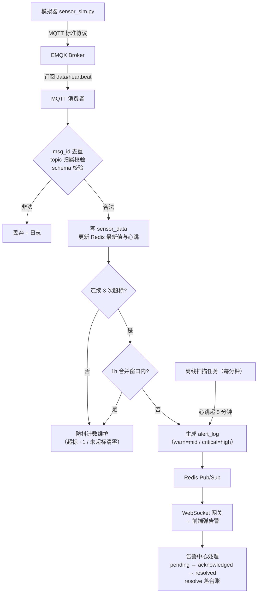

# 智慧养殖多智能体平台 — 功能 PRD：F03 设备接入与环境告警闭环

 - 文档版本：V1.1
- 编制日期：2026-10-12
- 编制角色：开发组（承接 F01/F02 纵切实现经验）
- 依据文档：主 PRD V1.7（第 3.3 节设备管理、3.3.4 模拟模式、第七章 EX-01）、《01-系统架构设计》V1.4（4.3/4.5 告警链路、5.3 Redis 键规划、六节实时通信）、《02-数据库设计》（device / sensor_data / camera_ai_result / alert_log 表）、《03-API接口设计》V1.1（第七/八/十三节）、《04-开发计划》V1.2 阶段 3、《05-测试计划》V1.2（2.5 节 TC-D01~D10、四节注入矩阵）、《06-UI页面设计规范》V1.4（4.7/4.8 节）、《07-硬件通信协议》V1.2
- 对应里程碑：**M3**（模拟数据跑通报警全链路，平台"心跳"）；前置 M2（F02 场舍存栏，已实现 mock 层）
- 合规声明：本方案为产品设计参考，具体实施请结合公司合规与法务要求确认

---

## 一、文档信息

| 版本 | 日期 | 变更 | 评审记录 |
|------|------|------|---------|
| V1.0 | 2026-10-12 | 首次出稿（阶段 3 纵切功能 PRD，第三刀） | 待评审 |
| V1.1 | 2026-10-14 | F09 同步项④回写（视觉链路状态更新）：① FR 范围"视觉事件链路随阶段 9 实装"更新为"已随 F09 实装"（注入入口/预览弹窗实际形态同步）；② 实施顺序与测试对齐注记中 TC-D09"随阶段 9 验收"更新为"已由 F09 实装验收（f09 冒烟 44/44）" | 文档同步 |

## 二、背景与目标

- **背景**：F01（账户与引导）、F02（场舍存栏）两刀纵切后，系统已具备"账号 → 场 → 圈 → 存栏"的真实数据地基。但平台的核心卖点——**告警驱动的养殖管理**——还没有数据来源：告警中心页是 mock 数据，看板传感器曲线是假数字，设备管理页骨架未建。本功能把"设备 → 数据 → 告警 → 处理"这条链路跑通，是整个平台的"心跳"（04-计划 M3 定位），后续 AI 问诊、配方大脑、数据查询 Agent 全部吃这条链路的数据。
- **要解决的问题**：① 无设备管理与数据接入能力，传感器数据进不了库；② 告警没有产生机制（防抖、分级、合并、离线判定均缺失）；③ 告警中心与看板曲线是静态 mock；④ 真实硬件未到位，需要按"协议层模拟"原则用模拟器撑起全链路。
- **成功指标与口径**：

| 指标 | 目标值 | 口径 |
|------|--------|------|
| 告警端到端延迟 | ≤30s（模拟场景 ≤5s） | 第 3 次超标数据进 broker → 前端可见告警 |
| 数据入库延迟 | <2s | 消息到达 broker → sensor_data 可查（PT-02） |
| 防抖准确率 | 100% | 单次超标零告警；连续 3 次超标恰好 1 条告警（合并窗口内） |
| 消费健壮性 | 0 崩溃 | 乱序/缺字段/重复消息全部正确处理（bad_payload 丢弃+日志） |
| 离线判定 | 100% | 停心跳 >5 分钟必产生 device_offline 告警，恢复后状态回 online |

## 三、名词与术语

| 术语 | 定义 |
|------|------|
| 协议层模拟 | 模拟器与真实 STM32 发送**完全相同**的 topic 与 payload，平台端对数据来源无感知（主 PRD 3.3.4，本项目核心原则）；模拟期设备在 device 表标记 source=sim |
| device_sn | 设备序列号（如 DEV001），device 表唯一字段；MQTT topic 中的 device_id 即此字段，消费者按 sn 回表校验归属（07 协议 V1.2 定稿，与 DB 自增主键 device_id 是两个字段） |
| 防抖（debounce） | 连续 3 次采集超阈值才生成正式告警，过滤瞬时抖动；计数存 Redis `sensor:debounce:{device_sn}:{metric}`（TTL 10 分钟） |
| 双档分级 | species.env_threshold 含 warn/critical 两档：超 warn 档生成 mid 告警、超 critical 档生成 high 告警（主 PRD 3.3.2 V1.4） |
| 合并窗口 | 同类告警 1 小时窗口合并为一条（Redis `alert:merge:{type}:{pen_id}`），避免告警风暴（架构 4.5） |
| 离线判定 | 每分钟扫描 `device:hb:{device_sn}`，>5 分钟无心跳 → online_status=offline + device_offline 告警（EX-01；V1.0 仅进告警中心，不触发 Agent） |
| 逻辑删除（设备） | 标记 is_deleted=true，列表不可见；历史 sensor_data 与告警**全部保留**（主 PRD 3.3.1） |

## 四、需求范围

**包含**：
1. 设备注册 / 编辑 / 逻辑删除 / 启停（sensor 类型为主；camera 类型支持注册占位，预览与视觉事件链路不实装）
2. MQTT 消费者：topic 归属校验 → msg_id 去重 → sensor_data 入库 → Redis 最新值与心跳刷新
3. 告警产生链路：防抖（连续 3 次）→ 双档分级 → 1 小时合并窗口 → alert_log(pending)
4. 离线判定：心跳扫描任务 + device_offline 告警 + 恢复自动回 online
5. 告警中心接口与状态闭环（pending → acknowledged → resolved，resolve 备注必填，落台账）
6. WebSocket 实时推送（/ws/alerts，Redis Pub/Sub 转发，断线重连 + 补拉 pending）
7. 传感器历史曲线接口（降采样 ≤2000 点），看板曲线接真
8. 模拟器 sensor_sim.py（正常模式 + 五种异常注入 + 幂等重发）
9. 前端：设备管理页**新建**（13 页缺页补齐）、告警中心页与看板传感器卡片切真

**不包含（本期不做）**：
 - 视觉事件链路（camera_ai_result 入库 + vision 告警 + vision_sim.py）：**已随 F09 实装（视觉告警闭环：注入入口走同一校验链、告警单通道、台账落库，见《17-功能PRD-F09》）**；设备管理页 camera 支持注册、[注入模拟事件] 与 [预览] 模拟模式弹窗（占位画面+事件时间线+免责文案）
- 气象告警（climate 链路）：阶段 8；本阶段 alert_type 枚举已预留 climate，前端类型筛选正常展示"暂无数据"而非隐藏
- 疫病告警（disease，由问诊链路产生）：阶段 5
- 下行控制（cmd topic）：V1.1 预留，07 协议已注明暂不实现
- sensor_data 按月分区与聚合归档：演示期不启用（02-数据库 3.5 注释保留）；2C2G 部署时批量异步消费（架构 7.2）

## 五、方案对比与选型

**决策 1：告警判定放在哪一层 — MQTT 消费者内联 vs 独立告警服务**

| 方案 | 延迟 | 复杂度 | 结论 |
|------|------|--------|------|
| 消费者内联判定（写库后顺手做防抖/分级/合并） | 低（毫秒级，满足 ≤5s） | 中，消费者职责变重 | **推荐**：架构文档 4.5 即按此设计；规则判定不进 LLM，保证端到端 ≤30s 且不依赖 LLM 可用性 |
| 独立告警服务轮询 sensor_data | 高（轮询间隔叠加） | 低 | 不采用：为凑架构分层牺牲延迟，违背"告警单通道汇聚但出口唯一"的初衷 |

**决策 2：防抖计数与合并窗口的存储 — Redis vs 数据库**

| 方案 | 说明 | 结论 |
|------|------|------|
| Redis 计数 + TTL | `sensor:debounce`（10 分钟 TTL）、`alert:merge`（1 小时 TTL），天然过期自清理 | **推荐**：架构 5.3 键规划已定；计数丢失的最坏结果是"多等一轮超标"，可接受 |
| 数据库表计数 | 需清理任务，多一次写放大 | 不采用：高频计数进库不划算 |

**决策 3：WebSocket 鉴权 — JWT query string vs 短时效 ws token**

| 方案 | 说明 | 结论 |
|------|------|------|
| JWT query string | 与 03-API 十三节一致（`/ws/alerts?token=JWT`）；token 会进访问日志 | **推荐（V1.0）**：沿用已定契约；实现时对访问日志中 token 参数脱敏（08 文档 C-03 留意项），V1.1 再评估 5 分钟短时效 ws token |
| 短时效 ws token | 需新增签发接口与刷新逻辑 | 备选：泄露风险实测后再升级 |

**决策 4：补报消息的防抖基准（08 文档 C-09，本文档定稿）** — 断网补报消息（ts 为原采集时刻）**参与防抖判定，按 ts 排序处理**（与实时消息同一状态机，仅入库与判定的排序基准不同）；若补报导致"连续 3 次超标"成立，同样生成告警并受合并窗口约束。此约定评审通过后回写《07-硬件通信协议》3.3 节。

## 六、用户角色与使用场景

| 角色 | 本功能内的场景 | 权限边界 |
|------|--------------|---------|
| farmer（主角色） | 管理名下场舍的设备、看曲线、收告警、处理告警 | 只能操作自己名下 farm/pen 挂载的设备与告警，越权 40302 |
| vet / admin | 本功能不涉及核心操作（admin 的设备配置管理随阶段 10 后台开放；vet 场景在阶段 10 复核链路） | V1.0 无设备管理入口；告警中心暂不做角色特判（是否对 vet/admin 开放只读视图列入待确认，见十四节） |

**主流程**：设备管理页添加模拟设备 → 启动 sensor_sim.py 向 MQTT 发数 → 消费者入库+更新缓存 → 看板曲线出现真实数据 → 注入超标 → 连续 3 次触发告警 → 告警中心弹卡（WebSocket ≤5s）→ 处理（已读/已处理+备注）→ 状态闭环落台账。

**分支流程**：① 设备停心跳 5 分钟 → 离线告警，恢复心跳后自动回 online；② 摄像头设备注册后 [预览] 占位；③ 用户处理告警时备注为空被 42201 拦截。

**异常流程**：乱序/缺字段/重复消息/设备不存在/他人设备 —— 见十二节。

## 七、功能需求

### FR-01 设备注册 / 编辑 / 逻辑删除

- 规则：接口 `POST /device` / `PUT /device/{device_id}` / `DELETE /device/{device_id}`（03-API 7.1）；字段 = 设备名称 + 类型（sensor/camera）+ 绑定养殖场与圈舍（归属校验沿用 F02 的 resolve 链路：farm/pen 须属当前用户且未删除，否则 40302/40401）+ device_sn（**必填、全局唯一**，重复返回 42201）+ 摄像头 rtsp_url（camera 选填）；mqtt_topic 按 `farm/{farm_id}/pen/{pen_id}/{device_sn}/data` 规则**服务端自动生成**（前端不填，防止 topic 与库不一致）；删除为逻辑删除，历史采集数据保留。
- 验收标准：
  - Given 完整字段，When 提交，Then device 落库、mqtt_topic 自动生成、source=sim（模拟期默认）
  - Given 已存在的 device_sn，When 再次注册，Then 返回 42201 提示"该设备编号已被使用"
  - Given 绑定他人圈舍，When 提交，Then 返回 40302（对齐 TC-D 系列的隔离要求）
  - Given 删除有历史数据的设备，When 删除，Then 列表消失、sensor_data 与告警记录完好可查

### FR-02 设备列表与在线状态

- 规则：`GET /device/list?farm_id=`（按 F02 列表契约风格 `{items:[...]}`）；每行返回 device_id / device_name / device_type / source / pen_name / online_status / last_heartbeat / is_enable；启停开关走 `PUT /device/{device_id}`（is_enable=false 时消费者仍收消息但不参与告警判定，离线扫描跳过）。
- 验收标准：
  - Given 2 个场各挂 2 台设备，When 切换场筛选，Then 只显示该场设备（多租户过滤）
  - Given 设备最近心跳 3 分钟前，When 打开列表，Then 显示绿点 online；8 分钟前则灰点 offline + "离线 X 分钟"
  - Given 停用设备，When 恢复心跳，Then online_status 更新但不产生告警

### FR-03 MQTT 消费与数据入库

- 规则：消费者按《07-硬件通信协议》实现，单条消息处理顺序与其 3.3 节一致 = ① `mqtt:dedup:{msg_id}` 去重（TTL 2h，覆盖 QoS1 重发与补报重放）→ ② topic 与 device_sn 回表校验归属（不一致丢弃+日志）→ ③ JSON schema 校验（metrics 键固定 temperature/humidity/nh3/co2，异常 payload 丢弃+日志，不崩溃）→ ④ 写 sensor_data（collect_time 取消息 ts）→ ⑤ 更新 Redis `sensor:latest:{device_sn}` 与 `device:hb:{device_sn}`（架构 5.3 键名写作 device_id，与 device_sn 同指设备序列号，见 07 协议 V1.2），device.last_heartbeat/online_status 同步刷新。
- 验收标准：
  - Given 标准 payload，When 发送，Then sensor_data 入库、Redis 最新值可查（TC-D01）
  - Given 同 msg_id 重发，When 消费，Then 不产生重复数据（TC-D 注入矩阵 duplicate）
  - Given bad_payload（缺字段/类型错），When 消费，Then 丢弃+日志，消费者不崩
  - Given 乱序 10 条，When 消费完成，Then sensor_data 按 collect_time 排序正确
  - Given topic 中 pen_id 与 device_sn 归属不一致，When 消费，Then 丢弃并记日志

### FR-04 防抖与双档分级告警

- 规则：每次入库后逐 metric 判定：值超 `species.env_threshold` 对应档位 → `sensor:debounce:{device_sn}:{metric}` 计数 +1（TTL 10 分钟，未超标清零）；**连续 3 次**超标 → 检查合并窗口 `alert:merge:sensor:{pen_id}`（1 小时内已合并则跳过）→ 生成 alert_log（alert_type=sensor，warn 档 risk_level=mid、critical 档 risk_level=high，pen/farm 取设备归属，alert_content 含圈名/指标/当前值/阈值/连续次数）→ 写合并窗口标记 → Redis Pub/Sub `channel:alert:{user_id}` 推送。阈值取**设备所属圈舍物种**（pen.species_code → species.env_threshold）。
- 验收标准：
  - Given 注入 1 次超标，When 消费，Then 无告警（TC-D02）
  - Given 连续 3 次超标，When 消费，Then 产生且仅产生 1 条告警（TC-D03）
  - Given warn 档与 critical 档各注入一次，When 对比，Then 分别生成 mid 与 high 告警（TC-D10）
  - Given 1 小时内同圈第二次触发，When 生成，Then 不再新产生告警（合并窗口，TC-D07）
  - Given 值在阈值内波动，When 持续采集，Then 防抖计数保持清零、无告警

### FR-05 离线判定与恢复

- 规则：后台任务每分钟扫描 `device:hb:{device_sn}`（is_enable=true 且未删除的设备）：>5 分钟无心跳 → online_status=offline + 生成 device_offline 告警（risk_level=mid——**本文档新增约定，07 协议与主 PRD 均未定义离线告警分级，评审确认后回写**，alert_content 含设备名/圈名/最后心跳时间）；恢复心跳 → online_status 回 online（**不生成"恢复"告警**，列表状态点自然转绿）。离线告警同样受合并窗口约束（离线期间不重复告警；type=device_offline 与 sensor 各自独立计数，互不挤占窗口）。
- 验收标准：
  - Given 停心跳 >5 分钟，When 扫描，Then device offline + 1 条 device_offline 告警（TC-D05，EX-01）
  - Given 离线设备恢复上报，When 心跳到达，Then online_status=online，无新告警
  - Given 设备 is_enable=false，When 扫描，Then 跳过不判离线

### FR-06 告警列表与状态闭环

- 规则：`GET /alert/list?status=&type=&page=`（03-API 8.1，按 user_id 名下场舍过滤；分页遵循 03-API 1.4 统一约定 `page/page_size`，响应含 total/page/page_size/items）；处理走 `POST /alert/{alert_id}/handle`：`{"action":"acknowledge"}` 一键已读；`{"action":"resolve","handled_note":"..."}` 已处理——**note 为空返回 42201**；处理动作落台账（record_type 沿用 02-数据库 breeding_record 枚举，按告警类型写 `sensor` / `device_offline`，溯源走 [补 V1.2] 的 alert_id 外键，为 M4 台账完整性打底）。状态机：pending → acknowledged → resolved（不可逆跳转，非法 action 返回 42201）。
- 验收标准：
  - Given pending 告警，When acknowledge，Then 状态变 acknowledged，列表角标减一
  - Given resolve 无备注，When 提交，Then 42201 拦截（TC-D06）
  - Given 合法 resolve，When 成功，Then 台账新增一条处理记录
  - Given 用户 A 的告警 ID 被用户 B 调用，When 处理，Then 40302（多租户隔离，对齐 F02 FR-05）

### FR-07 WebSocket 实时推送

- 规则：`/ws/alerts?token=JWT`（03-API 十三节）；服务端订阅 Redis Pub/Sub `channel:alert:{user_id}` 转发告警消息；30s 心跳 event，客户端未收到则断线重连（指数退避 1s→2s→4s→...→30s 上限）；重连成功后客户端补拉一次 pending 列表（防窗口丢失）。访问日志对 token 参数脱敏（08 文档 C-03）。
- 验收标准：
  - Given 前端在线，When 告警产生，Then 实时弹告警 ≤5s（模拟场景，TC-D04/D08）
  - Given 断网 10s 后恢复，When 重连，Then 自动重连成功并补拉 pending，无丢失
  - Given 无效 token，When 连接，Then 连接被拒绝（40101 语义）

### FR-08 传感器历史曲线

- 规则：`GET /sensor/history?pen_id=&metric=&from=&to=`（03-API 7.2，pen 归属校验 40302/40401 沿用 F02 链路）；返回 `{metric, points:[{time, value}]}`，大区间自动降采样至 ≤2000 点；看板传感器卡片与曲线接此真数据，空数据显示空态引导（"添加设备后可见曲线"）。
- 验收标准：
  - Given 24h 数据 @30s 间隔（2880 点），When 查询，Then 返回 ≤2000 点且趋势形状保持
  - Given pen_id 属他人，When 查询，Then 40302
  - Given 无数据圈舍，When 查询，Then points 为空数组，前端显示空态而非报错

### FR-09 模拟器 sensor_sim.py

- 规则：按《07-硬件通信协议》六节实现——参数化启动（`--farm --pen --device_id --interval --metrics`，支持一进程多设备）；正常模式数值在阈值内随机波动（温度带日周期曲线）；异常注入五件套：`overshoot`（持续超标）/ `spike`（单次抖动，验防抖）/ `heartbeat_off`（停心跳，验离线）/ `out_of_order`（乱序补发）/ `bad_payload`（缺字段/类型错）；`duplicate`（同 msg_id 重发，验去重）。
- 验收标准：对照 07 协议 6.2 验收表逐条通过（连续 3 条超标 → 恰 1 条告警；单条超标后恢复 → 无告警；停心跳 → 离线告警；乱序 → 排序正确；bad_payload → 丢弃不崩；duplicate → 无重复）。

### FR-10 前端：设备管理页新建 + 告警中心/看板切真

- 规则：按 06 规范 4.7 **新建设备管理页**（13 页缺页补齐）：设备表格（名称/类型图标/来源[真实/模拟]/绑定圈舍/在线状态点/最近心跳/启停开关/操作）+ [添加设备] / [使用模拟设备] 双入口（后者提供 sensor_sim 启动命令复制）；告警中心页（4.8）与看板传感器卡片从 mock 切真实接口，告警 WebSocket 实时插入（滑入动画 + 色条闪烁 + 铃铛红点 +1）；页内无硬编码设备/告警。
- 验收标准：
  - Given 添加模拟设备并启动模拟器，When 回到列表，Then 状态点转绿、最近心跳刷新
  - Given 告警产生，When 前端在线，Then 无需刷新即见新告警卡（滑入 + 色条闪烁）
  - Given 点击摄像头行 [预览]，Then toast 提示"视频预览将于后续版本开放"（占位不放开，与 F02 出栏入口策略一致）
  - Given <768px，When 查看两页，Then 表格转卡片式单列（06 规范断点表）

## 八、非功能需求

| 项 | 要求 | 口径 |
|----|------|------|
| 性能 | 数据入库延迟 <2s；告警端到端 ≤30s（模拟 ≤5s）；sensor/history P95 ≤300ms | 05-测试三节 PT-02/PT-03 |
| 吞吐 | 100 台模拟设备 @30s 间隔无消息积压 | PT-02 |
| 一致性 | 告警判定只出现在消费者内联路径，禁止其他代码路径直接写 alert_log(sensor/device_offline) | 代码审查 |
| 可用性 | 消费者崩溃重启后从断点继续（QoS1 + msg_id 去重保证不丢不重）；bad_payload 不崩溃 | 注入矩阵 |
| 安全 | WS/REST 全接口挂 JWT（40101）；设备/告警/曲线全链路 user_id 过滤（40302）；访问日志 token 脱敏（C-03） | 代码审查 |
| 兼容 | 设备管理/告警中心按 06 规范断点表：<768 表格转卡片 | DevTools 逐档验证 |
| 无障碍 | 设备启停开关与删除确认键盘可达；删除/处理弹窗焦点默认在取消按钮；告警卡片色条同时带文字状态标签（不单靠颜色传达） | Tab 走查 |
| 可观测 | MQTT 消费延迟、告警端到端耗时打日志（架构九节，request_id 贯穿） | 日志抽查 |

## 九、业务流程与状态流转

**告警状态机**：

| 状态 | 进入条件 | 允许操作 | 迁移 |
|------|---------|---------|------|
| pending | 告警产生（防抖成立/离线判定成立） | acknowledge / resolve | acknowledged / resolved |
| acknowledged | 用户点击已读 | resolve | resolved |
| resolved | 处理完成（备注必填） | 无（终态，档案保留） | — |

**设备在线状态**：online（心跳 ≤5 分钟）⇄ offline（>5 分钟），由心跳到达与扫描任务双向驱动；is_enable=false 时状态冻结不判定。

**指标与档位**：temperature(℃) / humidity(%RH) / nh3(ppm) / co2(ppm) 四指标共用同一防抖与分级逻辑，阈值逐指标独立计数。

## 十、数据与埋点

- **数据落库**：device（注册）、sensor_data（每条上报）、alert_log（防抖成立/离线判定）、breeding_record（告警处理切片，record_type 按告警类型写 sensor / device_offline——02-数据库枚举内取值，溯源以 [补 V1.2] 的 alert_id 外键承载）；camera_ai_result 表本阶段不写入（阶段 9）。
- **最小数据能力**：告警端到端耗时 = 告警 create_time − 第 3 次超标消息 ts，日志聚合统计（V1.0 无埋点系统，沿用 F01 的 T+1 手工核验口径）；消费者处理量按日志计数。
- **指标口径**：在线设备数 = is_enable=true 且未删除且 online_status=online 的设备数；告警未处理数 = 名下 alert_log status IN (pending, acknowledged)——看板与告警中心角标共用此口径。

## 十一、权限与安全要求

- 数据归属：device / sensor_data / alert_log 全链路按 pen→farm→user 链路回溯过滤（复用 F02 resolve 服务的归属校验），越权 40302；MQTT topic 归属与库不一致直接丢弃（07 协议规则 1）。
- 输入校验：device_sn 格式（字母数字与连字符，≤64 位）与唯一性服务端校验；metrics 白名单四键，数值范围合理（负湿度等丢弃）；WS 握手校验 JWT，无效拒绝连接。
- 安全清单：JWT 过期 40101；WS 访问日志 token 脱敏（C-03）；告警内容不包含用户手机号等 PII；消费者日志不打印完整 payload 敏感字段（本协议 payload 无 PII，留声明即可）。
- Broker 安全：V1.0 内网无鉴权（07 协议一节）；V1.1 启用 username/password + 每设备 ACL——本阶段在部署文档预留 EMQX 配置位，不实装。

## 十二、异常处理清单

| 编号 | 异常 | 处理 | 用户可见文案 | 状态 |
|------|------|------|------------|------|
| EX-C1 | 设备离线 | 心跳扫描判定 offline + 告警，恢复自动回 online | 告警卡"设备离线：X 号圈 XX 设备超过 5 分钟无心跳" | 复用 **EX-01**（TC-D05） |
| EX-C2 | 重复消息（QoS1 重发/补报重放） | msg_id 去重，不重复入库/告警 | 无感知 | 本文档定稿（07 协议 3.3） |
| EX-C3 | 乱序消息 | 按 ts 入库与防抖排序（决策 4） | 无感知（曲线排序正确） | 本文档定稿，回写 07 协议 |
| EX-C4 | 非法 payload（缺字段/类型错/超量程） | 丢弃 + 日志，消费者不崩 | 无感知 | 07 协议 6.2 |
| EX-C5 | topic 与设备归属不一致 | 丢弃 + 日志（防伪造数据） | 无感知 | 07 协议规则 1 |
| EX-C6 | 访问他人设备/告警/曲线 | 拦截 | "无权限访问" | 复用已有 **40302** |
| EX-C7 | 资源不存在（已删除设备/告警） | 拦截 | "该设备已删除" | 复用已有 **40401** |
| EX-C8 | resolve 备注为空 / 非法 action / 非法状态跳转 | 拦截 | "请填写处理备注" | 复用已有 **42201** |
| EX-C9 | device_sn 重复注册 | 拦截 | "该设备编号已被使用" | 复用已有 **42201** |
| EX-C10 | WebSocket 断线 | 客户端指数退避重连 + 补拉 pending | 前端提示"连接已恢复" | 03-API 十三节 |
| EX-C11 | Redis/EMQX 不可用 | 消费者退避重连并记日志；恢复后自动续接（QoS1 不丢） | "数据同步中，请稍后刷新" | 通用，日志留痕 |

> 本功能**无需新增错误码**：全部复用 03-API 已有 40101 / 40302 / 40401 / 42201。

## 十三、上线计划、依赖与验证

- **依赖评估**：

| 依赖项 | 所属 | 就绪状态 | 分级 | 说明 |
|--------|------|---------|------|------|
| 登录态 / JWT（40101） | F01 | 前端已建，后端待实装 | **阻塞** | 全部接口与 WS 握手的前置 |
| farm/pen 归属校验与多租户过滤 | F02 | mock 层已实现 resolve 链路 | 阻塞 | 设备注册/列表/曲线的归属判定直接复用 |
| device/sensor_data/alert_log 建表 | 阶段 0.2 | SQL 已定稿，待执行 | 阻塞 | 含 idx_device_online、idx_sensor_data_pen_metric_time、idx_alert_farm_status |
| species.env_threshold 双档种子数据 | 阶段 0.2 | 02-数据库 5.1 已定义 | 阻塞 | 猪先行：四指标 warn/critical 阈值 |
| EMQX / Redis 基础设施 | 阶段 0.1 | docker-compose 已备 | 阻塞 | 1883 / 16379 端口已映射 |
| **FastAPI 后端骨架** | 阶段 0.3 | **待搭** | **阻塞（本阶段必须先补）** | F03 是第一个真正依赖后端进程与中间件的纵切；JWT 中间件、统一响应、消费者进程、WS 网关均挂于此 |
| 前端告警中心页 | 已完成 | mock 版可点可看 | 并行 | 切真即可 |
| 前端设备管理页 | 本阶段 | **未建**（13 页缺页） | 阻塞 | 按 06 规范 4.7 新建 |
| 台账统一写入服务 | 阶段 4 | 未到阶段 | 可绕过 | 本阶段只写 alert 类型台账切片，统一补齐在阶段 4（与 F02 FR-08 的 stock_change 切片同策略） |

- **实施顺序**：后端骨架补齐（0.3，JWT+统一响应）→ 设备 CRUD（3.0）→ MQTT 消费者+防抖分级（3.1a）→ 离线扫描（3.1b）→ 告警接口+状态闭环+落台账（3.2）→ WS 网关（3.3）→ sensor/history（3.4）→ 模拟器 sensor_sim.py（3.5）→ 前端设备页新建 + 告警中心/看板切真（3.6）→ 按 TC-D01~D08 / D10 与注入矩阵验收（TC-D09 视觉事件注入随阶段 9 验收，本阶段显式不测）。
- **验证步骤**：① Swagger 逐接口调通；② 模拟器五件套注入矩阵逐条过（07 协议 6.2）；③ 双账号验证 40302 隔离；④ 断线重连 + 补拉验证；⑤ 演示脚本："添加模拟设备 → 启动模拟器 → 看板曲线动起来 → 注入超标 → 告警 5 秒内弹出 → 处理闭环 → 台账可查"，全程不改代码。
- **回滚**：设备/告警为纯增量功能；后端回滚 = 摘除新路由与消费者进程；前端回滚 = 恢复 mock 数据源（client.ts 一处切换）；无存量数据迁移。

## 十四、风险与遗留问题

| 编号 | 风险/遗留 | 类别 | 概率×影响 | 等级 | 应对 |
|------|----------|------|----------|------|------|
| RK-1 | FastAPI 后端骨架未搭，F03 全部接口阻塞 | 进度 | 3×4 | 高 | 本阶段第 0 步先补 0.3 骨架（JWT/统一响应/错误码），复用 F01/F02 mock 契约直接翻写，工作量可控 |
| RK-2 | 2C2G 服务器上 EMQX+消费者+PG 同机内存吃紧 | 部署 | 3×3 | 中 | 消费批量异步写入（架构 7.2）；sensor_data 演示期不分区；压测 PT-02 验证 |
| RK-3 | 防抖计数在 Redis 重启后丢失，可能漏一条告警 | 数据 | 2×2 | 低 | 接受：最坏结果"多等一轮超标"，下一周期补上；不做持久化 |
| RK-4 | WS token 进访问日志（C-03） | 安全 | 2×2 | 低 | V1.0 日志脱敏；V1.1 评估短时效 ws token |
| RK-5 | 补报防抖基准（决策 4）为新增约定，未回写 07 协议 | 需求 | 3×2 | 低 | 评审通过当天回写 07 协议 3.3 节（同 RK-3 of F02 的文档同步机制） |
| RK-6 | 摄像头注册入口放开但预览占位，用户误解可用 | 体验 | 2×2 | 低 | 预览按钮 toast 占位文案（与 F02 出栏入口策略一致）；阶段 9 放开 |
| RK-7 | FR-01/02 新增接口与约定未回写 03-API 文档：GET /device/list 与 PUT/DELETE /device/{device_id}（7.1 未定义）、mqtt_topic 改为服务端自动生成（7.1 请求示例含该字段）、device_offline 分级 mid | 需求 | 3×4 | 中 | 评审通过当天回写 03-API 7.1/7.2 与 07 协议（同 F02 RK-3 的文档同步机制，纳入变更管理表） |

**待确认项（评审时拍板）**：① 决策 4 补报防抖基准（按 ts 排序参与判定）是否采纳；② is_enable=false 设备是否仍计入离线扫描（当前方案：跳过）；③ 恢复在线是否需要"恢复"系统通知（当前方案：不生成，状态点自然转绿）；④ camera 类型本阶段是否开放注册（当前方案：开放注册 + 预览占位）；⑤ device_offline 告警分级固定为 mid 是否合适（当前方案：mid，不随机上告警风暴）。

## 十五、附录

### 15.1 需求追踪矩阵（RTM）

| 需求编号 | 需求描述 | PRD 章节 | 前端 | 后端接口 | 测试用例 | 状态 |
|---------|---------|---------|------|---------|---------|------|
| FR-01 | 设备注册/编辑/逻辑删除 | 七 | 设备管理页（新建） | POST/PUT/DELETE /device | TC-D 系列 + 注入矩阵 | 待开发 |
| FR-02 | 设备列表与在线状态 | 七 | 设备管理页 | GET /device/list | TC-D05（状态点） | 待开发 |
| FR-03 | MQTT 消费与数据入库 | 七 | — | mq/consumer.py | TC-D01 + 注入矩阵 | 待开发 |
| FR-04 | 防抖与双档分级告警 | 七 | — | 消费者内联 | TC-D02/D03/D07/D10 | 待开发 |
| FR-05 | 离线判定与恢复 | 七 | 设备状态点 | 心跳扫描任务 | TC-D05（EX-01） | 待开发 |
| FR-06 | 告警列表与状态闭环 | 七 | 告警中心切真 | GET /alert/list、POST /alert/{id}/handle | TC-D06 | 待开发 |
| FR-07 | WebSocket 实时推送 | 七 | 告警实时弹卡 | /ws/alerts | TC-D04/D08 | 待开发 |
| FR-08 | 传感器历史曲线 | 七 | 看板曲线切真 | GET /sensor/history | PT-02 关联 | 待开发 |
| FR-09 | 模拟器 sensor_sim.py | 七 | — | simulator/ | 07 协议 6.2 全表 | 待开发 |
| FR-10 | 前端设备页新建+两页切真 | 七 | 设备/告警/看板 | 全部 | TC-D 系列 UI 侧 | 待开发 |

> 测试用例对齐《05-测试计划》2.5 节 TC-D01~D10，其中 **TC-D09（视觉事件注入）不在本阶段范围**（原随阶段 9 安排，**已由 F09 实装并验收**——f09 冒烟 44/44 含 TC-D09 收口与 TC-V 系列），本阶段覆盖 TC-D01~D08、D10 及 07 协议 6.2 注入矩阵。

### 15.2 接口字段引用

device / sensor/history / alert / WebSocket 的请求响应字段以《03-API接口设计》七/八/十三节为准，本文档不重复定义；表结构与索引以《02-数据库设计》3.5/3.6 为准；MQTT topic 与 payload 以《07-硬件通信协议》V1.2 为准。

### 15.3 与 F01 / F02 的衔接关系

| 衔接点 | 说明 |
|--------|------|
| 依赖 F01（账户与引导） | 全部 REST/WS 接口挂 JWT（40101）；user_id 是设备与告警多租户过滤的根；告警中心仅对已引导用户可见（guide_done 守卫沿用） |
| 依赖 F02（场舍存栏） | 设备必须挂载到用户名下未删除的 pen（复用 F02 的 resolveFarm/resolvePen 归属校验链路，40302/40401 语义一致）；告警分级阈值取 pen.species_code → species.env_threshold（物种继承链路：主物种 → 圈舍物种 → 阈值路由） |
| 反哺 F02 | 设备离线告警提示用户"环境数据断更"，间接保障 F02 存栏管理依赖的环境监测可用性 |
| 台账一致性 | 本阶段告警处理落台账沿用 F02 FR-08 的"业务与台账同事务"强一致策略（处理动作与台账写入同一 mutate 序列），为 M4 台账完整性 100% 打底 |
| 架构延续 | 沿用"协议层模拟"哲学：本阶段模拟器与未来真实 STM32 走同一 MQTT 链路，正如 F01/F02 的 mock 层与未来 FastAPI 走同一 REST 契约——切真零改动是贯穿三个功能的同一设计纪律 |

### 15.4 合规声明

本方案为产品设计参考，具体实施请结合公司合规与法务要求确认。告警内容仅为环境与设备状态提示，不构成兽医诊断依据；视觉类告警（阶段 9）上线时须携带"仅作为提示不作为确诊依据"固定文案。
