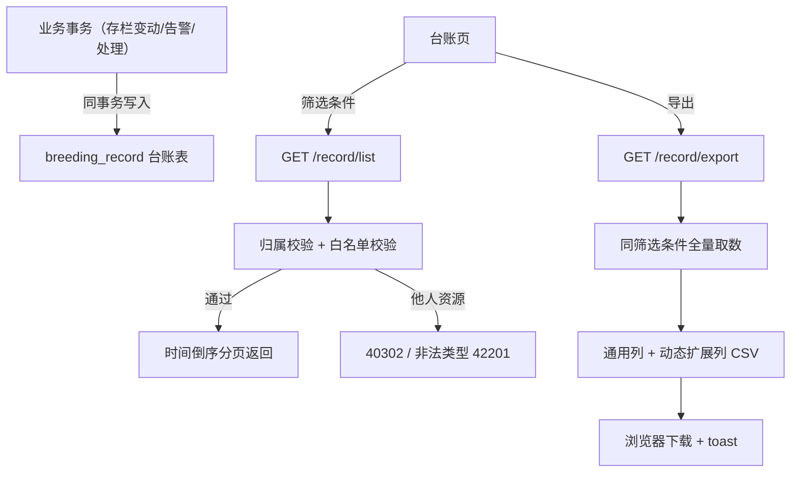

# 智慧养殖多智能体平台 — 功能 PRD：F04 台账查询与导出

- 文档版本：V1.2
- 编制日期：2026-10-12
- 编制角色：开发组（承接 F01~F03 纵切实现经验）
- 依据文档：主 PRD V1.7（第 3.6 节养殖台账模块）、《01-系统架构设计》V1.4（架构核心原则 4"台账自动落"）、《02-数据库设计》（breeding_record 表、variety.record_ext_fields、六节 数据保留与清理策略）、《03-API接口设计》V1.1（第十节 10.1/10.2）、《04-开发计划》V1.2 阶段 4、《05-测试计划》V1.2（2.7 节 TC-R01~R04、三节 PT-05）、《06-UI页面设计规范》V1.4（4.11 节）
- 对应里程碑：**M4**（台账档案可信可导）；前置 M3（F03 设备与告警闭环，已实现）
- 合规声明：本方案为产品设计参考，具体实施请结合公司合规与法务要求确认

---

## 一、文档信息

| 版本 | 日期 | 变更 | 评审记录 |
|------|------|------|---------|
| V1.0 | 2026-10-12 | 首次出稿（阶段 4 纵切功能 PRD，第四刀） | 待评审 |
| V1.1 | 2026-10-12 | 自查修订：① FR-02 列序口径纠偏为"按 variety.record_ext_fields 定义顺序"（原稿误写"按字段首次出现顺序"，与 03-API 10.2 / 02-数据库 / TC-R03 三处契约相悖），未入定义字段加兜底规则；② FR-03 补台账溯源外键核对（04-计划 4.1 要求）；③ 术语表标注 device_offline 为 F03 新增使用值、需回写 02-数据库枚举注释；④ record_ext 字段定名 male_delta/female_delta 并列种子数据回写项 | 第 1 轮自查通过 |
| V1.2 | 2026-10-12 | 二轮复核修订：① 修正 3 处 02-数据库章节引用（数据保留策略在六节而非 3.7，3.7 为会话/提醒/知识库补充表；variety.record_ext_fields 在 3.1）；② 15.4"导出留痕"与十一节"导出不落台账"矛盾消解（留痕经访问日志 request_id 承载）；③ FR-01 响应字段名标注为本文档具体化约定（03-API 10.1 仅定义通用列语义）；④ 依据文档补 PT-05 引用、架构原则名称对齐"架构核心原则 4" | 第 2 轮复核通过 |

## 二、背景与目标

- **背景**：F01~F03 三刀纵切后，台账写入点已经在各业务事务中持续落库（存栏变动五类 + 转群对笔、建圈初始流水、告警产生、告警处理），`breeding_record` 表数据持续积累。但**台账只能写不能读**：没有查询接口、没有台账页面、不能导出，"档案可信可导"（M4）无法验收。养殖户对外（合作社对账、检疫申报、保险理赔）与对内（复盘）都需要一份可筛选、可导出的完整档案。
- **要解决的问题**：① 台账无查询入口，落库数据"只写不读"；② 无导出能力，档案出不了系统；③ 台账页前端未建（13 页缺页之二）；④ 扩展字段（产仔数、公母变动等）没有动态列机制，导出列不完整。
- **成功指标与口径**：

| 指标 | 目标值 | 口径 |
|------|--------|------|
| 台账完整性 | 100% | 任意演示流程后：每笔存栏变动/告警产生/告警处理恰好一条台账，无遗漏无重复（TC-R01 本功能切片） |
| 筛选正确率 | 100% | farm/pen/类型/时间四条件任意组合查询结果与逐条核对一致（TC-R02） |
| 导出可用性 | 100% | 导出文件可打开、行数与筛选结果一致、扩展列按定义排序且列名中文（TC-R03） |
| 不可篡改性 | 100% | 系统不存在台账更新/删除接口（TC-R04） |

## 三、名词与术语

| 术语 | 定义 |
|------|------|
| 台账（breeding_record） | 养殖过程档案：由各业务事务自动写入，记录类型覆盖 stock_change/sensor/device_offline/climate/vision/disease/medicine/feed/vet_review/lifecycle/slaughter（02-数据库枚举 + F03 新增使用值 device_offline，该值需评审后回写 02-数据库枚举注释）；档案性质，逻辑删除之外**不允许任何修改与删除** |
| 通用列 | 每条台账都有的展示列：时间、圈舍、类型、摘要（03-API 10.1） |
| 动态扩展列（record_ext） | 按业务域不同的附加字段（如存栏变动的公母变动数）；导出时按**当前筛选范围内实际出现的字段**动态生成列，**列序按 variety.record_ext_fields 定义顺序**（03-API 10.2 / TC-R03），列名中文 |
| record_ext_fields | variety 表 JSONB 字段，定义该品种台账扩展字段的 field/label 清单（02-数据库 3.1）；本阶段前端按实际出现字段聚合展示，admin 后台维护随阶段 10 |
| male_delta / female_delta | 存栏变动类台账 record_ext 中的公/母变动整数字段（本文档定名，与 03-API 4.3 存栏变动请求字段同名同义）；对应 label"公变动/母变动"，建议随阶段 0.2 init_data 补入猪品种 record_ext_fields 种子定义 |

## 四、需求范围

**包含**：
1. 台账多条件查询接口（farm/pen/record_type/时间范围 + 03-API 1.4 分页）
2. 台账导出接口（同筛选条件，返回表格文件；mock 期 CSV（UTF-8 BOM，Excel 直接打开），真实后端升级 xlsx 文件流——03-API 10.2 契约不变）
3. 台账写入点完整性核对（F01~F03 已落的 stock_change/告警/告警处理写入点逐一核对，缺则补齐）
4. 前端台账页**新建**（13 页缺页之二，06 规范 4.11）+ 侧边栏入口

**不包含（本期不做）**：
- Excel 真正的 .xlsx 生成（openpyxl）：随 FastAPI 后端实装切换，本阶段导出 CSV（Excel 兼容），接口契约一致
- 台账的编辑/删除/批量操作：档案不可篡改（TC-R04），永不做
- variety.record_ext_fields 的 admin 后台维护：阶段 10
- sensor_data 明细按天聚合归档（02-数据库 六节 数据保留与清理策略；按月分区注释见 3.5）：数据量触发后再做

## 五、方案对比与选型

**决策 1：扩展列的生成方式 — 按筛选范围实际出现字段 vs 全量定义字段**

| 方案 | 说明 | 结论 |
|------|------|------|
| 按实际出现字段动态生成 | 筛选结果里出现什么扩展字段就生成什么列（03-API 10.2 即此口径）；**列序一律按 variety.record_ext_fields 定义顺序，与出列口径无关** | **推荐（沿用已定契约）**：导出列与数据严格对应，不产生空列 |
| 按 variety.record_ext_fields 全量生成 | 同品种定义的全部字段都出列，没数据填空 | 备选：列稳定但空列多；待 admin 后台维护字段定义后（阶段 10）再评估切换 |

> 两方案只决定"**哪些字段出列**"，**列序口径不变**：定义内字段按 record_ext_fields 顺序排；实际出现但未入定义的字段（如种子数据未补 male_delta/female_delta 时的公变动/母变动）按字段首次出现顺序追加在定义字段之后（兜底规则，本文档新增约定，待确认）。

**决策 2：导出文件格式（mock 期）— CSV(UTF-8 BOM) vs 前端 xlsx 库**

| 方案 | 说明 | 结论 |
|------|------|------|
| CSV + UTF-8 BOM | 服务端拼字符串，Excel/WPS 双击直接打开不乱码；契约与 10.2 一致（换 mime 即切 xlsx） | **推荐**：零依赖、可测试，切真只换生成器 |
| 前端 SheetJS 生成 xlsx | 引入新依赖，mock 期收益低 | 不采用：真实后端用 openpyxl 生成，前端库是重复投资 |

**决策 3：台账查询的权限口径** — 沿用 F02/F03 的 farm→user 归属链路：farm_id 必须属当前用户（40302），pen_id 必须挂在该 farm 下（40302/40401），不传 farm_id 时返回名下全部场数据（跨场聚合）。record_type 白名单校验（02-数据库枚举）。

## 六、用户角色与使用场景

| 角色 | 本功能内的场景 | 权限边界 |
|------|--------------|---------|
| farmer（主角色） | 按场/圈/类型/时间查台账、导出归档 | 只能查自己名下场舍的台账，越权 40302 |
| vet / admin | 本阶段不涉及（admin 全局查询随阶段 10 后台） | 无台账入口 |

**主流程**：进入台账页 → 顶部筛选（场/圈/类型/时间范围）→ 表格即时刷新 → 点 [导出 Excel] → 下载文件 + 成功 toast。

**分支流程**：① 无筛选默认展示名下全部台账（时间倒序）；② 清空筛选回到全量；③ 无记录显示空态。

**异常流程**：越权、非法类型、时间范围起止倒置 —— 见十二节。

## 七、功能需求

### FR-01 台账多条件查询

- 规则：`GET /record/list?farm_id=&pen_id=&record_type=&from=&to=&page=&page_size=`（03-API 10.1 + 1.4 分页约定）；每条返回 record_id / record_type / summary / create_time / pen_name / record_ext（动态扩展字段对象，可为空对象）——**字段名为本文档具体化约定**（03-API 10.1 仅定义通用列语义"时间、圈舍、类型、摘要"，实现时如 03 文档细化字段名以其为准）；时间倒序；record_type 限 02-数据库枚举白名单。
- 验收标准：
  - Given 名下 2 个场共 N 条台账，When 不带筛选查询，Then 返回全部 N 条（跨场聚合，时间倒序）
  - Given farm_id + record_type=stock_change 组合，When 查询，Then 仅返回该场存栏变动类台账（TC-R02）
  - Given from=2026-10-12&to=2026-10-12，When 查询，Then 含当日 00:00:00~23:59:59 的记录（to 为日期时含全天）
  - Given 他人 farm_id，When 查询，Then 40302
  - Given record_type=hack，When 查询，Then 42201（白名单拦截）

### FR-02 台账导出

- 规则：`GET /record/export`（03-API 10.2），筛选参数与 FR-01 完全一致；返回文件内容；**列结构 = 通用列（时间/圈舍/类型/摘要）+ 动态扩展列**（当前筛选范围内实际出现的 record_ext 字段，**列序按 variety.record_ext_fields 定义顺序，未入定义字段按首次出现顺序追加其后**——见五节决策 1 注）；列名中文；文件名含筛选范围与导出时间（如 `台账_育肥圈_stock_change_20261012_1030.csv`）。
- 验收标准：
  - Given 筛选范围内含存栏变动台账，When 导出，Then 文件含"公变动/母变动"列且数值与摘要一致
  - Given 猪品种 record_ext_fields 已定义 male_delta/female_delta，When 导出，Then 扩展列按定义顺序排列（TC-R03）
  - Given 文件下载后用 Excel 打开，Then 中文不乱码（UTF-8 BOM）
  - Given 导出行数，Then 与同条件查询 total 一致（TC-R03）
  - Given 他人 farm_id，When 导出，Then 40302（导出与查询同权限）

### FR-03 台账写入点完整性核对

- 规则：逐一核对 F01~F03 已实现的写入点——存栏变动五类（F02 FR-08）、转群对笔各一条（F02 FR-07）、建圈初始流水（F02 FR-03）、告警产生（F03 FR-04/05）、告警处理（F03 FR-06）；每笔业务动作恰好一条台账，摘要可读且含关键字段（圈名/类型/数量或处理内容）；**溯源外键逐类核对**（04-计划 4.1）：stock_change 类台账带 stock_change_id、告警产生/处理类台账带 alert_id（lifecycle_event_id / medicine_usage_id 随阶段 7 实装时核对）；发现缺失即补。
- 验收标准：
  - Given 一轮完整演示（建圈→产仔→死淘→转群→注入超标告警→处理），When 查台账，Then 每笔动作恰好一条对应记录，无遗漏无重复（TC-R01）
  - Given 任一 stock_change 类台账，When 查库，Then stock_change_id 非空且指向真实流水；Given 任一告警类台账，Then alert_id 非空且指向真实告警（溯源可回查）

### FR-04 台账不可篡改

- 规则：不提供台账更新/删除接口；路由层不存在 PUT/DELETE /record 路径（TC-R04）。
- 验收标准：Given PUT/DELETE /record/{id} 请求，Then 40401（接口不存在）。

### FR-05 前端台账页新建

- 规则：按 06 规范 4.11 实现——顶部筛选条（养殖场/圈舍/类型/时间范围）+ [导出 Excel] 主按钮；表格：时间、圈舍、类型标签、摘要 + 动态扩展列（按当前筛选结果实际出现字段生成，列名中文）；视觉"纸质台账数字化"克制感：无斑马纹、行 hover 才现底色、数字列 tabular 右对齐、类型标签 6px 圆角微标；导出反馈 loading → 成功 toast；空态；<768 横向滚动；侧边栏新增"台账档案"入口（生产管理组）。
- 验收标准：
  - Given 修改任一筛选条件，When 变更，Then 表格即时刷新（无需手动点查询）
  - Given 点击导出，Then 按钮 loading → 文件下载 + "导出成功" toast
  - Given 无记录组合，When 查询，Then 空态"该条件下暂无台账记录"
  - Given 侧边栏，Then 出现"台账档案"入口且活跃态高亮正确

## 八、非功能需求

| 项 | 要求 | 口径 |
|----|------|------|
| 性能 | 台账查询 P95 ≤ 300ms（F02 列表接口同口径）；10 万行导出 ≤10s（真实后端 PT-05，mock 期不做压测） | 05-测试三节 |
| 一致性 | 台账写入只出现在各业务事务内（F02 存栏事务/F03 告警管道），查询层禁止写 | 代码审查 |
| 安全 | farm/pen 归属校验 40302；导出与查询同权限；record_type 白名单 | 代码审查 |
| 兼容 | 台账页 <768 表格横向滚动（宽表不折行） | DevTools 验证 |
| 无障碍 | 筛选控件键盘可达；类型标签同时有文字（不单靠颜色） | Tab 走查 |

## 九、业务流程与状态流转

台账记录为**只追加、不修改**的档案流（append-only），无状态机——唯一的状态就是"已写入"。

## 十、数据与埋点

- **数据落库**：本功能不新增写入点（只读既有 breeding_record）；为支撑动态列，存栏变动类台账补充 record_ext（整数字段 male_delta/female_delta，label"公变动/母变动"，随写入事务同序列落库），并建议随阶段 0.2 init_data 将两字段补入猪品种 variety.record_ext_fields 种子定义（未补则导出走兜底列序）。
- **最小数据能力**：台账条数 = 各 record_type 计数（页头展示"共 N 条"）；导出行数 = 筛选 total；两者即可验收 TC-R01/R03。
- **指标口径**：台账完整性核验公式——stock_change 类台账数 = stock_change 流水数 × 1（转群=2 笔流水 2 条台账）+ 告警类台账数 = 告警产生数 + 告警处理数。

## 十一、权限与安全要求

- 数据归属：查询/导出均按 farm→user 链路校验（复用 F02 resolveFarm/resolvePen），越权 40302；record_type 白名单外返回 42201。
- 导出内容不含 PII（台账摘要为圈舍与业务数据）；导出动作本阶段不落台账（导出是读操作，避免自我繁殖记录），留痕经访问日志承载（request_id 贯穿，含操作人 user_id 与筛选参数，见 01-架构九节可观测约定）。

## 十二、异常处理清单

| 编号 | 异常 | 处理 | 用户可见文案 | 状态 |
|------|------|------|------------|------|
| EX-R1 | 访问他人场/圈台账 | 拦截 | "无权限访问" | 复用已有 **40302** |
| EX-R2 | record_type 非白名单 | 拦截 | "无效的台账类型" | 复用已有 **42201** |
| EX-R3 | 时间范围倒置（from > to） | 前端拦截 + 服务端兜底（返回空集） | "开始时间不能晚于结束时间" | 前端为主 |
| EX-R4 | 无记录 | 空态 | "该条件下暂无台账记录" | 前端文案 |
| EX-R5 | 导出数据量大 | 真实后端分页生成（PT-05）；mock 期数据量小不处理 | "正在生成…" | 阶段真切换时留意 |

> 本功能**无需新增错误码**：复用 40302 / 42201 / 40401。

## 十三、上线计划、依赖与验证

- **依赖评估**：

| 依赖项 | 所属 | 就绪状态 | 分级 | 说明 |
|--------|------|---------|------|------|
| breeding_record 表与写入点 | F02/F03 | 已实现且持续落库 | **就绪** | stock_change/告警/处理三类写入点已验证 |
| 归属校验链路 | F02 | 已实现 | 就绪 | 复用 resolveFarm/resolvePen |
| 前端台账页 | 本阶段 | 未建（13 页缺页） | 阻塞 | 按 06 规范 4.11 新建 |
| FastAPI 后端（xlsx 生成） | 阶段 0.3 | 待搭 | 可绕过 | mock 期 CSV 替代，契约一致，切真只换生成器 |

- **实施顺序**：查询/导出接口（4.2/4.3 mock 版）→ 存栏台账补 record_ext（4.1 切片）→ 前端台账页新建（4.4）→ 按 TC-R01~R04 验收。
- **验证步骤**：① 一轮完整演示流程后逐条核对台账完整性；② 四条件筛选组合抽查；③ 导出文件 Excel 打开核验行数/列序/中文；④ 双账号越权验证；⑤ 演示脚本："产仔 → 死淘 → 告警 → 处理 → 台账页全流程可查可导"。
- **回滚**：纯增量（新接口 + 新页面），回滚 = 摘除路由与入口；无存量数据迁移。

## 十四、风险与遗留问题

| 编号 | 风险/遗留 | 类别 | 概率×影响 | 等级 | 应对 |
|------|----------|------|----------|------|------|
| RK-1 | mock 期导出 CSV 与真实 xlsx 行为差异（样式/多 sheet） | 技术 | 2×2 | 低 | 契约按 03-API 10.2 定义，切真只换生成器；差异在切换时回归 TC-R03 |
| RK-2 | 猪品种种子数据 record_ext_fields 未定义 male_delta/female_delta 字段，扩展列走兜底顺序、TC-R03"按定义顺序"验收受限 | 数据 | 3×2 | 低 | 随 init_data 补两字段定义（十节数据落库项）；补定义后列序完全由 record_ext_fields 决定，不再有首次出现排序的漂移问题（V1.0 原风险已随列序纠偏消除） |
| RK-3 | 历史台账（F02 早期写入）无 record_ext，动态列对旧数据缺值 | 数据 | 3×2 | 低 | 接受：动态列按"实际出现"生成，旧数据无该列不出现；演示前重置演示数据即可 |
| RK-4 | 台账量随演示增长，列表无索引全量过滤变慢 | 性能 | 2×2 | 低 | mock 期量级小；真实后端走 idx_record_farm_time 索引（02-数据库已建） |

**待确认项（评审时拍板）**：① 动态列出列口径维持"实际出现字段"还是切"全量定义"（决策 1）；② 未入 record_ext_fields 定义字段的首现兜底排序规则是否采纳（决策 1 注）；③ 导出格式 mock 期 CSV 是否可接受（决策 2）；④ 台账页入口放"生产管理"组还是独立"档案"组；⑤ 猪品种种子数据是否随 init_data 补 male_delta/female_delta 定义（RK-2）。

**文档同步项（评审通过当天执行）**：① 02-数据库 breeding_record 枚举注释补 device_offline（F03 新增使用值）；② init_data 种子数据补 male_delta/female_delta 的 record_ext_fields 定义（若 ⑤ 采纳）。

## 十五、附录

### 15.1 需求追踪矩阵（RTM）

| 需求编号 | 需求描述 | PRD 章节 | 前端 | 后端接口 | 测试用例 | 状态 |
|---------|---------|---------|------|---------|---------|------|
| FR-01 | 台账多条件查询 | 七 | 台账页筛选条 | GET /record/list | TC-R02 | 待开发 |
| FR-02 | 台账导出 | 七 | 导出按钮 | GET /record/export | TC-R03 | 待开发 |
| FR-03 | 写入点完整性核对 | 七 | — | （核对 F02/F03 既有写入点） | TC-R01 | 待开发 |
| FR-04 | 不可篡改 | 七 | — | （无 PUT/DELETE 路由） | TC-R04 | 待开发 |
| FR-05 | 台账页新建 | 七 | 台账页（新建） | 全部 | TC-R02/R03 UI 侧 | 待开发 |

### 15.2 接口字段引用

/record/list、/record/export 的请求响应字段以《03-API接口设计》第十节为准；表结构与索引以《02-数据库设计》3.1（variety.record_ext_fields）/ 3.6（breeding_record 与 idx_record_farm_time）为准。

### 15.3 与 F01~F03 的衔接关系

| 衔接点 | 说明 |
|--------|------|
| 消费 F02 | 存栏变动五类 + 转群对笔 + 建圈初始流水的台账（F02 FR-03/07/08 写入点）是台账数据主体；本阶段为其补 record_ext 动态字段（公变动/母变动） |
| 消费 F03 | 告警产生（sensor/device_offline）与告警处理的台账（F03 FR-04/05/06 写入点）进入同一档案流，类型筛选可单独查看 |
| 复用基建 | 归属校验（resolveFarm/resolvePen）、分页约定（03-API 1.4）、统一响应与错误码全部沿用，零新增 |
| 为 M12 打底 | 台账是"3 天养殖故事演示"的收官环节（12.2：…存栏变动→导出台账），本功能补齐最后一环 |

### 15.4 合规声明

本方案为产品设计参考，具体实施请结合公司合规与法务要求确认。台账导出文件含养殖经营数据，外发时由用户自行承担数据安全责任；系统侧保证权限内访问，导出动作经访问日志留痕（request_id 贯穿，操作人为当前登录用户，不落台账——见十一节口径）。
