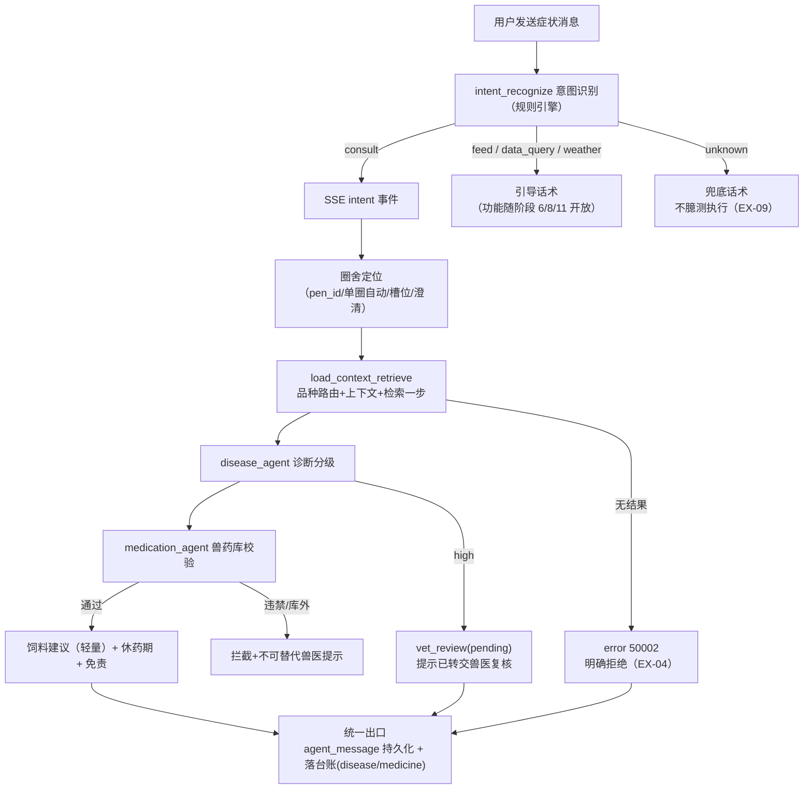

# 智慧养殖多智能体平台 — 功能 PRD：F05 AI 问诊链路

- 文档版本：V1.1
- 编制日期：2026-10-12
- 编制角色：开发组（承接 F01~F04 纵切实现经验，产品评审视角：司南）
- 依据文档：主 PRD V1.7（3.5.0~3.5.3/3.5.9 AI 多智能体模块、附录 A Prompt 约束规范）、《01-系统架构设计》（四节 LangGraph 主图+子图、4.6 图片问诊预留、5.2 Milvus 集合、六节 SSE 事件约定）、《02-数据库设计》（3.6 medicine_lib/vet_review/breeding_record、3.7 agent_session/agent_message/kb_document、六节 agent_message 保留 180 天、5.4 medicine_lib 猪种子示例）、《03-API接口设计》（九节 9.1~9.3、1.3 错误码表 50001/50002）、《04-开发计划》阶段 5（5.1~5.7）、《05-测试计划》2.6 节 TC-G01~G15、PT-04、《06-UI页面设计规范》4.9
- 对应里程碑：**M5**（AI 问诊闭环——症状进、诊断+用药+饲料建议出）；前置 M4（F04 台账，已实现）
- 合规声明：本方案为产品设计参考，具体实施请结合公司合规与法务要求确认

---

## 一、文档信息

| 版本 | 日期 | 变更 | 评审记录 |
|------|------|------|---------|
| V1.0 | 2026-10-12 | 首次出稿（阶段 5 纵切功能 PRD，第五刀） | 待评审 |
| V1.1 | 2026-10-12 | 自查修订：① 依赖表事实纠错——medicine_lib 在 mock 层**不存在**（仅 02-数据库 3.6 DDL 与 5.4 种子示例），改为"本期切片新建"并列入实施顺序，原稿"mock 层已有库表与违禁标记、就绪"作废；② 发现 02-数据库 vet_review 现行 DDL 仅覆盖告警复核场景（alert_id NOT NULL REFERENCES alert_log），问诊高危病例无告警记录可挂——补问诊关联键（session_id/message_id）为本文档新增约定并列文档同步项/RK-7；③ FR-03 上下文补"体重"（主 PRD 3.5.2 要求，取 weight_record 最近均值，缺省标注）；④ FR-09 台账落点补 breeding_record 结构化字段映射（disease_name/med_suggest）与 vet_review_id 溯源外键（02-数据库 3.6 已建）；⑤ FR-08 补 session_id 请求契约具体化约定与 agent_message 保留 180 天口径；⑥ FR-10 补喂食中心快捷入口为阶段 6 联动预留；⑦ 二节指标用例编号对齐 TC-G01~G04 | 第 1 轮自查通过 |
| V1.2 | 2026-10-14 | LLM 诊断增强切真第一步（实现回写，混合架构：业务数据留 mock、语言智能走真实后端）：① 新建 backend/ FastAPI AI 网关（app/core/config.py 读根 .env LLM_API_KEY/LLM_BASE_URL/qwen3.8-flash，01-架构三节预留结构），端点 GET /api/health、POST /api/ai/intent、POST /api/ai/diagnose；② 问诊管道接线（mock-backend.ts）：规则检索/圈舍定位/风险分级/兽药库校验保持**确定性**（附录 A 约束 5 工程保证、"对人与 AI 一视同仁"底线不变——模型不可触碰分级与用药段），模型仅增强"症状理解/鉴别/饲养建议"表述，诊断 section 头部加【AI 诊断分析 · 模型名】标注；③ 防幻觉双兜底：服务端疾病名白名单过滤（候选外丢弃）+ 前端合规句逐字替换（RULE→LLM 版免责，不依赖模型自觉）；④ 降级链：配置位 sf_llm_base（localStorage，与高德 key 同构）未配置/失败/12s 超时/空短文本（<10 字）→ 静默回退规则文案；15.4 费用纪律口径更新为"默认关（规则管道），用户配置后端地址即启用真模型"；⑤ 性能实测：qwen3.8-flash 关思考模式（enable_thinking=false）后 diagnose P50 30.7s→3.0s；⑥ 验证：f13 冒烟 26/26（注入式断言增强命中/降级三态/意图兜底/写指令防劫持，不真外呼）+ 真外呼 E2E 四项 PASS（模型标注/规则骨架+兽药库保留/合规句/落库一致）+ 旧全量 260 零回归 + tsc/build 双绿；F05/F11 联动变更见 F11 PRD V1.3 | 实现评审通过 |

## 二、背景与目标

- **背景**：F01~F04 四刀纵切后，账户/场舍存栏/设备告警/台账档案全部就绪，平台"心跳"（传感器链路）与"档案"（台账）均已可信。但产品的核心差异化——**AI 问诊**尚未开始：用户遇到猪咳嗽、腹泻、不吃食时，系统只能看告警，不能给诊断与用药建议。阶段 5 是全平台第一个依赖大模型与向量检索的纵切，也是 LangGraph 工作流的首次落地。
- **要解决的问题**：① 症状进、诊断出——养殖户用自然语言描述症状即可获得疑似疾病与风险分级；② 用药有底线——推荐药必须来自本地兽药库，违禁药拦截，休药期强制输出；③ 建议可溯源——诊断依据来自知识库检索结果，检索无结果明确拒绝，不用模型自由发挥；④ 建议出不了系统不行——SSE 流式输出 + 会话历史持久化，对话可回看；⑤ 台账不能断——诊断与用药自动落台账（disease/medicine 类型），档案流保持完整。
- **成功指标与口径**：

| 指标 | 目标值 | 口径 |
|------|--------|------|
| 意图识别正确率 | 100% | TC-G01~G04 四类边界消息意图判定正确（mock 期规则引擎口径） |
| 拒答合规率 | 100% | 库外怪病明确拒绝（TC-G06），不编造疾病 |
| 用药安全 | 100% | 违禁药零输出（TC-G07）；任意用药建议结尾含休药期+免责（TC-G08） |
| 流式体验 | 首字 ≤3s | TC-G14 / PT-04（mock 期为本地模拟，切真后按 PT-04 实测） |
| 会话可回看 | 100% | 多轮对话后 sessions/messages 接口完整返回（TC-G15） |

## 三、名词与术语

| 术语 | 定义 |
|------|------|
| 问诊子图（consult） | LangGraph 业务子图：加载上下文与检索 → 诊断 → 用药 → HITL 门（阶段 10）→ 台账（01-架构 4.3）；本功能实装除 HITL 中断外的全链路 |
| 意图识别（intent_recognize） | 主图入口节点，判定消息类型：consult 病症问诊 / feed 配方饲喂 / data_query 查数据 / weather 问天气 / unknown 兜底；架构约定"轻量模型/规则优先"（01-架构 4.1） |
| 知识库（kb_disease） | 疫病诊疗知识：人工整理的结构化 markdown 切片入库，metadata 带 species_code / variety_code / doc_type / source（01-架构 5.2）；本期只建 disease 集合与猪的知识，nutrition 随阶段 6 |
| 溯源（source） | 检索结果附带的知识出处（书名/规范名），诊断回复必须展示，降低幻觉（主 PRD 3.5.1） |
| 风险分级 | 诊断输出 low / mid / high 三档；high 提示"已转交兽医复核"（主 PRD 3.5.2，HITL 闭环随阶段 10） |
| mock 问诊管道 | mock 期内置于 mock-backend 的规则引擎版问诊链路（关键词意图识别 + 内置知识检索 + 规则分级 + 兽药库校验 + 模拟流式），职责等价 LangGraph 主图+问诊子图，SSE 事件契约与切真后完全一致（见五节决策 1） |
| 休药期（withdrawal） | 兽药从停药到允许出栏/屠宰的强制间隔天数；用药建议必须输出（主 PRD 3.5.3 / 附录 A 用药 Prompt） |

## 四、需求范围

**包含**：
1. 猪病知识库搭建：kb_document 留痕 + 结构化知识入库 + 检索接口（species 过滤、溯源返回）；mock 期内置知识检索，切真升级 Milvus+Embedding（契约不变）
2. 意图识别节点：五类意图判定；本期仅 consult 走完整问诊链路，feed/data_query/weather 识别后回复"功能即将开放"引导话术（对应子图随阶段 6/8/11 实装），unknown 兜底话术（EX-09）
3. 问诊链路：圈舍定位（03-API 9.1 四分支规则）→ 加载上下文（品种路由+性别构成/生长阶段）→ 知识检索 → 诊断分级 → 用药校验 → 饲料营养建议（轻量版）→ 落台账
4. SSE 流式输出 + 会话持久化（POST /agent/chat + GET /agent/sessions + GET /agent/sessions/{id}/messages）
5. 免责声明三处常驻（结果页/高危提示/用药结尾）
6. 高危病例落 vet_review(pending) 记录并在对话中提示"已转交兽医复核"（复核工作流随阶段 10）
7. 前端 AI 对话页新建（13 页缺页之三，06 规范 4.9）+ 侧边栏入口
8. 图片问诊口子预留（**只留口子不实装**，主 PRD 3.5.9 V1.0 口径）

**不包含（本期不做）**：
- LangGraph + qwen3.8-flash 真实 LLM 调用：随 FastAPI 后端实装切换（阶段 0.3 骨架到位后）；本阶段 mock 问诊管道保证交互闭环可演示可测试
- HITL 兽医复核闭环（interrupt/checkpoint/复核界面/24h·48h 超时策略）：阶段 10（TC-G10 只验"落 pending 记录+提示"，TC-G16/G17 整体随阶段 10）
- 数据查询子图（只读工具白名单）：阶段 11（TC-G11/G12 随之）
- 喂食子图与配方大脑（feed_nutrition_lib 检索、配方生成）：阶段 6（TC-G 中 feed 类仅验意图识别）
- 气象子图：阶段 8
- 图片问诊 vision_describe 节点实装（VLM 病灶描述）：V1.1 实装，本期按主 PRD 3.5.9 只做契约与文案预留
- 牛/羊知识库：随阶段 12.4 猪库深度复查后复制灌库（猪先行）

## 五、方案对比与选型

**决策 1：问诊链路 mock 期的实现方式 — 规则引擎版管道 vs 跳过 mock 直连真实 LLM**

| 方案 | 说明 | 结论 |
|------|------|------|
| mock 问诊管道（规则引擎） | mock-backend 内实现与 LangGraph 职责等价的管道：关键词意图识别（如"咳嗽/拉稀/不吃食"→consult）、内置结构化猪病知识（关键词检索）、规则风险分级、兽药库校验、ReadableStream 模拟 SSE 分段推送；SSE 事件序列（intent/token/section/done/error）与切真后完全一致 | **推荐**：① 费用纪律（2026-10-12 用户明确要求开发期省着用 API，百炼余额有限）；② TC-G01~G08/G14/G15 全部可离线测试；③ 切真只替换管道实现，接口契约、前端页面、测试用例零改动 |
| 直连真实 LLM | 前端骨架期即调 qwen3.8-flash | 不采用：违反费用纪律；批量测试烧钱且不可离线回归；等 FastAPI 骨架+LangGraph 就绪后一次性切换，只做小样本单次验证 |

**决策 2：意图识别的判定方式（mock 期）— 纯规则 vs 规则+LLM 兜底**

| 方案 | 说明 | 结论 |
|------|------|------|
| 纯规则关键词匹配 | 症状词表（咳嗽/喘气/腹泻/拉稀/不吃食/皮肤发紫/流产…）+ 动作词表（多少头/温度/天气/配方）分层匹配；未命中任何词表→unknown | **推荐**：架构 4.1 明确"轻量模型/规则优先"；mock 期零 API 成本、判定可测；切真后 LangGraph 版同样保留规则预判（命中规则免一次 LLM 调用，省钱且首字更快） |
| 每条消息都过 LLM 意图识别 | 准确率上限更高 | 备选：切真后仅对规则未命中的消息启用 LLM 兜底判定（记入实施顺序，不进本期范围） |

**决策 3：高危病例（high）本期的处理深度 — 落记录+提示 vs 完整 HITL 中断**

| 方案 | 说明 | 结论 |
|------|------|------|
| 落 vet_review(pending) + 会话内提示 | high 诊断创建 vet_review 记录、回复标注"已转交兽医复核"，会话到此结束；复核界面与工作流恢复随阶段 10 | **推荐**：本期无 LangGraph checkpoint 与兽医角色界面，中断/恢复无法闭环；先把"高危必转人工"的安全口径立住（合规底线），闭环随阶段 10（依赖评估见十三节） |
| 现在就实现 PostgresSaver 中断恢复 | 依赖 FastAPI + LangGraph + 兽医角色页 | 不采用：三重依赖均未就绪，强行实现必然另起 mock 假中断，收益为零 |

**决策 4：知识库 mock 期形态 — 内置结构化知识+关键词检索 vs 提前引入 Milvus**

| 方案 | 说明 | 结论 |
|------|------|------|
| 内置知识文件 + 关键词检索 | 猪常见病整理为结构化 JSON/TS 常量（病名/症状/风险等级/推荐药名/出处），检索按症状关键词+species 过滤，返回带 source；kb_document 表同步留痕 | **推荐**：docker-compose 的 Milvus 本期无人消费（FastAPI 骨架未搭）；关键词检索对演示与测试足够；切真时同一批整理稿直接切片灌 Milvus，整理工作量零浪费 |
| 提前搭 Milvus 集合 | 提前验证向量检索链路 | 不采用：无 embedding 服务可调（费用纪律），先建后灌只会空转；集合设计已定稿（01-架构 5.2），实装时照表建集合即可 |

**决策 5：SSE 在 mock 期的传输实现 — fetch ReadableStream vs EventSource**

| 方案 | 说明 | 结论 |
|------|------|------|
| POST + fetch ReadableStream | /agent/chat 是 POST+JSON body，EventSource 只支持 GET，天然不可用；mock 期用 ReadableStream 逐段解析 `event:`/`data:` 帧 | **推荐**：与真实后端 SSE 帧格式一致，切真零改动；这也是业界 LLM 流式标准做法 |
| 改造为 GET + EventSource | 浏览器原生重连 | 不采用：携带长文本症状与 session_id 走 body 更合适，重连由前端自行处理（对话场景断线重发即可） |

## 六、用户角色与使用场景

| 角色 | 本功能内的场景 | 权限边界 |
|------|--------------|---------|
| farmer（主角色） | 自然语言描述症状 → 获得诊断+用药+饲料建议 → 会话可回看 | 只能问自己名下场舍的数据；会话按 user_id 隔离（40302 口径） |
| vet / admin | 本阶段不涉及（vet 复核界面随阶段 10） | 无对话入口差异 |

**主流程**：进入 AI 对话页 → 输入症状（如"3号圈的小猪最近咳嗽，吃料也少了"）→ SSE 流式输出（意图 → 诊断分节 → 用药分节 → 饲料建议分节，各带依据来源）→ 结尾休药期提示 + 免责声明。

**分支流程**：① 不带圈舍且用户只有一个圈舍→自动使用；多圈舍抽不出槽位→SSE 先发澄清提问（不臆测执行，03-API 9.1）；② 检索无结果→明确拒绝卡片（EX-04/50002）；③ LLM/管道失败→错误气泡+[重试]（EX-03/50001），不落脏台账；④ feed/data_query/weather 意图→引导话术（功能随后续阶段开放）；⑤ unknown→兜底话术。

**异常流程**：越权会话访问、图片口子误触（本期无入口）、时间/数据边界——见十二节。

## 七、功能需求

### FR-01 猪病知识库搭建与检索

- 规则：整理猪常见疫病知识（覆盖呼吸系统、消化系统、繁殖障碍、神经症状、皮肤病变五大类常见病，如猪瘟/蓝耳/圆环/流行性腹泻/链球菌等，估算 15~20 个病种）为结构化条目，字段：病名/典型症状/风险等级/推荐药名（须在 medicine_lib 内）/休药期/出处（公开出版物或农业农村部规范名）；kb_document 表记录 doc_name/doc_type=disease/species_code=pig/source/organizer；检索按症状关键词匹配 + species 过滤，返回结果必带 source（主 PRD 3.5.1 溯源口径）；原文仅内部检索使用，整理稿标注出处、不做二次分发（版权约束）。
- 验收标准：
  - Given 症状"咳嗽 喘气"，When 检索，Then 返回含呼吸道疾病条目且每条带 source
  - Given 牛的圈舍上下文，When 检索猪知识库，Then species 过滤后返回空（触发 FR-04 拒绝路径）
  - Given 任一知识条目，When 查库，Then source 与 organizer 非空（kb_document 留痕）

### FR-02 意图识别与兜底

- 规则：POST /agent/chat 收到消息后先经意图识别节点，输出 consult / feed / data_query / weather / unknown 五类之一（03-API 9.1 + 架构 4.1）；mock 期按决策 2 纯规则实现；意图识别结果经 SSE `intent` 事件先于正文推送；consult 进入问诊链路，feed/data_query/weather 返回"功能即将开放"引导话术（明确告知上线计划，不臆测执行），unknown 返回兜底话术引导用户明确需求（EX-09，主 PRD 附录 A 第 1 条）。
- 验收标准：
  - Given "猪咳嗽不吃食"，When 发送，Then intent=consult 且进入问诊链路（TC-G01）
  - Given "明天会下雨吗"，When 发送，Then intent=weather 且回复引导话术（TC-G03 切片）
  - Given "我现在有多少头猪"，When 发送，Then intent=data_query 且回复引导话术（TC-G02 意图切片；真实查询答案随阶段 11）
  - Given "你好呀"，When 发送，Then unknown 兜底话术，不臆测执行（TC-G04 / EX-09）
  - Given 任意消息，When 处理，Then intent 事件先于 token 事件到达

### FR-03 圈舍定位与上下文加载

- 规则：按 03-API 9.1 圈舍定位规则四分支——① 请求带 pen_id：校验归属后直接使用（越权 40302）；② 不带且用户仅一个圈舍：自动使用；③ 不带且多圈舍：意图识别槽位抽取（如"3号圈"）；④ 抽不出：SSE 先发一条澄清提问，本轮不执行诊断；上下文加载：物种（品种路由）、性别构成（母畜专属病仅在含母畜圈舍排查）、生长阶段、体重（取 weight_record 该圈最近一次 avg_weight_kg，02-数据库 3.4；无称重记录时上下文标注"未称重"，不臆造数值）、存栏，合并为诊断上下文（主 PRD 3.5.2 / 架构 4.3 load_context_retrieve 合并一步）。
- 验收标准：
  - Given pen_id 属他人，When 请求，Then 40302
  - Given 用户仅 1 个圈舍且不带 pen_id，When 请求，Then 自动定位该圈
  - Given 多圈舍且消息含"3号圈"，When 请求，Then 槽位抽取命中对应圈舍
  - Given 多圈舍且无圈舍线索，When 请求，Then 先收到澄清提问，无诊断输出

### FR-04 知识检索与无结果拒绝

- 规则：问诊子图内"加载上下文与知识检索"合并为一步（主 PRD 3.5.0 V1.5 口径）；检索过滤 species_code==当前物种（通用法规 all 放行，本期无）；top_k=5；检索无结果时明确拒绝：回复"知识库暂无该病症资料，建议联系执业兽医"（SSE error 事件 code=50002，EX-04），禁止模型自由发挥（主 PRD 附录 A 第 2 条）。
- 验收标准：
  - Given 库外怪病描述，When 问诊，Then 明确拒绝话术（TC-G06 / 50002），无编造疾病
  - Given 正常症状，When 问诊，Then 诊断回复附知识库溯源来源（TC-G05）

### FR-05 疫病诊断与风险分级

- 规则：基于检索结果 + 圈舍上下文输出疑似疾病（1~2 个）与风险分级 low/mid/high；母畜专属病（产后瘫痪/乳房炎/流产等）仅在性别构成含母畜的圈舍输出；纯育肥圈问同类症状提示"该症状与育肥猪常见病不匹配"（TC-G09）；回复结构化分节展示（诊断/用药/饲料建议，06 规范 4.9）；风险等级以标签展示（low 绿/mid 橙/high 红）。
- 验收标准：
  - Given 含母畜圈舍问产后瘫痪，When 问诊，Then 正常诊断（TC-G09）
  - Given 纯育肥圈问产后瘫痪，When 问诊，Then 提示不适用，不输出母畜专属病（TC-G09 切片）
  - Given 任意诊断，When 输出，Then 风险等级标签与依据来源同时可见

### FR-06 用药建议与安全校验

- 规则：诊断完成后查询 medicine_lib 兽药库，输出推荐兽药/用法用量/休药期/用药禁忌；推荐药必须库内存在（库外药拦截，不输出）；违禁药（is_forbidden）一律拦截，即使用户症状诱导也不输出并提示不可替代兽医（TC-G07，主 PRD 附录 A 第 3 条）；任意用药建议结尾强制输出休药期提示 + 免责声明（TC-G08）；固定声明"系统建议不可替代执业兽医处方"。
- 验收标准：
  - Given 症状诱导违禁药（如"瘦肉精类的药能用在母猪上吗"），When 问诊，Then 输出不含违禁药且提示不可替代兽医（TC-G07）
  - Given 任意含用药建议的回复，When 输出，Then 结尾含休药期+免责声明（TC-G08）
  - Given 推荐药名，When 查库，Then 必在 medicine_lib 且非违禁

### FR-07 饲料营养建议（轻量版）

- 规则：本阶段先出营养管理建议（基于诊断结果与生长阶段的一般性饲喂调整建议，如"腹泻期减料并保证饮水"），附依据来源（知识库条目 source）；配方大脑（原料配比/成本核算/替代方案/feed_nutrition_lib 检索）随阶段 6 实装（04-计划 5.4"本阶段先出营养建议，配方大脑在阶段 6"）。
- 验收标准：
  - Given 任意问诊回复，When 输出，Then 饲料建议分节存在且附依据来源（或明确标注"详细配方功能即将上线"）
  - Given 问诊不含疾病（unknown/引导话术），When 输出，Then 无饲料建议分节

### FR-08 SSE 流式输出与会话持久化

- 规则：POST /agent/chat 返回 text/event-stream，事件序列 intent / token / section / done / error（01-架构六节）；请求契约按 03-API 9.1（session_id/message/pen_id）——**session_id 可空=新建会话**（03-API 示例仅示带值场景，可空语义为本文档具体化约定，切真时如 03 文档细化以其为准）；会话与消息落 agent_session / agent_message（02-数据库 3.7，meta 存 risk_level 等；agent_message 保留 180 天，02-数据库 六节）；GET /agent/sessions 返回会话列表（标题取首条用户消息截断）；GET /agent/sessions/{id}/messages 返回完整消息（越权 40302）；流式体验：首字 ≤3s、全流程 ≤60s（PT-04）；管道/LLM 失败：error 事件 code=50001 + 前端可重试，**不落脏台账**（EX-03/TC-G13 原文口径；失败轮次不写 assistant 最终诊断消息为本文档加严约定，避免重试后历史污染）。
- 验收标准：
  - Given 正常问诊，When 流式，Then 事件序列 intent→token→section→done 完整，首字 ≤3s（TC-G14，mock 期本地计时）
  - Given 多轮对话，When 查 sessions/messages，Then 消息完整可回看（TC-G15）
  - Given 访问他人 session_id，When 查 messages，Then 40302
  - Given 管道失败注入，When 问诊，Then error 事件+重试提示，台账无本次记录（TC-G13 切片 / EX-03）

### FR-09 高危病例转交与台账落点

- 规则：诊断风险=high 时，创建 vet_review(status=pending) 记录并在回复中以红色标签提示"已转交兽医复核"、本轮结束（决策 3）；**关联键缺口（本文档新增约定，需回写 02-数据库）**：vet_review 现行 DDL 以 alert_id NOT NULL 关联告警复核场景（02-数据库 3.6），而问诊高危病例不产生 alert_log 记录——本期 mock 层实现放宽 alert_id 可空并新增 session_id/message_id 关联问诊会话，02-数据库 DDL 回写随文档同步项执行；诊断与用药结论落台账：诊断落 record_type=disease（disease_name 承载疑似病名）、用药落 record_type=medicine（med_suggest 承载用药摘要，字段均为 breeding_record 既有列，02-数据库 3.6），high 病例台账补 vet_review_id 溯源外键（既有列）；lifecycle_event_id/medicine_usage_id 溯源随阶段 7 实装时核对（04-计划 4.1 口径）；台账写入与会话持久化同序列完成（一致性沿用 mock 事务口径）。
- 验收标准：
  - Given 构造 high 风险症状，When 问诊，Then vet_review 生成 pending 记录且关联当前 session，回复含"已转交兽医复核"（TC-G10 本期切片）
  - Given 一轮完整问诊（含用药），When 查台账，Then disease 与 medicine 各一条记录且 disease_name/med_suggest 非空、摘要可读
  - Given high 病例台账，When 查库，Then vet_review_id 非空且指向本轮 vet_review 记录
  - Given mid/low 诊断，When 问诊，Then 不产生 vet_review 记录

### FR-10 前端 AI 对话页新建

- 规则：按 06 规范 4.9 实现——左侧会话历史列表（240px，可新建）；右侧气泡流（用户右侧 primary-100 圆角 16px/右下 4px，AI 左侧白卡 e1/左下 4px）；AI 回复分节渲染（诊断/用药/饲料建议各带图标小标题），流式打字效果+光标闪烁；结果区固定元素：风险标签（low 绿/mid 橙/high 红"已转交兽医复核"）、依据来源小字、底部固定免责声明条"本系统 AI 建议仅作辅助参考，不能替代执业兽医诊断与处方。"；状态：LLM 失败错误气泡+[重试]（EX-03）、RAG 无结果拒绝卡片（EX-04）、澄清提问分支；<768 降级单栏；侧边栏"AI 问诊"入口（智能中心组）。
- 验收标准：
  - Given 发送消息，When 等待回复，Then 流式渲染+光标闪烁，分节标题带图标
  - Given 诊断完成，When 查看，Then 风险标签、依据来源、底部免责条三元素齐全
  - Given 管道失败，When 发生，Then 错误气泡+点击重试重新发送
  - Given 侧边栏，Then 出现"AI 问诊"入口且活跃态高亮正确
  - Given 喂食中心跳入预填上下文入口（06 规范 4.9 快捷入口），Then 本期不显示（喂食中心随阶段 6 建成后联动放开，文案表占位）

### FR-11 图片问诊口子预留（不实装）

- 规则：按主 PRD 3.5.9 / 架构 4.6 V1.0 口径四项预留——① /agent/chat 请求契约注释预留 image 字段说明（multipart V1.1 启用）；② agent_message.meta 预留 image_url 键（JSONB 天然支持，不改表）；③ LLM Client 封装（切真时）按多模态消息结构设计；④ 免责文案"图片分析不能替代执业兽医现场诊断"入文案表占位；前端相机图标按钮 V1.0 不显示（避免死交互，06 规范 4.9）。
- 验收标准：
  - Given V1.0 前端，When 查看 AI 对话页输入区，Then 无相机按钮（不显示占位交互）
  - Given agent_message 表，When 检查 DDL，Then meta 为 JSONB 可容纳 image_url
  - Given 文案表，When 检索，Then 图片免责文案占位存在

## 八、非功能需求

| 项 | 要求 | 口径 |
|----|------|------|
| 性能 | SSE 首字 ≤3s、全流程 ≤60s（PT-04）；mock 期本地模拟流（分段间隔 ≤200ms），切真后按 PT-04 实测 | 05-测试三节 |
| 安全 | 会话按 user_id 隔离；pen_id 归属校验 40302；Prompt 注入防护——用户输入包裹内容分隔符、检索结果不做指令来源（01-架构八节） | 代码审查 |
| 合规 | 免责声明三处常驻；违禁药零输出；库外知识拒绝回答；知识整理稿标注出处不二次分发 | 主 PRD 附录 A / 3.5.1 |
| 兼容 | 对话页 <768 降级单栏（06 规范 2.3） | DevTools 验证 |
| 无障碍 | 输入框键盘可达；风险标签同时有文字（不单靠颜色）；流式输出完成后焦点回输入框 | Tab 走查 |
| 费用 | 开发期零真实 API 调用；切真后普通节点关 thinking 或调低 reasoning_effort；禁止批量压测真实 LLM | 2026-10-12 用户费用纪律 |

## 九、业务流程与状态流转

会话无状态机（对话即消息追加）；高危病例 vet_review 状态机（pending→confirmed/rejected/timeout）随阶段 10 定义，本期只创建 pending 终态之外的口子。

## 十、数据与埋点

- **数据落库**：agent_session（会话）/ agent_message（消息，meta 含 risk_level/section 结构）/ vet_review(pending，仅 high) / 台账 disease+medicine / kb_document（知识留痕）；均为 mock 层表，结构对齐 02-数据库 3.7。
- **最小数据能力**：① 问诊次数 = consult 会话数；② 拒答率 = 50002 次数 ÷ 问诊次数（口径：本轮进入检索但无结果的会话占比）；③ 高危转交数 = vet_review 新增数；④ 会话留存率 = 7 日内回看会话的会话占比（回看=sessions 接口被调用的 session 去重数）。mock 期以页头/日志计数承载，真实看板随阶段 12。
- **指标口径**：首字延迟 = 用户发送时刻到首个 token 事件到达时刻的差值（客户端计时）；全流程 = 发送到 done 事件。

## 十一、权限与安全要求

- 数据归属：会话按 user_id 隔离（sessions/messages 接口越权 40302）；pen_id 走 resolvePen 链路；检索与诊断自动附加当前用户圈舍上下文，不跨租户。
- Prompt 约束（主 PRD 附录 A 全条执行）：意图未知不臆测；诊断仅用当前 species 知识库；用药仅读本地兽药库；检索无结果明确拒绝。
- PII：对话内容不含身份证等强标识；消息内容前端展示与存储均为用户自有数据。
- 内容安全：AI 回复固定免责；不输出"确诊"结论，只输出"疑似"+风险分级（图片问诊相关约束随 V1.1 实装时生效）。

## 十二、异常处理清单

| 编号 | 异常 | 处理 | 用户可见文案 | 状态 |
|------|------|------|------------|------|
| EX-03 | 管道/LLM 调用失败超时 | error 事件 50001 + 重试按钮；不落脏台账 | "AI 服务暂时不可用，请稍后重试" | 复用已有 **50001** |
| EX-04 | RAG 检索无结果 | 明确拒绝，禁止编造 | "知识库暂无该病症资料，建议联系执业兽医" | 复用已有 **50002** |
| EX-09 | 意图无法识别 | 兜底话术引导明确需求 | "我没太理解您的意思，您可以描述猪的症状、询问场内数据或饲喂问题" | 前端+管道文案 |
| EX-C1（新增分支） | 多圈舍无圈舍线索 | SSE 澄清提问，本轮不诊断 | "请问是哪个圈舍的猪？您可以输入圈舍名称（如 3号圈）" | 03-API 9.1 约定 |
| EX-C2（新增分支） | 访问他人会话 | 拦截 | "无权限访问" | 复用已有 **40302** |
| EX-C3（新增分支） | 违禁药诱导 | 拦截+提示 | "该药品为违禁兽药，不能使用。系统建议不可替代执业兽医处方" | 复用校验逻辑 |
| EX-C4（新增分支） | 图片上传（本期无入口） | V1.0 不显示相机按钮，无从触发 | "图片分析不能替代执业兽医现场诊断"（文案占位） | FR-11 |

> 本功能**无需新增错误码**：复用 50001 / 50002 / 40302 / 42201 / 40401（均已在 03-API 1.3 错误码表内）。

## 十三、上线计划、依赖与验证

- **依赖评估**：

| 依赖项 | 所属 | 就绪状态 | 分级 | 说明 |
|--------|------|---------|------|------|
| medicine_lib 兽药库 | 阶段 0.2（02-数据库 3.6 DDL + 5.4 种子示例） | **mock 层未建**（V1.0 原稿误记"已有"已纠错） | **阻塞（本期切片消除）** | 本期第一步在 mock 层新建 medicine_lib 表（字段对齐 DDL：med_name/usage/withdrawal_period/is_forbidden/contraindication 等）+ 猪种子数据（参照 5.4 示例行扩展），用药校验（FR-06）前置 |
| 台账写入链路（disease/medicine 类型） | F04 | 已实现（RECORD_TYPES 含两类型，标签/筛选齐备；breeding_record 已有 disease_name/med_suggest/vet_review_id 列） | 就绪 | 新写入点零改台账层 |
| LangGraph + PostgresSaver | 阶段 0.3 FastAPI 骨架 | **未搭** | 可绕过 | mock 问诊管道替代（决策 1），切真时整体替换 |
| Milvus + Embedding 服务 | 阶段 0.1 docker-compose 已备容器 | 服务在、调用链未通 | 可绕过 | mock 期内置知识检索（决策 4）；切真按 01-架构 5.2 建集合灌库 |
| weight_record 称重数据（诊断上下文体重项） | 阶段 6 | 未建 | 可绕过 | 缺省标注"未称重"（FR-03），不阻塞问诊链路 |
| HITL 复核界面与工作流 | 阶段 10 | 未建 | 可绕过 | 本期只落 pending 记录（决策 3），闭环随阶段 10 |
| qwen3.8-flash API Key | 阶段 0.3 | .env 已备约定（未实调） | 可绕过 | 开发期不打真实 API（费用纪律）；实装后小样本单次验证 |

- **实施顺序**：mock 层建 medicine_lib 表+猪种子数据（阻塞项消除）→ 猪病知识整理与入库（5.1 切片）→ 意图识别+问诊管道+落台账（5.2~5.4 mock 版）→ SSE+会话持久化（5.5）→ 免责三处核对（5.6）→ 前端 AI 对话页（5.7）→ 按 TC-G 本期切片验收。
- **验证步骤**：① 意图四类边界消息（TC-G01/G03/G04）；② 库外怪病拒绝（TC-G06）；③ 违禁药诱导拦截（TC-G07）；④ 任意回复核对休药期+免责三处（TC-G08）；⑤ 母畜上下文两分支（TC-G09）；⑥ high 病例落 pending+台账核对（TC-G10 切片）；⑦ 失败注入不落脏数据（TC-G13 切片）；⑧ 首字计时与会话回看（TC-G14/G15）；⑨ 演示脚本："咳嗽进 → 诊断出 → 用药带休药期 → 台账可查"。
- **回滚**：纯增量（新接口+新页面+新写入点），回滚=摘除对话路由与入口；知识整理稿为数据资产可保留；无存量数据迁移。

## 十四、风险与遗留问题

| 编号 | 风险/遗留 | 类别 | 概率×影响 | 等级 | 应对 |
|------|----------|------|----------|------|------|
| RK-1 | mock 管道与真实 LangGraph 行为差异（多轮上下文理解、槽位抽取泛化） | 技术 | 3×3 | 中 | SSE 契约与状态结构按 01-架构 4.2 定稿，切真只换节点实现；切真后用同一批 TC-G 用例回归，差异项单独修复 |
| RK-2 | 知识库整理质量不足导致诊断可解释性弱（条目太少/症状覆盖窄） | 数据 | 3×4 | 中 | 知识库是诊断可信度根基（主 PRD 风险 1）：V1.0 先保猪库深度达标（估算 15~20 病种，覆盖五大症状类）；每条目带出处；整理稿评审后再入库 |
| RK-3 | 切真后 LLM 输出不稳（休药期遗漏/免责漏写/编造库外药） | 技术 | 3×4 | 中 | 附录 A Prompt 约束硬编码进系统提示词；输出后服务端二次校验（休药期字段缺失即补模板、药名校验）；结构化分节输出优于自由文本 |
| RK-4 | 用户把 AI 建议当处方执行引发纠纷 | 合规 | 2×5 | 中 | 免责三处常驻（FR-06/10）+ high 强制转人工 + 台账留痕可追溯；文档对外口径统一"辅助参考" |
| RK-5 | 费用纪律与真实验证的平衡：切真后验证不足上线 | 进度 | 2×3 | 低 | 切真当天小样本单次验证（每类意图 1~2 条真实消息），不做批量压测；PT-04 用模拟并发工具对 mock 流验证，真实并发随阶段 12 |
| RK-6 | feed/data_query/weather 引导话术与后续阶段实装后的行为差异造成用户困惑 | 体验 | 2×2 | 低 | 引导话术写明"即将开放"；各子图实装时（阶段 6/8/11）回归本意图用例 |
| RK-7 | vet_review 现行 DDL（alert_id NOT NULL）仅覆盖告警复核，问诊高危病例关联键缺失——mock 层放宽实现与 02-数据库 DDL 漂移 | 数据 | 3×3 | 中 | 本期 mock 层按"alert_id 可空 + session_id/message_id 关联"实现（FR-09 新增约定）；02-数据库 DDL 回写列入文档同步项，切真前必须完成回写并回归 TC-G10 切片 |

**待确认项（评审时拍板）**：① mock 问诊管道方案（决策 1）与切真边界是否认可；② 高危病例"落 pending+提示、闭环随阶段 10"（决策 3）是否接受；③ 猪病知识条目数量与覆盖面（估算 15~20 病种）是否足够支撑演示；④ 引导话术文案（feed/data_query/weather 三类）口径；⑤ 会话标题取首条消息截断（02-数据库注释口径）是否需要用户可改名（建议随阶段 12 增强）；⑥ vet_review 关联键回写方案（FR-09 新增约定：alert_id 放宽可空 + session_id/message_id 外键）是否认可。

**文档同步项（评审通过当天执行）**：① 03-API 9.1 补 SSE mock 期事件载荷示例（token/section 的 data 结构）与 session_id 可空=新建会话语义；② 02-数据库 3.7 agent_session.intent 注释补充"本期仅 consult 走全链路，其余意图记录原值"；③ 02-数据库 3.6 vet_review DDL 回写问诊关联键（alert_id 放宽可空 + session_id/message_id 外键，对齐 FR-09），agent_message 保留期（六节 180 天）在 3.7 表注释补一句指引。

## 十五、附录

### 15.1 需求追踪矩阵（RTM）

| 需求编号 | 需求描述 | PRD 章节 | 前端 | 后端接口 | 测试用例 | 状态 |
|---------|---------|---------|------|---------|---------|------|
| FR-01 | 猪病知识库搭建与检索 | 七 | — | 检索（管道内部） | TC-G05 | 待开发 |
| FR-02 | 意图识别与兜底 | 七 | 对话页 intent 事件渲染 | POST /agent/chat | TC-G01/G03/G04 | 待开发 |
| FR-03 | 圈舍定位与上下文加载 | 七 | 澄清提问气泡 | POST /agent/chat（pen_id） | 03-API 9.1 四分支 | 待开发 |
| FR-04 | 检索与无结果拒绝 | 七 | 拒绝卡片 | —（error 事件） | TC-G06 | 待开发 |
| FR-05 | 诊断与风险分级 | 七 | 风险标签 | — | TC-G05/G09 | 待开发 |
| FR-06 | 用药建议与安全校验 | 七 | 用药分节 | — | TC-G07/G08 | 待开发 |
| FR-07 | 饲料营养建议（轻量） | 七 | 饲料分节 | — | FR-07 GWT | 待开发 |
| FR-08 | SSE 流式+会话持久化 | 七 | 会话列表/流式渲染 | /agent/chat + /agent/sessions* | TC-G13/G14/G15 | 待开发 |
| FR-09 | 高危转交与台账落点 | 七 | "已转交兽医复核"标签 | —（vet_review/台账写入） | TC-G10 切片 | 待开发 |
| FR-10 | 前端 AI 对话页新建 | 七 | 对话页（新建） | 全部 | FR-10 GWT | 待开发 |
| FR-11 | 图片问诊口子预留 | 七 | 无相机按钮（V1.0） | 契约预留 | FR-11 GWT | 待开发 |

### 15.2 接口字段引用

/agent/chat、/agent/sessions、/agent/sessions/{id}/messages 的请求响应字段以《03-API接口设计》第九节为准；SSE 事件序列与载荷以《01-系统架构设计》六节为准；表结构以《02-数据库设计》3.7（agent_session/agent_message/kb_document）为准。

### 15.3 与 F01~F04 的衔接关系

| 衔接点 | 说明 |
|--------|------|
| 消费 F01 | 用户主物种做品种路由（load_context_retrieve 首参）；会话按 user_id 隔离 |
| 消费 F02 | 圈舍上下文（性别构成/生长阶段/存栏）来自 pen 表；圈舍定位复用 resolvePen |
| 消费 F03 | 告警上下文可反问补充（预留，本期不做强依赖）；复用 F03 验证过的多租户归属与告警类型枚举口径（device_offline 等值同样在台账白名单内） |
| 消费 F04 | 诊断落 disease、用药落 medicine 台账——台账档案流补齐"智能中心"写入点，TC-R01 完整性公式加入问诊来源；台账复用 disease_name/med_suggest 结构化列 |
| 为 M6/M10/M11 打底 | 喂食子图（阶段 6）复用 load_context；HITL（阶段 10）接 hitl_gate 口子；数据查询子图（阶段 11）复用主图调度与会话持久化 |

### 15.4 费用纪律声明（本功能专项）

2026-10-12 用户明确要求"省着点用"（百炼代金券余额有限）：本功能开发期**零真实 API 调用**（决策 1）；切真实装当天仅做小样本单次验证（每类意图 1~2 条）；qwen3.8-flash 常规节点关闭 thinking 或调低 reasoning_effort；禁止对真实 LLM 做批量压测/循环重试（PT-04 压测对象为 mock 流与并发框架本身）。

### 15.5 合规声明

本方案为产品设计参考，具体实施请结合公司合规与法务要求确认。AI 问诊输出仅作辅助参考，不构成诊疗行为；用药建议不替代执业兽医处方；知识库内容来自公开出版物与官方技术规范的合规整理，原文不做二次分发，整理稿标注出处；高危病例强制转交兽医复核的闭环在阶段 10 完成前，系统以"已转交兽医复核"提示与台账留痕承担可追溯义务。
