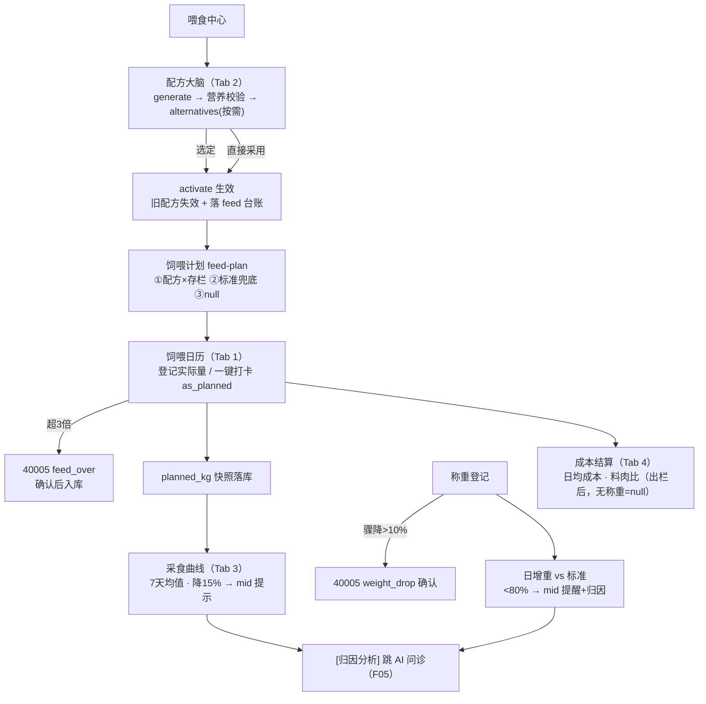

# 智慧养殖多智能体平台 — 功能 PRD：F06 喂食中心（配方大脑三大支柱）

- 文档版本：V1.0
- 编制日期：2026-10-12
- 编制角色：开发组（承接 F01~F05 纵切实现经验，产品评审视角：司南）
- 依据文档：主 PRD V1.7（3.1.5 喂食中心四大支柱、3.1.3 存栏、附录 B 存栏规则、附录 D 三物种参数表）、《01-系统架构设计》（4.1/4.3 feed 子图节点序列、API 直调不走路意图识别）、《02-数据库设计》（3.2 feeding_record 计划快照、3.4 feed_formula/feed_price/weight_record、3.6 feed_nutrition_lib、四节字段口径 457/458、5.2 variety.feed_param 种子、5.3 价格种子）、《03-API接口设计》（六节 6.1~6.9、1.3 错误码 40004/40005）、《04-开发计划》阶段 6（6.1~6.6）、《05-测试计划》2.4 节 TC-F01~F13、《06-UI页面设计规范》4.6、《08-遗留问题》C-02
- 对应里程碑：**M6**（喂食闭环——配方→执行→曲线→异常归因）；前置 M5（F05 问诊，已实现）
- 合规声明：本方案为产品设计参考，具体实施请结合公司合规与法务要求确认

---

## 一、文档信息

| 版本 | 日期 | 变更 | 评审记录 |
|------|------|------|---------|
| V1.0 | 2026-10-12 | 首次出稿（阶段 6 纵切功能 PRD，第六刀；数字大屏经用户 2026-10-12 明确排到最后，不占用本编号） | 待评审 |
| V1.1 | 2026-10-12 | 自查修订：① FR-02 与 FR-04 落库口径矛盾消解——统一为"generate 即落库候选态（is_active=false），activate 置真"两段式（原 FR-02"不落库"措辞作废）；② FR-08 日增重示例改用 03-API 6.8 原文数据（52.0→61.0 间隔 15 天 = 0.6000），消除原稿自造"间隔 15 天=0.7000"与依据文档数字混淆的风险；③ vs_standard.level 枚举（normal/low）标注为本文档具体化约定（03-API 6.7 仅示 normal），"持续低于 80%"具体化为连续 2 次称重 ratio<0.8 触发 mid 提醒；④ FR-07 补 pen_id 具体化约定（03-API 6.2 请求示例未含，按圈批量登记必须逐圈指定）→ 列文档同步项；⑤ FR-03 补 alternatives 请求契约具体化约定（03-API 6.4 仅示例响应）→ 列文档同步项；⑥ FR-10 出栏数据来源落地：料肉比正向验收依赖出栏登记（阶段 7），本期 mock 层建最小出栏记录切片验收（原稿"mock 造出栏数据"未落来源）；⑦ 依赖表 F05 衔接行修正：AI 问诊预填上下文机制为本期对接项（F05 FR-10 预留），非已就绪 | 第 1 轮自查通过 |
| V1.2 | 2026-10-12 | 实现回写：① FR-01~FR-11 全部实现（mock 层 v5 建表 + 规则模板引擎 + 前端四 Tab 接真 + AI 问诊预填对接），15.1 RTM 状态同步；② 03-API 回写 V1.3（同步项①③④ + 6.1 扩展字段 plan_source/active_formula + 6.4 响应 options[].formula）；③ 02-数据库回写 V1.3（同步项② is_active 两态注释）；④ 待确认②⑥按实现口径采纳：同 pen+date+feed_type 覆盖更新、日历默认按天视图+日期切换 | 第 2 轮实现评审 |

## 二、背景与目标

- **背景**：饲料占养殖成本 60~70%，喂食是养殖户每天做得最频繁的事（主 PRD 3.1.5）。F01~F05 交付后，平台已有存栏台账、环境告警、问诊闭环，但**喂食仍停留在"记录工具"空白状态**：没有配方、没有日历、没有采食/增重反馈——养殖户最关心的"喂多少、喂什么、花多少钱、长得怎么样"四大问题系统都答不了。本模块按主 PRD V1.3 升级为"配方大脑 + 执行工作台 + 数据反馈闭环"，本期实装前三支柱（库存与智能硬件放后续版本）。
- **要解决的问题**：① 配方不能执行——AI 只给"粗蛋白 16%"没用，要给原料比例+顿数+每顿喂量+成本；② 原料涨价缺货没预案——需要替代配方+成本对比；③ 喂了多少没账——计划 vs 实际无对照，历史对照会被存栏变化污染（计划快照解决）；④ 喂得好不好不知道——采食曲线、日增重 vs 标准、料肉比三大反馈缺失；⑤ 成本不透明——每天每头饲料成本要实时可见。
- **成功指标与口径**：

| 指标 | 目标值 | 口径 |
|------|--------|------|
| 配方可执行性 | 100% | 生成配方含原料比例/顿数/每顿每头喂量/每天每头成本/依据来源五要素（TC-F01） |
| 营养透明度 | 100% | 不达标项红字标注（EX-16），禁止静默输出（TC-F03） |
| 计划对照可信 | 100% | 登记时快照 planned_kg，存栏/配方后续变化不改写历史（02-数据库口径 458） |
| 异常可感知 | 100% | 采食降 15%/增重低于标准 80% 触发 mid 提示（TC-F09/F10） |
| 台账联动 | 100% | 换配方落 feed 类型台账（TC-F04），档案流完整 |

## 三、名词与术语

| 术语 | 定义 |
|------|------|
| 配方大脑（feed 子图） | LangGraph 业务子图：load_context → nutrition_rag → price_lookup → formula_gen → nutrition_check → alternatives(按需) → activate（01-架构 4.3）；喂食中心页面可 API 直调，不经对话意图识别 |
| 可执行配方 | 原料组成与比例（ratio_pct）+ 每天饲喂顿数（feeds_per_day）+ 每顿每头喂量（daily_kg_per_head）+ 每天每头成本（cost_per_head_day），而非仅营养指标（主 PRD 3.1.5 支柱一） |
| 计划快照（planned_kg） | 饲喂登记时服务端实时计算当日计划量并写入饲喂记录，存栏/配方后续变化不影响历史对照（02-数据库口径 458：①生效配方 Σ(daily_kg_per_head×存栏)→气象调整；②无配方按 feed_nutrition_lib 阶段标准兜底；③两者皆无为 NULL=手工登记） |
| 按计划一键打卡（as_planned） | 登记标记，amount_kg 可省略由服务端按计划量填入（03-API 6.2） |
| 日增重（daily_gain_kg） | (本次均重−上次均重)÷间隔天数，保留 4 位小数（02-数据库口径 455）；对比 variety.feed_param.standard_daily_gain_kg |
| 期初体重口径 | 料肉比结算时总增重 = 出栏总重 −（该批次首次称重记录均重 × 出栏时存栏数）；全程无称重记录返回 null+reason，禁止 0（03-API 6.9） |
| weather_adjust | feed_nutrition_lib 的气象调整规则 JSONB（如高温减精料 10%）；**数据源随阶段 8 气象模块，本期字段保留、计算钩子预留不生效**（决策 4） |
| 采食异常 | 日均采食量较前 7 天均值下降超 15%，mid 级提示可跳转 AI 问诊（主 PRD 3.1.5 支柱三） |

## 四、需求范围

**包含**：
1. 营养标准库（feed_nutrition_lib）种子整理与溯源：猪先行（育肥/母猪妊娠哺乳/仔猪保育分档），附 NY/T 饲养标准与地方规程出处
2. 配方大脑接口（mock 规则模板引擎）：生成（6.3）/替代方案（6.4）/成本核算/营养校验表
3. 配方生效与台账联动（6.5：同圈舍唯一生效、旧配方失效、落 feed 台账）；原料价格管理（6.6：改价重算生效配方成本、>30 天时效提示）
4. 饲喂计划与登记（6.1/6.2）：计算优先级三级、planned_kg 快照、按计划一键打卡、按圈批量登记、超 3 倍确认（40005）
5. 称重与反馈闭环（6.7/6.8/6.9）：称重登记（骤降确认 40005）、日增重 vs 标准曲线、采食曲线+7 天均值、降 15% 异常提示、日均成本、料肉比结算（无称重 null+reason）
6. 前端喂食中心页接真（06 规范 4.6 四 Tab：饲喂日历/当前配方/采食与增重/成本结算）+ 侧边栏入口已有（feeding 路由骨架已建）

**不包含（本期不做）**：
- 真实 LLM 配方生成：随 FastAPI 后端切换（mock 规则模板引擎替代，决策 1，费用纪律）；切换时 LangGraph feed 子图按 01-架构 4.3 节点序列实装
- 气象联动下调计划（weather_adjust 生效）：数据源随阶段 8 气象模块（TC-F13 届时回归）；本期字段与计算钩子保留
- 饲料库存与采购进销存（V1.1）、智能饲喂器硬件（V1.2）、TMR 精细化（按需评估）——主 PRD 3.1.5 V1.0 不做项
- 出栏登记本身（阶段 7）：料肉比接口本期实现并验收口径，但"出栏后自动结算"的完整闭环随阶段 7 联动
- 母畜圈 batch_stage 配方匹配的妊娠期细分推导：按字段口径 457 预留（妊娠阶段应用层推导随阶段 7 繁殖管理实装），本期母猪按 pig_sow 配置分档取计划

## 五、方案对比与选型

**决策 1：配方生成的 mock 期实现 — 规则模板引擎 vs 真实 LLM**

| 方案 | 说明 | 结论 |
|------|------|------|
| 规则模板引擎 | 按 species/variety/stage/sex_type 匹配 feed_nutrition_lib 种子的 formula 模板（原料构成+比例区间），结合排除原料约束做原料替换，价格按 feed_price 最新价实时核算 daily_kg_per_head 与成本；营养校验按 nutrition 指标表逐项比对 | **推荐**：① 费用纪律（2026-10-12 用户要求省着用 API）；② 配方结构化输出由模板保证（切真后 LLM 反而需要 schema 约束）；③ TC-F01~F05 全部可离线测试；切真只换 formula_gen 节点，接口契约零改动 |
| 直连 qwen3.8-flash 生成 | 灵活自然语言 | 不采用：费用纪律 + 结构化校验成本高 + 不可离线回归；切真后也仅作为模板不可用时的兜底路径（记实施顺序） |

**决策 2：营养标准与补饲量种子来源 — NY/T+地方规程整理 vs 现编数值**

| 方案 | 说明 | 结论 |
|------|------|------|
| 公开标准整理稿 | 按 NY/T 饲养标准（猪）、附录 D 补饲参考量、5.3 价格种子整理为结构化种子，逐条标 source 与"估算"标注 | **推荐**：主 PRD 3.5.1 知识库来源口径一致（公开出版物合规整理）；数值可溯源，演示可信 |
| 现编数值 | 快但无出处 | 不采用：配方大脑的可信度根基就是依据来源（TC-F01 验收项） |

**决策 3：采食/增重异常提示的计算位置 — 前端计算 vs 服务端接口**

| 方案 | 说明 | 结论 |
|------|------|------|
| 前端计算提示 | 采食 7 天均值与降 15% 判定、日增重 vs 标准 80% 判定均由前端基于 GET 数据计算展示 | **推荐（mock 期）**：03-API 未定义异常判定接口，前端计算零契约改动；数据量小（≤31 天）性能无忧 |
| 新增服务端异常判定接口 | 归因分析更权威 | 备选：切真后由 feed 子图/告警服务层承担三联动归因（主 PRD 3.5.6 在告警链路服务层实现），届时前端只消费结果；本期不做 |

**决策 4：weather_adjust 气象联动本期口径**

| 方案 | 说明 | 结论 |
|------|------|------|
| 字段保留+计算钩子预留，不生效 | feed_nutrition_lib.weather_adjust 种子保留；feed-plan 计算函数预留调整入参；页面不展示气象调整标注 | **推荐**：气象数据源在阶段 8 才存在（F08 未做），强做只能造假数据；预留钩子切真阶段 8 接入即可回归 TC-F13 |
| mock 气象数据提前联动 | 大屏/看板可看但数据假 | 不采用：违反"不编造业务数据"底线 |

## 六、用户角色与使用场景

| 角色 | 本功能内的场景 | 权限边界 |
|------|--------------|---------|
| farmer（主角色） | 生成/切换配方、每日登记饲喂、定期称重、查看成本与曲线 | 仅本人名下圈舍（复用 resolvePen 链路，40302） |
| vet / admin | 本阶段不涉及（营养库 admin 维护随阶段 10 后台） | 无入口差异 |

**主流程**：进入喂食中心 → [当前配方] Tab 生成配方（可带排除原料约束）→ 选定替代方案 → 激活生效（落台账）→ [饲喂日历] 每日登记（或一键打卡）→ [采食与增重] 定期称重、看曲线 → 异常提示跳 AI 问诊 → [成本结算] 每天每头成本实时可见、出栏后结算料肉比。

**分支流程**：① 无生效配方 → 计划按营养标准兜底并标注"标准兜底"；② 两者皆无 → 提示"请先生成配方"；③ 原料缺货 → 替代方案横排卡片选择；④ 投喂超 3 倍/称重骤降 → 确认弹窗（40005，confirm 重发）；⑤ 价格 >30 天 → 灰标提示改价（EX-17）。

**异常流程**：越权（40302）、配方比例合计≠100%（42201 校验，C-02）、无称重结算料肉比（null+reason）——见十二节。

## 七、功能需求

### FR-01 营养标准库与配方依据

- 规则：整理猪营养标准种子（mock 静态常量，字段对齐 02-数据库 3.6 feed_nutrition_lib DDL：species_code/variety_code/stage/sex_type/min_weight/max_weight/nutrition/formula/weather_adjust），覆盖 pig_fattening（保育期/育肥期）、pig_sow（妊娠/哺乳分档）、pig_piglet，每条含 nutrition 指标表（如粗蛋白 required 区间）、formula 原料模板、source 出处（NY/T 饲养标准、《湖南省生猪健康养殖技术规程》等公开资料合规整理，数值标"估算"）；配方生成与计划兜底的 basis 字段引用该 source（TC-F01 验收）。
- 验收标准：
  - Given 育肥猪圈请求计划兜底，When 计算，Then basis 含 NY/T 出处文案
  - Given 任一营养标准条目，When 检查，Then source 非空且 nutrition 为结构化指标表

### FR-02 配方生成（POST /feed/formula/generate）

- 规则：请求 {pen_id, constraints?{exclude_ingredients, reason}}；流程：归属校验（40302）→ 加载圈舍上下文（品种/阶段/性别构成/存栏）→ 匹配营养标准模板 → 应用排除约束做原料替换（替换原料须在价格库内，否则 42201 提示无可用原料）→ 按 feed_price 最新价核算每原料 daily_kg_per_head（Σratio_pct≈100%，C-02 一致性校验，偏差 >1% 拦 42201）与 cost_per_head_day → 营养校验表逐项 pass/fail → 响应含 formula_id/ingredients/feeds_per_day/cost_per_head_day/nutrition_check/basis/disclaimer:"AI 生成，仅供参考"（03-API 6.3 契约）；**生成结果落库为候选态（is_active=false，两段式口径，FR-04）**，仅 activate 后生效。
- 验收标准：
  - Given 育肥猪 50 头圈舍，When 生成，Then 返回原料比例+顿数+每顿喂量+成本+营养达标表+依据来源（TC-F01）
  - Given constraints 排除豆粕，When 生成，Then 配方不含豆粕且成本/营养同步变化（TC-F02 切片）
  - Given 不达标场景，When 返回，Then nutrition_check 不达标项 pass=false（前端红字 EX-16，TC-F03）
  - Given 他人 pen_id，When 生成，Then 40302
  - Given ratio 合计 97%，When 生成，Then 42201 提示比例校验失败

### FR-03 替代配方方案（POST /feed/formula/alternatives）

- 规则：同 FR-02 上下文与约束，输出 2~3 套方案数组（formula_id/label/cost_per_head_day/nutrition_pass/miss 缺失营养项，03-API 6.4 契约）；**请求契约 {pen_id, constraints?{exclude_ingredients, reason}} 与 FR-02 一致——03-API 6.4 仅示例响应、请求体未定义，本文档具体化约定（列文档同步项）**；方案间原料替代关系在 label 标注（如"麸皮替代"/"稻谷替代"）；前端横排可选中卡片 + 成本对比（低=绿/中=灰/高=橙色阶，06 规范 4.6）。
- 验收标准：
  - Given 排除豆粕，When 请求，Then 返回 2~3 套方案且逐套附成本与达标说明（TC-F02）
  - Given 某方案缺赖氨酸，When 返回，Then nutrition_pass=false 且 miss 含"赖氨酸"

### FR-04 配方生效与台账联动（POST /feed/formula/{id}/activate）

- 规则：激活后同圈舍旧配方 is_active=false（02-数据库部分唯一索引 uq_formula_active_per_pen 口径，mock 层同序列保证唯一）；新配方 is_active=true 并落 feed 类型台账一条（摘要"某圈舍换配方"，含配方摘要与成本，溯源外键随阶段 7 核对口径预留）；activate 前 formula 必须已存在（生成接口返回的 formula_id 落库为候选态，或 activate 时落库——**mock 实现口径：generate 即落库 is_active=false 候选态，activate 置真**，与部分唯一索引兼容）。
- 验收标准：
  - Given 圈舍已有生效配方 A，When 激活配方 B，Then A.is_active=false、B=true，且全库该圈仅 B 生效（TC-F04）
  - Given 激活成功，When 查台账，Then 新增 feed 类型记录且摘要可读
  - Given activate 不存在的 formula_id，When 请求，Then 40401

### FR-05 原料价格管理（GET/POST /feed/price）

- 规则：GET 返回原料最新价列表并附 price_age_days（EX-17：>30 天前端灰标"价格更新于 X 天前"）；POST 修改价 {ingredient_name, unit_price, price_date}，unit_price ≤0 拦 42201；**改价同步重算**含该原料的生效配方 cost_per_head_day 与 daily_kg_per_head（C-02：service 层同步批量，数据量小；替换原料不在价格库内无法核算即 42201）；新原料可新增（is_builtin=false 用户自建）。
- 验收标准：
  - Given 玉米 2.6→2.75，When 改价，Then 含玉米的生效配方成本即时重算（TC-F05）
  - Given 某原料价格 35 天未更新，When GET，Then price_age_days=35，前端显示灰标（TC-F06/EX-17）
  - Given unit_price=-1，When POST，Then 42201

### FR-06 饲喂计划（GET /pen/{pen_id}/feed-plan）

- 规则：计算优先级三级（03-API 6.1 / 口径 458）：①圈舍有生效配方 → Σ(原料 daily_kg_per_head × 当前存栏)，预纳入当日 weather_adjust 调整（本期无气象数据不生效，钩子预留，决策 4）；②无生效配方 → feed_nutrition_lib 阶段补饲标准兜底；③两者皆无 → daily_plan_kg=null 且提示"请先生成配方"；响应含 pen_id/stage/stock/daily_plan_kg/meals_per_day/per_meal_kg/basis；能繁母猪圈不参与 batch_stage 匹配，按 pig_sow 分档取（口径 457 妊娠细分随阶段 7 推导，本期按 sex_type 分档兜底）。
- 验收标准：
  - Given 生效配方（每头 1.5kg）存栏 50，When 查计划，Then daily_plan_kg=75.0 且 basis 标注"生效配方"
  - Given 无生效配方，When 查计划，Then 按营养标准兜底且 basis 标注标准出处
  - Given 两者皆无，When 查计划，Then null + "请先生成配方"

### FR-07 饲喂登记与日历（POST/GET /feeding/record）

- 规则：POST {pen_id, feed_date, feed_type(concentrate/roughage/silage/other), amount_kg?, as_planned?, confirm?, remark?}——**pen_id 为本文档具体化约定（03-API 6.2 请求示例未含，按圈批量登记必须逐圈指定，列文档同步项）**；as_planned=true 时 amount_kg 可省略按计划量填入（TC-F07）；amount_kg 超参考量 3 倍 → 40005 confirm_type=feed_over，重发附 confirm=true（EX-14/TC-F08，参考量=当日计划量）；登记时**服务端实时计算当日计划量并快照 planned_kg**（口径 458，无配方且无标准时 NULL）；同一 pen+date+feed_type 重复登记按覆盖更新（当日重复打卡不产生双记录，mock 口径，待确认②）；GET ?pen_id=&from=&to= 返回 planned_kg vs amount_kg 对照列表（分页）；**连续 3 天偏差 >20% 提示校准**（前端计算，决策 3，TC-F09b）。
- 验收标准：
  - Given as_planned=true，When 登记，Then 实际=计划快照，日历对勾（TC-F07）
  - Given amount=4×计划量，When 首次提交，Then 40005+feed_over；confirm=true 重发后入库（TC-F08/EX-14）
  - Given 登记，When 查历史，Then planned_kg 为登记时刻快照，后续改存栏/配方不改写（口径 458）
  - Given 连续 3 天偏差 >20%，When 查看日历，Then 提示条"实际长期偏离计划，建议校准计划或排查原因"（TC-F09b）
  - Given 他人 pen_id，When 登记，Then 40302

### FR-08 称重与日增重（POST/GET /feeding/weight）

- 规则：POST {pen_id, weigh_date, avg_weight_kg, sample_count, remark?}：均重较上次下降超 10% → 40005 confirm_type=weight_drop 需 confirm（EX-15/TC-F11）；服务端自动算 daily_gain_kg=(本次均重−上次均重)÷间隔天数（4 位小数，口径 455）与 vs_standard{standard, ratio, level}（standard 取 variety.feed_param.standard_daily_gain_kg；**level 枚举 normal/low，low=ratio<0.8——03-API 6.7 仅示 "normal"，枚举为本文档具体化约定，列文档同步项**）；**mid 提醒触发口径（"持续低于标准 80%"的具体化，主 PRD 3.1.5 支柱三）**：连续 2 次称重 ratio<0.8 时生成 mid 级提醒并附归因建议文案（适口性/密度/隐性发病/寄生虫排查方向）；单次 ratio<0.8 仅在响应 level=low 标注、不置顶提醒；GET /pen/{id}/daily-gain 返回 points/daily_gain/standard_line（03-API 6.8 契约）。
- 验收标准：
  - Given 两次称重（09-20 均重 52.0 → 10-05 均重 61.0，间隔 15 天，数据取 03-API 6.8 原文），When 登记，Then daily_gain_kg=0.6000
  - Given 日增重 0.68 vs 标准 0.75，When 返回，Then ratio=0.907 level=normal（03-API 6.7 原文口径）
  - Given 单次 ratio<0.8，When 返回，Then level=low（不置顶提醒）
  - Given 连续 2 次 ratio<0.8，When 查看，Then mid 提醒 + 归因建议（TC-F10）
  - Given 均重骤降 12%，When 首次提交，Then 40005+weight_drop；confirm 后入库（TC-F11/EX-15）

### FR-09 采食曲线与异常提示

- 规则：采食曲线数据 = GET /feeding/record 按日聚合各 feed_type 实际量（日柱状）+ 7 天均值参考线（前端 recharts）；日均采食量较前 7 天均值下降超 15% → mid 级"采食异常"提示条，附 [归因分析] 链接跳 AI 问诊（预填上下文文案"X 圈采食下降 15%…"，与 06 规范 4.9 快捷入口口径一致，跳转携带 query 或 sessionStorage 上下文——**mock 实现口径：跳转 /ai-chat 并 sessionStorage 预填**）；无登记日期曲线为 0 柱（口径透明）。
- 验收标准：
  - Given 近 7 天日均 100kg、今日 80kg，When 查看，Then 提示条"采食异常（较前 7 天均值下降 20%）"+跳转入口（TC-F09）
  - Given 正常波动 <15%，When 查看，Then 无提示条
  - Given 点击归因分析，When 跳转，Then AI 对话页预填采食下降上下文

### FR-10 成本结算与料肉比（GET /pen/{pen_id}/feed-conversion）

- 规则：日均饲料成本卡 = 生效配方 cost_per_head_day（无配方显示"—"并引导生成）；料肉比按 03-API 6.9 契约：total_feed_kg=该圈 feeding_record Σamount_kg（出栏日后截止）、总增重=出栏总重−（首称均重×出栏时存栏）、fcr=总饲料÷总增重；**全程无称重记录 → {fcr:null, reason:"缺少称重数据，无法计算料肉比"}，禁止返回 0**（TC-F12）；无出栏记录批次 → fcr=null + reason:"批次未出栏"；**出栏数据来源（V1.1 落地）**：出栏登记接口随阶段 7（03-API 5.4），本期 mock 层建最小出栏记录（pen_id/出栏日期/出栏总重/出栏存栏数）支撑料肉比正向口径切片验收，阶段 7 建正式 slaughter 表时对齐迁移；出栏登记本身与休药期校验不在本期范围。
- 验收标准：
  - Given 批次含首末称重与最小出栏记录，When 查询，Then fcr 数值正确（口径：期初=首称均重×出栏存栏）（TC-F12，本期切片）
  - Given 无称重批次，When 查询，Then fcr=null+reason，不返回 0（TC-F12）
  - Given 未出栏批次，When 查询，Then fcr=null+"批次未出栏"

### FR-11 前端喂食中心页（06 规范 4.6）

- 规则：四 Tab 布局——① 饲喂日历：按天视图（日期切换），每圈舍一行"计划 vs 实际"圆角进度条（实际条主色渐变、计划刻度竖线），未登记高亮 warning，顶部 [按计划一键打卡] 主按钮 + 按圈批量登记弹窗；② 当前配方：菜谱卡质感——原料表格（名称/占比/每顿喂量，数字列 tabular 右对齐）+ 顶部大数字每天每头成本（40px）+ 营养达标表（不达标 danger 红字）+ [换个配方] → 生成/替代方案弹窗（横排卡片+成本色阶）+ 底部依据来源 + "AI 生成，仅供参考"；③ 采食与增重：采食柱状图（圆角顶+7 天均值虚线）、日增重折线（渐变面积+标准虚线 chart-standard）、右上 [称重登记] 弹窗；④ 成本结算：日均成本卡+料肉比卡；异常提示条（采食降 15%/增重偏低）置顶部橙色附 [归因分析]；改价后成本即时重算；价格 >30 天灰标（EX-17）；<768 Tab 降级纵向堆叠。
- 验收标准：
  - Given 四 Tab，When 切换，Then 数据各自加载且空态完整（无配方/无登记/无称重/未出栏四类空态）
  - Given 激活新配方，When 返回日历，Then 计划量即时更新（当日快照规则：当日已登记不改写，次日生效新计划）
  - Given 侧边栏，Then"喂食中心"入口活跃态高亮正确（入口已存在）
  - Given <768，When 查看，Then 单列纵向堆叠无横向溢出

## 八、非功能需求

| 项 | 要求 | 口径 |
|----|------|------|
| 性能 | 列表/计划接口 P95 ≤300ms（F02 同口径）；配方生成 ≤2s（mock 本地 ≤100ms，切真 LLM 后按此验收） | 05-测试三节 |
| 一致性 | planned_kg 只在登记时刻计算写入，任何后续操作不改写（口径 458）；生效配方唯一由同序列写入保证 | 代码审查 |
| 安全 | pen_id 归属校验 40302 贯穿全部九个接口；价格/配方写操作仅限本人圈舍范围 | 代码审查 |
| 兼容 | <768 Tab 纵向堆叠；表格横向滚动 | DevTools 验证 |
| 无障碍 | 数字列 tabular；不达标红字同时有文字标注（非仅颜色）；弹窗键盘可达 | Tab 走查 |
| 费用 | 开发期零真实 API（决策 1）；切真后 feed 子图普通节点关 thinking | 2026-10-12 费用纪律 |

## 九、业务流程与状态流转

配方状态：候选（is_active=false）→ 生效（true）→ 失效（被新配方替换）；喂食记录无状态机（append+当日覆盖）。

## 十、数据与埋点

- **数据落库**：feed_formula（候选/生效， ingredients JSONB 含 name/ratio_pct/daily_kg_per_head）/ feeding_record（planned_kg 快照+as_planned）/ feed_price（最新价+is_builtin）/ weight_record（daily_gain_kg 应用层计算）/ 最小出栏记录（FR-10 V1.1，阶段 7 正式表前过渡）/ 台账 feed 类型；均为 mock 层新表（对齐 02-数据库 3.4/3.2 DDL）。
- **最小数据能力**：① 每天每头饲料成本（当前配方卡）；② 计划达成率 = Σ实际/Σ计划（日历页头，近 7 天）；③ 异常提示计数（采食/增重）。真实看板随阶段 12。
- **指标口径**：计划达成率排除 as_planned=false 且 planned_kg=NULL 的手工登记；采食量=Σ(feed_type 各类) 当日 amount_kg。

## 十一、权限与安全要求

- 数据归属：九个接口全部复用 resolvePen 链路（40302/40401）；价格库为全用户共享参考数据（GET 开放、POST 允许改内置价——**admin 专属随阶段 10，本期 farmer 可改并留 create_time 痕迹**，待确认⑤）。
- 数值边界：amount_kg/avg_weight_kg/unit_price 禁止 ≤0（42201）；ratio_pct 合计 97~101% 之外拦截（C-02）。

## 十二、异常处理清单

| 编号 | 异常 | 处理 | 用户可见文案 | 状态 |
|------|------|------|------------|------|
| EX-14 | 投喂超参考量 3 倍 | 40005 feed_over，confirm 重发 | "投喂量明显偏大（超参考量 3 倍），确认无误请再点一次确认" | 复用 **40005** |
| EX-15 | 称重均重骤降 >10% | 40005 weight_drop，confirm 重发 | "均重较上次下降 12%，请确认录入是否正确" | 复用 **40005** |
| EX-16 | 配方营养不达标 | nutrition_check pass=false 红字，禁止静默 | "营养不达标：{项}（要求 {required}，实际 {actual}）" | 复用结构化标注 |
| EX-17 | 价格 >30 天未更新 | 灰标提示不拦截 | "价格更新于 X 天前，建议改价" | 复用 price_age_days |
| EX-6a | 无生效配方且无标准 | 计划 null | "请先生成配方" | 03-API 6.1 |
| EX-6b | 料肉比无称重数据 | fcr=null+reason | "缺少称重数据，无法计算料肉比" | 03-API 6.9，禁止 0 |
| EX-6c | 配方比例合计≠100% | 42201 拦截 | "配方原料比例合计需为 100%（当前 {Σ}%）" | 复用 **42201**（C-02） |
| EX-6d | 排除原料后无可行配方 | 42201 | "排除 {原料} 后暂无可用替代方案，请调整约束" | 复用 **42201** |
| EX-6e | 访问他人圈舍 | 拦截 | "无权限访问" | 复用 **40302** |

> 无新增错误码：40004 营养不达标仅预留强拦截（03-API 1.3 口径），常规路径走 data.nutrition_check 标注。

## 十三、上线计划、依赖与验证

- **依赖评估**：

| 依赖项 | 所属 | 就绪状态 | 分级 | 说明 |
|--------|------|---------|------|------|
| 前端喂食中心页骨架 | 阶段 0.4 | 已建（_layout.feeding，侧边栏入口已有） | 就绪 | 接真改造 |
| 存栏数据（feed-plan 计算） | F02 | 已实现 | 就绪 | pen.male/female_count 快照驱动 |
| 台账 feed 类型 | F04 | 已实现（RECORD_TYPES 含 feed） | 就绪 | 换配方落台账零改台账层 |
| AI 问诊预填上下文 | F05 | 对话页已建，预填机制未做 | 本期对接 | 采食异常 [归因分析] 跳转对接（F05 FR-10 预留的 06 规范 4.9 快捷入口本期正式启用） |
| 价格/配方/称重/登记四表 | 本期 | 未建 | 阻塞（切片消除） | mock 层 v5 建表+种子，实施顺序第一步 |
| 气象数据源（weather_adjust） | 阶段 8 | 未建 | 可绕过 | 钩子预留不生效（决策 4），阶段 8 回归 TC-F13 |
| 最小出栏记录（料肉比正向口径） | 本期切片 | 未建 | 阻塞（切片消除） | mock 层建最小出栏记录（FR-10 V1.1）支撑 TC-F12 正向验收；正式 slaughter 表随阶段 7 对齐迁移 |
| LangGraph feed 子图 | 阶段 0.3 | 未搭 | 可绕过 | mock 模板引擎替代（决策 1），切真只换 formula_gen |

- **实施顺序**：mock 层 v5 建表（feed_formula/feed_price/feeding_record/weight_record）+ 营养标准/价格种子（6.1 切片）→ 配方生成/替代/激活/价格接口（6.2/6.3）→ 计划与登记接口（6.4）→ 称重/曲线/结算接口（6.5）→ 前端四 Tab 接真（6.6）→ 异常提示与问诊跳转 → 按 TC-F01~F13（本期切片）验收。
- **验证步骤**：① 生成配方核对五要素+依据来源（TC-F01）；② 排除豆粕看替代方案（TC-F02）；③ 改价重算+30 天灰标（TC-F05/F06）；④ 一键打卡+超 3 倍确认（TC-F07/F08）；⑤ 快照口径：登记后改存栏/配方查历史不变；⑥ 称重骤降确认+日增重 vs 标准（TC-F10/F11）；⑦ 采食降 15% 提示+跳问诊预填（TC-F09）；⑧ 料肉比口径与 null 边界（TC-F12）；⑨ 演示脚本："生成配方 → 生效 → 打卡喂猪 → 称重 → 曲线异常 → 跳问诊"。
- **回滚**：纯增量（新表+新接口+既有页面接真），回滚=摘除接口与 Tab 数据源；种子数据保留无迁移。

## 十四、风险与遗留问题

| 编号 | 风险/遗留 | 类别 | 概率×影响 | 等级 | 应对 |
|------|----------|------|----------|------|------|
| RK-1 | mock 模板引擎配方与真实 LLM 输出差异（多样性/营养精度） | 技术 | 3×3 | 中 | 接口契约按 03-API 6.3 定稿，结构化字段完全一致；切真后同一批 TC-F 回归；模板兜底路径保留（LLM 失败降级） |
| RK-2 | 营养标准数值为公开资料整理估算，精度有限 | 数据 | 3×2 | 低 | 逐条标"估算"+source；admin 营养库维护随阶段 10；页面标注"参考值，以实测与兽医建议为准" |
| RK-3 | 改价同步重算在配方量大时性能退化 | 性能 | 2×2 | 低 | 演示期配方 ≤个位数；真实后端按 C-02 service 层同步方案评估，超阈值改惰性重算 |
| RK-4 | weather_adjust 预留钩子与阶段 8 实装口径漂移 | 技术 | 2×2 | 低 | 钩子签名即按 03-API 6.1"纳入当日 weather_adjust"定义；阶段 8 只填数据源不改造计算 |
| RK-5 | 采食异常前端判定与服务端三联动归因（3.5.6）双轨并行口径不一 | 数据 | 2×2 | 低 | 前端仅做"提示"，不落告警不升级；三联动归因唯一入口在告警链路服务层（切真后统一） |
| RK-6 | 母畜妊娠期细分推导依赖阶段 7 繁殖档案 | 数据 | 2×2 | 低 | 本期按 sex_type 分档兜底；阶段 7 实装妊娠推导后回归母猪计划口径（口径 457） |

**待确认项（评审时拍板）**：① 配方两段式口径（generate 落候选态、activate 置真）是否认可；② 同 pen+date+feed_type 重复登记按覆盖更新（不产生双记录）是否接受；③ 价格 POST 本期放开给 farmer（admin 管控随阶段 10）是否接受；④ 采食异常提示前端计算（决策 3）与切真后服务端归因的双轨边界；⑤ 营养标准数值覆盖面（猪三品种×分档，估 6~8 条）是否够支撑演示；⑥ 饲喂日历默认视图"按天"还是"近 7 天网格"（06 规范按天视图口径，推荐按天+日期切换）。

**文档同步项（评审通过当天执行）**：① 03-API 6.2 补请求体 pen_id 字段（本文档具体化约定回写）与"同 pen+date+feed_type 覆盖更新"口径（若待确认②采纳）；② 02-数据库 3.4 feed_formula 补候选/生效两态注释（is_active 与部分唯一索引的对应关系）；③ 03-API 6.4 补请求体契约 {pen_id, constraints?}；④ 03-API 6.7 补 vs_standard.level 枚举（normal/low，low=ratio<0.8）。

## 十五、附录

### 15.1 需求追踪矩阵（RTM）

| 需求编号 | 需求描述 | PRD 章节 | 前端 | 后端接口 | 测试用例 | 状态 |
|---------|---------|---------|------|---------|---------|------|
| FR-01 | 营养标准库与依据 | 七 | 配方 basis 展示 | （种子常量） | TC-F01 | 已实现（mock） |
| FR-02 | 配方生成 | 七 | 生成弹窗 | POST /feed/formula/generate | TC-F01/F02/F03 | 已实现（mock） |
| FR-03 | 替代配方方案 | 七 | 横排卡片+成本色阶 | POST /feed/formula/alternatives | TC-F02 | 已实现（mock） |
| FR-04 | 配方生效与台账 | 七 | [设为生效配方] | POST /feed/formula/{id}/activate | TC-F04 | 已实现（mock） |
| FR-05 | 原料价格管理 | 七 | 改价弹窗+灰标 | GET/POST /feed/price | TC-F05/F06 | 已实现（mock） |
| FR-06 | 饲喂计划 | 七 | 日历计划量 | GET /pen/{id}/feed-plan | 03-API 6.1 三级 | 已实现（mock） |
| FR-07 | 登记与日历 | 七 | 日历+批量弹窗 | POST/GET /feeding/record | TC-F07/F08/F09b | 已实现（mock） |
| FR-08 | 称重与日增重 | 七 | 称重弹窗+折线 | POST/GET /feeding/weight + daily-gain | TC-F10/F11 | 已实现（mock） |
| FR-09 | 采食曲线与异常 | 七 | 柱状+提示条 | （GET record 聚合） | TC-F09 | 已实现（mock） |
| FR-10 | 成本结算与料肉比 | 七 | 结算卡 | GET /pen/{id}/feed-conversion | TC-F12 | 已实现（mock） |
| FR-11 | 前端四 Tab 页 | 七 | 喂食中心页接真 | 全部 | FR-11 GWT | 已实现（mock） |

### 15.2 接口字段引用

/feed/formula/*、/feeding/*、/feed/price、/pen/{id}/feed-plan、/pen/{id}/daily-gain、/pen/{id}/feed-conversion 以《03-API接口设计》六节为准；表结构与索引以《02-数据库设计》3.2（feeding_record）/3.4（feed_formula/feed_price/weight_record）/3.6（feed_nutrition_lib）为准；错误码 40004/40005/42201 以 1.3 错误码表为准。

### 15.3 与 F01~F05 的衔接关系

| 衔接点 | 说明 |
|--------|------|
| 消费 F01/F02 | 圈舍上下文（品种/阶段/性别构成/存栏）驱动配方匹配与计划计算 |
| 消费 F04 | 换配方落 feed 台账，档案流补齐"喂食"写入点；配方切换可追溯（主 PRD 3.1.5） |
| 消费 F05 | 采食异常/增重偏低 [归因分析] 跳 AI 问诊并预填上下文（06 规范 4.9 快捷入口正式启用） |
| 为阶段 7/8 打底 | 出栏登记触发料肉比结算闭环；气象数据源接入 weather_adjust 钩子回归 TC-F13 |
| 为 M12 打底 | "3 天养殖故事"演示的饲喂环节：配方→执行→异常→问诊全链路 |

### 15.4 费用纪律声明（本功能专项）

2026-10-12 用户明确要求"省着点用"：本功能开发期**零真实 API 调用**（决策 1 模板引擎）；切真实装当天小样本单次验证（育肥猪 1 条生成请求）；feed 子图常规节点关闭 thinking；禁止对真实 LLM 批量压测。

### 15.5 合规声明

本方案为产品设计参考，具体实施请结合公司合规与法务要求确认。营养标准与补饲量为公开饲养标准与地方规程的合规整理估算值，页面显著标注"参考值，不替代兽医与营养师建议"；配方生成结果标"AI 生成，仅供参考"；料肉比与成本为经营参考数据。
