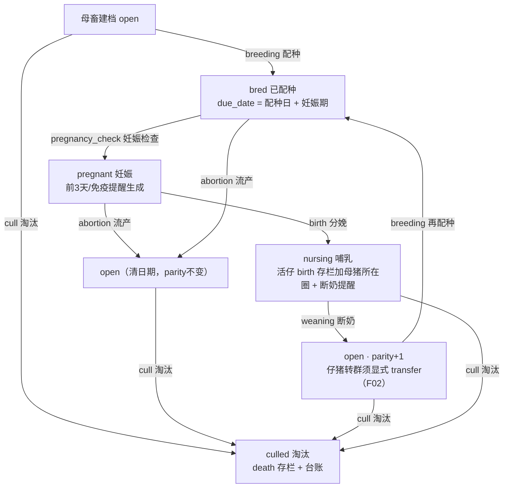
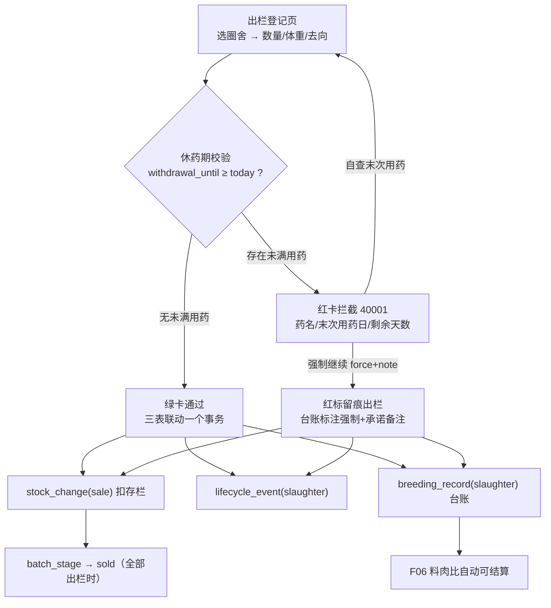

# 智慧养殖多智能体平台 — 功能 PRD：F07 全生命周期管理与出栏休药期（繁殖到出栏合规闭环）

- 文档版本：V1.0
- 编制日期：2026-10-13
- 编制角色：开发组（承接 F01~F06 纵切实现经验，产品评审视角：司南）
- 依据文档：主 PRD V1.7（3.1.4 全生命周期管理、3.1.3 存栏、3.7 页面清单、附录 B 存栏规则、附录 D 三物种参数表）、《01-系统架构设计》（services 层落点：lifecycle 状态机校验、withdrawal 休药期校验、提醒生成）、《02-数据库设计》（3.3 全生命周期表、3.7 reminder、四节字段口径 parity/存栏归属/妊娠细分/出栏三表联动、5.1 lifecycle_params 种子）、《03-API接口设计》（五节 5.1~5.5、4.3/4.4 存栏与转群、1.3 错误码 40001/40002/40003）、《04-开发计划》阶段 7（7.1~7.5）、《05-测试计划》2.3 节 TC-L01~L09、2.8 节 TC-B03、《06-UI页面设计规范》4.4/4.5、4.8（提醒 todo 型展示）、7.1（图标语义）、《08-遗留问题与后续版本池》C-05/C-07/C-08
- 对应里程碑：**M7**（繁殖到出栏全周期管控可用，含合规硬校验）；前置 M6（F06 喂食中心，已实现，母猪妊娠分档推导随本期回归）
- 合规声明：本方案为产品设计参考，具体实施请结合公司合规与法务要求确认

---

## 一、文档信息

| 版本 | 日期 | 变更 | 评审记录 |
|------|------|------|---------|
| V1.0 | 2026-10-13 | 首次出稿（阶段 7 纵切功能 PRD，第七刀）：母畜个体档案 + 生命周期事件状态机 + 预产期/断奶/免疫提醒 + 用药记录 + 出栏登记休药期硬校验 + 前端两页接真 | 待评审 |
| V1.1 | 2026-10-13 | 自查修订（第 1 轮，评审视角：产品/研发/测试）：① FR-07 验收示例改为猪回落单档口径（原「妊娠 100 天=后期」对猪不可测——F06 营养种子猪妊娠仅单档），羊/牛为推导分档受益场景；② FR-05 新增 GET /medicine/usage 标「本文档具体化」+ 文档同步项④（03-API 五节仅有 POST）；③ FR-02 birth 事件 detail 公母拆分结构标具体化（03-API 5.2 仅 live_count/dead_count）+ 验收示例统一为活仔 11（6 公 5 母，取 03-API 4.3 数据，消除原「10（6+5）」自相矛盾）+ 同步项⑤；④ FR-04 expired 提醒处理错误码 40401→42201（40401=资源不存在，语义错误）；⑤ FR-03 免疫提醒 anchor=birth 改为按母畜分娩事件在场范围生成（原「按圈舍批次分娩事件」导致仔猪转群后提醒永不触发）；⑥ FR-07 收口范围收窄为 F06 遗留项①，②转入 F06 跟踪（15.3）；⑦ 「06 规范 3.8」正名为 4.8 告警中心页（3.8 不存在，03-API 5.3.1 亦引错，同步项⑥）；⑧ FR-04 看板 today_reminders 口径改为页面本地聚合（mock 层无 /dashboard/summary 接口，原稿「接真」不成立）；⑨ EX-5e 改为公/母分别校验；⑩ 决策 2 索引表述修正（idx_musage_pen_until 支撑未满休药期直接查询，非 90 天窗口）；⑪ castration/dehorning detail 文案、tag_no 唯一范围、reminders 排序标具体化；⑫ 母畜转圈显式记入范围外 | 第 1 轮自查通过 |
| V1.2 | 2026-10-13 | 实现回写（mock 层 v6 纵切）：① FR-01~FR-09 全部实现——mock-backend 升 v6（breeding_female/lifecycle_event/medicine_usage/reminder 四表 + v1~v5 迁移保数据）、lifecycle_params 种子入 species-data（猪全量 + 羊/牛附录 D 口径）、事件表驱动状态机、提醒惰性幂等生成、用药记录、出栏三表联动、前端 /breeding 与 /slaughter 两新页 + 侧边栏入口 + 场舍页 [出栏] 占位替换 + 告警中心生产提醒 todo 区；② RTM 状态同步「已实现（mock）」；③ EX-5e 错误码对齐：公/母超存栏由 42201 改 **40002**（与 F02 存栏不足同码同纪律，V1.1 ⑨两处表述取一）；④ 待确认项按推荐值落地为实现口径（①沿用 male_count/female_count+注释、②独立页面、③cull 档案抽屉内提供、④断奶提醒出生时生成、⑤仅猪种子）；⑤ 新增具体化接口 GET /medicine/list（出栏页用药登记下拉，违禁药过滤）与 mock 药库种子修正（阿莫西林 28→7、氟苯尼考 14→28，对齐 02-数据库 5.4 与 03-API 5.4 原文）；⑥ F06 切片表停写改只读兼容（业务出栏只写三表，读侧统一 resolver：lifecycle slaughter 优先、切片兜底，禁双写）；⑦ 验证：tsc 0 错误、build 通过、冒烟 48/48（TC-L01~L09 + TC-B03 + TC-F12 双路径 + FR 边界，见 smart-farming-project/.smoke/） | 第 2 轮实现评审 |
| V1.3 | 2026-10-15 | 提醒展示面收敛（去重）：V1.2 落地的「告警中心生产提醒 todo 区」+ 后加的独立「生产提醒」页（/reminders，超出 3.7 页面清单）与 4.4 繁殖管理页的三类待办**同源同写**（同一 GET /lifecycle/reminders + 同一 POST /reminder/{id}/handle），三处展示导致口径漂移风险，收敛为繁殖管理单点归属。改动：删 `_layout.alerts.tsx` 提醒区块与查询/handler、删 `routes/_layout.reminders.tsx`、删侧边栏「生产提醒」入口；**接口与 mock 层未动**，TC-B03 冒烟走 HTTP 层不依赖 DOM，复跑 48/48 零回归。06 规范 4.8 同步作废原「提醒也进此列表」口径（记 V1.5） | 待评审 |

## 二、背景与目标

- **背景**：F01~F06 交付后，平台已有存栏台账、环境告警、问诊闭环与喂食闭环，但**繁殖管理仍是空白**：能繁母畜没有个体档案，配种/分娩/断奶靠脑子记，预产期没人算；出栏登记只有场舍管理页一个占位入口（toast「后续版本开放」），《兽药管理条例》休药期合规校验未落地。对中小养殖户，「预产期提醒」与「休药期合规」是主 PRD 1.2 定义的**对散养户也有强吸引力的免录入功能**（能自动算的绝不让人填），也是全生命周期「从配种怀孕到出栏」承诺的收口环节。
- **要解决的问题**：① 母畜繁殖状态无档可查——空怀/妊娠/哺乳全凭记忆，漏配、漏产常见；② 预产期靠手算——猪 114 天、羊 150 天、牛 280 天，算错漏算直接造成接产准备不足；③ 断奶/免疫节点无人提醒——哺乳期 28 天（猪）到期不提醒就压栏，免疫程序（如产前 21 天大肠杆菌苗）错过窗口；④ 出栏无合规闸门——休药期未满出栏是食品安全红线，养殖户自己记不住末次用药日；⑤ AI 问诊的用药建议与实际用药脱节——建议完了没有登记入口，休药期校验无数据来源。
- **成功指标与口径**：

| 指标 | 目标值 | 口径 |
|------|--------|------|
| 预产期自动计算准确率 | 100% | due_date = 配种日期 + species.lifecycle_params.gestation_days（猪 114 天，TC-L01） |
| 状态机非法跳变拦截 | 100% | 仅 lifecycle_event 事件驱动流转，非法前置状态 40003（EX-12，TC-L03） |
| 休药期拦截 | 100% | withdrawal_until ≥ today 即拦截，返回药品名/末次用药日/剩余天数三要素（EX-11，TC-L07） |
| 出栏三表联动 | 100% | 出栏一次事务生成 stock_change(sale) + lifecycle_event(slaughter) + breeding_record(slaughter)（TC-L06） |
| 提醒触达 | 100% | 预产期前 3 天看板 + 提醒列表出现，过期未分娩持续置顶（EX-13，TC-L05） |

## 三、名词与术语

| 术语 | 定义 |
|------|------|
| 能繁母畜个体档案（breeding_female） | 按个体建档的繁殖母畜，字段：个体编号（耳标号 tag_no）/所属圈舍/品种/胎次 parity/繁殖状态 breed_status/配种日期/预产期（主 PRD 3.1.4-1）；仔畜与育肥畜仍按圈舍批次管理，不做全个体耳标 |
| breed_status 状态机 | 仅 5 状态：open 空怀 / bred 已配种 / pregnant 妊娠 / nursing 哺乳 / culled 淘汰；由 lifecycle_event 事件驱动流转，禁止手工跳改（02-数据库口径：仅事件驱动，EX-12） |
| 妊娠确认（pregnancy_check） | bred→pregnant 的**事件**而非独立状态（V1.7 定稿） |
| 预产期（due_date） | 配种日期 + 物种妊娠期天数（species.lifecycle_params.gestation_days：猪 114 / 羊 150 / 牛 280），预产期前 3 天提醒（附录 D） |
| 妊娠阶段细分（推导值） | 羊/牛妊娠前期/后期不进状态机，由应用层按「配种日期 + 妊娠期参数」动态推导（如羊妊娠后期 = 妊娠第 91~150 天），feed_nutrition_lib.stage 匹配使用推导值（V1.7 定稿，口径 457） |
| 休药期（withdrawal_period） | 兽药停药至出栏屠宰的强制间隔天数；withdrawal_until = usage_date + withdrawal_period，服务端计算写入（02-数据库口径，前端不传） |
| 强制出栏（force） | 休药期拦截后用户填写承诺备注强制继续，留痕落台账，合规责任自担（EX-11） |
| 出栏三表联动 | 出栏 service 一次事务生成：stock_change(sale) + lifecycle_event(slaughter) + breeding_record(record_type=slaughter，含校验结果与 force 留痕)（02-数据库口径） |
| 提醒（reminder） | due_date 预产期 / weaning 断奶 / vaccine 免疫三类 todo 型提醒，状态 pending/done/expired（02-数据库 3.7）；看板与告警中心均以 todo 展示（06 规范 4.8 告警中心页；03-API 5.3.1） |

## 四、需求范围

**包含**：
1. 母畜个体档案 CRUD（POST/GET/PUT/DELETE /breeding-female，多租户隔离）：建档、列表（按圈舍/状态筛选）、编辑、逻辑删除
2. 生命周期事件与状态机（POST /lifecycle/event）：配种/妊娠检查/流产/分娩/断奶/阉割去势/去角/转阶段/淘汰九类事件的登记、合法迁移校验（40003）与副作用（预产期计算、存栏联动、台账落库）
3. 提醒生成与处理：预产期前 3 天提醒、过期未分娩持续置顶（EX-13）、断奶提醒（按哺乳期天数）、免疫提醒（vaccination_program 种子）、提醒处理接口（5.3.1）与看板待办数联动
4. 用药记录（POST /medicine/usage）：兽药库校验（库内且非违禁）、withdrawal_until 服务端计算、落 medicine 台账——为休药期校验提供数据来源
5. 出栏登记与休药期硬校验（POST /pen/{pen_id}/slaughter）：数量校验（不得超存栏/为负）、休药期拦截（40001 三要素）、force+force_note 留痕、三表联动、batch_stage 置 sold
6. 母畜妊娠细分推导回归：应用层推导妊娠前后期，喂食中心 pig_sow 计划匹配按推导 stage 分档（F06 已知可接受项①收口，口径 457）
7. 前端：母畜繁殖管理页新建（06 规范 4.4，新路由 + 侧边栏生产管理组入口）+ 出栏登记页新建（06 规范 4.5 步骤式）+ 场舍管理页 [出栏] 占位入口替换为跳转

**不包含（本期不做）**：
- 真实后端与定时任务：随 FastAPI 后端切换（mock 层纵切，提醒惰性生成替代每日定时扫描，决策 1，费用纪律）
- 免疫记录管理全套（V1.0 仅提醒，不做免疫台账管理——主 PRD 3.1.4-5 口径）
- 用药对象个体级休药期校验（V1.1，承接 C-07：圈舍级校验宁可错拦）
- 全个体耳标管理（后续版本，主 PRD 3.1.4 设计依据口径）
- HITL 兽医复核（阶段 10，本功能不涉及）
- 牛/羊 lifecycle_params 与免疫程序实灌（配置格式已定稿，种子随第二/三阶段横向复制，本期仅猪先行验收）

## 五、方案对比与选型

**决策 1：提醒生成机制 — 查询时惰性计算 vs 每日定时任务**

| 方案 | 说明 | 结论 |
|------|------|------|
| 惰性生成（推荐） | 进入看板/提醒列表时扫描 breeding_female 与 vaccination_program，对到期未生成提醒的记录幂等生成 reminder 行（去重键：farm_id + reminder_type + female_id + remind_date）；expired 置位同路径惰性处理 | **推荐**：mock 期前端 localStorage 无后台进程，定时任务无处安放；幂等去重键与 02-数据库 3.7 表结构兼容，切真后同一去重逻辑搬进每日定时服务即可，reminder 表与提醒列表接口契约零改动 |
| 前端实时算不落库 | 无需表 | 不采用：02-数据库补充 reminder 表的原因即「避免每次实时计算」+ 提醒需要已处理状态持久化（done 不能被重新算出来） |

**决策 2：休药期校验口径 — withdrawal_until ≥ today 即拦截**

- 按《08-遗留问题》C-08 定稿执行：出栏登记时查该圈舍 medicine_usage 中 withdrawal_until ≥ 当日 的记录即拦截，不做「末次用药近 90 天」的额外筛选（idx_musage_pen_until 按 pen_id+withdrawal_until 建索引，直接支撑「未满休药期」查询；「近 90 天」仅作数据清理参考，不参与拦截判定）；拦截返回**药品名 / 末次用药日期 / 休药期剩余天数**三要素（EX-11，03-API 5.4 原文示例）；多条未满药取剩余天数最多的一条优先展示、其余在明细列出。

**决策 3：出栏登记入口形态 — 独立页面 vs 场舍管理页弹窗**

| 方案 | 说明 | 结论 |
|------|------|------|
| 独立页面 /slaughter | 按 06 规范 4.5 步骤式表单（选圈舍 → 数量体重去向 → 校验结果区 → 确认），场舍管理页 [出栏] 快捷按钮跳转并预选圈舍 | **推荐**：休药期校验结果区（通过绿卡/拦截红卡三要素 + 强制继续承诺弹窗 + 合规原文固定）信息量大，弹窗装不下；步骤式流程与「合规硬校验」的庄重感匹配（06 规范 4.5「文件感」要求）；出栏是低频高价值操作，独立页不损效率 |
| 场舍管理页弹窗 | 少一次跳转 | 备选不采用：校验结果 + force 承诺 + 合规文案三层叠加，弹窗层级过深（待确认②） |

**决策 4：状态机校验唯一权威在服务层（表驱动迁移矩阵）**

- mock 层以「合法迁移矩阵」常量表实现（事件类型 × 前置状态 → 迁移 + 副作用），所有 /lifecycle/event 与出栏登记复用同一矩阵函数；前端「登记入口按状态给出合法动作、非法动作置灰」（06 规范 4.4）仅为体验层，**不作为安全边界**——绕过前端直接请求仍由 40003 拦截。与 F02 存栏「禁止 UPDATE 绕过」同一纪律。

**决策 5：妊娠细分推导 — 应用层纯函数，不进状态机**

- 推导函数 derive_pregnancy_stage(breed_date, today, lifecycle_params) → early/late（按物种参数切分，如羊 91 天为界），供 feed-plan 计划兜底与配方匹配消费（feed_nutrition_lib.stage 使用推导值，口径 457）；推导失败（缺 breed_date）回落 sex_type 分档兜底（F06 现状）。不写入 breed_status（V1.7 定稿：状态机不区分妊娠前后期）。

## 六、用户角色与使用场景

| 角色 | 本功能内的场景 | 权限边界 |
|------|--------------|---------|
| farmer（主角色） | 母畜建档、登记配种/分娩/断奶、处理提醒、登记用药、出栏登记 | 仅本人名下圈舍与档案（复用 resolvePen 链路，40302/40401） |
| vet / admin | 本阶段不涉及（兽医复核随阶段 10；免疫程序 admin 维护随后台管理，本期种子内置） | 无入口差异 |

**主流程（繁殖线）**：进入繁殖管理页 → 待产提醒卡片行看倒计时 → 登记配种（自动算预产期）→ 妊娠检查确认 → 收到产前提醒（预产期前 3 天 + 免疫节点）→ 登记分娩（活仔自动计入母猪所在圈存栏）→ 收到断奶提醒 → 登记断奶（parity+1，仔猪显式转群走场舍管理页转群入口）。

**主流程（出栏线）**：场舍管理页 [出栏] → 出栏登记页（预选圈舍）→ 填数量/体重/去向 → 系统校验休药期 → 通过：绿卡确认，三表联动落台账，F06 料肉比自动可结算；拦截：红卡三要素 → 用户自查末次用药，或填承诺备注强制继续留痕。

**分支流程**：① 未配种直接登记分娩 → 40003 拦截提示按事件顺序登记（EX-12）；② 预产期已过未登记分娩 → 提醒置顶持续高亮（EX-13）；③ 出栏数量 > 存栏 → 拦截（TC-L09）；④ 登记库外/违禁药 → 42201 拦截；⑤ 流产/死胎 → abortion 事件回空怀，parity 不变，清配种/预产日期。

**异常流程**：越权（40302）、档案不存在（40401）、超存栏出栏（40002）、force 未填备注（42201）——见十二节。

## 七、功能需求

### FR-01 母畜个体档案 CRUD（POST/GET/PUT/DELETE /breeding-female）

- 规则：POST {pen_id, tag_no, variety_code, parity, breed_status?默认 open}——pen_id 归属校验（40302）；tag_no 同圈舍内唯一（42201，重号提示；**唯一范围为本文档具体化约定**——02-数据库 breeding_female.tag_no 无唯一约束）；PUT **仅允许修改 tag_no/variety_code/remark**，breed_status/breed_date/due_date 由事件驱动、PUT 直接改状态返回 40003（02-数据库口径「仅 lifecycle_event 事件驱动流转」）；**母畜转圈（pen_id 变更）V1.0 不做**——需要时按淘汰/重建档案处理（显式记入范围外）；DELETE 逻辑删除，事件历史保留；GET 按 pen_id/breed_status 筛选分页（1.4 分页约定）。
- 验收标准：
  - Given 母猪圈建档案 M-012（parity=2），When 创建，Then 列表可见且状态 open
  - Given 直接 PUT breed_status=pregnant，When 请求，Then 40003
  - Given 他人 pen_id，When 建档，Then 40302
  - Given 同圈舍重复 tag_no，When 创建，Then 42201

### FR-02 生命周期事件与状态机（POST /lifecycle/event）

- 规则：合法迁移矩阵（决策 4，服务层表驱动）——

| event_type | 前置状态 | 迁移 | 副作用 |
|------------|---------|------|--------|
| breeding | open | →bred | 算 due_date = event_date + gestation_days（TC-L01） |
| pregnancy_check | bred | →pregnant | — |
| abortion | bred / pregnant | →open | 清 breed_date/due_date；parity 不变（口径 457） |
| birth | pregnant | →nursing | birth 类型 stock_change：活仔数（分公母 **detail {live_male, live_female, dead_count}——结构为本文档具体化约定，03-API 5.2 示例仅 {live_count, dead_count}，公母拆分是 stock_change 联动必需，列文档同步项③**）加在**母猪所在圈**（口径 454，TC-L04）；活仔 0 仍登记事件、不产生存栏变动 |
| weaning | nursing | →open | parity+1；**不隐式搬动仔猪存栏**，仔猪转保育/育肥圈必须显式调转群（口径 454，F02 转群入口已建） |
| castration / dehorning | —（批次事件，pen_id） | 无状态变化 | detail 标记（阉割/去角日期与方式） |
| stage_change | —（批次事件，pen_id） | batch_stage 流转 | pen.batch_stage 更新（白名单见 F02 FR-03） |
| cull | 非 culled | →culled | death 类型 stock_change（个体淘汰）+ 台账 |

  - 非法前置状态返回 40003，文案指明「当前状态 {status} 不允许登记 {event_type}」（EX-12）；每笔事件落 lifecycle 类型台账（溯源外键 lifecycle_event_id，02-数据库 3.6）；事件必须归属 female_id 或 pen_id 其一（chk_event_owner）。
- 验收标准：
  - Given 10-09 配种（猪），When 登记，Then due_date=2027-01-31，状态 bred（TC-L01）
  - Given 完整链 open→bred→pregnant→nursing→open，When 逐步登记，Then 每步成功且 weaning 后 parity+1（TC-L02）
  - Given open 状态直接登记分娩，When 提交，Then 40003（TC-L03/EX-12）
  - Given pregnant 登记分娩活仔 11（6 公 5 母，取 03-API 4.3 示例数据；detail 公母拆分结构为本文档具体化），When 提交，Then 母猪所在圈存栏 +11 且生成 birth 台账（TC-L04 切片）
  - Given nursing 登记断奶，When 提交，Then 状态 open、parity+1、仔猪存栏不变（口径 454）

### FR-03 提醒生成（预产期/断奶/免疫）

- 规则：惰性生成（决策 1，幂等去重键 farm_id+reminder_type+female_id+remind_date）——① **预产期提醒**：pregnant 档案 due_date 前 3 天生成 due_date 类型 reminder（标题「{tag_no} 预产期还有 X 天」）；**due_date 已过且状态仍 pregnant → 持续置顶展示**（EX-13，前端排序权重最高 + danger 底色）；② **断奶提醒**：birth 事件登记时生成（remind_date = 分娩日 + lactation_days，weaning 登记后自动置 done，待确认④）；③ **免疫提醒**：按 species.lifecycle_params.vaccination_program 扫描——anchor=birth 按**母畜分娩事件在场范围生成**（仔猪出生锚点为母猪圈分娩日，转群不改变日龄；reminder.pen_id 可空，02-数据库 3.7 已支持），anchor=due_date 按妊娠档案预产期推算（timing_day 负数=提前，02-数据库 5.1 猪种子 3 条）；GET /lifecycle/reminders?farm_id= 按 remind_date 升序返回（03-API 5.3 契约；**排序为本文档具体化约定**）。
- 验收标准：
  - Given due_date=3 天后档案，When 进入看板/提醒列表，Then 提醒出现（TC-L05）
  - Given due_date 已过 2 天未登记分娩，When 查看，Then 提醒置顶且标注「已过期 X 天」（EX-13）
  - Given 妊娠母猪匹配产前 21 天免疫节点（anchor=due_date），When 扫描，Then 生成 vaccine 提醒「大肠杆菌K88/K99（产前 21 天免疫）」
  - Given 仔猪由本场分娩事件转入保育圈且日龄满 30 天（anchor=birth），When 扫描，Then 场范围生成猪瘟兔化弱毒苗提醒（不受仔猪转群影响）
  - Given 同一档案重复扫描，When 再次进入，Then 不产生重复提醒（幂等）
  - Given 断奶提醒已生成后登记 weaning，When 查看，Then 提醒自动 done（待确认④）

### FR-04 提醒处理（POST /reminder/{reminder_id}/handle）

- 规则：{"action":"done","note"?} 置 status=done（03-API 5.3.1）；他人 reminder 40302；**expired 状态不允许 done**（42201「提醒已过期」——已过期提醒仅可忽略，前端置灰）；处理联动看板待办数减一（TC-B03）；**看板待办数由 reminders 数据驱动**（mock 期看板页本地聚合——/dashboard/summary 聚合接口 mock 层未实现；切真后 03-API 十四节 today_reminders 字段自然有数据源）。
- 验收标准：
  - Given 预产期提醒标记完成，When 查看，Then status=done、看板待办数减一（TC-B03）
  - Given 他人 reminder_id，When 处理，Then 40302

### FR-05 用药记录（POST /medicine/usage）

- 规则：{pen_id, med_id, usage_date, dosage?, operator_note?}——med_id 必须在 medicine_lib 且 is_forbidden=false，否则 42201（「违禁药品不可登记」/「兽药库中不存在该药品」）；withdrawal_until = usage_date + medicine_lib.withdrawal_period **服务端计算写入**（口径 455，前端不传）；每笔落 medicine 类型台账（溯源外键 medicine_usage_id）；F05 问诊用药建议后由用户按实际用药登记（建议≠登记，两者解耦）。**GET /medicine/usage?pen_id=&days=90 按圈舍查询用药列表（本文档具体化接口——03-API 五节仅有 POST，列文档同步项④）**，返回 med_name/usage_date/withdrawal_until/withdrawal_left_days，休药期校验与出栏页「查看近期用药」入口同源复用。
- 验收标准：
  - Given 氟苯尼考注射液（休药期 28 天）10-09 用药，When 登记，Then withdrawal_until=2026-11-06 且台账 medicine 记录一条
  - Given 瘦肉精（is_forbidden=true），When 登记，Then 42201
  - Given 库外 med_id=9999，When 登记，Then 42201
  - Given 他人 pen_id，When 登记，Then 40302

### FR-06 出栏登记与休药期硬校验（POST /pen/{pen_id}/slaughter）

- 规则：请求 {male_count, female_count, avg_weight_kg?, destination?, force?, force_note?}（**字段语义=出栏数量，正整数，C-05 具体化约定列文档同步项①**）——① 数量校验：出栏数 > 当前存栏或为负 → 40002（TC-L09，EX-10 同源）；② **休药期硬校验（决策 2）**：该圈舍存在 withdrawal_until ≥ today 的用药 → HTTP 200 + code 40001，data 返回 {med_name, usage_date, withdrawal_until, left_days}（EX-11/TC-L07，03-API 5.4 原文契约）；③ force=true 时 force_note 必填（缺省 42201），留痕写入台账；④ 校验通过后**三表联动一个事务**：stock_change(sale，负增量) + lifecycle_event(slaughter) + breeding_record(record_type=slaughter，含休药期校验结果与 force 留痕)（口径：出栏三表联动）；出栏全部存栏时 pen.batch_stage 置 sold（F02 白名单口径「sold 由出栏流程设置」）；⑤ 出栏后 F06 料肉比接口自动可结算（回归 TC-F12）。
- 验收标准：
  - Given 无未满休药期用药（该圈 medicine_usage 无 withdrawal_until ≥ 当日 记录），When 出栏 5 公 10 母，Then 成功返回 {withdrawal_check:"passed"}，存栏同步扣减、台账 slaughter 记录一条（TC-L06）
  - Given 氟苯尼考 withdrawal_until=2026-10-18（今天 10-13），When 出栏，Then 40001 + 药名/末次用药日/剩余 5 天三要素（TC-L07）
  - Given 40001 后 force=true+force_note，When 重发，Then 成功，台账标注「强制出栏」+承诺备注（TC-L08）
  - Given force=true 且 force_note 为空，When 重发，Then 42201
  - Given 存栏 50 出栏 100，When 提交，Then 40002 拦截（TC-L09）
  - Given 出栏完成，When 查 F06 料肉比，Then fcr 有值（有称重数据时）（TC-F12 回归）

### FR-07 母畜妊娠细分推导与 F06 计划回归

- 规则：derive_pregnancy_stage 纯函数（决策 5）接入 feed-plan 计算链——妊娠档案按推导 stage（early/late）匹配 feed_nutrition_lib 妊娠分档；nursing 档案匹配哺乳分档；推导输入缺失回落 sex_type 分档兜底（F06 现状不变）；能繁母猪圈不参与 batch_stage 配方匹配的规则不变（口径 454）。收口 F06 已知可接受项①（哺乳档恒取首档不可达）；**F06 遗留项②（多批次出栏料肉比口径）不在本期收口**——随本期正式出栏数据源落地后转入 F06 文档回归时处理（见 15.3 衔接表）。
- 验收标准：
  - Given 妊娠 100 天母猪圈（猪妊娠期 114 天；**本期 feed_nutrition_lib 妊娠为单档种子，early/late 推导均回落该单档**），When 查 feed-plan，Then basis 标注「妊娠」并取妊娠档计划，与 F06 母猪兜底行为一致（分档收益场景为羊/牛——如羊妊娠后期 = 第 91~150 天，阈值参数化，种子随横向复制阶段补）
  - Given 无 breed_date 的档案（兜底路径），When 查 feed-plan，Then 回落 pig_sow sex_type 分档，行为与 F06 一致

### FR-08 前端母畜繁殖管理页（06 规范 4.4，新建路由 /breeding）

- 规则：布局三段——① 顶部待产提醒卡片行：预产期倒计时大数字（tabular-nums），3 天内 danger 红数字 + 微脉动（06 规范唯一情绪焦点动效），过期置顶；② 母畜表格：耳标号/圈舍/胎次/状态标签/配种日期/预产期/操作，状态标签色 固定：空怀=灰 / 已配种=info 蓝 / 妊娠=primary 浅绿 / 哺乳=warning 浅橙 / 淘汰=灰划线；③ 单头档案抽屉（e3）：时间线展示 lifecycle_event（配种→检查→分娩→断奶），节点语义色实心圆点 + 1px 连接线；**登记入口按状态给合法动作、非法动作置灰**（EX-12 前端表达：空怀→登记配种；妊娠→登记分娩/流产；哺乳→登记断奶）；淘汰入口在档案抽屉内（待确认③）。侧边栏「生产管理」组新增「繁殖管理」入口，图标 heart-handshake（06 规范 7.1 语义映射）。
- 验收标准：
  - Given 母畜列表，When 按状态筛选，Then 结果正确且空态完整（无档案空态插画）
  - Given pregnant 档案，When 查看操作列，Then 仅「登记分娩/流产」可用，「登记配种」置灰
  - Given 预产期 2 天后档案，When 进入页面，Then 倒计时卡红字微脉动
  - Given <768，When 查看，Then 表格转卡片列表（06 规范 2.3 断点表）无横向溢出

### FR-09 前端出栏登记页（06 规范 4.5，新建路由 /slaughter）

- 规则：步骤式表单——选圈舍（默认带入场舍页跳转 query 的 pen_id）→ 填出栏数量（公/母步进器，上限=当前存栏）/体重（选填）/去向（选填）→ 校验结果区 → 确认。校验结果区两态：**通过=绿卡**（success @ 8% 底 + 对勾）；**拦截=红卡「文件感」**（白底 danger 1.5px 描边，非大红底）表格列出三要素 + 其余未满药明细 + 「强制继续」灰字链接 → 承诺备注弹窗（textarea 必填）→ 红色确认按钮；卡片底部固定合规原文："依据《兽药管理条例》，休药期未满的畜禽严禁出栏、屠宰、销售"；「查看近期用药」入口展示该圈舍 medicine_usage 列表辅助自查。场舍管理页 [出栏] 占位 toast 替换为跳转（携带 pen_id 预选）。出栏成功 toast + 台账可查。
- 验收标准：
  - Given 休药期未满圈舍，When 进入校验，Then 红卡三要素完整且强制入口可见
  - Given 强制继续，When 未填备注，Then 弹窗不可提交
  - Given 场舍管理页点击 [出栏]，When 跳转，Then 预选该圈舍
  - Given 出栏成功，When 查台账页，Then slaughter 记录可见且存栏数字已扣减

## 八、非功能需求

| 项 | 要求 | 口径 |
|----|------|------|
| 性能 | 档案/事件/提醒/出栏接口 P95 ≤300ms（F02/F06 同口径）；出栏三表联动事务原子（任一失败全部回滚，禁止半联动） | 05-测试三节 |
| 一致性 | breed_status 仅事件驱动（PUT 改状态 40003）；存栏只由 stock_change 驱动（birth/sale/cull 联动同遵守口径 453）；batch_stage=sold 仅出栏流程写入 | 代码审查 |
| 安全 | 全部接口归属校验 40302 贯穿；违禁药登记 42201 拦截与 F05 问诊违禁拦截同底线；force_note 留痕不可篡改（台账无更新接口，TC-R04） | 代码审查 |
| 兼容 | 两页响应式按 06 规范 2.3 断点表；<768 表格转卡片 | DevTools 验证 |
| 无障碍 | 状态标签颜色同时有文字；倒计时微脉动遵循 prefers-reduced-motion 呈现终态；步进器键盘可达 | Tab 走查 |
| 费用 | 本功能为纯规则链路，**零 LLM 调用、零真实 API**（无费用敞口） | 2026-10-12 费用纪律 |

## 九、业务流程与状态流转

状态机规则：状态仅 5 个（open/bred/pregnant/nursing/culled），culled 为终态；pregnancy_check 是事件非状态（V1.7 定稿）；妊娠前后期为应用层推导值，不入状态机。提醒状态：pending → done（处理）/ expired（过末日惰性置位）。

## 十、数据与埋点

- **数据落库**：mock 层升 v6 新增四表（对齐 02-数据库 3.3/3.7 DDL）——breeding_female（idx_bfemale_due 预产期扫描索引口径）/ lifecycle_event（chk_event_owner：个体或批次其一）/ medicine_usage（withdrawal_until 服务端算，idx_musage_pen_until 休药期查询索引口径）/ reminder（pending/done/expired）；F06 切片表 slaughterRecords **迁移收口**：出栏改为三表联动写入，切片表停写并按既有演示数据一次性迁移（禁止双写）；台账 lifecycle/medicine/slaughter 三类型（F04 RECORD_TYPES 白名单已含）。
- **最小数据能力**：① 看板待办数由 reminders 数据驱动（繁殖/断奶/免疫待办计数，页面本地聚合；TC-B03）；② 繁殖概览：妊娠/哺乳头数（繁殖管理页头部，档案表聚合）；③ 出栏合规计数：本期拦截次数 / 强制出栏次数（台账统计，合规留痕可查）。真实看板随阶段 12。
- **指标口径**：待产提醒数 = status=pending 且 reminder_type=due_date 的 remind_date ≤ 今日+3；妊娠头数 = breed_status=pregnant 且 due_date 未过；强制出栏率 = 强制出栏台账数 ÷ 出栏台账总数（合规观察指标，仅统计不拦截）。

## 十一、权限与安全要求

- 数据归属：全部接口复用 resolvePen 链路（40302/40401）；reminder 按 farm_id 归属校验；出栏接口对 pen 归属校验后，数量校验与休药期校验顺序固定（先归属 → 再数量 → 再休药期），避免越权探测。
- 合规安全：违禁药登记 42201（与 F05 问诊违禁拦截同一兽药库底线，对人和 AI 一视同仁）；强制出栏必须 force_note 且落台账留痕（合规责任留痕自担，红卡附法规原文）；休药期校验圈舍级口径宁可错拦（C-07，V1.0 接受，V1.1 个体级）。
- 数值边界：出栏数量正整数且 ≤ 当前存栏（40002）；parity/tag_no 前端步进器/输入拦截非法值，服务端 42201 兜底。

## 十二、异常处理清单

| 编号 | 异常 | 处理 | 用户可见文案 | 状态 |
|------|------|------|------------|------|
| EX-11 | 出栏时休药期未满 | 40001，data 返回三要素；force+force_note 可强制留痕 | "休药期未满，禁止出栏：{药名}，末次用药 {日期}，剩余 {X} 天" | 复用 **40001** |
| EX-12 | 母畜状态非法跳变 | 40003 拦截 | "当前状态为 {状态}，不允许登记 {事件}，请按配种→检查→分娩顺序操作" | 复用 **40003** |
| EX-13 | 预产期已过未登记分娩 | 提醒置顶持续高亮，不自动关闭 | "M-012 预产期已过 {X} 天，请确认是否已分娩" | 复用置顶策略 |
| EX-10 同源 | 出栏数量超存栏/为负 | 40002 拦截 | "出栏数量超过当前存栏（{存栏} 头）" | 复用 **40002** |
| EX-5a | 登记违禁/库外药品 | 42201 拦截 | "违禁药品不可登记" / "兽药库中不存在该药品" | 复用 **42201** |
| EX-5b | force 未填承诺备注 | 42201 | "强制出栏需填写承诺备注" | 复用 **42201** |
| EX-5c | tag_no 同圈重号 | 42201 | "该圈舍已存在编号 {tag_no}" | 复用 **42201** |
| EX-5d | 访问他人档案/圈舍/提醒 | 拦截 | "无权限访问" | 复用 **40302** |
| EX-5e | 出栏公/母数量分别超过该圈公/母存栏 | 40002 拦截（V1.2 对齐 F02 存栏不足同码） | "出栏公畜/母畜数量不能超过对应存栏（公 {X} / 母 {Y}）" | 复用 **40002** |

> 无新增错误码：40001/40002/40003/42201/40302/40401 均为 03-API 1.3 既有码，本功能零新增（沿用 F06「无新增错误码」纪律）。

## 十三、上线计划、依赖与验证

- **依赖评估**：

| 依赖项 | 所属 | 就绪状态 | 分级 | 说明 |
|--------|------|---------|------|------|
| 场舍管理页出栏入口（占位） | F02 | 已建（占位 toast） | 就绪 | 替换为跳转携带 pen_id |
| 转群入口（断奶后显式转群） | F02 | 已实现 | 就绪 | weaning 不搬存栏，转群承接 |
| 台账 lifecycle/medicine/slaughter 类型 | F04 | 已实现（白名单含三类） | 就绪 | 零改台账层 |
| 兽药库 medicine_lib（18 条猪药含违禁 4 条） | F05 | 已实现 | 就绪 | 用药登记与休药期校验数据源 |
| 喂食中心 pig_sow 分档兜底 | F06 | 已实现（首档兜底） | 就绪（回归项） | FR-07 推导接入后回归母猪计划 |
| 最小出栏记录 slaughterRecords | F06 切片 | 已建（最小字段） | 阻塞（切片消除） | 本期迁移收口为三表联动，禁双写 |
| lifecycle_params 猪种子（114/28/免疫程序 3 条） | 本期切片 | 未建（species-data 仅文案） | 阻塞（切片消除） | 按 02-数据库 5.1 结构入 mock 种子 |
| 四张新表（breeding_female/lifecycle_event/medicine_usage/reminder） | 本期 | 未建 | 阻塞（切片消除） | mock 层 v6 建表，实施顺序第一步 |
| 繁殖管理页 / 出栏登记页 | 本期 | 未建 | 阻塞（本期新建） | 侧边栏生产管理组新增入口 |
| 每日定时任务（提醒扫描/expired 置位） | 切真后 | 未搭 | 可绕过 | 惰性生成替代（决策 1），切真搬进定时服务 |

- **实施顺序**：mock v6 建表 + lifecycle_params/免疫程序种子 → 档案 CRUD + 事件状态机接口（7.1）→ 提醒生成与处理（7.2/7.3）→ 用药记录接口 → 出栏登记三表联动 + 休药期校验（7.4）+ F06 切片迁移 → 前端繁殖管理页（7.5）→ 出栏登记页 + 场舍入口替换 → FR-07 妊娠推导接入 feed-plan 回归 → 按 TC-L01~L09 + TC-B03 + TC-F12 回归验收。
- **验证步骤**：① 建档 M-012 → 配种 10-09 → due_date=2027-01-31（TC-L01）；② 状态机全链流转 + open 直接分娩 40003（TC-L02/03）；③ 分娩活仔 11 头 → 母猪圈存栏 +11 且 birth 台账（TC-L04）；④ 构造 due_date 3 天后 → 看板提醒出现，过期置顶（TC-L05/EX-13）；⑤ 登记氟苯尼考 → 出栏 40001 三要素 → force 留痕成功（TC-L07/08）；⑥ 无用药圈出栏成功 → sale 台账 + batch_stage=sold + F06 料肉比可结算（TC-L06/F12）；⑦ 出栏 100 > 存栏 50 拦截（TC-L09）；⑧ 提醒标记完成看板待办减一（TC-B03）；⑨ 演示脚本："配种 → 产前提醒 → 分娩进存栏 → 断奶转群 → 用药 → 出栏拦截 → 强制留痕"。
- **回滚**：纯增量（新表 + 新接口 + 两新页面 + 场舍入口替换）；回滚 = 出栏入口还原占位 toast、摘除两页面路由与接口；切片迁移为一次性行为，回滚后切片表数据保留。

## 十四、风险与遗留问题

| 编号 | 风险/遗留 | 类别 | 概率×影响 | 等级 | 应对 |
|------|----------|------|----------|------|------|
| RK-1 | 强制出栏被滥用成常规操作，合规留痕形同虚设 | 合规 | 2×4 | 中 | 红卡强提示 + 法规原文固定 + 台账留痕 + 强制出栏率观察指标（十节）；文案明确责任自担；后续版本可加频次预警 |
| RK-2 | 圈舍级休药期校验偏保守（个别用药拦全圈，C-07） | 业务 | 3×2 | 低 | V1.0 明确接受（合规宁可错拦）；红卡「查看近期用药」辅助定位；V1.1 个体级校验已入版本池 |
| RK-3 | 惰性提醒生成与切真定时任务口径漂移 | 技术 | 2×2 | 低 | 幂等去重键即按 reminder 表结构定义（文档同步项②）；切真只换触发时机不换去重逻辑 |
| RK-4 | 妊娠细分推导改变 F06 已验收母猪计划数值 | 技术 | 2×2 | 低 | 推导仅影响 stage 分档匹配；回归 F06 母猪档用例；缺 breed_date 回落兜底行为不变 |
| RK-5 | 出栏切片表迁移期双写或漏迁移 | 数据 | 2×3 | 中 | 一次性迁移脚本口径：既有演示数据迁入三表后切片表停写；代码审查断言无第二写入点 |
| RK-6 | 母畜个体录入坚持度不足（档案断更） | 体验 | 3×2 | 低 | 只录高价值事件（配种/分娩/断奶三步），预产期提醒驱动打开（主 PRD 1.2 原则）；登记入口按状态收敛到最少动作 |

**待确认项（V1.2 实现回写：已按推荐值落地为实现口径，评审时可追认或调整）**：① 出栏请求体字段命名沿用 male_count/female_count（03-API 5.4 原文，语义=出栏数量，补注释落地 C-05）——**已采纳**（03-API V1.4 已回写注释）；② 出栏登记入口独立页面 /slaughter（决策 3）——**已采纳**；③ 个体淘汰（cull）入口——**已采纳**（繁殖管理页档案抽屉内淘汰按钮 + 确认弹窗，联动 death 存栏）；④ 断奶提醒生成时机（birth 事件登记时生成，weaning 后自动置 done）——**已采纳**；⑤ 免疫提醒仅灌猪 3 条种子演示——**已采纳**（羊/牛参数已预置 species-data，种子随横向复制阶段补）。

**文档同步项（V1.2 已全部执行）**：① 03-API 5.4 请求体补「male_count/female_count 语义为出栏数量（正整数）」注释——**已回写（03-API V1.4）**；② 02-数据库 3.7 reminder 补幂等去重唯一口径（farm_id+reminder_type+female_id+remind_date）——**已回写（02-数据库 V1.4）**；③ 03-API 5.2 补 birth 事件 detail 公母拆分结构 {live_male, live_female, dead_count} 与 castration/dehorning detail 示例、stage_change 的 batch_stage 合法流转枚举——**已回写（03-API V1.4）**；④ 03-API 五节新增 GET /medicine/usage?pen_id=&days=90——**已回写（03-API V1.4，另新增 5.7 GET /medicine/list 具体化接口）**；⑤ 03-API 5.3.1 引用「06 规范 3.8」正名为「4.8 告警中心页」——**已回写（03-API V1.4）**；⑥ 02-数据库 feed_nutrition_lib 补母猪妊娠/哺乳分档选取口径注释——**已回写（02-数据库 V1.4）**。

## 十五、附录

### 15.1 需求追踪矩阵（RTM）

| 需求编号 | 需求描述 | PRD 章节 | 前端 | 后端接口 | 测试用例 | 状态 |
|---------|---------|---------|------|---------|---------|------|
| FR-01 | 母畜档案 CRUD | 七 | 繁殖管理页表格 | POST/GET/PUT/DELETE /breeding-female | FR-01 GWT | 已实现（mock） |
| FR-02 | 生命周期事件与状态机 | 七 | 按状态置灰的登记入口 | POST /lifecycle/event | TC-L01/L02/L03/L04 | 已实现（mock） |
| FR-03 | 提醒生成（预产/断奶/免疫） | 七 | 倒计时卡+提醒列表 | GET /lifecycle/reminders | TC-L05 | 已实现（mock） |
| FR-04 | 提醒处理 | 七 | todo 处理按钮 | POST /reminder/{id}/handle | TC-B03 | 已实现（mock） |
| FR-05 | 用药记录 | 七 | 出栏页近期用药 | POST/GET /medicine/usage | FR-05 GWT | 已实现（mock） |
| FR-06 | 出栏登记与休药期硬校验 | 七 | 出栏登记页 | POST /pen/{pen_id}/slaughter | TC-L06/L07/L08/L09 + TC-F12 回归 | 已实现（mock） |
| FR-07 | 妊娠细分推导回归 | 七 | （feed-plan 计划标注） | （feed-plan 计算链接入） | FR-07 GWT + F06 母猪档回归 | 已实现（mock） |
| FR-08 | 母畜繁殖管理页 | 七 | /breeding 新建 | 全部 | FR-08 GWT | 已实现（mock） |
| FR-09 | 出栏登记页 | 七 | /slaughter 新建 | FR-06 接口 | FR-09 GWT | 已实现（mock） |

### 15.2 接口字段引用

/breeding-female、/lifecycle/event、/lifecycle/reminders、/reminder/{id}/handle、/pen/{pen_id}/slaughter、/medicine/usage、/medicine/list 以《03-API接口设计》五节（5.1~5.7、5.3.1，V1.4）为准；表结构与索引以《02-数据库设计》3.3（breeding_female/lifecycle_event/medicine_usage）/3.7（reminder）为准；错误码 40001/40002/40003/42201 以 1.3 错误码表为准；lifecycle_params 种子结构以 5.1 节 JSON 为准。birth 事件 detail 公母拆分结构、GET /medicine/usage、GET /medicine/list 为 F07 具体化约定，已随 03-API V1.4 回写（文档同步项③④）。

### 15.3 与 F01~F06 的衔接关系

| 衔接点 | 说明 |
|--------|------|
| 消费 F02 | 圈舍归属校验、转群入口（断奶仔猪显式转群）、存栏流水驱动纪律（birth/sale/cull 联动） |
| 消费 F04 | lifecycle/medicine/slaughter 三类台账落库，溯源外键（lifecycle_event_id/medicine_usage_id）对齐 3.6 设计 |
| 消费 F05 | 兽药库校验同底线（违禁 42201）；用药记录承接问诊用药建议的实际登记 |
| 消费 F06 | 出栏登记打通料肉比结算闭环（TC-F12 正向数据源）；妊娠细分推导接入 feed-plan 收口 F06 遗留项① |
| F06 遗留项② | 多批次出栏料肉比口径（取最新一次、饲料累计含早批次）：本期不改造 F06 结算逻辑，正式出栏数据源落地后在 F06 文档回归时收口 |
| 为 M12 打底 | 「3 天养殖故事」演示补齐配种→分娩→出栏全周期环节，休药期校验是合规演示的核心看点 |

### 15.4 费用纪律声明（本功能专项）

本功能为纯规则链路（状态机/日期计算/校验），**零 LLM 调用、零外部 API**；不引入任何真实大模型请求；费用纪律对本期无敞口。

### 15.5 合规声明

本方案为产品设计参考，具体实施请结合公司合规与法务要求确认。出栏登记页固定展示《兽药管理条例》休药期要求原文；强制出栏的合规责任由操作用户自行承担，系统仅做拦截提示与留痕；生命周期参数（妊娠期/哺乳期/免疫程序）为公开饲养标准与地方规程整理的参考值，页面显著标注"参考值，以兽医建议为准"。
