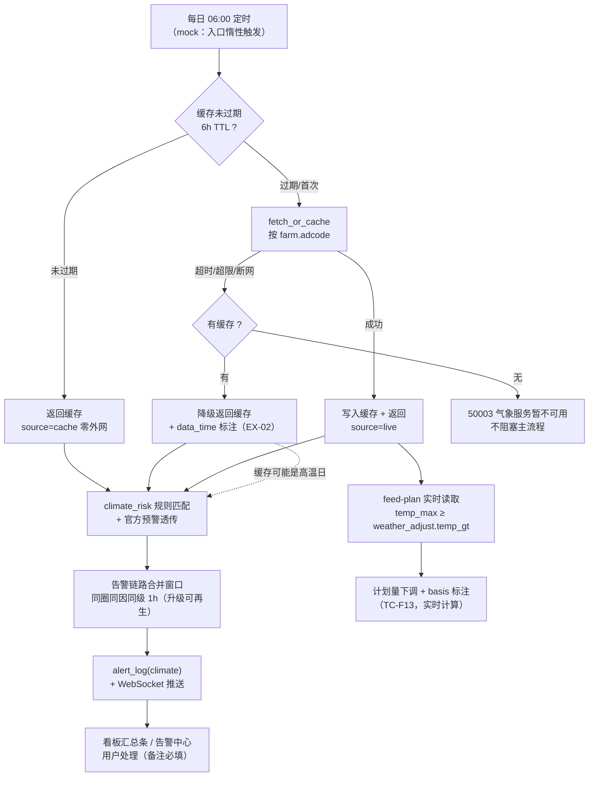

# 智慧养殖多智能体平台 — 功能 PRD：F08 气象告警（多源风险最后一路 · 高温联动喂食）

- 文档版本：V1.4
- 编制日期：2026-10-13
- 编制角色：开发组（承接 F01~F07 纵切实现经验，产品评审视角：司南）
- 依据文档：主 PRD V1.7（3.4 气象气候告警模块、3.1.5 喂食气象联动、3.6 台账 climate 类型、附录 性能/可靠性、EX-02）、《01-系统架构设计》（4.3 气象子图 fetch_or_cache→climate_risk_match→advice、services/weather.py APScheduler、5.3 Redis `weather:{adcode}` TTL 6h、第七节 EX-02 落点）、《02-数据库设计》（species.climate_risk、alert_log alert_type=climate）、《03-API接口设计》（十五节 GET /weather、1.3 错误码 50003）、《04-开发计划》阶段 8（8.1~8.3）、《05-测试计划》（TC-F13、TC-G03、1.2 断网注入）、《06-UI页面设计规范》4.2（看板气象卡）/4.8（告警中心 climate 类型）、《14-功能PRD-F06》（weather_adjust 钩子决策 4/RK-4）
- 对应里程碑：**M8**（气象告警，前置 M3 告警链路已实现、M5 对话 weather 意图已分类；与 M6/M7 并行无阻塞）
- 合规声明：本方案为产品设计参考，具体实施请结合公司合规与法务要求确认

---

## 一、文档信息

| 版本 | 日期 | 变更 | 评审记录 |
|------|------|------|---------|
| V1.0 | 2026-10-13 | 首次出稿（阶段 8 纵切功能 PRD，第八刀）：气象数据获取与 6h 缓存 + EX-02 降级 + climate_risk 规则告警 + 看板气象卡接真 + 高温联动喂食计划（TC-F13 回归）+ 对话天气问答接数据源 | 待评审 |
| V1.1 | 2026-10-13 | 自查修订（第 1 轮，评审视角：产品/研发/测试）：① FR-03 告警归属粒度定稿——气象数据按 adcode 场级命中，但告警生成口径经实现评审（V1.4）反转为**圈级**（pen_id 指向该圈、按圈物种匹配、合并键带 level），以 V1.4 结论为准；② EX-W2 与主 PRD EX-02 对齐：过期缓存也返回 + data_time 强标注（staleness 由数据时间透明化），50003 仅限完全无缓存；③ FR-05 补规则源解耦：weather_adjust 规则唯一来源是 feed_nutrition_lib，生效配方圈同样按品种/阶段匹配该规则；④ FR-04「主养殖场」改「当前选中养殖场」（TopBar 可切换）；对话带 pen_id 时取该圈舍所属养殖场；⑤ RK-1 措辞修正：mock 契约为自有结构，和风字段在切真适配层映射，非直接透传；⑥ FR-07 官方预警等级映射补来源标注（国家气象灾害预警信号等级）；⑦ EX-W3 随①同步合并键表述 | 第 1 轮自查通过 |
| V1.2 | 2026-10-13 | 数据源定稿（用户拍板）：① 决策 1 定稿——气象数据源为**高德天气 MCP**（maps_weather 工具，按 adcode 查询实况+预报；key 由用户提供，配置位预留，本档不落明文），和风天气降为备选存档；② 决策 4 改写——主路径高德天气 MCP，weather_sim 降级为 key 未配置/EX-02 演练的兜底模拟器；③ FR-01 补高德字段映射与 key 配置口径（GET /weather 契约零改动；precip_prob 高德无此字段，由天气现象推导或留空）；④ FR-07 官方预警透传标注数据源受限——高德无预警接口，warnings 契约保留恒空数组，weather_sim 注入演练，真实预警源入版本池；⑤ 费用纪律更新为高德免费额度语境；⑥ 依赖表/RK-1/RK-2/待确认④/不包含清单同步；⑦ 实施顺序补适配层步骤，TC-G03 笔误修正 | 数据源评审（用户定稿） |
| V1.3 | 2026-10-13 | 实现回写（mock 层纵切，F08 FR-01~08 全部实现）：① 气象服务层 weather-service.ts 新建（weather_sim 确定性兜底 + 高德 REST 适配层 fetchLiveFromAmap（key 配置位 localStorage `sf_amap_weather_key`，切真后端 AMAP_WEATHER_KEY 同契约）+ climate_risk 匹配纯函数 + `sf_weather_cache:{adcode}` 6h 缓存——**零建表零迁移**，主 MockDb 结构不变）；② GET /weather 分发（缓存三态 + EX-02 两分支 + key 配置时 primeWeatherLive 前置刷新、outcome 标记区分 live/cache）；③ climate 告警单通道生成（按圈物种匹配、mergeStore 复用 1h 合并、key 带 level 支持升级再生；新增演示/测试钩子 resetAlertMergeWindows）；④ FR-05 钩子激活：applyWeatherAdjust 三参改造（planKg×规则×当日 temp_max），formula 分支规则按圈舍营养标准取，basis 追加「高温下调 X%（依据气象阈值 Y℃）」，planned_kg 快照自动兼容口径 458；⑤ FR-06 对话 weather 分支接数据源（主养殖场场级、降级不编造）；⑥ FR-04 看板气象卡接真（live/cache 角标 + data_time + 降级橙标 + 风险条 + mock 演示注入菜单：高温/连击/暴雨/霜冻/大风/预警/失败演练；data/mock.ts weatherData 静态数据移除）；⑦ RTM 状态同步「已实现（mock）」；⑧ 验证：tsc 0 错误、build 通过、冒烟 f07 48/48（旧回归）+ f08 55/55（TC-W 系列 + TC-F13/G03 回归 + 高德映射纯函数，见 smart-farming-project/.smoke/，run.ts 支持模块选择） | 第 3 轮实现评审 |
| V1.4 | 2026-10-13 | 实现核验 + 自查修订（第 4 轮，评审视角：产品/研发/测试）：**实现 claims 全部核验属实**（weather-service.ts/mock-backend F08 编排/tsc 0 错误/build 通过/冒烟 f07 48/48 + f08 55/55/CLIMATE_RISK_SEED 四类值与文档拟定值一致/50003 与 EX-02 两分支/FR-05 三参钩子与 formula 分支规则源）。文档侧修订 5 项：① 告警归属粒度定稿**圈级**（V1.1 行①的「场级」表述经实现评审反转，以此行为准）——术语表重写为「圈级生成口径」并写明三条理由（物种规则按圈匹配使 EX-W7 按圈生效、告警带圈名可直接行动、mock DbAlert.penId 非空零改结构），FR-03 规则/验收、九节流程图、EX-W3 同步「同圈同因**同级** 1h 合并、级别升级（mid→high）允许再生 1 条」；② EX-W2 修正为「过期缓存也返回 + data_time 强标注，50003 仅限完全无缓存」（与主 PRD EX-02 原文及实现 resolveWeatherForFarm 行为对齐，原「过期缓存不返回」作废）；③ 版本号重排（原两行均标 V1.1，数据源定稿行改 V1.2、实现回写行改 V1.3）；④ FR-05 正文补「规则来源与计划量来源解耦」条款（实现已落地）；⑤ FR-07 补预警等级映射来源标注、FR-06 补「主养殖场」口径理由（对话无场切换上下文，与看板当前选中场的差异为有意指名） | 第 4 轮核验通过 |

## 二、功能概述与目标

- **功能概述**：按养殖场 adcode 定时拉取第三方气象数据（未来 3 天预报 + 官方气象预警），Redis 缓存 6 小时；读取物种 `climate_risk` 规则匹配暴雨/霜冻/高温/大风，生成养殖专属气候告警，与传感器/视觉/疫病告警同通道汇聚（1h 合并窗口）进告警中心；高温日按 `weather_adjust` 规则自动下调喂食计划量并标注原因。这是「传感器 + 视觉 + 气象 + 疫病」多源风险版图的最后一路，也是**养殖户零设备投入即可获得**的第一路风险预警。
- **背景**：F01~F07 交付后，告警链路（F03）已打通传感器与设备离线，视觉告警有模拟注入（F03/F09 预留位），疫病告警由问诊链路产生——唯独气象一路空转：看板气象卡是阶段 0.4 骨架的演示数据（注释明确「阶段 6/8 逐页接真」），F05 对话里天气意图返回的是「气象服务即将开放」占位话术，F06 喂食计划的 `weather_adjust` 钩子恒等不生效（F06 决策 4/RK-4，等气象数据源）。本期把这三个消费口全部接上同一气象数据源。
- **要解决的问题**：① 气象数据按 adcode 拉取、缓存、失败降级（EX-02）无实现；② climate_risk 规则匹配与养殖专属告警无产生源，告警中心 climate 类型筛选一直是空态；③ 高温联动喂食计划（TC-F13）钩子未激活，高温天料肉比恶化无任何系统干预；④ 看板气象卡、对话天气问答两个高频触点无真实数据。
- **成功指标与口径**：

| 指标 | 目标值 | 口径 |
|------|--------|------|
| 降级可用率 | 100% | 气象 API 失败时有缓存必返回缓存 + data_time 标注；无缓存必返回 50003 文案，不阻塞看板（EX-02，TC-W01/W02） |
| climate 告警触达 | ≤5 分钟 | 每日定时拉取完成后 climate 告警前端可见（含 WebSocket 推送，本文档具体化时点：每日 06:00 拉取） |
| 喂食联动回归 | 100% | 高温日 feed-plan 计划量按 weather_adjust 下调且 basis 标注原因（TC-F13，实时计算非预生成） |
| 缓存命中零外网 | P95 ≤300ms | source=cache 的 GET /weather 不发起外网请求（mock 期读本地缓存） |

## 三、名词与术语

| 术语 | 定义 |
|------|------|
| adcode | 行政区划编码（farm_info.adcode，建场时由前端行政区划选择器带出）；气象 API 按 adcode 查询，缓存键 `weather:{adcode}`（01-架构 5.3，TTL 6h） |
| climate_risk 规则 | species.lifecycle 同级配置 JSONB：暴雨/霜冻/高温/大风四类风险的触发阈值（如 `{"heat_stress":{"temp_gt":35}}`，02-数据库）；命中即生成 climate 告警 |
| weather_adjust | feed_nutrition_lib 的气象调整规则（如 `{"high_temp":{"temp_gt":32,"reduce_concentrate_pct":10}}`，F06 种子已建）；**与 climate_risk 分工：weather_adjust 管喂食计划下调阈值，climate_risk 管告警阈值，两者分别配置**（本文档具体化，防双阈值混淆） |
| 官方气象预警 | 气象部门发布的预警（warning），透传生成对应等级 climate 告警，不等规则匹配（V1.1：高德天气 MCP 无预警接口，透传链路保留、真实生效待预警源入版本池，见 FR-07） |
| data_time | 气象数据的取数时间（缓存写入时刻）；降级返回时必须随数据标注「数据更新于 X 小时前」（EX-02） |
| 热应激（heat_stress） | 高温超出物种耐受阈值的管理风险期：轻则采食下降，重致死淘上升；联动喂食下调精料比例是主 PRD 3.1.5 的应对手段 |
| climate 告警的圈级生成口径（V1.4 定稿） | 气象数据按 adcode **场级**命中，但告警**按圈舍生成**（pen_id 指向该圈）：① 物种规则按圈匹配（猪圈 35℃ 阈值生效、无规则圈不生成规则告警——EX-W7 按圈生效）；② 告警内容带圈名可直接行动；③ mock DbAlert.penId 非空，零改结构。合并键 `climate:{pen_id}:{risk_type}:{level}`：同圈同因**同级** 1h 内仅 1 条；级别升级（mid→high）允许再生 1 条，避免升级被合并吞掉。（V1.1 行①曾定稿「场级告警 pen_id 空」，经 V1.4 实现评审反转为圈级，以此条为准） |

## 四、需求范围

**包含**：
1. 气象数据获取与缓存（GET /weather）：按 farm.adcode 拉取未来 3 天预报 + 官方预警；每日定时（具体化 06:00）+ 看板手动刷新；缓存 6h（mock 期 localStorage 同结构，切真 Redis `weather:{adcode}`）
2. 失败降级（EX-02）：API 超时/超限返回最近缓存 + data_time 标注；无缓存返回 50003「气象服务暂不可用」，不阻塞主流程
3. climate_risk 规则匹配与告警生成：四类风险阈值匹配 → 风险等级 + 对本物种影响 + 预防管理建议；官方预警透传；走告警单通道 1h 合并窗口进 alert_log(climate) + WebSocket
4. 看板气象卡接真（06 规范 4.2）：未来 3 天 + data_time 标注 + live/cache 角标 + 降级文案；替换阶段 0.4 骨架演示数据
5. 高温联动喂食计划（TC-F13 回归）：feed-plan 实时读取当日气象，按 weather_adjust 下调计划量并 basis 标注原因；激活 F06 恒等钩子
6. 对话天气问答接数据源（TC-G03 回归）：intent=weather 取主养殖场气象返回风险 + 建议，替换 F05 占位话术
7. 告警中心 climate 类型闭环：F03 已建类型筛选从空态转为有数据；处理（acknowledge/resolve 备注必填）落 record_type=climate 台账（F03 既有口径）

**不包含（本期不做）**：
- 真实气象取数（key 未到位前）：V1.1 定稿主路径为高德天气 MCP，key 由用户提供后启用；此前 weather_sim 兜底（决策 4，EX-02 演练不受影响）
- 15 天中长期预报延伸、历史气象回算（V1.1 视需求）
- 气象对配方/营养建议的深度调整（多雨防霉等措施）：属饲料 Agent 配方建议范畴（主 PRD 3.5），本期仅在 climate 告警的建议文案中体现预防提示
- 羊/牛 climate_risk 与 weather_adjust 规则实灌：配置格式已定稿，种子随第二/三阶段横向复制补（缺规则物种不生成 climate 告警，见 FR-03）

## 五、方案对比与选型

**决策 1：气象数据源选型 — 高德天气 MCP（定稿）vs 和风天气（备选存档）**

| 方案 | 说明 | 结论 |
|------|------|------|
| 高德天气 MCP | 经 MCP 协议接入高德官方气象能力（maps_weather 工具，按 adcode 查询实况 + 未来 3~4 天预报）；key 由用户开通提供（高德开放平台，配置位见 FR-01，本档不落明文） | **定稿（V1.1 用户拍板）**：MCP 生态现成接入、零自建 HTTP 客户端；预报窗口正好覆盖「未来 3 天」需求；key 到位即真实取数。已知限制：无官方气象预警接口——FR-07 透传链路保留、真实生效待预警源（入版本池）；precip_prob 无此字段（映射层推导，见 FR-01） |
| 和风天气 | 3 天预报 + 官方预警（warning 数组带级别）+ 免费开发额度；按 adcode 查询 | 备选存档（V1.0 原推荐）：如后期需要官方预警透传真实生效，切此源走适配器模式，GET /weather 契约不变（与 RK-1 应对同层） |

**决策 2：climate 告警生成与合并位置 — 告警链路服务层统一合并 vs 气象模块自行落库**

| 方案 | 说明 | 结论 |
|------|------|------|
| 告警链路服务层统一合并（推荐） | 气象模块只产「待生成告警」事件，由告警服务层按 1h 窗口 + 同圈同因合并后落 alert_log + WebSocket | **推荐**：01-架构 5.x 单通道汇聚（四类风险统一出口）；防止每日批量拉取时同因告警刷屏；与 F03 传感器告警同路径同状态机，零新增链路 |
| 气象模块自行写 alert_log | 少一跳 | 不采用：破坏「出口唯一」，多源合并窗口失效，告警中心状态闭环要写两套 |

**决策 3：高温联动喂食接入点 — feed-plan 实时读取气象 vs 告警时预生成下调计划**

| 方案 | 说明 | 结论 |
|------|------|------|
| feed-plan 实时读取当日气象匹配 weather_adjust（推荐） | 计划计算时读缓存气象，temp_max ≥ temp_gt 即按 reduce_concentrate_pct 下调 perHead 并 basis 标注 | **推荐**：TC-F13 口径「当日计划量计算纳入 weather_adjust（实时计算，非预生成）」；气象变化/缓存刷新后计划自动跟随；与 F06 planned_kg 快照口径 458 兼容（登记时刻按下调后量快照） |
| 告警触发时改写配方/计划存储值 | 一次写入长期生效 | 不采用：高温持续多日需按日调整，预生成会过期；且绕过 planned_kg 快照口径 |

**决策 4：气象数据路径 — 高德天气 MCP 主路径（V1.1 定稿）+ weather_sim 兜底模拟器**

| 方案 | 说明 | 结论 |
|------|------|------|
| 高德天气 MCP 主路径 | GET /weather 的 fetch 节点经高德天气 MCP 取真实数据（maps_weather 按 adcode 查询；key 待用户提供，配置位预留）；映射层转换为 FR-01 契约形状，GET /weather 契约零改动 | **定稿（V1.1 用户拍板）**：key 到位后每日 1 次/场 + 6h 缓存限频（高德免费额度内）；EX-02 降级与缓存三态不受数据源影响 |
| weather_sim 兜底模拟器（降级保留） | 本地确定性生成 3 天预报 + 演示注入（高温/暴雨/霜冻/大风 + 模拟官方预警注入）+ 失败开关 + 6h 缓存 | **兜底保留**：key 未配置时演示/开发用；EX-02 断网注入与 FR-07 透传链路演练稳定复现（PRD 3.3.4 模拟数据一等公民）；数据形状 = FR-01 契约（高德映射后） |

## 六、目标用户与使用场景

| 角色 | 本功能内的场景 | 权限边界 |
|------|--------------|---------|
| farmer（主角色） | 看板看气象卡与未来 3 天、处理 climate 告警、高温日喂食计划自动下调后按新计划打卡、对话问天气 | 仅本人名下养殖场气象（farm_id 归属 40302） |
| vet / admin | 本阶段不涉及（climate_risk 规则 admin 维护随后台管理，随阶段 10） | 无入口差异 |

**主流程（每日自动链路）**：APScheduler 每日 06:00 → 遍历有 adcode 的养殖场 fetch_or_cache → 规则匹配（climate_risk + 官方预警）→ 告警服务层 1h 合并 → alert_log(climate) + WebSocket 推送 → 看板汇总条/告警中心呈现 → 用户处理（备注必填，落 climate 台账）。

**主流程（用户主动链路）**：进入看板 → 气象卡看未来 3 天与 data_time（可 [刷新]）→ 或 AI 对话问「明天会下雨吗」→ 返回该场气象风险 + 建议；高温日进入喂食中心 → 计划量已按 weather_adjust 下调并标注原因 → 按新计划打卡。

**分支流程**：① API 失败有缓存 → 降级返回 + 「数据更新于 X 小时前」（EX-02）；② API 失败无缓存 → 50003 文案，看板其余卡片正常；③ 高温日 → climate 告警 + 喂食计划下调双联动；④ 官方气象预警 → 直接映射告警（等级取官方级别；**V1.1：高德数据源无预警接口，本期由 weather_sim 注入模拟演练，真实源入版本池**）；⑤ 养殖场 adcode 缺失 → 看板气象卡引导去完善地址（不报错、不空跑）。

**异常流程**：越权（40302）、缓存过期且拉取失败（返回过期缓存 + 强标注，见 EX-W2）、跨租户 farm_id、定时任务漏跑（进入看板时惰性补拉一次，与 F07 提醒惰性同模式）——见十二节。

## 七、核心功能点与输入输出说明

### FR-01 气象数据获取与缓存（GET /weather?farm_id=）

- 规则：输入 farm_id（归属校验 40302）；按 farm.adcode 经**高德天气 MCP**（maps_weather 工具，决策 1 定稿）拉取实况 + 未来 3 天预报，映射层转换为本文档契约形状（**GET /weather 契约零改动**；高德 daytemp/nighttemp/dayweather 映射 temp_max/temp_min/text_day；**高德无 precip_prob 字段——由天气现象文案推导估算或留空**，映射表随适配器定稿）；**高德无官方预警接口，warnings 本期恒为空数组**（透传演练见 FR-07）；**key 配置位（V1.1 用户拍板，key 由用户提供后填入，本档不落明文）**：切真后端配置项 `AMAP_WEATHER_KEY`（高德开放平台），key 未配置时 weather_sim 兜底（决策 4）；缓存 6h（mock 期 localStorage 键 `sf_weather_cache:{adcode}` 存 {data, fetched_at}，结构对齐 Redis `weather:{adcode}` String(JSON) 含取数时间）；每日 06:00 定时拉取（mock 期无后台进程，改为「看板/对话/刷新入口惰性触发 + 6h 过期判定」，切真搬 APScheduler）；看板气象卡 [刷新] 手动触发，缓存未过期直接返回缓存（零外网）。
- 输出（**本文档具体化契约，03-API 十五节展开，列文档同步项①**）：`{farm_id, adcode, data_time, source: "live"|"cache", forecast: [{date, temp_min, temp_max, text_day, precip_prob?}], warnings: [{type, level, title}]（**高德数据源本期恒空数组**，weather_sim 可注入模拟演练）, risk: {level, species, impact, advice[]}}`；risk 为空时 level=none。
- 验收标准：
  - Given 缓存未过期，When GET /weather，Then source=cache 且不发起外网请求（P95 ≤300ms）
  - Given 缓存过期或首次，When GET /weather，Then source=live、data_time=本次取数时间、forecast 3 天齐全
  - Given 他人 farm_id，When 请求，Then 40302

### FR-02 失败降级（EX-02）

- 规则：拉取失败（超时/超限/断网）时返回**最近一次缓存**并标注 data_time + source=cache（前端展示「数据更新于 X 小时前」）；**无任何缓存**时返回 code 50003「气象服务暂不可用，请稍后重试」（03-API 1.3 既有码），看板其余卡片与告警链路不阻塞；降级数据仍可跑规则匹配（缓存数据可能是高温日的，保证告警不中断）。
- 验收标准：
  - Given 注入 API 失败且有 2 小时前缓存，When 获取，Then 返回缓存数据 + source=cache + 「数据更新于 2 小时前」标注（EX-02/TC-W01）
  - Given 注入 API 失败且无缓存，When 获取，Then 50003 且看板其他卡片正常渲染（EX-02/TC-W02）
  - Given 缓存为高温日数据且 API 失败，When 规则匹配，Then climate 告警仍正常生成（降级不中断告警）

### FR-03 climate_risk 规则匹配与告警生成

- 规则：读取物种 climate_risk 四类规则（**猪种子本文档拟定，列文档同步项②**：高温 heat_stress temp_gt 35℃ / 暴雨 rainstorm 24h 降水 ≥50mm / 霜冻 frost 最低温 ≤2℃ / 大风 gale 风力 ≥6 级；羊/牛随横向复制补）；匹配 forecast 与 warnings → 生成「待生成告警」：risk_level 映射（规则命中单日 = mid；**连续 3 天命中或官方预警高级别 = high**，本文档具体化，待确认②）；文案 = 风险类型 + 对本物种影响 + 预防管理建议（高温：减精料/增饮水/调整喂食时段；暴雨：防潮防霉/检修排水；霜冻：保温防感冒；大风：加固栏舍防风）；官方预警（warnings）直接透传生成对应等级告警，不等规则（**V1.1：高德数据源恒空，透传逻辑保留、weather_sim 注入演练，见 FR-07**）；**告警按圈舍生成**（pen_id 指向该圈，术语表「圈级生成口径」）：规则按圈物种匹配、合并键 `climate:{pen_id}:{risk_type}:{level}`（同圈同因同级 1h 内仅 1 条；级别升级 mid→high 允许再生 1 条），全部走告警链路服务层（决策 2）落 alert_log(alert_type=climate) + WebSocket；缺 climate_risk 规则的物种不生成 climate 告警（不报错）。
- 验收标准：
  - Given 猪场预报 36℃（≥35），When 匹配，Then 对猪圈生成 mid climate 告警（pen_id 指向该圈），文案含「高温」+ 影响 + 建议（TC-W03）
  - Given 连续 3 天 ≥35℃，When 匹配，Then 生成 high 级 climate 告警
   - Given 官方发布高温橙色预警（weather_sim 注入模拟预警演练；真实预警源入版本池），When 扫描 warnings，Then 直接生成对应等级告警（标题带官方预警类型）
  - Given 同圈同因同级 1 小时内重复触发，When 合并，Then 仅 1 条告警；级别升级时可再生 1 条 high（F03 合并窗口复用，TC-W04）
  - Given 羊场（无 climate_risk 种子），When 匹配，Then 不生成 climate 告警

### FR-04 看板气象卡接真（06 规范 4.2）

- 规则：替换阶段 0.4 骨架演示数据（data/mock.ts weatherData），数据源 GET /weather（**当前选中养殖场**——TopBar 可切换，气象卡跟随切换，FR-04 具体化）；卡片展示未来 3 天（日期/天气/最高最低温，tabular）+ data_time 标注 + live/cache 来源角标；降级时显示「数据更新于 X 小时前」橙色小标（EX-02）；无缓存时显示降级文案「气象服务暂不可用」；adcode 缺失时引导「完善养殖场地址后显示气象」；位置与样式沿用骨架（右 1/3 栏，告警列表下方）。
- 验收标准：
  - Given 有缓存，When 进入看板，Then 气象卡显示 3 天预报 + data_time（06 规范 4.2「数据时间标注可见」）
  - Given 降级数据，When 查看，Then 「数据更新于 X 小时前」标注可见
  - Given 无 adcode，When 查看，Then 引导完善地址而非空白/报错

### FR-05 高温联动喂食计划（TC-F13 回归）

- 规则：feed-plan 计算时读取当日气象（缓存数据即可），当 temp_max ≥ weather_adjust.high_temp.temp_gt 时，按 reduce_concentrate_pct 下调 perHead（计划量 = ΣperHead × 存栏 × (1−pct)），basis 追加「高温下调 X%（依据气象阈值 Y℃）」；激活 F06 恒等钩子 applyWeatherAdjust（决策 3）；实时计算非预生成（缓存刷新/气象变化后计划自动跟随）；与 planned_kg 快照口径 458 兼容（登记时刻按下调后量快照，登记后气象变化不改写历史）；母猪/育肥/仔猪分别按各自营养条目的 weather_adjust 规则（猪种子：育肥 32℃/10%、母猪 30℃/8%，F06 已建）；**规则来源与计划量来源解耦**——生效配方圈同样按圈舍品种/阶段匹配 feed_nutrition_lib 的 weather_adjust 规则（配方本身不带规则，与 03-API 6.1「纳入当日 weather_adjust」同口径，V1.3 已实现）。
- 验收标准：
  - Given 当日预报 33℃（育肥阈值 32），When 查 feed-plan，Then 计划量下调 10% 且 basis 含「高温下调 10%」（TC-F13）
  - Given 当日 28℃（未达阈值），When 查 feed-plan，Then 计划量与 F06 完全一致（零回归）
  - Given 高温日登记饲喂，When 次日气象回落查历史，Then planned_kg 仍为登记时刻下调后快照（口径 458 兼容）

### FR-06 对话天气问答接数据源（TC-G03 回归）

- 规则：intent=weather（F05 已分类）取该用户**主养殖场**气象（无需圈舍定位——气象是场级信息；**对话无养殖场切换上下文故取主养殖场，与看板「当前选中养殖场」（FR-04）的差异为有意指名，非不一致**），返回 SSE 文本：本地天气 3 天概况 + 风险等级 + 对本物种影响 + 建议（数据源同 FR-01）；降级/无缓存时返回 50003 话术「气象服务暂不可用，请稍后重试」；替换 F05「气象服务即将开放」占位话术。
- 验收标准：
  - Given 问「明天会下雨吗」，When 对话，Then intent=weather 且回复含该场 3 天预报 + 风险建议（TC-G03）
  - Given 气象无缓存且 API 失败，When 问天气，Then 回复暂不可用话术（不编造天气）

### FR-07 官方气象预警透传（V1.1：链路保留 + 模拟注入演练，真实生效待预警源）

- 规则：warnings[] 中官方预警（type/level/title）逐条映射生成 climate 告警：level 映射 risk_level（蓝色=low/黄色=mid/橙色=high/红色=high 且置顶，本文档具体化；**来源为国家气象灾害预警信号等级蓝/黄/橙/红四级**）；标题带官方预警类型（如「高温橙色预警」）；与规则告警同通道合并（同圈同级收敛、升级再生）；官方预警不依赖 species.climate_risk 配置（对所有物种生效）。**V1.1 数据源限制：高德天气 MCP 无官方预警接口，切真后 warnings 恒为空数组——本条透传链路保留（weather_sim 注入模拟预警可演练，验证步骤④照常执行），真实官方预警数据源（如和风 warning）列入《08-遗留问题》版本池，接入时零改链路。**
- 验收标准：
  - Given 官方发布暴雨黄色预警（weather_sim 注入），When 扫描，Then 生成 mid climate 告警且标题含「暴雨黄色预警」
  - Given 官方红色预警（weather_sim 注入），When 扫描，Then 生成 high 并置顶展示

### FR-08 告警中心 climate 类型闭环

- 规则：F03 类型筛选 climate 从空态转为有数据源；告警产生即落 record_type=climate 台账（F03 appendLedgerEntry 既有口径：record_type 取 alert_type）；处理动作 acknowledge/resolve（备注必填，42201 拦截）同样落 climate 台账；处理建议文案与 FR-03 一致。
- 验收标准：
  - Given climate 告警产生，When 告警中心按 climate 筛选，Then 可见且可处理（TC-W05）
  - Given resolve 无备注，When 提交，Then 42201 拦截（F03 同款）
  - Given 处理完成，When 查台账，Then record_type=climate 记录含溯源 alert_id

## 八、非功能需求

| 项 | 要求 | 口径 |
|----|------|------|
| 性能 | 缓存命中 GET /weather P95 ≤300ms 零外网；live 拉取 ≤2s（mock 本地 ≤50ms）；定时拉取异步不阻塞主业务 | 主 PRD 非功能/05-测试三节 |
| 可靠性 | EX-02 降级 100%（有缓存必返回缓存+标注，无缓存必 50003）；缓存 6h TTL 严格（过期即拉新） | 代码审查 |
| 一致性 | weather_adjust 只影响计划计算不改写存储值；planned_kg 快照口径 458 兼容；告警状态机 pending→acknowledged→resolved 复用 F03 | 代码审查 |
| 安全 | farm_id 归属 40302 贯穿；气象为公开数据，同 adcode 多租户共享缓存属合理设计（无隐私数据，十一节） | 代码审查 |
| 兼容 | 气象卡 <768 降级为 3 天纵列；告警卡复用 F03 响应式 | DevTools 验证 |
| 无障碍 | live/cache 角标带文字非仅颜色；风险等级三色 + 文字标签（06 规范全局规则） | Tab 走查 |
| 费用 | 高德天气 MCP 按用户提供的 key 走免费额度：每日 1 次/场定时拉取 + 6h 缓存限频，演示期手动刷新单次；key 未配置时 weather_sim 兜底零调用；禁止循环重试与压测 | 2026-10-12 费用纪律 + V1.1 数据源定稿 |

## 九、操作流程与状态流转

气象数据状态：live（新取数）→ cache（6h 内）→ expired（待拉新）；climate 告警状态机复用 F03：pending → acknowledged → resolved（单向，resolved 必须 handled_note）。

## 十、数据与埋点

- **数据落库**：气象缓存（mock localStorage `sf_weather_cache:{adcode}`，切真 Redis `weather:{adcode}`，结构 {data, fetched_at}，TTL 6h）；climate_risk 规则种子（species-data，猪四类，02-数据库 species.climate_risk 结构）；climate 告警（复用 alert_log + F03 告警产生/处理落台账口径，record_type=climate）；台账 climate 类型（F04 RECORD_TYPES 已含）。
- **最小数据能力**：① 气象告警计数与等级分布（看板汇总条）；② 缓存命中率 = source=cache 次数 ÷ 总获取次数（降级观测，EX-02 演练指标）；③ 高温下调天数计数（喂食中心 basis 标注统计）。真实看板随阶段 12。
- **指标口径**：缓存命中率统计窗口为自然日；高温下调天数 = 当日 feed-plan 命中 weather_adjust 的圈舍去重数；climate 告警等级以 alert_log.risk_level 为准。

## 十一、权限与安全要求

- 数据归属：GET /weather 的 farm_id 经 resolveFarm 校验（40302/40401）；adcode 仅用于公开气象数据查询，不透出他人养殖场信息。
- **公开数据共享设计**：气象数据按 adcode 缓存（`weather:{adcode}`，01-架构 5.3 既定键设计），同 adcode 多租户共享缓存条目——气象为公开数据无隐私属性，此设计控制 API 调用频率；不构成数据越权（响应体内不含任何租户信息）。
- 告警处理：resolve 无 handled_note 返回 42201（F03 同款，EX-C8 复用）；告警台账不可篡改（无更新/删除接口，TC-R04）。

## 十二、异常处理与边界情况

| 编号 | 异常 | 处理 | 用户可见文案 | 状态 |
|------|------|------|------------|------|
| EX-02 | 气象 API 超时/超限（有缓存） | 返回最近缓存 + data_time 标注 | "数据更新于 X 小时前" | 复用 **EX-02** |
| EX-02 | 气象 API 失败且无缓存 | 50003，不阻塞看板其余卡片 | "气象服务暂不可用，请稍后重试" | 复用 **50003** |
| EX-W1 | 养殖场 adcode 缺失 | 不拉取不报错，气象卡引导完善地址 | "完善养殖场地址后显示气象信息" | 新增引导态 |
| EX-W2 | 缓存过期且拉取失败 | **返回过期缓存 + data_time 强标注**（「数据更新于 X 小时前（缓存已过期）」；与主 PRD EX-02「返回最近缓存数据并标注数据时间」对齐，staleness 由数据时间透明化）；仅当完全无缓存时 50003。V1.4 修正：原「过期缓存不返回」作废（与主 PRD 及实现 resolveWeatherForFarm 行为矛盾） | "数据更新于 X 小时前（缓存已过期）" | 具体化（V1.4 修正） |
| EX-W3 | 同圈官方预警与规则同时命中 | 按合并键收敛：同级合并为一条（标题保留官方预警类型）；预警级别更高时升级再生 1 条 high | 展示高等级告警 | 复用合并窗口（V1.4 补升级再生口径） |
| EX-W4 | 访问他人养殖场气象 | 拦截 | "无权限访问" | 复用 **40302** |
| EX-W5 | 高温下调与手工登记冲突 | 登记时 planned_kg 快照下调后计划量；登记后气象变化不改写历史 | 日历显示登记时刻快照 | 口径 458 兼容 |
| EX-W6 | 定时任务漏跑/未到点 | 看板/对话/刷新入口惰性补拉（与 F07 提醒惰性同模式） | 无感知 | 具体化 |
| EX-W7 | 物种无 climate_risk 规则 | 不生成 climate 告警（官方预警仍透传） | 无 | 具体化 |

> 无新增错误码：50003 为 03-API 1.3 既有码，本期零新增（沿用 F06/F07「无新增错误码」纪律）。

## 十三、上线计划、依赖与验证

- **依赖评估**：

| 依赖项 | 所属 | 就绪状态 | 分级 | 说明 |
|--------|------|---------|------|------|
| 告警链路（alert_log/状态机/WebSocket/合并窗口） | F03 | 已实现 | 就绪 | climate 告警同通道，零改链路 |
| 看板气象卡位置与样式 | 阶段 0.4 骨架 | 已建（演示数据 weatherData） | 就绪 | 替换数据源，不动布局 |
| weather_adjust 规则种子（猪：育肥 32℃/10%、母猪 30℃/8%） | F06 | 已建 | 就绪 | 激活恒等钩子（决策 3） |
| 对话 weather 意图分类 | F05 | 已实现（占位话术） | 就绪 | 替换话术为数据源 |
| climate_risk 猪种子（四类阈值） | 本期切片 | 未建 | 阻塞（切片消除） | species-data 按 02-数据库结构入种子（FR-03 拟定值） |
| weather_sim 模拟器 + 6h 缓存 + 失败注入开关 | 本期 | 未建 | 阻塞（本期新建） | 决策 4；切真换 fetch_or_cache 节点 |
| GET /weather 契约展开 | 本期 | 03-API 仅一句话 | 阻塞（文档同步） | FR-01 具体化契约回写 03-API 十五节 |
| 高德天气 key（maps_weather，用户提供） | 配置 | 待用户提供 | 阻塞（主路径，兜底可绕） | key 到位后配置 `AMAP_WEATHER_KEY`（切真）并接入高德天气 MCP；未配置时 weather_sim 兜底（决策 4）；免费额度内限频 |

- **实施顺序**：climate_risk 种子 + weather_sim 兜底 + 缓存（8.1）→ 高德天气 MCP 适配层（key 到位即切主路径）→ GET /weather + 降级（EX-02 两分支）→ 规则匹配 + 告警生成走单通道（8.2）→ 看板气象卡接真（8.3）→ FR-05 喂食联动激活 F06 钩子 → FR-06 对话天气接数据源 → FR-07/08 预警透传（模拟注入）与告警中心闭环 → TC-W + TC-F13/TC-G03 回归验收。
- **验证步骤**：① 缓存命中/过期/live 三态 + 零外网断言；② 注入 API 失败：有缓存降级标注 / 无缓存 50003 两分支（EX-02）；③ 注入高温 36℃ → mid 告警 + 连续 3 天 high；④ 官方预警透传与合并（EX-W3）；⑤ 高温 33℃ → 喂食计划下调 10% + basis 标注，28℃ 零回归（TC-F13）；⑥ 对话问天气返回该场数据（TC-G03）；⑦ 告警中心 climate 筛选 + resolve 无备注 42201 + climate 台账；⑧ 回归 F06 计划快照口径（高温日登记后气象回落，历史 planned_kg 不变）；⑨ 演示脚本：「看板气象卡 → 高温告警推送 → 喂食计划自动下调 → 对话问天气 → 处理告警落台账」。
- **回滚**：纯增量（缓存 + 新接口 + 告警产生源 + 看板卡片数据源替换）；回滚 = 气象卡还原骨架演示数据、摘除 weather_sim 与 /weather 路由、恢复 F05 占位话术与 F06 恒等钩子；缓存数据可留（TTL 6h 自然过期）。

## 十四、风险与遗留问题（关键注意事项）

| 编号 | 风险/遗留 | 类别 | 概率×影响 | 等级 | 应对 |
|------|----------|------|----------|------|------|
| RK-1 | 高德天气字段与 FR-01 契约存在字段差（precip_prob 缺失、无预警接口，切真返工） | 技术 | 2×3 | 中 | 映射层收敛差异并写入 FR-01 契约（precip_prob 由天气现象推导或留空、warnings 恒空）；GET /weather 契约零改动；weather_sim 按 FR-01 契约形状生成 |
| RK-2 | 高德免费额度耗尽（key 到位后） | 成本 | 2×2 | 低 | 每日 1 次/场定时拉取 + 6h 缓存天然限频；演示期手动刷新单次；费用纪律禁止循环重试；超限时临时回退 weather_sim 兜底 |
| RK-3 | climate_risk 与 weather_adjust 双阈值混淆（告警阈值 ≠ 下调阈值） | 数据 | 3×2 | 低 | 术语表明确分工；FR-05 basis 文案同时标注两个阈值来源；评审时确认 |
| RK-4 | 1h 合并在「每日一次批量生成」节奏下作用有限 | 体验 | 2×1 | 低 | 合并逻辑保留为多源预留（手动刷新/多次补拉场景仍生效）；不做特殊化 |
| RK-5 | 羊/牛无 climate_risk 规则期间 climate 告警缺失 | 数据 | 3×1 | 低 | 官方预警透传对所有物种生效（FR-07）；规则种子随横向复制补（EX-W7 明确不报错） |
| RK-6 | 降级数据可能是数小时前高温日，用户误当实时 | 体验 | 2×2 | 低 | data_time + 「数据更新于 X 小时前」强制标注（EX-02 硬要求）；来源角标 cache 态常显 |

**待确认项（评审时拍板）**：① 每日定时拉取时点（建议 06:00——赶在当日高温峰值前的管理决策时间）；② 高温告警分级阈值（建议：单日命中 = mid、连续 3 天命中或官方高级别 = high）；③ climate_risk 四类猪种子取值（本文档拟定：高温 35℃/暴雨 24h 50mm/霜冻 ≤2℃/大风 ≥6 级，来源为公开气象预警等级标准整理，标「估算」）；④ ~~和风天气 vs 高德天气最终选型~~——**已定稿（V1.1 用户拍板）：高德天气 MCP，key 由用户提供**；官方预警真实生效源（和风 warning 或其他）转版本池。

**文档同步项（评审通过当天执行）**：① 03-API 十五节展开 GET /weather 请求/响应契约（FR-01 具体化：forecast/warnings/risk 结构 + source/data_time 语义，并注明数据源为高德天气 MCP 与 key 配置位）；② 02-数据库 species.climate_risk 补四类猪种子 JSON 与阈值口径（与 weather_adjust 分工注释）；③ 05-测试计划 2.9 节新增 TC-W01~W06 用例（缓存三态/EX-02 两分支/规则告警/合并/告警中心闭环/联动回归，官方预警用例标注 weather_sim 注入口径）；④ F06 PRD RK-4 勾销（weather_adjust 钩子本期激活）；⑤ 06-UI 4.2 气象卡无需结构变更（仅数据源替换，列入验收核对）；⑥ 01-架构 4.3 气象子图 WX 节点与 services/weather.py 注明数据源为高德天气 MCP（决策 1 定稿、key 配置位、无预警接口限制）。

## 十五、附录

### 15.1 需求追踪矩阵（RTM）

| 需求编号 | 需求描述 | PRD 章节 | 前端 | 后端接口 | 测试用例 | 状态 |
|---------|---------|---------|------|---------|---------|------|
| FR-01 | 气象获取与 6h 缓存 | 七 | 气象卡 [刷新] | GET /weather | TC-W01 | 已实现（mock） |
| FR-02 | 失败降级 EX-02 | 七 | 降级文案/角标 | （GET /weather 分支） | TC-W01/W02 | 已实现（mock） |
| FR-03 | climate_risk 规则告警 | 七 | 告警中心 | （告警服务层） | TC-W03/W04 | 已实现（mock） |
| FR-04 | 看板气象卡接真 | 七 | 看板气象卡 | GET /weather | FR-04 GWT | 已实现（mock） |
| FR-05 | 高温联动喂食计划 | 七 | 喂食计划 basis 标注 | GET /pen/{id}/feed-plan | TC-F13 回归 | 已实现（mock） |
| FR-06 | 对话天气问答 | 七 | AI 对话 | （chat weather 分支） | TC-G03 回归 | 已实现（mock） |
| FR-07 | 官方预警透传（V1.1：模拟注入演练，真实源待版本池） | 七 | 告警中心 | （warnings 扫描） | FR-07 GWT | 已实现（mock） |
| FR-08 | 告警中心 climate 闭环 | 七 | 告警中心 | POST /alert/{id}/handle | TC-W05 | 已实现（mock） |

### 15.2 接口字段引用

GET /weather 以《03-API接口设计》十五节为准，本文档 FR-01 具体化契约（forecast/warnings/risk/source/data_time）随文档同步项①回写；气象原始数据源为高德天气 MCP（maps_weather，按 adcode 查询，V1.1 定稿），字段映射与 key 配置位见 FR-01；缓存键结构以 01-架构 5.3 `weather:{adcode}` 为准；climate_risk 结构以 02-数据库 species 表注释与同步项②为准；错误码 50003/40302/42201 以 03-API 1.3 为准；weather_adjust 规则以 F06 feed_nutrition_lib 种子为准。

### 15.3 与 F01~F07 的衔接关系

| 衔接点 | 说明 |
|--------|------|
| 消费 F03 | 告警单通道（1h 合并/状态机/WebSocket/处理落台账）零改动复用；climate 类型筛选从空态转有数据 |
| 消费 F05 | weather 意图已分类（TC-G03），占位话术替换为气象数据源回复 |
| 消费 F06 | 激活 weather_adjust 恒等钩子（决策 3）；planned_kg 快照口径 458 兼容；RK-4 勾销 |
| 消费 F01/F02 | farm.adcode（建场时带入）是拉取依据；缺失时引导完善（EX-W1） |
| 为 M12 打底 | 「3 天养殖故事」演示可加入气象环节：高温告警 → 计划下调 → 打卡 → 对话问天气 |

### 15.4 费用纪律声明（本功能专项）

2026-10-12 用户明确要求「省着点用」；V1.1 用户拍板接高德天气 MCP（key 由用户提供）：**key 未到位前零真实调用（weather_sim 兜底）**；key 到位后按高德免费额度使用——每日 1 次/场定时拉取 + 6h 缓存限频，演示期手动刷新单次；禁止对气象接口循环重试/压测。

### 15.5 合规声明

本方案为产品设计参考，具体实施请结合公司合规与法务要求确认。气象数据来源于第三方公开气象服务，仅用于养殖管理风险提示；climate_risk 与 weather_adjust 阈值为公开气象预警等级标准与饲养标准的整理估算值，页面标注「参考值，以当地气象部门发布为准」；气象建议不替代执业兽医诊断与处方。
