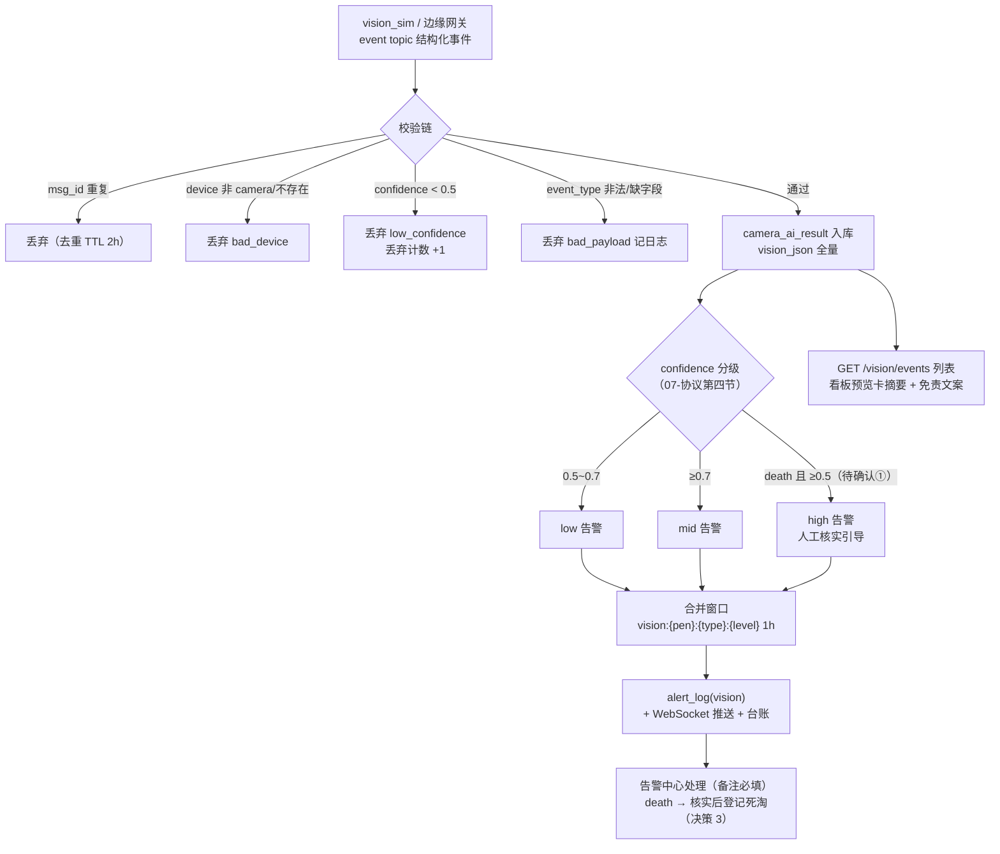

# 智慧养殖多智能体平台 — 功能 PRD：F09 视觉告警（模拟事件 · 多源风险收官）

 - 文档版本：V1.4
- 编制日期：2026-10-13
- 编制角色：开发组（承接 F01~F08 纵切实现经验，产品评审视角：司南）
- 依据文档：主 PRD V1.7（3.3.3 摄像头接入、3.3.4 模拟模式原则、3.6 台账 vision 类型、EX 清单）、《07-硬件通信协议》（第三节 event topic、**第四节 视觉结构化事件 payload 定稿**、六节 vision_sim 规格）、《01-系统架构设计》（4.1 告警产生链路视觉分支、5.3 Redis `mqtt:dedup:{msg_id}` TTL 2h）、《02-数据库设计》（3.5 camera_ai_result 保留 90 天、alert_log vision 类型）、《03-API接口设计》（7.3 GET /vision/events）、《04-开发计划》阶段 9（9.1~9.2）、《05-测试计划》（TC-D09、四节异常注入矩阵）、《06-UI页面设计规范》4.2（看板预览卡）/4.7（设备管理 [预览] 弹窗）、《08-遗留问题》C-01（mediamtx 端口）
- 对应里程碑：**M9**（视觉告警模拟事件，前置 M3 告警链路已实现；M8 气象告警已实现，多源合并模式可直接复用）
- 合规声明：本方案为产品设计参考，具体实施请结合公司合规与法务要求确认

---

## 一、文档信息

| 版本 | 日期 | 变更 | 评审记录 |
|------|------|------|---------|
| V1.0 | 2026-10-13 | 首次出稿（阶段 9 纵切功能 PRD，第九刀）：视觉事件接入与入库 + 协议分级告警 + vision_sim 模拟注入 + 看板预览卡/设备预览占位放开 + 告警中心 vision 闭环 + 免责文案三处固定 | 待评审 |
| V1.1 | 2026-10-13 | 出稿自检（第 1 轮）：① FR-02 咳嗽文案的「[归因分析] 跳问诊链接」移出 V1.0 范围（原与待确认④自相矛盾——正文当已定、待确认又推迟），改「建议尽早 AI 问诊排查（跳转链接 V1.1）」；② FR-04 注入入口收敛为设备管理页单入口（原「设备管理页/看板」双入口表述与 FR-05 职责划分模糊） | 第 1 轮自查通过 |
| V1.2 | 2026-10-13 | 二轮自查修订（第 2 轮，评审视角：产品/研发/测试）：① **免责「三处」第二处落地修正**——原「视觉事件列表」页面在 F09 前端不存在（FR-05 仅摘要卡 + [查看全部] 入口，跳转目标悬空，验收不可测），第二处改定「设备 [预览] 弹窗事件时间线」（FR-06 已建），[查看全部] 改跳告警中心 vision 筛选，二节指标表/术语表/FR-05/三处核对口径全文统一；② **分级边界值消解**——07-协议原文「0.5~0.7 low、≥0.7 mid」存在 0.7 恰好值双区间歧义，明确化为 [0.5, 0.7) → low、[0.7, +∞) → mid（death ≥0.5 → high），FR-02 验收补 0.5/0.7 边界用例；③ FR-01 输出 level 枚举补 high（death 场景，原 low/mid 漏项）；④ 十节「低置信丢弃率」更名「过滤丢弃率」并修正口径（分母含全部丢弃原因，原名称与分子错位）；⑤ EX-V9 场景与文案对齐（误报场景原配登记引导文案，改中性双路径文案）；⑥ FR-05 占位文案「事件识别正常」改「结构化事件接入已就绪」（无事件时不编造运行状态）；⑦ RK-5 标题语病修正；⑧ 实施顺序「CLIMATE_RISK 式枚举种子」改「视觉事件类型文案映射常量」（事件映射为常量非物种配置，防误读入 species-data）；⑨ FR-06「关闭逻辑同现有弹窗」指代明确化 | 第 2 轮自查通过 |
| V1.3 | 2026-10-13 | 实现回写（mock 层纵切，F09 FR-01~07 全部实现）：① **v7 迁移**：MockDb 新增 camera_ai_result 表（`cameraAiResults` + `seq.visionResult`），v6 惰性补表零数据丢失（smart-farming-project/src/lib/mock-backend.ts）；② 引擎扩展 `ingestVisionEvent`：校验链 msg_id 去重（复用 dedupStore 等价 mqtt:dedup TTL 2h）→ device 回表（camera 限定）→ event topic 前缀交叉验证 → 枚举/字段校验 → <0.5 丢弃 → 入库 vision_json 全量透传（bbox/extra 仅存）；**EX-V3/EX-V5 分流细化**：缺字段（含 event_type 缺失、confidence 越界）归 bad_payload，枚举外非空值归 bad_event_type（比十二节原文更精确，其余行为一致）；③ 分级应用层计算 `visionConfidenceLevel` 纯函数（[0.5,0.7) low / ≥0.7 mid / death ≥0.5 high——待确认①默认采纳为实现口径，表内不落 level 与文档同步项②一致），告警单通道复用 createAlertInternal（alert_log+台账+WebSocket 零新增链路），合并键 `vision:{pen}:{type}:{level}` 同因同级 1h 合并、升级再生（F08 口径）；停用设备入库保留、告警跳过（F03 同款裁决）；④ GET /vision/events（倒序分页/中文标签/level 计算/bbox 不返回/device_sn 扩展字段供弹窗过滤）+ POST /vision/simulate（演示注入入口：五类+置信度+异常三演练，走同一校验链非旁路）；⑤ 前端：设备页 [注入模拟事件] 弹窗 + [预览] 模拟模式弹窗（占位画面+事件时间线+免责，toast 占位已替换）、看板摄像头预览卡（FR-05：模拟提示/3 条摘要/[查看全部] 跳 /alerts?type=vision——告警中心新增 URL 参数初始筛选）、告警中心 vision 卡免责文案（**三处共用 VISION_DISCLAIMER 同一导出常量，逐字一致结构性保证**）；⑥ death 不自动扣存栏验证通过（决策 3 断言）；⑦ 过滤丢弃率内存观测 getVisionDropStats（分母含全部丢弃原因，低置信单列，V1.2 口径）；⑧ RTM 状态同步「已实现（mock）」；⑨ 验证：tsc 0 错误、build 通过、冒烟 f07 48/48 + f08 55/55 双回归 + f09 44/44（TC-D09 收口 + TC-V 系列 + EX-V1~V7 全覆盖，.smoke/README.md） | 第 3 轮实现评审 |
| V1.4 | 2026-10-14 | 待确认项拍板 + 文档同步项执行回写（用户确认）：① 四项待确认全部定稿（death ≥0.5→high 采纳 / high 置顶 / 预览卡占位形态 / 咳嗽跳转 V1.1），与已实现口径一致零代码改动；② 五项文档同步项当日执行完毕：03-API V1.6（7.3 契约展开）、02-数据库 V1.5（camera_ai_result 应用层计算注释）、05-测试 V1.3（TC-V01~V06）、07-协议 V1.3（death 升级注记）、F03 PRD V1.1（vision 有源注记）；③ 主 PRD V1.8 变更记录收录本轮回写 | 文档同步完成 |

## 二、功能概述与目标

- **功能概述**：边缘网关（YOLO 识别）只上传**结构化事件 JSON**（不上传视频流），平台按 07-协议第四节 payload 接入：`camera_ai_result` 入库 → confidence 分级 → vision 告警走告警单通道（1h 合并窗口）→ 告警中心处理闭环；模拟期由 vision_sim 按与边缘网关**完全相同的 payload** 注入（协议层模拟，3.3.4 原则）。事件类型五类（V1.0 三物种共用）：扎堆 / 圈舍积水 / 咳嗽 / 精神萎靡 / 死亡牲畜。这是「传感器 + 视觉 + 气象 + 疫病」四路风险的收官一路——**F09 交付后四路风险源全部在线**。
- **背景**：F03 建好了告警链路与 vision 类型筛选（空态展示），设备管理页 camera 设备可建（rtsp_url 必填）、[预览] 按钮为占位 toast「视频预览将于后续版本开放」（与 F02 出栏入口同策略）；07-协议第四节视觉 payload 已定稿但无消费方；TC-D09（视觉事件注入→入库+告警+免责文案）自 F03 起一直挂起。本期把视觉链路从「协议就绪」推进到「端到端可演示」。
- **要解决的问题**：① 视觉事件无接入链路与存储（camera_ai_result 空表）；② vision 告警无产生源（告警中心 vision 筛选空态）；③ 看板摄像头预览卡未建、设备页 [预览] 占位未放开；④ 「仅作提示不作为确诊依据」免责文案无处落地。
- **成功指标与口径**：

| 指标 | 目标值 | 口径 |
|------|--------|------|
| 事件端到端延迟 | ≤5 秒 | vision_sim 注入 → 告警前端可见（模拟场景口径，对齐 TC-D04 模拟 ≤5s） |
| 低置信过滤 | 100% | confidence <0.5 事件不入库不告警，仅丢弃计数（07-协议第四节边界） |
| msg_id 去重 | 100% | 同 msg_id 2h 内重复投递不产生重复事件/告警（QoS1，`mqtt:dedup:{msg_id}`） |
| 免责文案 | 3 处齐全 | 看板预览卡 / 设备 [预览] 弹窗事件时间线 / vision 告警卡固定展示「视觉识别结果仅作为提示，不作为确诊依据」（V1.2 修正：原「视觉事件列表」页面本期不存在） |

## 三、名词与术语

| 术语 | 定义 |
|------|------|
| 视觉结构化事件 | 边缘网关 YOLO 识别输出的 JSON（07-协议第四节定稿）：`{msg_id, device_id, ts, event_type, confidence, bbox?, extra?}`；**只传事件不传视频流**，视频预览走 RTSP→mediamtx 独立链路与本协议解耦 |
| event_type 枚举 | V1.0 三物种共用五类：`huddle` 扎堆 / `water` 圈舍积水 / `cough` 咳嗽 / `lethargy` 精神萎靡 / `death` 死亡牲畜（07-协议定稿枚举名） |
| confidence 分级 | 07-协议定稿：**<0.5 丢弃（不入库不告警）；0.5~0.7 生成 low 告警；≥0.7 生成 mid 告警**；death 事件升级建议见待确认① |
| event topic | `farm/{farm_id}/pen/{pen_id}/{device_id}/event`（07-协议第三节），与传感器 data topic 同前缀不同尾段 |
| msg_id 去重 | QoS1 幂等：Redis `mqtt:dedup:{msg_id}` TTL 2h（01-架构 5.3），同 msg_id 重发不产生重复事件/告警 |
| 免责固定文案 | 「视觉识别结果仅作为提示，不作为确诊依据」（07-协议第四节边界约定）；落地三处（V1.2 定稿）：看板预览卡、设备 [预览] 弹窗事件时间线、vision 告警卡 |
| camera_ai_result | 视觉事件存储表（02-数据库 3.5）：device_id/collect_time/pen_id/vision_json JSONB；保留 90 天 |

## 四、需求范围

**包含**：
1. 视觉事件接入与入库：event topic 消费（或 mock 等价注入函数）、msg_id 去重、device_sn 回表校验（须为 camera 类型）、confidence <0.5 丢弃、`camera_ai_result` 入库（vision_json 全量存）
2. 告警分级与生成：协议分级（low/mid）+ death 升级建议（待确认①）；按圈生成（对齐 F08 圈级口径）、合并键 `vision:{pen_id}:{event_type}:{level}`（同圈同因同级 1h 合并、级别升级再生）；走 F03 告警单通道落 alert_log(vision) + WebSocket + 台账
3. 视觉事件列表（GET /vision/events）：pen_id/from/to 筛选 + 分页；event_type 中文标签 + confidence + 置信度分级标签
4. vision_sim 模拟注入：按 07-协议六节规格（`--mode vision --event huddle --confidence 0.87` 等价能力）；mock 期设备管理页/看板演示入口（事件类型选择 + 置信度滑条 + 异常注入开关）；异常注入：低置信、重复 msg_id、缺字段 bad_payload
5. 看板摄像头预览卡（新建，06 规范 4.2）：未接真实摄像头显示**模拟提示占位** + 该场最近视觉事件摘要 + 免责固定文案
6. 设备管理页 [预览] 放开：占位 toast 替换为「模拟模式」提示弹窗（显示设备信息 + 最近视觉事件；真实拉流随 mediamtx 部署，C-01 端口同步补）
7. 告警中心 vision 闭环：类型筛选空态转有数据；处理 acknowledge/resolve（备注必填）落 record_type=vision 台账（F03 既有口径）

**不包含（本期不做）**：
- 真实视频流预览（RTSP→mediamtx→WebRTC/HLS 拉流）：3.3.4 原则「不模拟视频流」——真实摄像头接入时增加流媒体转发与边缘网关识别两个模块；C-01 端口映射随部署补
- bbox 展示与截图（07-协议：V1.0 平台不展示，V1.1 截图用）
- 物种级事件区分（V1.0 三物种共用同一套事件类型，主 PRD 3.3.3 定稿）
- 死亡事件的自动存栏扣减（决策 3：AI 提示不能替代人工确认，存栏变动须显式登记）
- 真实 YOLO 模型与边缘网关固件（V1.2，主 PRD 版本池）

## 五、方案对比与选型

**决策 1：告警分级 — 严格遵循 07-协议已定稿分级 + death 升级建议**

| 方案 | 说明 | 结论 |
|------|------|------|
| 协议分级为准 + death 升级（推荐） | confidence <0.5 丢弃 / 0.5~0.7 low / ≥0.7 mid（07-协议第四节定稿）；**death 事件建议 confidence ≥0.5 即生成 high**（死亡须人工立即核实，mid 会淹没在列表里） | **推荐**：协议是开发契约不随意推翻；death 升级作为本文档具体化建议列待确认①（若不采纳则 death 同协议分级） |
| 全部按协议分级 | death 与扎堆同级 | 备选：一致性好但死亡事件的紧急性被稀释 |

**决策 2：告警归属粒度 — 圈级生成（对齐 F08 定稿口径）**

- 气象告警 V1.4 已定稿圈级（pen_id 指向该圈、按圈物种匹配、合并键带 level）。视觉事件天然带 pen_id（event topic 含 {pen_id}），直接对齐：合并键 `vision:{pen_id}:{event_type}:{level}`，同圈同因同级 1h 内仅 1 条、级别升级（如 confidence 从 0.65 low 升至 0.85 mid）允许再生 1 条。与 F03/F08 告警模型完全一致，零新增链路。

**决策 3：death 事件不自动扣存栏 — 提示驱动人工确认**

- 存栏快照只能由 stock_change 流水驱动（02-数据库口径 453 纪律），AI 视觉识别的死亡事件存在误报可能（趴卧/阴影），自动扣减会污染账实一致。V1.0：death 事件生成高优先级告警，建议文案引导「请人工核实并到场舍管理登记死淘」；存栏变动由用户显式登记（death 类型）。此为「AI 提示不替代人工」红线在视觉域的落点。

**决策 4：mock 期不做视频流 — 协议层模拟仅结构化事件**

- 3.3.4 原则「在协议层模拟，不在功能层模拟」：vision_sim 发与边缘网关完全相同的结构化事件 JSON（同 topic/同 payload/同去重），不模拟视频流。看板预览卡与设备 [预览] 弹窗显示**模拟提示占位**（设备信息 + 最近事件流 + 免责文案），真实拉流（RTSP→mediamtx→WebRTC/HLS）随真实摄像头部署，属切真范畴（C-01 端口映射同步补）。

## 六、目标用户与使用场景

| 角色 | 本功能内的场景 | 权限边界 |
|------|--------------|---------|
| farmer（主角色） | 看板预览卡看最近视觉事件与模拟提示、处理 vision 告警（死亡核实→登记死淘）、设备页 [预览] 看单摄像头事件流 | 仅本人名下圈舍事件（device_sn 回表→pen→farm 归属链） |
| vet / admin | 本阶段不涉及（事件类型配置无 admin 面；YOLO 模型管理 V1.2） | 无入口差异 |

**主流程（模拟注入演示线）**：设备管理页建 camera 设备（rtsp_url 必填）→ [注入模拟事件] 选类型（如扎堆）与置信度 → 事件入 camera_ai_result → 生成 vision 告警（WebSocket 推送）→ 告警中心处理（备注必填，落 vision 台账）→ 台账可查。
**主流程（用户日常线）**：看板预览卡 → 最近视觉事件摘要（如「1 号圈 2 小时前 咳嗽 · 置信 0.82」）→ 点击进告警中心处理 → death 类告警提示人工核实存栏。
**分支流程**：① 低置信（<0.5）→ 丢弃不入库（丢弃计数可见）；② 中置信（0.5~0.7）→ low 告警；③ 重复 msg_id → 去重不重复告警；④ 同圈同因 1h 内重复 → 合并为一条。
**异常流程**：payload 缺字段/类型错 → 跳过记日志不崩溃（对齐 TC-D 矩阵 bad_payload）；device_sn 不存在或非 camera → 丢弃；越权 → 40302——见十二节。

## 七、核心功能点与输入输出说明

### FR-01 视觉事件接入与入库

- 规则：消费 event topic（mock 期经注入函数 `ingestVisionEvent` 走与 data topic 同一引擎链路，07-协议第三节）；输入 payload 按 07-协议第四节：`{msg_id, device_id, ts, event_type, confidence, bbox?, extra?}`——校验链：msg_id 去重（`mqtt:dedup:{msg_id}` TTL 2h，重复丢弃）→ device_id 回表（不存在/已删除/非 camera 类型 → 丢弃）→ event_type 枚举校验（非法丢弃）→ confidence <0.5 丢弃（不入库不告警，丢弃计数 +1）→ 通过者写 `camera_ai_result`（device_id/pen_id/collect_time=ts/vision_json 全量含 bbox/extra）。
- 输出（**本文档具体化，列文档同步项①**）：入库记录 `{result_id, device_id, device_sn, pen_id, pen_name, event_type, event_label, confidence, level(low/mid/high), collect_time, vision_json}`；丢弃路径返回 `{dropped: true, reason: "low_confidence"|"dup_msg_id"|"bad_device"|"bad_payload"|"bad_event_type"}`（引擎日志可观测，十节丢弃计数）。
- 验收标准：
  - Given 合法扎堆事件 confidence 0.87，When 注入，Then camera_ai_result 入库且生成 mid 告警（TC-D09）
  - Given confidence 0.4，When 注入，Then 不入库不告警、丢弃计数 +1（EX-V1）
  - Given 同 msg_id 2h 内重发，When 注入，Then 仅入库一次（TC-D 矩阵 duplicate）
  - Given device_id 指向 sensor 设备，When 注入，Then 丢弃（bad_device）

### FR-02 告警分级与生成（圈级 · 对齐 F08 口径）

- 规则：confidence ∈ [0.5, 0.7) → low、∈ [0.7, +∞) → mid（07-协议「低于 0.5 丢弃 / 0.5~0.7 low / ≥0.7 mid」的边界值明确化：**0.5 归 low、0.7 归 mid**，V1.2 消解原文双区间歧义）；**death 事件 confidence ≥0.5 即 high**（待确认①，默认建议值）；文案 = 事件中文标签 + 影响 + 建议（扎堆：密度过高/应激排查，建议通风降温与分群；积水：湿度与蹄病风险，建议检修排水；咳嗽：呼吸道前兆，建议尽早 AI 问诊排查——跳问诊预填链接 V1.1，待确认④；萎靡：健康巡查提示；死亡：**请立即人工核实，确认后到「场舍管理 → 调整存栏」登记死淘**——决策 3）；**按圈生成**（pen_id 指向该圈），合并键 `vision:{pen_id}:{event_type}:{level}`——同圈同因同级 1h 内仅 1 条、级别升级（low→mid）允许再生 1 条（对齐 F08 V1.4 圈级口径）；走 F03 告警单通道：alert_log(vision) + WebSocket 推送 + 告警产生/处理落台账（record_type=vision，F03 既有口径）。
- 验收标准：
  - Given 扎堆 confidence 0.65，When 注入，Then 生成 **low** 级 vision 告警（协议分级）
  - Given confidence 恰为边界值，When 注入，Then 0.5 → low、0.7 → mid（V1.2 边界归属明确化）
  - Given death confidence 0.6，When 注入，Then 生成 **high** 级告警且文案含「人工核实」（待确认①默认值）
  - Given 同圈同类型同级 1h 内重复注入，When 合并，Then 仅 1 条告警；置信度升级（0.65→0.85）时再生 1 条 mid（对齐 F08 圈级口径）
  - Given 告警产生，When 查台账，Then record_type=vision 记录含溯源 alert_id

### FR-03 视觉事件列表（GET /vision/events）

- 规则：`GET /vision/events?pen_id=&from=&to=&page=&page_size=`（03-API 7.3 契约展开，**筛选参数与分页为本文档具体化，列文档同步项①**）；归属校验（pen_id → resolvePen 40302，缺省取名下全部圈）；按 collect_time 倒序分页（1.4 约定）；items 每条：`{result_id, event_type, event_label, confidence, level, collect_time, pen_name}`（bbox 不返回——07-协议 V1.0 不展示）。
- 验收标准：
  - Given 圈内 3 条事件，When 按时间范围查询，Then 倒序返回且置信度标签正确
  - Given 他人 pen_id，When 查询，Then 40302

### FR-04 vision_sim 模拟注入（协议层模拟）

- 规则：按 07-协议六节规格实现等价能力——mock 期提供**设备管理页演示入口**（camera 设备行 [注入模拟事件]，与 [预览] 并列，单一入口不分散）：选事件类型（五类）→ 置信度滑条（0.3~0.95）→ 注入（走 FR-01 同一校验链，非旁路直写）；异常注入开关：低置信演练（EX-V1）、重复 msg_id 演练（去重）、bad_payload 演练（缺 event_type/非法 confidence——跳过记日志，消费者不崩溃，对齐 TC-D 矩阵）；`--mode vision` CLI 等价能力随切真由 Python vision_sim.py 承接（payload 与本注入完全一致）。
- 验收标准：
  - Given 演示入口注入咳嗽 0.82，When 提交，Then 走完整校验链入库+mid 告警（与 CLI 注入行为一致）
  - Given bad_payload 注入（缺 event_type），When 处理，Then 跳过并记日志，系统无异常（TC-D 矩阵健壮性）
  - Given 注入入口，When 未选 camera 设备，Then 提示「请先创建摄像头设备」

### FR-05 看板摄像头预览卡（新建，06 规范 4.2）

- 规则：看板左 2/3 栏传感器曲线卡旁新建预览卡：**未接真实摄像头**（mock 期恒为此态）显示模拟提示占位（设备图标 + 「模拟模式：已接入 X 路摄像头，结构化事件接入已就绪」——不断言运行状态，V1.2 措辞修正）+ 该场最近 3 条视觉事件摘要（类型标签/圈名/相对时间/置信度）+ [查看全部] 跳**告警中心 vision 筛选**（免责三处的「事件列表」由告警中心与 [预览] 弹窗时间线承接，V1.2 修正）+ **免责固定文案**；点击事件摘要可跳告警中心对应告警；真实拉流（WebRTC/HLS）随 mediamtx 部署切真，卡片结构预留 video 区位。
- 验收标准：
  - Given 场内有视觉事件，When 进入看板，Then 预览卡显示最近 3 条摘要 + 免责文案
  - Given 无 camera 设备，When 查看，Then 显示「添加摄像头设备后可接收视觉识别事件」引导（跳设备管理）
  - Given 免责文案，When 三处核对（预览卡/[预览] 弹窗时间线/告警卡），Then 文案逐字一致

### FR-06 设备管理页 [预览] 放开

- 规则：占位 toast「视频预览将于后续版本开放」替换为**模拟模式弹窗**（06 规范 4.7 播放弹窗同款结构：圆角 12px + e3）：上部视频区显示模拟占位画面（「模拟模式 · 真实摄像头接入后经 mediamtx 转流播放（WebRTC/HLS）」）+ 下部该设备最近视觉事件时间线 + 免责文案；关闭交互与设备页现有弹窗一致（V1.2 措辞明确化）；真实拉流属切真范畴（C-01：mediamtx WebRTC ICE UDP 8189 端口映射随部署补）。
- 验收标准：
  - Given camera 设备行点击 [预览]，When 弹窗打开，Then 显示模拟占位 + 该设备事件时间线 + 免责文案（非 toast）
  - Given sensor 设备行，When 查看，Then 无 [预览] 按钮（仅 camera 有）

### FR-07 告警中心 vision 闭环与免责三处

- 规则：告警中心类型筛选 vision 从空态转有数据（F03 已建）；vision 告警卡（TYPE_META vision=Eye 图标已有）固定展示免责文案（卡片底部小字，与 F03 处理弹窗结构兼容）；处理 acknowledge/resolve（备注必填 42201）落 record_type=vision 台账；death 类告警处理建议文案含「核实后登记死淘」引导。
- 验收标准：
  - Given vision 告警产生，When 告警中心按 vision 筛选，Then 可见且免责文案在卡片上（TC-D09 文案项）
  - Given resolve 无备注，When 提交，Then 42201（F03 同款）
  - Given 处理完成，When 查台账，Then record_type=vision 记录可见

## 八、非功能需求

| 项 | 要求 | 口径 |
|----|------|------|
| 性能 | 事件端到端 ≤5s（注入→前端告警可见，模拟场景）；列表接口 P95 ≤300ms | TC-D04 口径/05-测试三节 |
| 可靠性 | msg_id 去重 TTL 2h 100%；bad_payload 跳过不崩溃（消费者健壮性，TC-D 矩阵）；camera_ai_result 保留 90 天（02-数据库六节） | 代码审查 |
| 一致性 | 告警圈级生成与 F08 同口径（合并键带 level、升级再生）；death 不自动动存栏（决策 3）；台账 record_type=vision 复用 F03 | 代码审查 |
| 安全 | device_sn 回表校验归属（pen→farm→user，40302 贯穿）；事件注入仅限本人圈舍设备 | 代码审查 |
| 兼容 | 预览卡 <768 降级单列；告警卡复用 F03 响应式 | DevTools 验证 |
| 无障碍 | 置信度分级标签带文字非仅颜色；免责文案对比度达标 | Tab 走查 |
| 费用 | 零真实 API、零 LLM（YOLO 识别在边缘网关侧，平台只收结构化事件）；mock 全链路零费用 | 2026-10-12 费用纪律 |

## 九、操作流程与状态流转

事件状态：入库（camera_ai_result）即终态（不可变，V1.0 无人工反馈闭环——反馈闭环 V1.1 视需求）；告警状态复用 F03：pending → acknowledged → resolved（单向，resolved 必须 handled_note）。

## 十、数据与埋点

- **数据落库**：mock 层新表 camera_ai_result（对齐 02-数据库 3.5 DDL：device_id/pen_id/collect_time/vision_json JSONB；保留 90 天——mock 不做清理，切真由后端执行）；vision 告警复用 alert_log + F03 告警产生/处理落台账（record_type=vision，RECORD_TYPES 白名单已含）；msg_id 去重（mock 用内存 Map 等价 `mqtt:dedup:{msg_id}` TTL 2h，切真走 Redis）；低置信丢弃计数（内存观测值，演示/测试用）。
- **最小数据能力**：① vision 告警计数与类型分布（看板汇总条）；② 过滤丢弃率 = 全部丢弃数（低置信/去重/非法设备/非法枚举/bad_payload）÷ 总注入数，其中低置信丢弃数单列观测（V1.2 口径修正：原「低置信丢弃率」名称与分母错位）；③ 预览卡事件摘要（最近 3 条）。真实看板随阶段 12。
- **指标口径**：过滤丢弃率统计窗口为自然日；事件类型分布以 camera_ai_result.vision_json.event_type 为准；置信度分级以 alert_log.risk_level 为准（low/mid/high）。

## 十一、权限与安全要求

- 数据归属：事件注入按 device_sn 回表校验（pen→farm→user 归属链，40302 贯穿）；GET /vision/events 复用 resolvePen（40302/40401）；告警处理复用 F03 归属校验。
- 注入入口安全：演示注入仅允许对**本人名下 camera 设备**注入（下拉即按归属过滤）；切真后 event topic 消费沿用 MQTT 鉴权与 msg_id 去重，防伪造事件刷告警（device_sn 白名单校验即准入）。
- 数值边界：confidence ∈ [0,1]（越界按 bad_payload 丢弃）；ts 合法毫秒时间戳（非法丢弃）；bbox/extra 仅透传存储不参与逻辑（V1.0）。

## 十二、异常处理与边界情况

| 编号 | 异常 | 处理 | 用户可见文案 | 状态 |
|------|------|------|------------|------|
| EX-V1 | confidence <0.5 | 不入库不告警，丢弃计数 +1（07-协议第四节定稿） | 无（引擎日志/丢弃计数观测） | 协议定稿 |
| EX-V2 | msg_id 重复（QoS1 重发） | 去重丢弃（TTL 2h），不重复入库/告警 | 无 | 复用 **01-架构 5.3** |
| EX-V3 | payload 缺字段/类型错（bad_payload） | 整条跳过记引擎日志，消费者不崩溃 | 无 | 对齐 TC-D 矩阵 |
| EX-V4 | device_id 不存在/已删除/非 camera | 丢弃 bad_device（sensor 不产视觉事件） | 无 | 具体化 |
| EX-V5 | event_type 非法（枚举外） | 丢弃（五类枚举白名单） | 无 | 具体化 |
| EX-V6 | 访问他人圈舍事件/告警 | 拦截 | "无权限访问" | 复用 **40302** |
| EX-V7 | resolve 无备注 | 42201 拦截 | "请填写处理备注" | 复用 F03 **42201** |
| EX-V8 | 注入时无 camera 设备 | 入口引导 | "请先创建摄像头设备" | 新增引导态 |
| EX-V9 | death 告警与人工核实不一致（误报） | 用户 resolve 备注记「核实为误报」即可，存栏不动（决策 3）；确属死亡时引导登记（V1.2 场景与文案对齐） | "如为误报请在备注说明；如确认死亡，请到「场舍管理 → 调整存栏」登记死淘" | 具体化 |

> 无新增错误码：40302/42201 均为既有码，丢弃类走引擎日志非 HTTP 错误（沿用 F06~F08「无新增错误码」纪律）。

## 十三、上线计划、依赖与验证

- **依赖评估**：

| 依赖项 | 所属 | 就绪状态 | 分级 | 说明 |
|--------|------|---------|------|------|
| 告警链路（alert_log/状态机/WebSocket/台账/合并窗口） | F03 | 已实现 | 就绪 | vision 同通道零改链路 |
| 告警中心 vision 类型筛选与图标 | F03 | 已建（空态） | 就绪 | 有源即转数据态 |
| 设备管理页 camera 表单（rtsp_url 必填） | F03 | 已建 | 就绪 | [预览] 占位 toast 替换 |
| 圈级告警口径与合并键模式 | F08 | 已定稿（V1.4） | 就绪 | vision:{pen}:{type}:{level} 同款复用 |
| camera_ai_result 表 | 本期切片 | 未建 | 阻塞（切片消除） | 对齐 02-数据库 3.5 DDL |
| vision_sim 注入（引擎扩展 event topic + 演示入口） | 本期 | 未建 | 阻塞（本期新建） | 决策 4：协议层模拟 |
| 看板摄像头预览卡 | 本期 | 未建（骨架未含） | 阻塞（本期新建） | 06 规范 4.2 预览卡（模拟提示态） |
| [预览] 模拟模式弹窗 | 本期 | 占位 toast | 阻塞（本期放开） | FR-06 |
| 真实视频流（RTSP→mediamtx→WebRTC/HLS） | 切真 | 未部署 | 可绕过 | 决策 4：不模拟视频流；C-01 端口随部署补 |
| 真实 YOLO 边缘网关 | V1.2 | 未建 | 可绕过 | vision_sim 与其 payload 完全一致，接入零改链路 |

- **实施顺序**：camera_ai_result 表 + 视觉事件类型文案映射常量（vision 域内常量，非物种配置——V1.2 措辞修正，防误读入 species-data）→ 引擎扩展 event topic 消费（msg_id 去重/校验链/丢弃计数）→ 分级告警单通道生成 → GET /vision/events → vision_sim 演示入口 + 异常注入 → 看板预览卡 → 设备页 [预览] 弹窗 → 告警中心 vision 闭环 + 免责三处 → TC-D09 回归 + TC-V 用例验收。
- **验证步骤**：① 注入扎堆 0.87 → 入库 + mid 告警 ≤5s + WebSocket（TC-D09）；② 分级三态：0.4 丢弃 / 0.65 low / 0.87 mid；③ death 0.6 → high + 人工核实引导（待确认①）；④ 同 msg_id 重发仅一条；⑤ bad_payload 跳过不崩溃；⑥ 同圈同型同级 1h 合并、升级再生；⑦ 告警中心 vision 筛选 + resolve 42201 + vision 台账；⑧ 看板预览卡摘要 + 免责三处逐字一致；⑨ [预览] 弹窗模拟态；⑩ 演示脚本：「注入扎堆 → 告警推送 → 看板预览卡摘要 → 对话问诊预填 → 处理落台账」。
- **回滚**：纯增量（新表 + 引擎扩展 + 新卡片/弹窗）；回滚 = [预览] 还原占位 toast、摘除预览卡与注入入口、引擎 event 分支下线；camera_ai_result 数据保留（90 天自然清理）。

## 十四、风险与遗留问题（关键注意事项）

| 编号 | 风险/遗留 | 类别 | 概率×影响 | 等级 | 应对 |
|------|----------|------|----------|------|------|
| RK-1 | death 事件自动告警的误报骚扰（趴卧误识别） | 体验 | 3×2 | 低 | 决策 3 提示驱动不自动扣存栏；resolve 备注记「误报」闭环（EX-V9）；V1.1 可加同圈死亡事件频次聚合 |
| RK-2 | vision_sim 注入与真实边缘网关 payload 漂移 | 技术 | 2×3 | 中 | payload 严格按 07-协议第四节字段表实现（msg_id/device_id/ts/event_type/confidence/bbox/extra 全字段透传）；切真接真实网关时零改消费链路，仅换事件来源 |
| RK-3 | 事件刷屏（高频注入时告警泛滥） | 体验 | 2×2 | 低 | 1h 合并窗口 + 级别升级再生口径（对齐 F08）；演示入口为手动单次，无自动循环 |
| RK-4 | 「提示不作为确诊依据」合规文案漏挂 | 合规 | 2×4 | 中 | 免责三处为验收硬项（二节指标表）；FC-合规检查列入冒烟断言 |
| RK-5 | 模拟注入数据被用户误当真实识别结果（非实时识别） | 体验 | 2×2 | 低 | 演示注入的告警内容带「（模拟）」标注（与 F03 模拟设备 source=sim 同思路，实现期确认文案位） |
| RK-6 | 90 天保留策略 mock 期不生效 | 数据 | 3×1 | 低 | mock 不做清理（与 F05 agent_message 同口径）；切真由后端定时清理执行 |

**待确认项（2026-10-14 用户拍板，全部定稿）**：① death 事件分级——**采纳** confidence ≥0.5 即生成 high（其余四类按协议 0.5~0.7 low / ≥0.7 mid；与实现一致，07-协议 V1.3 已回写）；② death 告警强提醒形态——**定稿 V1.0 仅 high 置顶**；③ 看板预览卡 V1.0 形态——**定稿**「模拟提示占位 + 最近 3 条事件摘要 + 免责文案」（决策 4，已实现）；④ 咳嗽事件联动——**定稿 V1.0 告警文案建议、跳转链接 V1.1**。

**文档同步项（✅ 2026-10-14 全部执行完毕，随待确认项拍板）**：① 03-API 7.3 展开请求筛选参数（pen_id/from/to/page）与响应字段（event_label/level，bbox 不返回口径）——**已落《03-API接口设计》V1.6**；② 02-数据库 3.5 camera_ai_result 补「confidence 分级与 risk_level 由应用层计算」注释（表内不落 level）——**已落《02-数据库设计》V1.5**；③ 05-测试计划 2.5 节补 TC-V01~V06（分级三态/去重/健壮性/合并升级/免责三处/端到端延迟）——**已落《05-测试计划》V1.3**；④ F03 PRD「vision 无产生源」注记更新为「F09 起有源（vision_sim）」——**已落《11-功能PRD-F03》V1.1**；⑤ 07-协议第四节补 death 升级分级注记（若待确认①采纳）——**已落《07-硬件通信协议》V1.3**。

## 十五、附录

### 15.1 需求追踪矩阵（RTM）

| 需求编号 | 需求描述 | PRD 章节 | 前端 | 后端接口 | 测试用例 | 状态 |
|---------|---------|---------|------|---------|---------|------|
| FR-01 | 事件接入与入库（校验链/去重/丢弃） | 七 | — | （ingestVisionEvent） | TC-D09 + TC-V01 | 已实现（mock） |
| FR-02 | 分级告警生成（圈级/合并） | 七 | 告警中心 | （告警服务层） | TC-V02/V03 | 已实现（mock） |
| FR-03 | 视觉事件列表 | 七 | 预览卡/[查看全部]跳告警中心 | GET /vision/events | TC-V04 | 已实现（mock） |
| FR-04 | vision_sim 模拟注入 | 七 | 演示入口弹窗 | （注入函数） | TC-V05 | 已实现（mock） |
| FR-05 | 看板摄像头预览卡 | 七 | 看板预览卡 | GET /vision/events | FR-05 GWT | 已实现（mock） |
| FR-06 | 设备 [预览] 模拟弹窗 | 七 | 设备管理页 | GET /vision/events | FR-06 GWT | 已实现（mock） |
| FR-07 | 告警中心 vision 闭环 + 免责三处 | 七 | 告警中心/预览卡 | POST /alert/{id}/handle | TC-D09/TC-V06 | 已实现（mock） |

### 15.2 接口字段引用

GET /vision/events 以《03-API接口设计》7.3 为准（筛选分页与响应扩展随文档同步项①回写）；事件 payload 以《07-硬件通信协议》第四节为准（枚举/置信度分级/边界约定为开发契约）；camera_ai_result 表结构与保留策略以《02-数据库设计》3.5/六节为准；msg_id 去重以《01-系统架构设计》5.3 `mqtt:dedup:{msg_id}` 为准；错误码 40302/42201 以 03-API 1.3 为准。

### 15.3 与 F01~F08 的衔接关系

| 衔接点 | 说明 |
|--------|------|
| 消费 F03 | 告警单通道（状态机/WebSocket/台账/合并窗口）零改动复用；vision 筛选空态转有数据 |
| 消费 F05 | 咳嗽事件建议文案引导归因分析（跳问诊预填，V1.1 接链接，待确认④） |
| 对齐 F08 | 圈级告警口径、合并键带 level、升级再生模式直接复用（决策 2） |
| 消费 F01/F02 | device_sn 归属链（pen→farm→user）校验事件准入 |
| 为 M12 打底 | 「3 天养殖故事」演示补齐视觉环节：注入扎堆 → 告警 → 预览卡 → 处理；death 人工核实 → 存栏登记联动演示 |

### 15.4 费用纪律声明（本功能专项）

本功能开发期**零真实 API、零 LLM 调用**：YOLO 识别在边缘网关硬件侧（V1.2），平台只消费结构化事件；mock 期 vision_sim 为本地确定性注入；无任何费用敞口。

### 15.5 合规声明

本方案为产品设计参考，具体实施请结合公司合规与法务要求确认。视觉识别结果仅作为提示，不作为确诊依据（07-协议定稿文案，前端三处固定展示）；死亡等事件以人工核实为准，系统不自动变更存栏；事件识别置信度为边缘网关输出，平台不做二次判定，页面标注「参考提示，以现场人工核查为准」。
