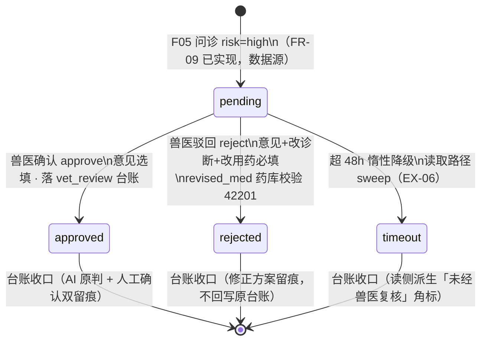

# 智慧养殖多智能体平台 — 功能 PRD：F10 HITL 兽医复核（高危病例人机协同闭环）

- 文档版本：V1.3
- 编制日期：2026-10-13
- 依据文档：主 PRD V1.7（3.5.8 HITL 人在回路、2.2 兽医角色、EX-05/EX-06）、《01-系统架构设计》（第八节 vet/admin 跨租户角色例外、LangGraph checkpoint 恢复/超时降级双路径）、《02-数据库设计》（3.6 vet_review、user 表 is_enable/role）、《03-API接口设计》（十一节 11.1/11.2、十二节后台管理、1.3 错误码 40301/40401/42201/40101）、《04-开发计划》阶段 10（10.1~10.4）、《05-测试计划》（TC-G16/G17、TC-G 系列高危路径）、《06-UI页面设计规范》（4.10 待复核病例页、4.12 后台管理页、导航分组"智能中心"）、《08-遗留问题》C-05（字段命名）
- 对应里程碑：**M10**（高危病例人机协同闭环；前置 M5 问诊链路已实现——F05 已在 high 病例落 vet_review(pending) 与问诊台账，M9 已实现多源告警链路与演示注入先例）
- 前置自检：已回源核对 vet_review DDL（review_status 四态 + idx_vreview_pending）、03-API 11.1/11.2 请求响应示例、F05 mock 层 high 落库现状（alertId=0 + sessionId 关联的放宽口径）、user 表 is_enable 字段、06 规范 4.10 环形进度微件

## 一、文档信息

| 项 | 内容 |
|----|------|
| 功能编号 | F10（阶段 10，第十刀） |
| 功能名称 | HITL 兽医复核（高危病例人机协同） |
| 交付形态 | mock 层纵切（延续 F01~F09 模式）：vet_review 消费链路接口 + 兽医待复核页 + 后台用户管理 + 兽医/管理员账号体系接通 |
| 核心价值 | 高危疫病 AI 诊断不直接落地——强制进入执业兽医复核回路，复核全过程留痕可追溯；超时自动降级保证工作流不无限挂起 |

### 版本修订记录

| 版本 | 日期 | 变更说明 | 状态 |
|------|------|---------|------|
| V1.0 | 2026-10-13 | 首次出稿（阶段 10 纵切功能 PRD，第十刀）：待复核列表 + 复核确认/驳回（修改方案过兽药库校验）+ 24h 提醒/48h 降级 + 管理员创建兽医账号 | 第 1 轮自查通过 |
| V1.1 | 2026-10-13 | 二轮评审修订（11 项，回源核对 1.3 错误码表/02-数据库 DDL/03-API 11.1~11.2/01 架构第八节）：① 修复出稿替换引入的"40301/40301"重复（3 处）并补 40101 入零新增清单；② 决策 4/场景 S3 禁用登录错误码补齐 40301→40101（上轮漏改 2 处）；③ 决策 5/FR-05/十一节补 admin 待办徽标接口载体（GET /vet/pending-cases 只读放宽，待确认③）；④ 同步项③补 risk_level/sessionId/messageId DDL 缺列注记；⑤ FR-04 review_time 复用记降级时间标具体化；⑥ 同步项①/15.2 补 11.2 响应结构具体化；⑦ M9/15.3 纠正"F09 角色化导航先例"不实表述（角色导航为本档新建）；⑧ RK-3 对策指代 FR-06→决策 5/FR-05；⑨ 15.3 F01 行 40301→40101；⑩ 决策 4 散列措辞修正（F01 无演示账号先例） | 待评审 |
| V1.2 | 2026-10-13 | 实现回写（mock 层纵切，F10 FR-01~07 全部实现）：① **v8 迁移**：MockDb 无新表，users 补 isEnable 兜底（缺列=启用，02-数据库 3.1 is_enable 语义；migrate/惰性双路补齐；禁用不删档）；② 引擎段：sweepTimeoutReviews 惰性扫描（≥24 warn/≥48 降级均含等号 EX-R10；review_time 复用记降级时间）+ GET /vet/pending-cases（vet 全功能/admin 只读放宽=待确认③默认采纳；最小字段集白名单落码，farm/pen 服务端派生，warn 恒首+waiting 倒序）+ POST /vet/review（角色→状态→必填→药库→终态化校验序，复核人从 JWT 注入，幂等 40401，vet_review 台账六要素 record_ext + vetReviewId 溯源，F04 白名单首个写入方）+ validateRevisedMed（isForbidden 库行命中 + FORBIDDEN_MENTIONS 词表双查，文案与 F05 同族）+ /admin/user GET/POST/PUT（vet|admin 互建、重复 42201、防自锁、无删除）；③ 40301 贯通：ERR.ROLE_FORBIDDEN 入表（mock 首位用者）+ 分发器统一角色门卫（farm/pen/…/vision 业务前缀 vet/admin 拦截；/user/me 等共享只读免拦）+ 禁用双点（登录 + requireUser 请求路径即时 40101，RK-6 对策落码；改密链路零回归）；④ 台账角标读侧派生（决策 2 落码）：GET /record/list items 对关联 vet_review 的 disease 台账输出 vet_review_id/vet_review_status，导出摘要后缀「（未经兽医复核）」，已降级病例不重复落账；⑤ **seedRoleDemoAccounts**（决策 4 bootstrap：1 管理 + 2 兽医 13000000001~03 统一初始密码 + 2h/25h/50h 三病例；幂等守卫加强为「该场存在任何 vet_review 记录即不注入」，防处理后二次注入，比 FR-07「无 pending」原文更严）；⑥ 前端四件套：Sidebar 角色过滤（vet=待复核+个人中心；admin=后台+个人中心；farmer 现状，接口层 40301 仍是唯一边墙）+ _layout 角色路由守卫（vet/admin 直达越权 URL 重定向 +「无权限访问」提示，不跑 farmer onboarding）+ 待复核页 /vet-review（环形进度微件 48h 窗口剩余弧长 ≥24h 变红、复核弹窗 approve/reject 逐字段错误回显）+ 后台管理页 /admin（用户 Tab 全表脱敏/启停/新增弹窗；超时待办徽标常驻页首 + 只读下钻面板——admin 无复核按钮）+ 系统设置「演示环境」注入入口（S3/S4 全链路可演示）；⑦ **实现收口注记（记录非遗漏）**：复核弹窗上下文以 originalDiagnosis 快照承载（F05 落库即含完整症状文本），vet 不开问诊会话消息接口（十一节权限表 vet 仅两接口，最小授权原则）；咳嗽联动问诊预填仍按本档 V1.1 推迟；⑧ RTM 状态同步「已实现（mock）」；⑨ 验证：tsc 0 错误、vite build 通过（routeTree 含新页）、冒烟 f07 48/48 + f08 55/55 + f09 44/44 + **f10 47/47**（TC-G16/G17/G18/G19/G20/G21/G22 + EX-R1~R10 + 幂等；timeout 角标用等价构造=问诊病例关联 review 置 timeout，台账本体不动） | 第 3 轮实现评审 |
| V1.3 | 2026-10-13 | 实现核验修订（6 项，"实现已收口、正文未回写"的口径脱节清账）：① FR-07 注入守卫回写（任何 vet_review 记录存在即不注入，幂等加强口径）；② FR-03 补违禁判定双查具体化（FORBIDDEN_MENTIONS 六词与 F05 共用）；③ FR-05 补防自锁与 farmer 拒收；④ S1/FR-02 复核上下文口径统一为 originalDiagnosis 快照（vet 不开放会话消息接口，最小授权）；⑤ 十一节禁用双点改"已落码"；⑥ 十四节补待确认清单（修复正文悬空引用②③、①补定义），③标注默认采纳待追认；同步项①补 admin 只读放宽回写 | 第 4 轮核验评审 |

## 二、功能概述与目标

**功能概述**：F05 问诊链路对高危（high）疫病病例已创建 vet_review(pending) 记录（本功能的数据源，mock 层 alertId=0 + sessionId 关联口径已定），但**消费侧全部空转**——无待复核列表页、无复核接口、兽医角色无法登录使用（注册恒为 farmer）、超时无降级、管理员无创建兽医账号的入口。F10 打通"高危中断 → 兽医复核 → 恢复/降级"的完整人机协同闭环。

**要解决的问题**：
1. **高危病例无人接手**：pending 记录躺在表里，没有兽医能看到它；
2. **复核动作无接口**：03-API 十一节的 GET /vet/pending-cases 与 POST /vet/review 均未实现；
3. **超时无限挂起**：主 PRD 明确 24h 提醒 / 48h 降级，当前两者都不存在（EX-05/EX-06 无行为载体）；
4. **兽医账号无法产生**：主 PRD 2.2"兽医由管理员在后台创建，不开放注册"，但注册接口恒产 farmer、后台管理页未建；
5. **合规留痕缺一块**：台账 record_type=vet_review 白名单早在 F04 备好（"兽医复核"），从未有记录写入。

**可衡量成功指标**：

| 指标 | 目标值 | 验证方式 |
|------|--------|---------|
| 高危病例进入待复核列表 | 100%（F05 产生的 pending 全部可见） | TC-G18 |
| 复核操作留痕完整 | 确认/驳回均落 vet_review 台账（含复核人/意见/修改内容/耗时） | TC-G19 |
| revised_med 药库校验拦截 | 100%（违禁/库外药 42201） | TC-G07 回归口径扩展到复核侧 |
| 48h 超时降级 | pending 超 48h 自动置 timeout，复核接口返回 40401，不再出现在列表 | TC-G17 |
| 角色越权拦截 | farmer 访问 /vet/* 与 vet 访问业务接口均 40301 | TC-G20 |

## 三、名词与术语

| 术语 | 定义 |
|------|------|
| HITL（Human-in-the-Loop） | 人在回路：AI 判定为高危疫病时工作流暂停，等待人工复核后再继续或降级，AI 不单独对高危决策负责 |
| 高危病例（high） | F05 问诊风险分级为 high 的病例；产生即创建 vet_review(pending)（F05 FR-09 已实现）并提示"已转交兽医复核，复核前请勿自行用药" |
| checkpoint | LangGraph 工作流暂停点（PostgresSaver 持久化）；兽医复核后经 `Command(resume)` 从 hitl_gate 续跑 record 节点；**mock 期不实现真实 checkpoint**（决策 1），语义由 vet_review 状态机等价承接 |
| 超时降级 | pending 超 48h 未复核，工作流按原诊断降级收尾（标注"未经兽医复核"），review 置 timeout，checkpoint 弃用——**不走 resume，避免唤醒旧工作流双写**（架构文档定稿） |
| 跨租户角色例外 | vet 仅开放待复核病例列表/详情（按 vet_review 任务授权，返回最小字段集，不开放按 farm 遍历）；admin 仅限全局配置表与用户管理——01 架构文档第八节 V1.1 定稿 |
| waiting_hours | 病例等待时长 = 当前时间 − create_time，服务端实时计算（mock 期无后台进程，惰性口径见决策 3） |
| timeout_level | warn（waiting_hours ≥24，列表置顶标红）；≥48 已降级不再出现（03-API 11.1 原文） |

## 四、需求范围

**本期范围（In Scope）**：
1. 待复核病例列表（GET /vet/pending-cases，role=vet）：实时 waiting_hours、≥24h warn 置顶标红、跨租户最小字段集
2. 复核确认（approve）：意见选填，review→approved，落 vet_review 台账
3. 复核驳回修改（reject）：意见+修改后诊断+修改后用药**必填**，revised_med 过兽药库校验（存在且非违禁，否则 42201），落 vet_review 台账
4. 24h 提醒（EX-05）：兽医侧列表置顶标红 + 管理员侧待办提示（mock 具体化形态见 FR-06）
5. 48h 超时降级（EX-06）：惰性降级（决策 3），review→timeout、复核接口 40401、"未经兽医复核"标注（决策 2 读侧派生）
6. 管理员创建兽医账号 + 启用/禁用（POST /admin/user，role=admin）：后台管理页用户 Tab（06 规范 4.12，**本期仅交付"用户"一个 Tab**）
7. 兽医角色接通：登录可用、导航动态过滤（非 vet 不显示待复核页；vet 仅显示待复核 + 个人中心）
8. 前端两页新建：待复核病例页（06 规范 4.10，环形进度微件）+ 后台管理页（用户 Tab，06 规范 4.12）

**范围外（Out of Scope）**：
- 真实 LangGraph 工作流中断与 PostgresSaver checkpoint（随切真 + 阶段 5 深化实装，本期限定语义等价，见决策 1）
- 后台管理页其余 Tab（物种/细分品种/兽药库/饲料营养库/知识库文档）——随阶段 12 整合（06 规范 4.12 全量）
- WebSocket 实时推送新病例到兽医端（列表轮询/进页刷新已满足演示；实时推送随切真）
- 通知短信/邮件通道（"通知管理员"以页面待办形态具体化，决策 4）
- 高危疫病告警弹窗（主 PRD 3.7-9，属告警链路增强，非本功能）
- 合作社管理员辖区数据（主 PRD 明确后续版本）

## 五、方案对比与选型

### 决策 1：checkpoint 语义的 mock 等价（不引入假 LangGraph）

- **背景**：主 PRD 3.5.8 与架构文档均以 PostgresSaver checkpoint 描述中断/恢复；mock 期 LangGraph 未实装，无工作流可挂起。
- **备选**：a) 引入轻量状态机伪造 checkpoint 存取；b) 状态机语义等价 + 接口契约对齐。
- **定稿：b**。vet_review 本身就是四态状态机（pending/approved/rejected/timeout，DDL CHECK 约束已定）："中断"= pending 存在，"恢复"= approve/reject 终态化 + 复核动作触发的台账落库，"弃用"= timeout。**接口契约与切真零差异**（11.1/11.2 请求响应原样），切真时 resume 由 PostgresSaver `Command(resume=复核结果)` 承接，本功能的"复核动作 → 落台账"改为"复核动作 → 恢复工作流 → record 节点落台账"，前端与 API 契约零改动。本档如实声明这是语义等价而非流程模拟（3.3.4 协议层模拟原则：模拟结构化行为，不模拟引擎内部）。

### 决策 2：台账策略——不重写问诊台账，复核独立落账（对齐台账纪律）

- **背景**：F05 实现在 high 问诊时**已即时落 disease 台账**（含 vet_review_id 溯源外键）；架构文档 48h 降级原文是"按原诊断生成台账记录并标注'未经兽医复核'"——若照搬会与 F05 即时落账**双写**。
- **定稿**：
  - approve/reject：不动原 disease 台账（台账只增不改纪律），新增一条 record_type=**vet_review** 台账记录复核全过程（复核人/意见/修改内容/耗时），与原台账通过 vet_review_id 互查；
  - 驳回修改的 revised 方案**不回写**原诊断台账，作为 vet_review 台账的 record_ext 字段留痕，追溯链 = 原台账（AI 原判）→ vet_review 台账（人工修正）；
  - 48h 降级：不重复生成台账，**"未经兽医复核"标注由读侧派生**（原 disease 台账关联的 vet_review 状态为 timeout 时，台账详情/导出叠加该角标）——与架构文档"降级不走 resume 防双写"的防双写精神一致，属 mock 具体化，列文档同步项④。
- **否决项**：降级时补写新台账——与 F05 已落库冲突，产生双记录。

### 决策 3：超时惰性计算与惰性降级（mock 无后台进程，沿用 F07 提醒模式）

- waiting_hours 一律**读取路径实时计算**（now − create_time），不落存储、不跑定时任务；
- **≥48h 的降级在读取路径惰性执行**：GET /vet/pending-cases 与 POST /vet/review 入口统一先跑 `sweepTimeoutReviews`（扫描该用户可见 pending 中超 48h 者 → 置 timeout + 记录 timeout 时间），保证任何入口看到的都是降级后的真实状态；
- 切真后由后台定时任务（APScheduler）承接扫描，惰性逻辑保留为兜底——行为完全一致。

### 决策 4：兽医/管理员账号的产生方式（演示可跑通优先）

- **主路径（对齐主 PRD 2.2）**：admin 登录后台 → 用户 Tab → [新增用户]（手机号/昵称/角色 vet/初始密码）→ 创建成功；is_enable=false 即禁用（登录拦截 40101 提示"账号已禁用"，口径同 FR-05/EX-R8）；
- **bootstrap 问题**：admin 账号自身无法通过注册产生（注册恒 farmer）——mock 期提供**演示账号一键注入**（`seedRoleDemoAccounts`，幂等，对齐 F06/F07 演示数据先例）：注入 1 个演示管理员 + 2 个演示兽医（密码复用 F01 演示散列函数（F01 无演示账号先例，散列函数同源；演示注入先例实为 F06/F07），登录页演示入口提示，不落明文文档）；**真实后端由运维 SQL 初始化首个 admin**（列部署清单，非本档范围）；
- **否决项**：注册页加角色选择——违反主 PRD 2.2"不开放注册"定稿；注册接口放 role 参数——越权面扩大，拒绝。

### 决策 5：24h 提醒的 mock 形态（页面待办，不建推送通道）

- 兽医侧 = 待复核列表 warn 置顶标红 + 环形进度微件变红（06 规范 4.10 定稿形态）；
- 管理员侧 = 后台用户 Tab 头部待办徽标「N 个病例超 24h 未复核」（点击跳兽医待复核视图的只读副本）。**接口载体（本档具体化）**：GET /vet/pending-cases 放宽接受 role=admin（只读、同最小字段集、无复核动作权限——POST /vet/review 仍仅限 vet），徽标计数即响应 items 中 warn 数；01 架构第八节"业务数据只读例外仅此一处"，**列待确认③，不采纳则徽标降级为仅计数不可下钻**；
- 切真后升级为 WebSocket 推送 + 站内信，页面形态不变。

## 六、目标用户与使用场景

| 角色 | 与本功能的关系 | 关键诉求 |
|------|--------------|---------|
| 兽医（vet） | 待复核病例的唯一处理人 | 快速看到高危病例（等待时长排序/超时标红）、了解病例上下文（原诊断/用药/会话）、确认或给出修正方案 |
| 管理员（admin） | 兽医账号管理者、超时督办 | 创建/禁用兽医账号、看到超时未复核的待办、确保复核回路不积压 |
| 养殖户（farmer） | 高危病例的产生方与结果接受方 | 知道"已转交兽医复核"（F05 已实现提示）；复核后知道最终方案——**结果回传形态列范围外**（15.3 衔接⑥），本期以台账与问诊会话可见 |

### 场景 S1：兽医日常复核（主流程）

1. 兽医登录（演示注入或管理员创建的账号）→ 导航"智能中心 → 待复核"；
2. 列表按等待时长排序，环形进度微件显示剩余复核窗口，≥24h 的置顶标红"已超时 X 小时"；
3. 点开病例卡 → 复核弹窗：**原诊断全文（F05 落库快照已含完整症状文本）**；不开放问诊会话消息接口（V1.2 收口注记：vet 最小授权原则，十一节权限表仅两接口）；
4. 认可 → 填意见（选填）→ [确认]；有异议 → 填意见 + 修改后诊断 + 修改后用药（均必填）→ [驳回修改]，修改后用药实时过兽药库校验；
5. 提交成功 → 病例从列表消失，台账新增 vet_review 记录。

### 场景 S2：超时降级（异常主流程）

1. 病例 pending 超 24h：兽医列表置顶标红，管理员后台出现待办徽标；
2. 持续无处理至 48h：任一入口读取时惰性降级——review→timeout，病例不再出现在待复核列表，复核接口对其返回 40401，原诊断台账展示"未经兽医复核"角标；
3. 工作流收口，不无限挂起（EX-06）。

### 场景 S3：管理员创建兽医（运营流程）

1. 管理员登录 → 系统组导航"后台管理"（仅 admin 可见）→ 用户 Tab；
2. [新增用户] 填手机号/昵称/角色（本期限 vet 与 admin 互建）/初始密码 → 创建成功入列表；
3. 离职兽医 → 行内 [禁用] → 该账号登录被拦截（40101"账号已禁用"），历史复核记录与 vet_user_id 溯源不受影响。

### 场景 S4：越权与边界（异常分支）

- farmer 直接访问 /vet/pending-cases → 40301；vet 访问场舍/存栏等业务接口 → 40301（跨租户例外的另一面：授权面最小化）；
- 对 approved/rejected/timeout 病例重复提交复核 → 40401；
- 驳回时 revised_med 填违禁药（如克仑特罗）或库外药 → 42201，提交失败——**药库校验底线对人和 AI 一视同仁**（主 PRD 3.5.8 V1.7 定稿）。

## 七、核心功能点与输入输出说明

### FR-01 待复核病例列表（GET /vet/pending-cases）

- **输入**：JWT（role 必须为 vet，否则 40301）；无查询参数（按 idx_vreview_pending 口径全量 pending，前端排序）。
- **输出**：`items[]`：`{review_id, alert_id, session_id, waiting_hours(数值，1 位小数), timeout_level("normal"|"warn"), original_diagnosis, risk_level, farm_name, pen_name, create_time}`；**最小字段集**（跨租户例外：不返回养殖户手机号/user_id，不开放按 farm 遍历——01 架构第八节）；列表按 waiting_hours 降序（等最久的在前，warn 恒在最前）。
- **规则**：入口先执行惰性降级（决策 3）；排除 timeout（已降级不出现）；farm_name/pen_name 由 farmId/penId 服务端派生（vet 无租户上下文，不能让前端反查）；mock 期无 alert 来源病例 alert_id=0（F05 放宽口径，文档同步项③回写）。
- **验收标准**：
  - Given 3 条 pending（等待 2h/25h/50h），When 兽医拉取列表，Then 仅返回 2 条（50h 已降级），25h 的 timeout_level=warn 且排首位（TC-G16）
  - Given farmer token，When 请求，Then 40301（TC-G20）
  - Given 跨租户两条 pending 分属两个养殖户，When 兽医拉取，Then 均可见且仅含 farm_name/pen_name 最小字段（跨租户例外按任务授权）

### FR-02 复核确认（POST /vet/review · approve）

- **输入**：`{review_id, action:"approve", review_opinion?}`（意见选填，≤500 字）。
- **输出**：`{review_id, review_status:"approved", ledger_record_id}`；副作用：review 置 approved + review_time + vet_user_id（从 JWT 取，客户端传的一律忽略）；落 record_type=vet_review 台账（决策 2）。
- **规则**：仅 pending 可复核——approved/rejected/timeout 均返回 40401；review_opinion 超长 42201；幂等性：同一病例二次提交 40401 而非重复落账；复核上下文以 originalDiagnosis 快照承载（V1.2 收口注记，vet 不开放会话消息读取——最小授权）。
- **验收标准**：
  - Given pending 病例，When approve 意见"同意诊断与用药"，Then review→approved、台账新增 vet_review 记录含复核人与耗时（TC-G19）
  - Given 已 approved 病例，When 再次 approve，Then 40401

### FR-03 复核驳回修改（POST /vet/review · reject）

- **输入**：`{review_id, action:"reject", review_opinion(必填), revised_diagnosis(必填), revised_med(必填)}`。
- **输出**：`{review_id, review_status:"rejected", ledger_record_id}`；副作用同 FR-02，台账 record_ext 含 `{revised_diagnosis, revised_med, original_diagnosis}` 全留痕。
- **规则**：三必填字段缺一 42201（错误信息指名缺哪个字段）；**revised_med 兽药库校验**：必须在 medicine_lib 中存在且 is_forbidden=false，否则 42201（「兽药库中不存在该药品」/「违禁药品不可用于复核方案」，提示语与 F05 问诊侧同文案族）；**违禁判定双查（V1.2 具体化）**：库内违禁行名命中 **或** FORBIDDEN_MENTIONS 公共词表命中（瘦肉精/克伦特罗/沙丁胺醇/莱克多巴胺/氯霉素/呋喃唑酮，与 F05 问诊侧共用同一常量）——防变体写法绕过库行精确匹配；校验顺序 = 必填 → 药库 → 终态化（校验失败不产生任何状态变更）。
- **验收标准**：
  - Given 驳回填 revised_med="双黄连可溶性粉拌料"（库内非违禁），When 提交，Then rejected + 台账含修改内容（03-API 11.2 原文示例）
  - Given revised_med="克仑特罗"（违禁），When 提交，Then 42201 且 review 仍 pending（TC-G07 回归口径）
  - Given revised_med 缺失，When 提交，Then 42201「请填写修改后用药」

### FR-04 48h 超时降级（EX-06，惰性）

- **输入**：无（读取/复核入口内嵌 `sweepTimeoutReviews`）。
- **输出**：超 48h 的 pending → timeout + `review_time` 记降级时间（本档具体化：DDL review_time 语义为复核时间，timeout 无独立列，复用记降级时间，列文档同步项④一并注记）；对应病例从待复核列表消失；POST /vet/review 对其返回 40401「病例已超时降级，无法复核」。
- **规则**：降级批处理与列表/复核同事务（mock 单写序）；"未经兽医复核"标注读侧派生（决策 2）：原 disease 台账的关联 vet_review 处于 timeout 时，台账列表/详情/导出叠加该角标；降级动作本身不产生新台账、不重写旧台账。
- **验收标准**：
  - Given pending 超 48h，When 兽医拉列表，Then 该病例消失且 review=timeout（TC-G17）
  - Given 已降级病例，When POST /vet/review，Then 40401
  - Given 已降级病例，When 养殖户查台账/导出，Then 原 disease 台账带「未经兽医复核」角标

### FR-05 管理员用户管理（POST/PUT /admin/user · role=admin）

- **输入**：创建 `{phone, nickname, role:"vet"|"admin", initial_password}`；启停 `{user_id, is_enable}`。JWT role=admin 否则 40301。
- **输出**：创建返回 `{user_id, phone(脱敏), nickname, role, is_enable:true}`；列表 GET /admin/user 返回全量用户（手机号脱敏展示）；待办徽标计数复用 GET /vet/pending-cases（role=admin 只读放宽，见决策 5，待确认③）。
- **规则**：手机号唯一（重复 42201「该手机号已注册」）；初始密码走 F01 同款演示散列，**响应与日志不回传明文**；is_enable=false → 登录拦截 40301「账号已禁用」（F01 登录链路补此校验，F01 PRD 衔接③）；admin 可创建 vet 与 admin（互建，待确认②；farmer 走注册链路，本接口拒收）；**不提供删除**（复核记录 vet_user_id 溯源要求账号不可物理删除，与台账只增不改一致），只用禁用；**防自锁（V1.2 具体化）**：不允许停用当前登录管理员自身（42201「不能停用当前登录的管理员账号」）。
- **验收标准**：
  - Given admin 创建兽医 138xxxx0002，When 该兽医登录，Then 成功且导航仅"待复核 + 个人中心"（TC-G21）
  - Given 手机号已存在，When 再次创建，Then 42201
  - Given 兽医被禁用，When 登录，Then 40101「账号已禁用」（TC-G22）

### FR-06 角色化导航与页面权限（前端）

- **输入**：JWT payload role（登录时已含，F01 链路）。
- **输出**：Sidebar 按 role 动态过滤——farmer：现状全量业务导航；vet：**仅「待复核」（智能中心组）+「个人中心」（系统组）**；admin：仅「后台管理」（系统组）+「个人中心」。
- **规则**：前端过滤仅为体验层，**接口层 40301 是唯一安全边界**（前端隐藏 ≠ 授权）；路由守卫：非对应角色直达 URL → 跳登录后首页 + toast「无权限访问」；环形进度微件（06 规范 4.10：24h 一圈，剩余窗口弧长，超时环变红）仅待复核页使用。
- **验收标准**：
  - Given vet 登录，When 查看导航，Then 不出现场舍/喂食/出栏等业务入口（06 规范 4.10 权限行）
  - Given farmer 直达 /vet-review URL，When 路由守卫生效，Then 跳转 + 无权限提示

### FR-07 演示账号与演示病例注入（seedRoleDemoAccounts）

- **输入**：登录后菜单触发（幂等）。
- **输出**：① 1 个演示管理员 + 2 个演示兽医（若手机号未占用）；② 3 条演示 pending 病例（等待 2h/25h/50h 各一，覆盖 normal/warn/已降级三态演示；守卫口径 **V1.2 收口：该场存在任何 vet_review 记录（含已处理/已降级终态）即不注入**——若仅判"无 pending"，病例复核完后重复点击会二次注入，违反幂等验收，比 V1.1 原文更严）。
- **规则**：幂等可重复执行（守卫见输出②）；注入的 50h 病例首次拉列表即触发惰性降级（天然演示 EX-06 全链路）；密码复用 F01 演示散列函数。
- **验收标准**：Given 重复注入两次，When 检查，Then 账号与病例数量不变（幂等）。

## 八、非功能需求

| 类别 | 要求 |
|------|------|
| 性能 | 待复核列表 P95 ≤500ms（pending 量级小，idx_vreview_pending 口径）；复核提交 P95 ≤800ms |
| 安全 | 接口层角色校验唯一权威（40301）；复核人身份从 JWT 取，客户端传入的 user_id/vet_user_id 一律忽略；初始密码不落明文、响应不回传；手机号脱敏展示（F01 既有口径）；vet 响应最小字段集，不泄露养殖户身份信息 |
| 审计 | 复核全过程留痕（原诊断/意见/修改内容/复核人/耗时）——主 PRD 3.5.8 硬要求；禁用账号不删档 |
| 可用性 | 48h 降级保证工作流必收口；复核提交失败（校验不过）不产生任何部分状态（校验顺序保证） |
| 兼容 | F05 问诊 high 流程零改动（数据源只读消费）；台账导出兼容新增 vet_review 类型与 timeout 角标 |

## 九、操作流程与状态流转

**关键时序（复核确认）**：兽医打开列表（入口 sweep）→ 看到病例 → 复核弹窗 → 提交 approve → 服务端校验（角色 40301 → 状态 40401 → 字段 42201）→ 终态化 + 落 vet_review 台账 → 列表失效刷新。

**关键时序（超时降级）**：create_time 起 24h → 列表 warn 标红 + 管理员待办徽标（EX-05）→ 48h 内未处理 → 任一入口 sweep → timeout + 40401 + 角标派生（EX-06）。

## 十、数据与埋点

- **最小数据能力**：① 待复核积压数（pending 计数，后台徽标与兽医列表共用）；② 平均复核耗时（approve/rejected 的 review_time − create_time 均值，复核质量观测）；③ 超时降级计数（timeout 状态计数，督办有效性观测）。真实看板随阶段 12。
- **指标口径**：复核耗时以 vet_review 表 review_time/create_time 差为准；积压数以 idx_vreview_pending 口径（status=pending）为准；统计窗口自然日。
- **留痕字段完备性**：vet_review 台账 record_ext 必含 `{review_action, review_opinion, revised_diagnosis?, revised_med?, review_cost_hours}`——审计要求（八节）落地载体。

## 十一、权限与安全要求

| 主体 | 权限 | 明确拒绝 |
|------|------|---------|
| vet | GET /vet/pending-cases、POST /vet/review（仅分配/存在的 pending 任务，最小字段集） | 全部业务 CRUD 接口（40301）；按 farm 遍历；查看养殖户身份字段 |
| admin | /admin/user CRUD（用户管理）、待办徽标计数（GET /vet/pending-cases 只读放宽，待确认③） | 业务数据写操作（配置表 CRUD 随阶段 12 后台全量）；以 admin 身份代复核（POST /vet/review 恒仅限 vet） |
| farmer | 自有数据全量（F01~F09 现状） | /vet/*、/admin/*（40301） |
| 未登录 | — | 全部（40101） |

- 复核动作的不可抵赖：vet_user_id 服务端从 JWT 注入，与 F01 安全声明一致；
- 禁用即时生效：is_enable 双点校验**已落码**（登录密码校验通过后判定 + requireUser 请求路径即时拦截——已签发 JWT 在有效期内禁用即失效，RK-6 对策生效）；
- 演示账号注入仅 mock 层存在，切真后该函数不部署（安全声明随 F01 八节）。

## 十二、异常处理与边界情况

| 编号 | 异常场景 | 处理方式 | 用户可见反馈 | 错误码/口径 |
|------|---------|---------|-------------|------------|
| EX-05 | 兽医 24h 未复核 | 列表 warn 置顶标红 + 环形微件变红 + 管理员待办徽标 | 「已超时 X 小时」标签 | 主 PRD EX-05 |
| EX-06 | 兽医 48h 未复核 | 惰性降级：timeout + 列表移除 + 40401 + 角标派生 | 复核弹窗不可再打开 | 主 PRD EX-06 |
| EX-R1 | 非 vet 访问 /vet/* | 角色校验拒绝 | 前端路由守卫拦截，接口层 40301 | 40301 |
| EX-R2 | vet 访问业务接口 | 同上（跨租户例外反向） | 40301 | 40301 |
| EX-R3 | 对非 pending 病例复核 | 状态机拦截 | 「病例已复核/已超时降级，无法重复操作」 | 40401 |
| EX-R4 | revised_med 为违禁药 | 药库校验拦截，状态不变更 | 「违禁药品不可用于复核方案」 | 42201 |
| EX-R5 | revised_med 为库外药 | 同上 | 「兽药库中不存在该药品」 | 42201 |
| EX-R6 | reject 三必填缺项 | 字段级校验 | 逐字段提示缺什么 | 42201 |
| EX-R7 | 创建用户手机号重复 | 唯一约束 | 「该手机号已注册」 | 42201 |
| EX-R8 | 禁用账号登录 | 登录拦截 | 「账号已禁用，请联系管理员」 | 40101 |
| EX-R9 | review_opinion 超长 | 长度校验（≤500 字） | 「复核意见不能超过 500 字」 | 42201 |
| EX-R10 | waiting_hours 恰好 =24/48 边界 | ≥24 即 warn；≥48 即降级（边界含等号，与 03-API 11.1「≥24」原文一致） | — | 具体化（测试补边界用例） |

**零新增错误码**：全程复用 40301/40401/42201/40101（1.3 错误码表既有；40101 承载禁用登录与本档具体化语义，见 EX-R8/同步项⑤）。

## 十三、上线计划、依赖与验证

- **前置依赖**：
  - 依赖 F05：vet_review(pending) 数据源（已实现）、问诊台账 vet_review_id 溯源（已实现）、兽药库 medicine_lib 校验函数（已实现，FR-03 直接复用）；
  - 依赖 F01：JWT role 载荷（已含）、密码散列规则、手机号脱敏（已实现）；
  - 依赖 F04：台账 record_type=vet_review 白名单（已备）；
  - 依赖 F06/F07 先例：演示数据注入模式、惰性计算模式（决策 3 沿用）。
- **实施顺序**：mock v8 迁移（无新表，user 表补 is_enable 兜底 + vet_review 台账动作字段）→ sweepTimeoutReviews + /vet/* 两接口 + /admin/user → Sidebar 角色过滤 + 路由守卫 → 待复核页（环形微件）→ 后台管理页（用户 Tab）→ 演示注入 → TC-G16/G17/G18~G22 冒烟 + F05/F07/F08/F09 四套回归。
- **验证**：tsc 0 错误、build 通过、冒烟全绿（新增 f10 套件，覆盖 EX-05/EX-06 全时序与越权矩阵）。
- **文档同步项（评审通过当天执行）**：① 03-API 十一节补请求/响应字段详表（session_id、risk_level、最小字段集声明、**11.2 响应结构 `{review_id, review_status, ledger_record_id}`**——03-API 原文仅有请求示例，响应为本档具体化；**role=admin 只读放宽语义**（待确认③追认后回写））；② 03-API 十二节 /admin/user 展开 CRUD 契约（本档具体化，原仅一行表）；③ 02-数据库 vet_review DDL 注释更新（alertId 可空放宽 + sessionId/messageId 关联 + risk_level 派生列注记——DDL 原型三字段均无，mock 层已落，承接 F05 文档同步项③一并落）；④ 02-数据库 3.6 补「48h 降级读侧派生角标，不新增台账」实现口径（决策 2）；⑤ 03-API 1.3 补 40101 在「账号已禁用」场景的语义注记（本档具体化：禁用=认证失败，非角色不符；F01 衔接③）；⑥ 05-测试计划 TC-G18~G22 用例编号回填。

## 十四、风险与遗留问题（关键注意事项）

| 编号 | 风险 | 类别 | 概率×影响 | 等级 | 对策 |
|------|------|------|----------|------|------|
| RK-1 | mock 无真实 checkpoint，切真时 resume 语义与状态机等价实现出现偏差 | 技术 | 中×中 | 中 | 接口契约对齐 11.1/11.2 原文；切真验收含「resume 落台账与 mock 台账结构一致」比对项 |
| RK-2 | vet 跨租户最小字段集被后续需求蚕食（如加 user_id） | 产品 | 中×中 | 中 | 本档 FR-01 输出字段即为白名单，新增字段需重新过安全评审（01 架构第八节口径） |
| RK-3 | 24h 提醒仅页面形态，演示时若不进列表看不到督办感 | 体验 | 高×低 | 低 | 管理员徽标常驻头部（决策 5/FR-05）；演示注入 25h warn 病例保证可见 |
| RK-4 | 兽医误驳回后无撤销手段（终态即定稿） | 产品 | 低×中 | 低 | 本期不提供撤销（台账纪律）；未来如需，走「再次问诊产生新病例」自然路径，不回写状态机 |
| RK-5 | 演示账号密码为弱口令被误用于"真实部署" | 安全 | 低×高 | 中 | 演示账号仅 mock 层；安全声明沿用 F01 八节（真实后端 bcrypt + 运维初始化 admin） |
| RK-6 | is_enable 禁用后已签发 JWT 在有效期内仍可用 | 安全 | 高×中 | 中 | mock 期 requireUser 补 is_enable 复查（登录+请求双点）；列实现注意 |

### 待确认项（评审时拍板；实现期已按推荐值执行的两项标"默认采纳待追认"）

1. **① 演示账号与病例注入形态**（决策 4/FR-07）：mock 期 seedRoleDemoAccounts 一键注入 1 管理 + 2 兽医 + 3 病例（13000000001~03），真实后端由运维 SQL 初始化首个 admin——推荐接受；
2. **② admin 互建**（FR-05）：管理员可创建另一管理员账号（互建）——推荐接受（大屏/多管理员场景）；
3. **③ admin 只读放宽**（决策 5）：GET /vet/pending-cases 接受 role=admin 只读（同最小字段集、无复核动作），支撑后台待办徽标与超时督办下钻——**实现已默认采纳，待追认**；不采纳则徽标降级为仅计数不可下钻。

## 十五、附录

### 15.1 需求追踪矩阵（RTM）

| FR | 功能点 | 来源 | 接口/载体 | 验收 | 状态 |
|----|--------|------|-----------|------|------|
| FR-01 | 待复核列表 | 04 计划 10.2 / 03-API 11.1 | GET /vet/pending-cases | TC-G16/G18/G20 | 已实现（mock） |
| FR-02 | 复核确认 | 03-API 11.2 / 主 PRD 3.5.8 | POST /vet/review(approve) | TC-G19 | 已实现（mock） |
| FR-03 | 复核驳回修改 | 03-API 11.2 / 主 PRD 3.5.8 V1.7 | POST /vet/review(reject) | TC-G07 回归/EX-R4~6 | 已实现（mock） |
| FR-04 | 48h 超时降级 | 主 PRD EX-06 / 04 计划 10.3 / TC-G17 | sweepTimeoutReviews（惰性） | TC-G17 | 已实现（mock） |
| FR-05 | 管理员用户管理 | 04 计划 10.4 / 03-API 十二节 | POST/PUT/GET /admin/user | TC-G21/G22 | 已实现（mock） |
| FR-06 | 角色化导航与页面 | 06 规范 4.10/4.12 | /vet-review、/admin 前端页 | TC-G21 界面项 | 已实现（mock） |
| FR-07 | 演示注入 | 本档决策 4 | seedRoleDemoAccounts | 幂等断言 | 已实现（mock） |

### 15.2 接口字段引用

/vet/pending-cases、/vet/review 以《03-API接口设计》十一节（11.1/11.2 原文示例）为准；/admin/user 以十二节框架 + 本档 FR-05 具体化为准；vet_review 表结构与 idx_vreview_pending 以《02-数据库设计》3.6 为准；错误码 40301/40401/42201/40101 以 1.3 错误码表为准；环形进度微件与列表卡规格以《06-UI页面设计规范》4.10 为准。**/admin/user CRUD 字段、11.2 响应结构、vet_review 台账 record_ext 结构、admin 只读放宽（待确认③）、EX-R10 边界口径为本档具体化约定，评审通过后回写（文档同步项①②④⑥）**。

### 15.3 与 F01~F09 的衔接关系

| 关系 | 说明 |
|------|------|
| 消费 F05 | vet_review(pending) 数据源、兽药库校验函数复用、high 病例「已转交兽医复核」提示闭环的终点 |
| 消费 F01 | JWT role 载荷、密码散列、脱敏展示、40101 禁用语义扩展（EX-R8） |
| 消费 F04 | 台账 vet_review 类型白名单激活（首个写入方） |
| 沿用 F06/F07 | 演示数据幂等注入模式、惰性计算模式（决策 3） |
| 沿用 F09 | 免责常量"单一来源结构性保证"的工程思路（本档用于 RK-2 字段白名单与最小字段集声明）；角色化导航为本档新建，无先例 |
| 留给后续 | 复核结果回传养殖户（问诊会话内展示最终方案）随阶段 11 对话 Agent 一并考虑；后台其余配置 Tab 随阶段 12 |

### 15.4 合规声明

- **AI 建议不可替代执业兽医**：本功能存在的意义即为该声明的制度保障——高危病例 AI 无权终审（问诊侧免责文案 F05 已固定，本功能是执行侧）；
- **药库校验对人和 AI 一视同仁**（主 PRD 3.5.8 V1.7）：兽医修改方案同样被违禁药拦截，FR-03 为落地条款；
- **个人电子信息**：vet 视角最小字段集不暴露养殖户手机号/身份；admin 用户管理手机号脱敏（对齐《个人信息保护法》最小必要原则）；
- **审计追溯**：复核全过程留痕满足纠纷回溯要求（主 PRD 3.5.8 末条）。
