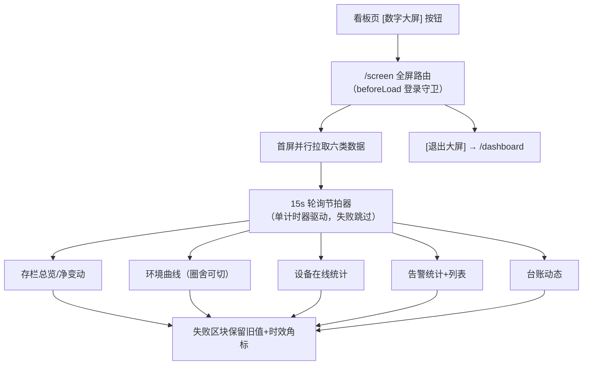

# 智慧养殖多智能体平台 — 功能 PRD：F06 数字大屏

- 文档版本：V1.2
- 编制日期：2026-10-12
- 编制角色：开发组（承接 F01~F05 纵切实现经验，产品评审视角：司南）
- 依据文档：主 PRD V1.7（3.7 前端页面模块、1.4 演示闭环指标）、《04-开发计划》（阶段 12 看板整合/演示闭环）、F01~F05 已交付接口（farm/pen/device/alert/sensor/record）、《06-UI页面设计规范》（一节"现代田园"设计语言、2.3 断点表）
- 对应里程碑：**增量需求**（2026-10-12 用户提出，排在 M5 后实施；非原开发计划 M6）
- 合规声明：本方案为产品设计参考，具体实施请结合公司合规与法务要求确认

---

## 一、文档信息

| 版本 | 日期 | 变更 | 评审记录 |
|------|------|------|---------|
| V1.0 | 2026-10-12 | 首次出稿（M5 后增量功能，第六个功能；用户原始诉求："再加一个数字大屏的功能"） | 待评审 |
| V1.1 | 2026-10-14 | 复工回写：已随 F12 FR-06 纳入收官交付（用户既定"最后再弄"排期兑现）；screen 复活为 /screen 路由，七区块（原五区块 + 气象模块随 RK-5 增补），数据全复用既有接口零新增后端；冒烟 TC-SC01 由 f12 套件承载 | 已复工交付 |
| V1.2 | 2026-10-16 | **口径与实现对齐（docs/08 C-26 收口）**：① FR-02 由「跨场汇总 + Top3」改为**单场视图 + Top5**——场舍管理里每场都叫「1号育肥圈」，跨场平铺会在采食/台账里重复十几行，故加场区选择器、整块面板按 `farm_id` 作用域（本轮后端 `/alert/list`、`/vision/events`、`/feeding/overview` 补收 `farm_id`，越权 40302）；② FR-04 温湿度**双轴同屏未实现**，现为单指标 + 24h 窗口（"近 3 小时/24 小时"由前端节拍控制），原「from=昨日 0 点」口径一并作废；③ RK-3 的**深色投屏视觉不再做**——2026-10-15 拍板"浅色唯一主题"，embedded 与 projection 共用同一套令牌；④ 15.1 RTM 状态列全部回填（此前整表仍写"待开发"，与本节"已复工交付"自相矛盾）；⑤ 未做且仍属 V2 面：跨场汇总、双轴曲线、摄像头路数计数与「查看全部」跳 /alerts?type=vision（读侧筛选已实现，缺生产者）。真正的遗留缺陷不在大屏本身，而在**同名口径**：AI 数据查询把全部农场求和、大屏只算当前场，两处头数会打脸，已登记待归一 | 待评审 |

## 二、背景与目标

- **背景**：F01~F05 交付后，平台已具备完整的养殖数据链路（存栏、环境、告警、台账、问诊），但全部承载在"管理界面"形态中——屏幕小、信息密度按操作优化，**不适合投屏/展示场景**。合作社参观、上级检查、养殖户演示（M12"3 天养殖故事"）都需要一块"一眼看全场"的数字大屏。
- **要解决的问题**：① 演示时需在多个管理页间切换，无法一屏呈现全场态势；② 缺少面向"观看者"（而非操作者）的信息聚合形态；③ 大屏是行业招标/汇报场景的标配交付物。
- **成功指标与口径**：

| 指标 | 目标值 | 口径 |
|------|--------|------|
| 一屏完整性 | 100% | 存栏/环境/设备/告警/台账五类态势同屏可见，无需滚动（1080p） |
| 数据新鲜度 | ≤15s | 各区块数据自动刷新间隔（估算，对齐看板 10s 轮询口径放宽） |
| 零新增后端 | 100% | 数据全部复用 F01~F05 既有接口，本期不改 mock 后端 |

## 三、名词与术语

| 术语 | 定义 |
|------|------|
| 数字大屏 | 面向投屏/参观场景的全屏只读数据展示页，独立路由，不含管理界面的侧边栏与顶栏 |
| 数据时效标注 | 每次成功拉取数据的时间戳，接口失败时保留上次数据并展示该标注（EX-S1） |
| 净变动 | 某日存栏变动的 公delta+母delta 合计（正为净增、负为净减），来源台账 stock_change 类记录 record_ext |

## 四、需求范围

**包含**：
1. 独立全屏路由 `/screen`（不套 `_layout` 壳，无侧边栏/顶栏；自带登录守卫）
2. 五类态势区块：存栏总览、近 7 日存栏净变动图、环境实时曲线（选中圈舍温度+湿度）、设备在线统计、告警统计与滚动列表、台账动态滚动
3. 数据全部复用既有接口（apiListFarms / apiListPens / apiListDevices / apiListAlerts / apiSensorHistory / apiListRecords），15s 轮询自动刷新
4. 看板页 [数字大屏] 入口按钮 + 大屏内 [退出] 返回
5. 深色投屏视觉：延续"现代田园"品牌——深墨绿底 + 暖琥珀强调色（不引入冷蓝科技风）

**不包含（本期不做）**：
- 大屏布局配置化（拖拽自定义卡片）：记入后续版本池
- 多主题/多场切换轮播、TV 常驻模式（开机自启、休眠唤醒）
- 真实大屏分辨率适配调优（仅保证 1080p 与常见笔记本分辨率可用，<768 降级纵向滚动）
- 摄像头视频流上屏（监控预览随 WebRTC 链路另行评估）
- 新增任何后端接口

## 五、方案对比与选型

**决策 1：路由形态 — 独立全屏路由 vs 布局内新页**

| 方案 | 说明 | 结论 |
|------|------|------|
| 独立全屏路由 `/screen` | 不套 `_layout`，整页归大屏，浏览器 F11 即可投屏 | **推荐**：大屏本质是"展示形态"而非"操作页"，独立路由零布局污染；自带登录守卫不破坏鉴权体系 |
| `_layout` 内新页 | 复用侧边栏守卫 | 不采用：侧边栏/顶栏占宽，违背"一屏看全场" |

**决策 2：数据获取 — 复用既有接口轮询 vs 新增大屏聚合接口**

| 方案 | 说明 | 结论 |
|------|------|------|
| 前端组合既有接口 | 六个既有接口 + 前端聚合，零后端改动 | **推荐**：本期定位展示形态，数据量小（演示场景）；新增聚合接口属于后端投资，待切真后端后按真实数据量再评估（演进路径见十三节） |
| 新增 GET /screen/summary 聚合接口 | 一次请求全量 | 备选：真实后端+大屏数量多时再切换，接口契约预留（FR-08） |

**决策 3：视觉基调 — 深墨绿+暖琥珀 vs 冷蓝科技风**

| 方案 | 说明 | 结论 |
|------|------|------|
| 深墨绿底 + 暖琥珀强调 | "现代田园"夜间延伸：与品牌绿一脉相承，投屏对比度高，避免市面大屏同质化蓝紫 | **推荐**：延续 06 规范设计语言；用户已明确反感冷色调科技风（2026-10-10 视觉方向拍板） |
| 冷蓝科技风 | 行业大屏惯例 | 不采用：与全站设计语言冲突 |

## 六、用户角色与使用场景

| 角色 | 本功能内的场景 | 权限边界 |
|------|--------------|---------|
| farmer（主角色） | 演示/参观/汇报时投屏展示自己场内态势 | 仅本人名下数据（复用既有接口的归属校验），未登录跳登录页 |
| vet / admin | 本阶段不涉及 | — |

**主流程**：看板页点 [数字大屏] → 全屏大屏呈现五类态势 → 浏览者观看（数据 15s 自刷）→ 点 [退出] 返回看板。

**分支流程**：① 无任何场数据 → 各区块空态引导去管理页；② 圈舍多个 → 曲线区提供圈舍切换（默认第一个）；③ 接口失败 → 保留上次数据 + 角标"数据更新于 HH:mm"。

## 七、功能需求

### FR-01 独立全屏路由与入口

- 规则：新增顶层路由 `/screen`（不套 `_layout`）；`beforeLoad` 校验登录态（复用 readAuthSnapshot），未登录重定向 `/login`；看板页头部新增 [数字大屏] 按钮跳转；大屏右上角 [退出大屏] 返回 `/dashboard`；页面标题"云上牧场 · 数字大屏"。
- 验收标准：
  - Given 未登录，When 直接访问 /screen，Then 重定向 /login
  - Given 已登录，When 点看板 [数字大屏]，Then 进入全屏大屏且无侧边栏/顶栏
  - Given 大屏内，When 点 [退出大屏]，Then 返回看板页

### FR-02 存栏总览聚合

- 规则：拉取名下全部场（apiListFarms）与各场圈舍（apiListPens，逐场并发），汇总展示：总存栏（公+母，逐圈累加）、公/母分项、圈舍数、场数；大数字卡片 + 单场存栏 Top3 圈舍横条（估算展示口径：演示数据量小，全量累加不做分页）。
- 验收标准：
  - Given 2 场 5 圈（公 30/母 20），When 打开大屏，Then 总存栏 50、公 30、母 20、圈舍 5、场 2
  - Given 名下无场，When 打开，Then 区块空态"暂无场舍数据，请先在管理页创建"

### FR-03 近 7 日存栏净变动图

- 规则：apiListRecords({record_type:'stock_change', from:6 天前, page_size:100, page:1})，按本地日期聚合 record_ext 的 male_delta+female_delta，输出近 7 日净变动柱状图（正=绿净增、负=红净减，recharts BarChart；转群对笔同日相互抵消属正常口径）。
- 验收标准：
  - Given 昨日 birth 公+2 母+1、death 公-1，When 查看，Then 昨日柱 = +2（3-1），颜色绿
  - Given 无变动日期，When 查看，Then 该日柱为 0
  - Given 超过 100 条流水，When 查看，Then 页脚标注"仅统计最近 100 条"（口径透明）

### FR-04 环境实时曲线

- 规则：圈舍切换器（默认第一个圈舍）；apiSensorHistory 拉取该圈温度与湿度（from=昨日 0 点，降采样 ≤2000 点既有口径），recharts 双轴折线图（左轴温度 ℃ / 右轴湿度 %RH）；15s 轮询刷新。
- 验收标准：
  - Given 圈舍有传感器数据，When 打开，Then 曲线呈现且最新值高亮
  - Given 切换圈舍，When 选择，Then 曲线切换为对应圈数据
  - Given 圈舍无传感器，When 打开，Then 空态"该圈舍暂无传感器数据"

### FR-05 设备在线统计

- 规则：apiListDevices() 汇总：总数、在线数、离线数、摄像头数；在线/离线用语义色圆点 + 数字。
- 验收标准：
  - Given 5 传感器（3 在线）+1 摄像头，When 查看，Then 总数 6、在线 3、离线 2、摄像头 1
  - Given 无设备，When 查看，Then 空态引导"去设备管理页添加"

### FR-06 告警统计与滚动

- 规则：apiListAlerts({page:1,page_size:8}) 展示最新 8 条（时间/圈舍/内容/风险色标签，类型中文标签复用 F03 口径）；统计卡：待处理数（status=pending，单独请求 status=pending 取 total）、今日新增（items 内 create_time 为今日的计数，口径：以当前页最新 50 条估算）。
- 验收标准：
  - Given 3 条 pending，When 查看，Then 待处理卡 = 3
  - Given 新告警产生，When 15s 轮询，Then 列表出现该告警且按时间倒序
  - Given 无告警，When 查看，Then 空态"暂无告警，环境运行平稳"

### FR-07 台账动态滚动

- 规则：apiListRecords({page:1,page_size:8}) 展示最近 8 条（时间/圈舍/类型微标/摘要），类型中文标签复用 F04 RECORD_TYPE_LABEL 口径；自动滚动由数据刷新承载（不做 CSS 无限滚动动画，避免演示分神）。
- 验收标准：
  - Given 问诊/存栏动作产生新台账，When 15s 轮询，Then 动态列表头部出现该条
  - Given 无台账，When 查看，Then 空态"暂无台账记录"

### FR-08 自动刷新与数据时效

- 规则：五类数据统一 15s 轮询（一个轮询节拍器驱动，避免多计时器漂移）；时钟 1s 刷新（顶栏 HH:mm:ss）；任一区块拉取失败不阻塞其他区块，保留上次数据并在区块角标"数据更新于 HH:mm"；数据源全部为既有接口，接口契约与 F01~F05 零改动（切真后端时大屏自动跟随，如需聚合接口再升级）。
- 验收标准：
  - Given 大屏打开 15s，When 轮询触发，Then 各区块数据静默更新（无整屏闪烁）
  - Given 断网/接口失败，When 轮询失败，Then 区块保留上次数据且角标显示最后成功时间
  - Given 顶栏时钟，When 观察 1s，Then 秒级跳动

## 八、非功能需求

| 项 | 要求 | 口径 |
|----|------|------|
| 性能 | 首屏数据 ≤2s（mock 本地）；轮询不叠加（上一轮未完成跳过本轮） | 代码审查 |
| 兼容 | 1080p 全区块无滚动；<768 纵向滚动（06 规范断点表） | DevTools 验证 |
| 视觉 | 深墨绿底（#14201A 系）+ 暖琥珀强调（#E8A23D 系）；涨绿跌红对齐国内口径；禁用冷蓝紫 | 06 规范一节延伸 |
| 安全 | 页面只读（无任何写操作入口）；登录守卫复用既有 token 校验 | 代码审查 |
| 无障碍 | 风险/状态标签均带文字；退出按钮键盘可达 | Tab 走查 |

## 九、业务流程与状态流转

大屏为纯只读展示，无状态机；唯一状态是"数据新鲜度"。

## 十、数据与埋点

- **数据落库**：零新增写入点（纯消费既有表）；不落台账（展示是读操作）。
- **最小数据能力**：大屏打开次数（后续埋点，本期不做）。
- **指标口径**：净变动 = Σ(male_delta+female_delta) 按日聚合；今日新增告警以最新 50 条内今日占比估算（数据量小场景下准确）。

## 十一、权限与安全要求

- 登录守卫复用 readAuthSnapshot；数据归属由既有接口的 farm→user 校验保证（大屏不做二次过滤）。
- 页面无任何写操作/编辑入口；不展示 PII（手机号等）。

## 十二、异常处理清单

| 编号 | 异常 | 处理 | 用户可见文案 | 状态 |
|------|------|------|------------|------|
| EX-S1 | 区块拉取失败 | 保留上次数据 + 时效角标 | "数据更新于 HH:mm" | 前端 |
| EX-S2 | 无场/圈/设备数据 | 区块空态引导 | "暂无数据，请先在管理页创建" | 前端 |
| EX-S3 | 圈舍无传感器数据 | 曲线空态 | "该圈舍暂无传感器数据" | 前端 |
| EX-S4 | 未登录访问 | 重定向登录 | — | 复用守卫 |

> 无新增错误码（纯读，错误由既有接口承载，前端静默降级）。

## 十三、上线计划、依赖与验证

- **依赖评估**：

| 依赖项 | 所属 | 就绪状态 | 分级 | 说明 |
|--------|------|---------|------|------|
| farm/pen/device/alert/sensor/record 六类接口 | F01~F04 | 全部已实现 | 就绪 | 零新增后端 |
| recharts 图表库 | 阶段 0.4 | 已在依赖（看板曲线使用中） | 就绪 | 技术栈一致 |

- **实施顺序**：路由与守卫 → 布局骨架与深色令牌 → 五区块逐个填充 → 轮询节拍器 → 看板入口按钮 → build 回归。
- **验证步骤**：① 未登录访问 /screen 重定向；② 造数后核对存栏汇总与净变动柱；③ 注入超标告警 → 15s 内大屏出现；④ 切圈舍曲线跟随；⑤ 断网看时效角标；⑥ 1080p 与 <768 布局走查。
- **回滚**：纯增量（新路由+看板一个按钮），回滚=摘除。

## 十四、风险与遗留问题

| 编号 | 风险/遗留 | 类别 | 概率×影响 | 等级 | 应对 |
|------|----------|------|----------|------|------|
| RK-1 | 存栏净变动按最近 100 条流水统计，长周期口径不完整 | 数据 | 2×2 | 低 | 页脚口径标注（FR-03）；切真后端后按聚合接口重做 |
| RK-2 | 多场用户逐场拉圈舍请求数随场数线性增长 | 性能 | 2×2 | 低 | 演示场景场数 ≤3；真实后端按决策 2 备选升级聚合接口 |
| RK-3 | 深色大屏与全站浅白风格的风格分裂 | 体验 | 2×2 | 低 | 大屏定位"展示形态"，深色是投屏惯例；色彩延续品牌绿与琥珀，不引入冷色 |

**待确认项（评审时拍板）**：① 大屏是否需要进侧边栏入口（当前仅看板页按钮进）；② 轮询间隔 15s 是否合适；③ 净变动是否需要切换近 30 日；④ 后续是否要做配置化布局（已记版本池）。

## 十五、附录

### 15.1 需求追踪矩阵（RTM）

| 需求编号 | 需求描述 | PRD 章节 | 前端 | 后端接口 | 测试用例 | 状态 |
|---------|---------|---------|------|---------|---------|------|
| FR-01 | 独立路由与入口 | 七 | /screen（projection）+ /dashboard（embedded，同一 ScreenBoard） | — | FR-01 GWT | ✅ 已交付 |
| FR-02 | 存栏总览聚合 | 七 | 总览卡 | farm/list + pen/list | FR-02 GWT | ⚠ 已交付、口径变更（**单场 + Top5**，非原「跨场汇总 + Top3」；跨场平铺会让每场同名的「1号育肥圈」重复十几行。见 V1.2 变更①） |
| FR-03 | 近 7 日净变动图 | 七 | BarChart | record/list | FR-03 GWT | ✅ 已交付（前端按 `record_ext.*_delta` 累加、上限 100 条，RK-1 已标注） |
| FR-04 | 环境实时曲线 | 七 | 双轴折线 | sensor/history | FR-04 GWT | ⚠ 部分交付（**单指标 24h**，温湿度双轴同屏未做；且取数起点是当日而非"昨日 0 点"。见 V1.2 变更②） |
| FR-05 | 设备在线统计 | 七 | 统计卡 | device/list | FR-05 GWT | ✅ 已交付 |
| FR-06 | 告警统计与滚动 | 七 | 列表 | alert/list（2026-10-16 起收 `farm_id` + `from`） | FR-06 GWT | ✅ 已交付（「今日新增」改为服务端自然日计数，与「待处理」同源） |
| FR-07 | 台账动态 | 七 | 列表 | record/list（收 `farm_id`） | FR-07 GWT | ✅ 已交付 |
| FR-08 | 轮询与时效 | 七 | 节拍器 | 全部 | FR-08 GWT | ✅ 已交付（WS 推送优先，轮询仅兜底） |

### 15.2 与 F01~F05 的衔接关系

| 衔接点 | 说明 |
|--------|------|
| 消费 F01/F02 | 场与圈舍清单、存栏公母口径（快照=流水累加） |
| 消费 F03 | 设备在线状态、告警列表与风险色、传感器历史（降采样口径复用） |
| 消费 F04 | 台账动态、净变动聚合（record_ext male/female_delta） |
| 消费 F05 | 问诊产生的 disease/medicine 台账自动进入大屏动态 |
| 为 M12 打底 | "3 天养殖故事"演示的展示收口形态 |

### 15.3 合规声明

本方案为产品设计参考，具体实施请结合公司合规与法务要求确认。大屏展示内容为用户自有经营数据，投屏外发场景的数据安全责任由用户自行承担；系统侧保证登录与归属校验，页面纯只读。
