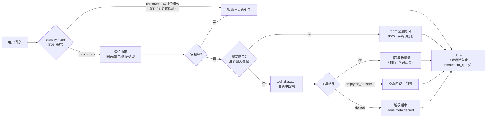

# 智慧养殖多智能体平台 — 功能 PRD：F11 数据查询 Agent（自然语言查数据 · 只读工具白名单）

- 文档版本：V1.2
- 编制日期：2026-10-13
- 依据文档：主 PRD V1.7（3.5.0 意图识别、3.5.5 数据查询 Agent、附录 A Prompt 约束 5、EX-09）、《01-系统架构设计》（数据查询子图 tool_dispatch→answer_format、只读工具白名单目录、多租户工具内过滤、分层规则"agents 工具函数只读"）、
《03-API接口设计》（/agent/chat SSE 契约与事件序列 intent/section/done/error、圈舍定位规则 V1.2 澄清先例、1.3 错误码 40301/40302/42201）、《04-开发计划》阶段 11（11.1 只读工具白名单、11.2 越权验证）、《05-测试计划》（TC-G 系列意图用例、EX-09 兜底）、《06-UI页面设计规范》（4.9 AI 对话页，结果区 sections 渲染既有）、《08-遗留问题》（F10 衔接⑥：复核结果回传随阶段 11 一并考虑）
- 对应里程碑：**M11**（数据查询 Agent；前置 M5 问诊对话骨架已实现——意图识别/SSE 事件序列/会话持久化/澄清机制全部就绪，本功能只接 data_query 分支）
- 前置自检：已回源核对 3.5.5 原文（三例查询+权限约束+白名单机制）、附录 A 第 5 条（仅白名单工具、回答基于查询结果、查不到明说）、04 计划 11.1/11.2、F05 mock 骨架现状（classifyIntent 已含 data_query 枚举但走 GUIDANCE_TEXT 占位、clarify 先例、persistRound 支持 intent 标注）、F10 角色门卫（/agent/* 对 vet/admin 已 40301 拦截）、F06 feed 子图页面直调先例（对话 feed 分支维持占位的合理性）

## 一、文档信息

| 项 | 内容 |
|----|------|
| 功能编号 | F11（阶段 11，第十一刀） |
| 功能名称 | 数据查询 Agent（自然语言查数据，只读工具白名单） |
| 交付形态 | mock 层纵切（延续 F01~F10 模式）：data_query 意图分支接真（规则引擎工具直查，零 LLM 调用）+ 四把只读工具 + 澄清/越权/空态三种边界 + 对话页展示 |
| 核心价值 | 养殖户零学习成本用大白话查场内数据（存栏/温度/告警/复核状态），AI 只基于真实查询结果回答、查不到就明说——**数据可信优先于回答流畅** |

### 版本修订记录

| 版本 | 日期 | 变更说明 | 状态 |
|------|------|---------|------|
| V1.0 | 2026-10-13 | 首次出稿（阶段 11 纵切功能 PRD，第十一刀）：data_query 分支接真 + 只读工具白名单四把 + 槽位抽取与澄清 + 越权话术 + 空态明说 + 写操作拒绝。出稿自检（第 1 轮）：① EX-D11 消息超长截断原引"与 F05 问诊侧同口径"经核为**编造引用**（F05 无长度上限，500 字仅存在于 F10 复核意见）——改为本档具体化并列入同步项①（问诊侧一并统一）；② 其余引用（3.5.5/附录 A/04 计划 11.1~11.2/clarify 先例/台账十类枚举/F10 门卫）逐条回源核对无误；③ EX-D 前缀与 EX-W/V/R 无撞号、TC-Q 与 TC-G/L/W/V 无撞号、待确认①②均有定义无悬空 | 第 1 轮自查通过 |
| V1.1 | 2026-10-13 | 二轮评审修订（5 项，核心=意图可达性——回源核对 INTENT_DATA_KEYWORDS 13 词后发现多处场景例句不可达）：① FR-01 诚实化：词表"零改动"改为"扩充 2 词（复核/病例）"（原稿「我的病例复核了吗」会落 unknown，FR-06 不可达）；② FR-01/EX-D7 补写指令兜底检测（unknown+祈使模式 → 拒绝路径，否则「帮我在 1 号圈加 10 头猪」落 unknown，04 计划 11.1"写操作被拒"验收不可达）；③ FR-07 补圈舍槽位两级匹配（先本人圈→再全局+归属校验），越权路径可达且 EX-D9 判定顺序明确；④ 例句修正（「帮我看看 5 号圈的数据」→「查一下…」，原句"看看数据"被圈舍名隔断不命中关键词）；⑤ 九节流程图补 unknown+写指令分支、决策 1 补"词表扩充不触及契约"说明、同步项②补词表回写注记 | 待评审 |
| V1.2 | 2026-10-13 | 实现回写（mock 层纵切，F11 FR-01~08 全部实现：mock-backend.ts F11 段 + 分支接线）：① 词表：INTENT_DATA_KEYWORDS +2（复核/病例）+ **classifyIntent 复核前置判定**（问诊词表含单字「病」会吞「病例复核」——实现期实测发现，比 V1.1 的"纯词表扩充"更进一步：复核语义无歧义、优先于问诊判定）；② 写指令兜底检测 WRITE_INSTRUCTION_RE（unknown/data_query + 祈使模式 → 拒绝路径，consult/feed/weather 不检测防劫持）；③ DATA_QUERY_TOOLS 枚举四把 + dispatchDataTool 物理封口 + ToolResult 结构化 + 回答模板 buildDataQueryAnswer（数值=查询结果）；④ 槽位：normalizeCnNums 中文数字归一 + matchPenSlot 两级匹配（本人圈→全局+归属校验→denied/penNotFound）+ extractWindowDays（默认 7 上限 90）；⑤ 分支接线：写拒绝（meta write_rejected）/denied（done meta denied=true）/EX-D9 明说/多圈澄清（done clarify=true 复用 F05 先例）/工具回答（AgentMessageSection 增 tool?: string 逐段标注）；⑥ EX-D11 落码：chat 入口 message 截断 500 字（问诊侧一并适用，同步项①兑现）；⑦ 验证：tsc 0 错误、build 6.10s、冒烟 **f11 19/19**（TC-Q01~05 + EX-D1~D9/D11 + EX-09 不变 + 双租户越权 + engineIngest 真实传感器链路）+ f07 48/48 + f08 55/55 + f09 44/44 + f10 47/47 零回归；⑧ RTM 状态同步「已实现（mock）」 | 第 2 轮实现评审 |
| V1.3 | 2026-10-14 | 意图兜底 LLM 接真（决策 2 兑现第一步，实现回写）：① classifyIntent 规则预判保留，仅 unknown 且 LLM 服务已配置（sf_llm_base）时经 backend /api/ai/intent 兜底分类（五类枚举前端校验，非法枚举回 unknown，EX-09 兜底零回归）；② 安全侧倾斜：写指令疑似（looksLikeWriteInstruction）判定前置，writeish 消息不送模型、LLM 升级不得绕过写拒绝路径（data_query/unknown+祈使 → 拒绝不变）；③ 降级：fail/超时 → 保持 unknown 原兜底话术；④ 验证：f13 冒烟 26/26（兜底命中走 weather 分支/失败回 EX-09/非法枚举/写指令防劫持）+ 旧全量 286 断言零回归；架构口径见 F05 PRD V1.2（混合切真：业务数据留 mock、语言智能走真实后端） | 实现评审通过 |

## 二、功能概述与目标

**功能概述**：主 PRD 3.5.0 意图识别早已枚举 data_query（F05 关键词分类器已实现并正常返回 intent 事件），但该分支至今走 GUIDANCE_TEXT 占位话术（"数据查询功能即将开放"）——**用户用自然语言查数据的主链路空转**。F11 把这个分支接真：规则引擎工具直查库内数据，基于查询结果组装回答，覆盖澄清（多圈歧义）、越权（查他人数据）、空态（查不到明说）、写指令拒绝四类边界。

**要解决的问题**：
1. **意图已识别、回答是占位**：用户问"我有多少头猪"得到"即将开放"——体验断裂；
2. **查询能力散落各页**：存栏在看板、曲线在传感器卡、告警在告警中心——养殖户想"问一句"没有入口；
3. **附录 A 约束 5 无落地载体**：「仅调用只读工具白名单，回答须基于查询结果，查不到就说明查不到」是数据查询的硬约束，需要工程机制保证而非靠模型自觉；
4. **F10 遗留衔接**：养殖户无法自然语言获知"我的高危病例复核了吗"（F10 V1.3 明确该项随阶段 11 一并考虑）。

**可衡量成功指标**：

| 指标 | 目标值 | 验证方式 |
|------|--------|---------|
| data_query 意图接真率 | 100%（命中关键词即走工具回答，不再出现占位话术） | TC-Q01 |
| 回答基于查询结果 | 100%（回答中的数字与库内查询结果一致，禁止编造） | TC-Q02（构造数据后断言数值） |
| 查不到明说 | 100%（空场/无传感器/无告警/无复核记录均给明示话术） | TC-Q03 |
| 写操作拒绝 | 100%（自然语言写指令被拒并引导对应页面） | TC-Q04 |
| 越权拦截 | 100%（自然语言查他人数据返回无权限话术） | TC-Q05（04 计划 11.2 验收） |
| 端到端延迟 | ≤3s（mock 规则引擎即时，零外部调用） | 冒烟计时断言 |

## 三、名词与术语

| 术语 | 定义 |
|------|------|
| 数据查询 Agent | 主图意图识别调度的四个子图之一（01 架构 V1.2）：tool_dispatch（只读白名单）→ answer_format，**仅对话场景，无独立 API 端点** |
| 只读工具白名单 | Agent 可调用的查询函数枚举（本档四把），白名单外**不存在任何可调用函数**——写操作不是"被禁止调用"而是"根本不可达"（01 架构分层规则：agents 工具函数只读） |
| 槽位（slot） | 从用户消息抽取的查询条件：数据类型（存栏/曲线/告警/复核）、圈舍（名/编号）、时间窗口（今天/最近 N 天，默认 7 天） |
| 澄清（clarify） | 多圈舍且消息抽不出圈舍槽位时，SSE 先发澄清提问不臆测执行（03-API 圈舍定位规则 V1.2 定稿；F05 问诊链路已有同款先例，事件类型零新增） |
| 查不到明说 | 附录 A 约束 5：查询结果为空时明示"暂无数据"及原因与建议，禁止编造数字填充 |
| 复核状态查询 | 本档具体化的第四把工具（主 PRD 11.1 只列三把）：养殖户查询自己高危病例的复核进度，承接 F10 衔接⑥（列待确认①） |

## 四、需求范围

**本期范围（In Scope）**：
1. data_query 意图分支接真：替换 GUIDANCE_TEXT 占位，走工具调度回答
2. 只读工具白名单四把：存栏汇总 / 传感器曲线摘要 / 告警查询 / 复核状态查询（第四把本档具体化，待确认①）
3. 槽位抽取：圈舍（编号正则+在栏圈舍名匹配）、时间窗口（默认 7 天）、数据类型路由
4. 澄清机制：多圈舍且无圈舍槽位 → SSE 澄清提问（复用 F05 clarify 先例）；单圈自动使用（03-API 原文）
5. 越权处理：pen/farm 归属校验失败 → 自然语言"无权限"话术（决策 2：工具内转话术，不中断对话）
6. 空态明说：空场/无传感器数据/无告警/无复核记录 → 明示话术 + 跳转引导（附录 A 约束 5）
7. 写操作拒绝：自然语言写指令 → 拒绝并引导对应页面（04 计划 11.1 验收"写操作被拒"）
8. 会话持久化：intent=data_query 轮次落 agent_session/agent_message（F05 既有机制，sections 标注工具名）
9. 对话页展示：sections 渲染（06 规范 4.9 既有能力，无新页面）

**范围外（Out of Scope）**：
- LLM function calling 实装（mock 期为规则引擎直查，零 API 调用——决策 1；切真换工具调用，SSE 契约与白名单不变）
- feed 意图对话接真（F06 已实现喂食中心页面直调子图；对话内生成配方不在本档，GUIDANCE_TEXT.feed 占位保留，列待确认②）
- 传感器原始曲线图在对话内渲染（本档返回统计摘要文本；内嵌图表随阶段 12 看板整合）
- 多轮追问上下文（"那 2 号圈呢？"依赖槽位继承——每轮独立解析，列后续版本池）
- vet/admin 使用数据查询（F10 角色门卫已拦截 /agent/*，跨租户例外不含对话——01 架构第八节；farmer 专属）
- 数据查询 Agent 的 API 直调形态（01 架构定稿：仅对话场景）
- 语义级模糊查询（"猪长得怎么样"涉增重分析——超出"查数据"意图边界，属数据分析，列后续版本池）

## 五、方案对比与选型

### 决策 1：mock 期工具实现=规则引擎直查（不引入 LLM function calling）

- **背景**：切真后数据查询子图由 LLM 按附录 A 约束 5 调用工具；mock 期无 LLM（费用纪律：百炼代金券省着用）。
- **备选**：a) 引入小模型做槽位抽取与工具选择；b) 关键词分类（已有 classifyIntent）+ 正则槽位抽取 + 规则路由工具，回答模板基于查询结果拼装。
- **定稿：b**。理由：① 零外部 API 调用，延迟 ≤3s 可保证；② 回答数值 100% 来自查询结果（模板拼装天然满足附录 A 约束 5，不存在编造面）；③ **接口契约与切真零差异**（SSE intent/section/done 事件序列不变、工具白名单枚举不变、意图枚举仍附录 A 五类），切真只换 tool_dispatch 内部实现（规则路由→LLM function calling）；意图词表扩充 2 词与写指令兜底检测为分支内实现细节，不触及契约；④ 槽位正则与圈舍名匹配逻辑切真后保留为 LLM 失败的降级路径。
- **否决项**：a——引入模型调用违反费用纪律，且把"回答基于查询结果"的保证从工程机制降级为 prompt 约束。

### 决策 2：越权在工具内转话术，不抛 40302 中断对话

- **背景**：04 计划 11.2 验收"自然语言问他人数据返回无权限"；03-API 常规接口对越权返回 40302 异常。
- **定稿**：工具内部复用 resolvePen/resolveFarm 归属校验，命中越权时**不抛异常**，返回结构化 `{denied: true}` 由回答层输出话术「该圈舍不属于您的账号，您只能查询自己养殖场的数据」——对话体验连续；done 事件 meta 标 `denied:true`，40302 语义在契约层如实可观测。异常式拦截留给直连 API 的非对话调用路径（既有 40302 行为不变）。
- **否决项**：抛 40302——SSE 流中断，用户看到报错而非回答；"权限原因查不到"也是"明说"的一种（附录 A 约束 5 精神）。

### 决策 3：白名单四把工具（第四把本档具体化）

- 主 PRD 11.1 三把（存栏汇总/传感器曲线/告警查询）+ **复核状态查询**（F10 衔接⑥明确"随阶段 11 一并考虑"——养殖户问"我的病例复核了吗"是同一自然语言查询入口，复用 vet_review 数据源，成本极低价值明确）。
- 白名单落码形态：`DATA_QUERY_TOOLS` 枚举常量，tool_dispatch 只路由到枚举内工具，**枚举外无实现函数**（物理性禁写，对齐 01 架构"agents 工具函数只读"分层规则）。列待确认①。

### 决策 4：澄清机制复用 F05 先例（SSE 事件类型零新增）

- 多圈舍且消息抽不出圈舍槽位 → 复用问诊链路 clarify 模式（澄清提问作为回答正文 + done 事件 `clarify:true`，03-API 圈舍定位规则 V1.2 同款）——前端 4.9 无需改动。
- 单圈舍用户不澄清（自动使用唯一圈，03-API 原文"用户只有一个圈舍则自动使用"）；存栏汇总（场级）与告警查询（场级）天然无需圈舍槽位，不触发澄清。

### 决策 5：不落业务台账

- 主 PRD 台账 record_type 枚举（3.7-1 十类）不含 query 类型——查询是读操作无台账义务；会话轮次照常持久化到 agent_session/agent_message（F05 既有，intent=data_query 标注），审计可回溯（谁在何时问了什么、答了什么、基于哪个工具）。

## 六、目标用户与使用场景

| 角色 | 与本功能的关系 | 关键诉求 |
|------|--------------|---------|
| 养殖户（farmer） | 唯一使用方 | 用大白话"问一句"得到真实数据：多少头猪、温度怎么样、最近有啥告警、病例复核没复核 |
| 兽医/管理员 | 明确不可用 | F10 角色门卫已拦截 /agent/*（跨租户例外不含对话），无本功能入口 |

### 场景 S1：日常查询（主流程）

1. 「我场里现在有多少头猪？」→ intent=data_query → 存栏汇总（场级）→ 「您全场共存栏 55 头（公 25 / 母 30），分布在 4 个圈舍」；
2. 「3 号圈温度怎么样？」→ 槽位抽取圈舍 → 传感器曲线摘要 → 「3 号圈最近 7 天温度：最新 26.5℃ / 均值 25.1℃ / 峰值 33.2℃（10-11 日），超阈值 2 次」；
3. 「最近有什么告警？」→ 告警查询 → 「最近 7 天共 5 条告警（未处理 2 条）。最近一条：10-12 1 号圈高温 mid 级」；无告警 → 「最近 7 天没有告警记录，圈舍环境正常」。

### 场景 S2：歧义澄清（分支）

- 多圈舍用户问「温度怎么样？」（无圈舍槽位）→ SSE 澄清「您有多个圈舍，请问要查哪个？可以说圈舍名称或编号」→ 用户补圈舍后正常回答——不臆测执行（03-API V1.2 定稿）。

### 场景 S3：越权与写指令（异常分支）

- 「查一下 5 号圈的数据」（5 号圈属于他人，经两级匹配命中他人圈舍）→ 「该圈舍不属于您的账号，您只能查询自己养殖场的数据」；
- 「帮我在 1 号圈加 10 头猪」→ 识别为写指令 → 「数据查询助手只能查询，不能修改数据。调整存栏请到【场舍管理 → 调整存栏】操作」（写指令引导页映射见 FR-07）。

### 场景 S4：空态明说（附录 A 约束 5）

- 新用户无场 → 「您还没有创建养殖场，请先到【场舍管理】完成建场」；
- 圈舍无传感器数据 → 「3 号圈暂无传感器数据。请确认已添加温湿度设备并保持在线」；
- 无复核记录 → 「近期没有进行中的高危病例复核」。

## 七、核心功能点与输入输出说明

### FR-01 意图分支接真与槽位抽取

- **输入**：POST /agent/chat 消息，classifyIntent 命中 data_query（F05 既有分类器；**词表小幅扩充 2 词**：`复核`、`病例`——现有 INTENT_DATA_KEYWORDS 13 词不含二者，「我的病例复核了吗」今天会落 unknown 兜底，FR-06 不可达。本档具体化，列文档同步项②）。
- **输出**：SSE `intent(data_query)` → `[section...]` → `done`（替换占位话术）；槽位 `{tool_route, pen_id?, window_days=7}`。
- **规则**：圈舍槽位=编号正则（"3号圈"/"三号圈"中文数字归一化）+ 在栏圈舍名精确匹配（先编号后名称）；时间窗口词表（今天=1/最近 N 天/本周=7，默认 7，上限 90）；数据类型路由=存栏/温度|湿度|曲线→sensor、告警→alert、复核|病例→review；数据类型与圈舍同时抽到但组合矛盾（如"告警 圈舍X"且该圈无设备）按空态明说处理；**写指令兜底检测（具体化）**：unknown 意图且命中写指令祈使模式（帮我/给我 + 加/减/调/登记/修改/删除 + 圈舍/存栏/饲喂对象）→ 进入 data_query 分支拒绝路径而非 EX-09 泛化兜底——否则「帮我在 1 号圈加 10 头猪」今天落 unknown，04 计划 11.1"写操作被拒"验收不可达；检测失败仍走 EX-09（禁止臆测执行不变，拒绝+引导不是执行）。
- **验收标准**：
  - Given 消息「我有多少头猪」，When 进入对话，Then intent 事件为 data_query 且回答含真实存栏数（TC-Q01）
  - Given 消息「三号圈最近温度」，When 抽取，Then 圈舍=3 号圈（中文数字归一化）、窗口=7 天

### FR-02 工具白名单与调度（tool_dispatch）

- **输入**：槽位。
- **输出**：路由到 `DATA_QUERY_TOOLS` 枚举内四把工具之一；枚举外请求一律拒绝。
- **规则**：白名单落码为常量枚举，枚举外无实现函数（物理性禁写）；每把工具的返回统一为 `{ok: true, data} | {ok: false, reason: "empty"|"no_sensor"|"denied"|"no_review"}` 结构化结果，回答层只认结构化结果拼装话术（回答基于查询结果的工程保证）；工具内部查询强制附加当前 user 归属过滤（01 架构多租户工具内过滤原文）。
- **验收标准**：
  - Given 四把工具外的任何路由企图，When 调度，Then 无实现函数可命中（白名单物理封口）
  - Given 工具返回，When 组装回答，Then 回答中数值与 data 字段一致（TC-Q02）

### FR-03 存栏汇总工具

- **输入**：`{scope: "farm"|"pen", pen_id?, farm_id}`。
- **输出**：场级=`{total, male, female, pen_count}`（Σ 在栏圈舍，口径与看板一致——快照只由 stock_change 流水驱动）；圈级=`{total, male, female, batch_stage?}`。
- **规则**：空场（无未删除圈舍）→ reason=empty + 引导建场；圈舍存栏为 0 → 明说「该圈当前无在栏牲畜」；数字一律取 pen 快照字段，禁止实时重算口径混用。
- **验收标准**：
  - Given 4 个圈舍存栏 25+30 头，When 问「我场里现在有多少头猪」，Then 回答含 55（TC-Q02 构造断言）
  - Given 新用户无场，When 查询，Then 回复建场引导（TC-Q03）

### FR-04 传感器曲线摘要工具

- **输入**：`{pen_id, window_days}`（传感器数据必带圈舍——单圈自动/槽位抽取/澄清补齐三路来源）。
- **输出**：`{metric(温度|湿度), latest, avg, peak(值+日期), threshold_exceeds, sample_count, window_days}`；回答模板输出统计摘要。
- **规则**：窗口内无读数 → reason=no_sensor + 设备排查引导；多指标关键词（"温湿度"）时温度优先返回并提示可追问湿度（多轮追问列后续版本池，本档单轮单指标）；阈值判定复用 env_threshold 既有配置（F03 口径，不重复定义）。
- **验收标准**：
  - Given 3 号圈 7 天内有 60 条温度读数（含 2 次超阈值），When 查询，Then 回答 latest/avg/peak 与库内一致且"超阈值 2 次"（TC-Q02）
  - Given 圈舍无任何读数，When 查询，Then 回复设备排查引导（TC-Q03）

### FR-05 告警查询工具

- **输入**：`{farm_id, window_days, pen_id?}`（pen_id 可选=圈级过滤）。
- **输出**：`{total, unhandled, by_level: {low, mid, high}, recent: [{type, level, pen_name, create_time}] (最近 3 条)}`。
- **规则**：无告警 → 明说「最近 N 天没有告警记录，圈舍环境正常」（正常态也是"查到的事实"）；数字与告警中心列表同源（alert_log，归属过滤后），禁止两处口径不一致。
- **验收标准**：
  - Given 7 天 5 条告警（2 条 pending），When 查询，Then 回答 5/2 与最近一条明细（TC-Q02）
  - Given 零告警，When 查询，Then 回复环境正常话术（TC-Q03）

### FR-06 复核状态查询工具（本档具体化，待确认①）

- **输入**：`{farm_id, window_days}`。
- **输出**：`{total, by_status: {pending, approved, rejected, timeout}, recent: [{original_diagnosis, status, review_time?}] (最近 3 条)}`。
- **规则**：仅查**当前用户自己**的 vet_review（经 farm 归属过滤——vet_review 无 user_id 字段，经 farmId 关联校验归属）；pending 含等待时长（复用 F10 waiting_hours 口径）；timeout 病例如实展示"已超时降级"（不隐藏，合规透明）；无记录 → 明说。
- **验收标准**：
  - Given 本场 1 条 pending（等 26h）+ 1 条 approved，When 问「我的病例复核了吗」，Then 回答含两条状态与等待时长（TC-Q02）
  - Given 跨租户构造，When 查询，Then 不可见（归属过滤，TC-Q05 同源）

### FR-07 越权话术与写指令拒绝

- **输入**：消息含他人圈舍（槽位抽取到 pen_id 后归属校验失败）或写指令关键词。
- **输出**：越权 → 「该圈舍不属于您的账号，您只能查询自己养殖场的数据」+ done meta `denied:true`；写指令 → 拒绝 + 页面引导映射（调整存栏→场舍管理、饲喂登记→喂食中心、设备管理→设备管理页、处理告警→告警中心）。
- **规则**：越权判定复用 resolvePen 归属校验（40302 同源判定），工具内转话术（决策 2）；**圈舍槽位两级匹配（具体化）**：先在用户自己的在栏圈舍匹配（命中即用），未命中再全场库匹配+归属校验——全局命中但非本人 → denied 话术（11.2 可达）；全局也无 → EX-D9「没有找到」；写指令判定优先于查询路由（安全侧倾斜，含 unknown 兜底前检测，见 FR-01）；写指令拒绝不落库（本来也无写路径）。
- **验收标准**：
  - Given 用户 B 问「查一下 5 号圈的数据」（5 号圈属用户 A），When 提交，Then 回复无权限话术且 done meta denied=true（TC-Q05，04 计划 11.2）
  - Given 「帮我在 1 号圈加 10 头猪」，When 提交，Then 回复拒绝+场舍管理引导且存栏不变（TC-Q04）

### FR-08 澄清、空态与会话持久化

- **输入/输出**：多圈无槽位 → 澄清提问（done clarify:true，F05 先例）；空态四类话术（空场/无传感器/无告警/无复核）；轮次持久化 agent_session（intent=data_query）+ agent_message（assistant content=回答全文，sections 标注 `{tool: "stock_summary"|"sensor_digest"|"alert_digest"|"review_status"}`）。
- **规则**：澄清轮不计工具调用（无结果）；空态话术附跳转引导文案（建场→场舍管理、设备→设备管理）；会话标题按首条消息生成（F05 既有）；EX-09 兜底不变（unknown 意图不臆测执行）。
- **验收标准**：
  - Given 多圈用户问「温度怎么样」，When 提交，Then 收到澄清提问且无编造数据
  - Given 完成一轮查询，When 查会话历史，Then 轮次与 sections 完整可回溯

## 八、非功能需求

| 类别 | 要求 |
|------|------|
| 性能 | 端到端 ≤3s（规则引擎本地直查，无外部调用）；单工具查询 P95 ≤200ms |
| 安全 | 工具内强制归属过滤（01 架构多租户原文）；白名单物理封口禁写；vet/admin 由 F10 门卫 40301 拦截；用户消息不进入任何写路径；Prompt 注入面在 mock 期为零（无 LLM，规则路由不可被话术操纵——切真后按 01 架构 Prompt 注入防护条款补） |
| 数据可信 | 回答数值 100% 来自查询结果（模板拼装）；与看板/告警中心/复核列表同源同口径，禁止两处数字不一致 |
| 费用纪律 | 零外部 API 调用（决策 1，百炼代金券不消耗） |
| 可用性 | 澄清/空态/越权均有引导性话术，无死胡同；SSE 流不因边界情况中断 |

## 九、操作流程与状态流转

**关键时序（正常查询）**：intent 事件 → 工具直查（归属过滤）→ 结构化结果 → 回答模板 → done。无 LLM 环节，端到端本地完成。

## 十、数据与埋点

- **最小数据能力**：① data_query 轮次数/日（使用率观测）；② 工具调用分布（四把占比，指导后续补工具）；③ 空态率（empty+no_sensor 占比——数据接入完整性的反向指标）+ 越权率（denied 占比）。真实看板随阶段 12。
- **指标口径**：统计窗口自然日；轮次以 agent_message 中 intent=data_query 的 assistant 轮为准；工具分布以 sections.tool 标注为准（澄清轮不计）。
- **审计可回溯**：会话持久化含完整问答与工具标注（决策 5），纠纷可查"当时 AI 说了什么、基于什么数据"。

## 十一、权限与安全要求

| 主体 | 权限 | 明确拒绝 |
|------|------|---------|
| farmer | /agent/chat 内 data_query 分支（四把工具，仅自己数据） | 白名单外一切操作；他人 farm/pen 数据（话术拒绝）；写操作（物理不可达） |
| vet / admin | — | /agent/* 全部（F10 角色门卫 40301，跨租户例外不含对话） |
| 未登录 | — | 全部（40101） |

- 工具内归属过滤为**第二道墙**（第一道是会话归属），两道独立生效（01 架构"工具内部同样附加过滤"原文）；
- 越权话术不泄露他人数据存在性以外的任何信息（不说"5 号圈属于谁"）；
- 演示与冒烟数据构造均不含真实个人信息。

## 十二、异常处理与边界情况

| 编号 | 异常场景 | 处理方式 | 用户可见反馈 | 口径 |
|------|---------|---------|-------------|------|
| EX-D1 | 空场（无未删除圈舍） | 空态明说 | 「您还没有创建养殖场，请先到【场舍管理】完成建场」 | 附录 A 约束 5 |
| EX-D2 | 圈舍窗口内无传感器读数 | 空态明说 | 「暂无传感器数据。请确认已添加温湿度设备并保持在线」 | 附录 A 约束 5 |
| EX-D3 | 窗口内无告警 | 正常态明说 | 「最近 N 天没有告警记录，圈舍环境正常」 | 附录 A 约束 5 |
| EX-D4 | 无复核记录 | 空态明说 | 「近期没有进行中的高危病例复核」 | 具体化 |
| EX-D5 | 多圈无圈舍槽位 | 澄清不臆测 | 「您有多个圈舍，请问要查哪个？」 | 03-API V1.2 |
| EX-D6 | 圈舍槽位归属他人 | 越权话术 | 「该圈舍不属于您的账号」+ meta denied | 决策 2 / 11.2 |
| EX-D7 | 写指令（data_query 内或 unknown+写模式兜底） | 拒绝+引导 | 「数据查询助手只能查询…请到【对应页面】操作」 | 11.1 验收（可达路径见 FR-01 兜底检测） |
| EX-D8 | 查询词与写词冲突 | 写优先拒绝 | 同 EX-D7 | 安全侧倾斜（具体化） |
| EX-D9 | 圈舍名两级匹配均未命中（"9 号圈"） | 如实明说 | 「没有找到"9 号圈"，您当前圈舍：1 号圈、3 号圈…」（两级匹配顺序见 FR-07：先本人后全局+归属校验） | 附录 A 约束 5 |
| EX-D10 | 意图未命中（unknown） | EX-09 兜底不变 | 引导话术列可用能力 | 主 PRD EX-09 |
| EX-D11 | 消息超长（>500 字） | 截断解析 | 按前 500 字解析（**本档具体化**：F05 问诊侧现无长度上限，本档落码时统一补该上限并回写问诊侧——列文档同步项①；500 字数值与 F10 复核意见上限对齐） | 具体化 |

**零新增错误码**：40301/40101 由 F10 门卫与既有认证承担；40302 语义经 done meta 传递（决策 2）；无新增。

## 十三、上线计划、依赖与验证

- **前置依赖**：
  - 依赖 F05：意图分类器/SSE 事件序列/会话持久化/澄清先例（全部已实现，零改动复用）；
  - 依赖 F02/F03/F04：pen 快照与归属校验、sensor_data 与 env_threshold、alert_log 与台账白名单（全部已实现）；
  - 依赖 F10：角色门卫（/agent/* 对 vet/admin 40301，已实现）、vet_review 数据源（FR-06）、复核状态口径（waiting_hours）；
  - 依赖 F08：resolveWeatherForFarm 无关（气象走独立 weather 意图分支，不并入本档）。
- **实施顺序**：槽位抽取与白名单枚举 → 四把工具（结构化返回）→ 回答模板与空态/越权/写拒绝话术 → data_query 分支接线（替换占位）→ 澄清复用 → 会话持久化标注 → 前端 4.9 验证（应零改动）→ TC-Q01~Q07 冒烟 + F05/F07/F08/F09/F10 五套回归。
- **验证**：tsc 0 错误、build 通过、冒烟全绿（新增 f11 套件；数值一致性用构造数据断言）。
- **文档同步项（评审通过当天执行）**：① 03-API /agent/chat 节补 data_query 分支说明与 done meta denied/clarify 语义注记、消息长度上限 500 字（EX-D11，问诊侧一并统一）；② 03-API 431 行圈舍定位规则补"数据查询子图同样适用"；主 PRD 3.5.0/附录 A 不新增意图枚举（写指令拒绝为 data_query 分支内行为），但意图词表扩充（复核/病例 2 词）与写指令兜底检测在 03-API /agent/chat 节注记（随同步项①一并）；③ 01-架构工具白名单目录补第四把（复核状态查询，待确认①追认后）；④ 05-测试计划 TC-Q01~Q05 编号回填（TC-Q06/Q07 并入 EX-D5/持久化断言，冒烟 19 条实测）；⑤ 06-UI 4.9 补一行"sections.tool 工具标注"展示说明（如需）；⑥ 主 PRD 3.5.5 补第四把工具注记（待确认①）。

## 十四、风险与遗留问题（关键注意事项）

| 编号 | 风险 | 类别 | 概率×影响 | 等级 | 对策 |
|------|------|------|----------|------|------|
| RK-1 | 规则槽位抽取覆盖不了用户真实说法（方言/简称/口语变体） | 体验 | 高×中 | 中 | 圈舍名精确匹配+编号正则覆盖主路径；澄清机制兜底一切抽取失败（宁可多问不猜）；真实话术样本随演示迭代词表 |
| RK-2 | 切真换 LLM function calling 后回答风格变化（mock 模板 vs LLM 生成） | 技术 | 中×低 | 低 | 附录 A 约束 5 与白名单在切真侧同样强制；验收口径"数值一致"不变 |
| RK-3 | 传感器摘要统计口径与看板曲线观感不一致（如均值含离线空洞时段） | 数据 | 中×中 | 中 | 摘要只统计窗口内实际读数并展示 sample_count；口径注释入回答脚注（依据来源小字，06 规范 4.9 既有元素） |
| RK-4 | 写指令词表误伤（"最近加的 10 头猪怎么样了"被判写指令） | 体验 | 中×低 | 低 | 写判定要求"祈使+数据对象"双特征；误伤时用户改述即可（澄清引导），不阻塞查询主路径 |
| RK-5 | 复核状态查询暴露超时降级引发用户焦虑 | 体验 | 低×低 | 低 | timeout 如实展示（合规透明）附"已按原诊断生成记录"说明（F10 决策 2 话术复用） |

### 待确认项（评审时拍板）

1. **① 第四把工具**（决策 3/FR-06）：复核状态查询纳入白名单——推荐纳入（F10 衔接⑥的轻量承接，成本极低）；
2. **② feed 对话占位**：F06 已实现喂食中心页面直调，对话内 feed 意图是否维持占位——推荐维持（页面直调是配方生成的主路径，对话配方价值低且引入长流程），列后续版本池观察。

## 十五、附录

### 15.1 需求追踪矩阵（RTM）

| FR | 功能点 | 来源 | 载体 | 验收 | 状态 |
|----|--------|------|------|------|------|
| FR-01 | 意图接真+槽位抽取 | 主 PRD 3.5.0/3.5.5 | /agent/chat data_query 分支 | TC-Q01 | 已实现（mock） |
| FR-02 | 工具白名单与调度 | 主 PRD 3.5.5 / 01 架构分层规则 | DATA_QUERY_TOOLS 枚举 | 白名单物理封口断言 | 已实现（mock） |
| FR-03 | 存栏汇总 | 04 计划 11.1 | 工具 1 stock_summary | TC-Q02/Q03 | 已实现（mock） |
| FR-04 | 传感器曲线摘要 | 04 计划 11.1 | 工具 2 sensor_digest | TC-Q02/Q03 | 已实现（mock） |
| FR-05 | 告警查询 | 04 计划 11.1 | 工具 3 alert_digest | TC-Q02/Q03 | 已实现（mock） |
| FR-06 | 复核状态查询 | 本档决策 3（待确认①）/ F10 衔接⑥ | 工具 4 review_status | TC-Q02 | 已实现（mock） |
| FR-07 | 越权话术+写指令拒绝 | 04 计划 11.1/11.2 | 工具内归属校验+词表 | TC-Q04/Q05 | 已实现（mock） |
| FR-08 | 澄清/空态/持久化 | 03-API V1.2 / 附录 A 约束 5 / EX-09 | clarify 先例+模板话术 | TC-Q06/Q07 | 已实现（mock） |

### 15.2 接口与数据引用

/agent/chat SSE 契约与事件序列以《03-API接口设计》既有定义为准（本档零新增事件类型）；澄清与单圈自动使用以 03-API 圈舍定位规则 V1.2 为准；pen 快照口径以《02-数据库设计》与 F02 存栏纪律（快照=流水累加）为准；env_threshold 判定复用 F03 口径；vet_review 状态与 waiting_hours 以 F10 V1.3 为准；错误码 40301/40101 以 1.3 错误码表为准。**四把工具的结构化返回结构、话术文案、EX-D11 截断口径为本档具体化约定，评审通过后回写（文档同步项①③⑥）**。

### 15.3 与 F01~F10 的衔接关系

| 关系 | 说明 |
|------|------|
| 复用 F05 | 意图分类器、SSE 契约、澄清先例、会话持久化——零改动复用，data_query 分支从占位切真 |
| 消费 F02/F03/F04 | pen 快照与归属校验、sensor_data/env_threshold、alert_log——四把工具的数据源全部为既有只读查询 |
| 消费 F10 | vet_review 数据源与 waiting_hours 口径（FR-06）；角色门卫（vet/admin 不可用本功能） |
| 沿用 F08 模式 | 意图分支接真的改造模式（weather 分支 F08 已走通一遍，本档照方抓药） |
| 边界（不做） | feed 对话分支维持占位（待确认②）；气象不并入（独立 weather 意图已接真） |
| 留给后续 | 多轮追问槽位继承、语义级分析查询（增重/料肉比问答）、对话内嵌图表——随阶段 12 整合评估 |

### 15.4 合规声明

- **AI 建议不可替代执业兽医**：本功能只做数据呈现不涉及诊疗建议，回答模板不含任何诊断/用药措辞；
- **数据可信声明**：回答数值 100% 来自库内查询（工程保证而非模型自觉），与各页面同源同口径；
- **个人电子信息**：越权话术不泄露他人数据细节；会话审计数据仅本人与管理员可及（同 F01 口径）；
- **免责边界**：查询结果为管理参考，告警与复核状态以对应功能页面为准（回答附跳转引导）。
