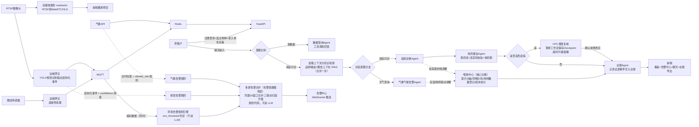
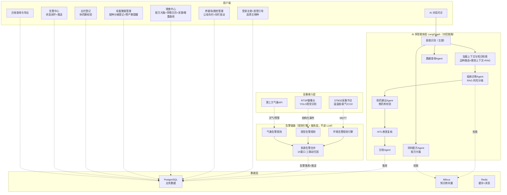
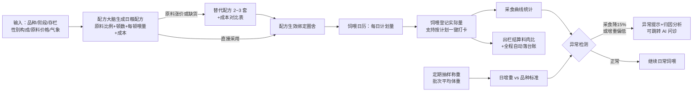

# 智慧养殖多智能体平台 PRD 文档

- 文档版本：V1.8
- 编制日期：2026-10-08
- 文档类型：产品需求文档（PRD）
- 项目名称：智慧养殖多智能体平台

**变更记录**

| 版本 | 日期 | 变更摘要 |
| ---- | ---- | ---- |
| V1.0 | 2026-10-08 | 初稿：整体业务流程、功能框架、核心表结构与接口 |
| V1.1 | 2026-10-08 | ①新增账户模块与首次登录引导（注册后选主物种）；②圈舍存栏拆分公/母数量，新增存栏变动自动更新机制；③补齐多租户落地（user 表、farm 归属）；④新增传感器历史数据表与设备离线监测；⑤RTSP 预览改为流媒体转发方案；⑥新增数据查询 Agent 与意图识别层；⑦告警闭环（状态流转+通知）；⑧HITL 兽医复核补充超时与拒绝分支；⑨接口清单补齐；⑩非功能需求量化；⑪新增异常处理清单与竞品参考 |
| V1.2 | 2026-10-08 | 新增全生命周期管理：①能繁母畜个体档案（配种→妊娠→分娩→哺乳→断奶循环）；②圈舍批次生长阶段（哺乳→保育→育肥→出栏）；③预产期自动计算与提醒；④**出栏休药期校验**（依据《兽药管理条例》休药期未满不得出栏）；⑤物种生命周期参数配置（妊娠期/哺乳期/出栏体重）；⑥生命周期事件台账；⑦附录 D 三物种生命周期参数表；⑧喂食管理模块（饲喂计划、饲喂记录、采食异常提示、料肉比结算） |
| V1.3 | 2026-10-09 | **喂食中心升级**：①配方大脑——饲料 Agent 升级为可直接执行的日粮配方（原料组成+比例+每顿喂量），支持替代配方方案（原料涨价/缺货给 2~3 套替代配方+成本对比）；②原料价格表（内置参考价+用户改价），配方自动核算每天每头饲料成本；③称重记录（批次平均体重）→ 日增重与品种标准对比提醒；④采食曲线、日增重、料肉比三联动异常归因；⑤饲喂执行工作台（日历式计划 vs 实际对照、按圈批量登记）；⑥饲料库存采购、智能饲喂器对接分别列入 V1.1/V1.2 后续版本；⑦硬件层明确 STM32 采集节点方案（传感器选型、滤波、MQTT 上报） |
| V1.4 | 2026-10-09 | **文档评审修订（开发启动前）**：①喂食计划快照（feeding_record 增 planned_kg/as_planned，支撑计划vs实际历史对照）；②存栏变动新增转群 transfer 类型（transfer_out/transfer_in 两笔联动）；③设备表新增 source 字段（sim/real）；④Redis 规划补 MQTT msg_id 去重键；⑤传感器告警分级规则（warn 档=mid / critical 档=high）；⑥批次阶段枚举补牛育成期 growing；⑦采食异常（15%）与计划偏差校准（20%）阈值口径区分；⑧料肉比期初体重口径；⑨新增转群、提醒处理、看板聚合接口；⑩vet/admin 跨租户例外写入安全设计；⑪猪先行口径全文同步；⑫环境/视觉/气象告警链路与 LLM 主图边界澄清；⑬低优先级事项移入《08-遗留问题与后续版本池》 |
| V1.5 | 2026-10-10 | **对话链路精简（与用户确认）**：①"品种路由+圈舍上下文+RAG 检索"三步合并为一步"加载上下文与知识检索"（问诊子图 7 节点减为 5）；②"风险汇总"从对话链路移除——多源告警合并（同类 1h 窗口、三联动归因升级）改为告警链路服务层实现（规则代码，不设 LLM 节点）；③业务流程图与模块架构图同步更新 |
| V1.6 | 2026-10-10 | **图片问诊技术路线定稿（与用户确认）**：采用路线 A 多模态大模型看图（不训练专用模型），识别描述并入问诊子图现有安全链路；新增 3.5.9 设计节（流程/合规约束/V1.0 预留项：chat 接口图片字段、meta.image_url、LLM Client 多模态预留）；实装排期维持 V1.1 |
| V1.7 | 2026-10-10 | **全套文档评审修复（17 项，用户确认）**：①风险说明"羊知识库先行"改为猪先行（漏改残留）；②生命周期存栏口径定稿——分娩仔猪计入母猪所在圈、母猪圈不参与 batch_stage 配方匹配、断奶转保育必须显式转群；③免疫程序配置落 species.lifecycle_params.vaccination_program；④妊娠前后期细分由配种日期动态推导不改状态机；⑤附录 A 意图枚举补"配方饲喂"；⑥附录 B 补转群方向；⑦3.5.8 兽医修改方案同样需过兽药库校验；⑧3.7-9 删"气候告警"残留措辞；⑨3.7-3 补转群入口；⑩第四章标注以《02-数据库设计》为完整版 |
| V1.8 | 2026-10-14 | **附录 E 入 PRD + F09 拍板回写（用户确认）**：① 新增附录 E《知识库建设 SOP》（D-01 拍板：每物种 Top15 常见病清单、LLM 辅助结构化整理+人工校对流程、来源与整理人留痕规范）；② F09 四项待确认按实现默认值定稿（① death confidence ≥0.5 即 high 已采纳；② V1.0 仅 high 置顶；③ 预览卡=模拟提示+3 条摘要+免责；④ 咳嗽跳转链接 V1.1）且五项文档同步项执行完毕（03-API V1.6 / 02-数据库 V1.5 / 05-测试 V1.3 / 07-协议 V1.3 / F03 PRD V1.1，详见《17-功能PRD-F09》V1.4） |

---

## 一、项目概述

### 1.1 产品简介

智慧养殖多智能体平台是面向养殖户的 AI 辅助养殖系统。平台支持**猪、牛、羊**三种（暂定）畜禽及其细分品种，围绕畜禽**从配种怀孕、出生到出栏的全生命周期**做管控（能繁母畜个体建档、育肥批次阶段管理、出栏休药期合规校验），可接入圈舍传感器、RTSP 摄像头，结合当地气象数据，通过 LangGraph 多智能体工作流，实现圈舍环境告警、摄像头视觉行为告警、气候气象预警、畜禽疫病 RAG 诊断、兽药用药建议、饲料营养方案推荐，并自动生成标准化养殖台账；高危疫病场景支持兽医 HITL 人在回路复核。

> **演示环境说明**：项目支持模拟传感器、模拟摄像头 AI 事件进行演示；架构原生支持对接真实物联网硬件（MQTT 传感器、RTSP 监控摄像头）。模拟数据脚本作为一等公民开发，是后续 Agent 调试与告警测试的基础工具。

### 1.2 目标用户与首发市场（湖南）

**首发地域：湖南**。湖南是全国生猪出栏量排名前列的养殖大省，家庭农场与中小规模猪场密度高；牛羊养殖集中在湘西、邵阳等丘陵山区。产品面向全国中小养殖户设计，不绑定地域，首发种子用户从本地可触达的养殖户切入。

**用户分层**：

| 用户群 | 存栏规模 | 匹配度 | 说明 |
| ---- | ---- | ---- | ---- |
| 家庭农场/合作社社员 | 几十~几百头 | ★★★★ 核心用户 | 规模到了“凭脑子记不住”、又没到大厂企业系统的门槛，正是市场空白带 |
| 散养户 | <50 头 | ★★ 潜在用户 | 只会被免录入功能吸引（预产期提醒、休药期校验） |
| 规模化牧场 | 上千头 | ★ 不是目标 | 已使用农信数智等企业级系统，不作为目标 |

**辅助用户**：兽医（复核高危病例）、合作社管理员（辖区数据，后续版本）。

**对抗“坚持不了录入”的设计原则**（农业数字化产品的第一死因）：
1. 能自动算的绝不让人填：预产期自动算、饲喂参考量自动生成、存栏自动更新、台账自动落，用户只做确认
2. 只录高价值信息：配种日期、用药、出栏——三样都有强回报（预产期提醒、休药期合规、料肉比）
3. 提醒驱动打开：产品日常形态是“系统主动喊人”（预产期、断奶期、采食异常），不是等人来查

**物种优先级的地域适配**：湖南以生猪为主导产业，首批种子用户为养猪户，**实施顺序已确认猪先行**（原计划羊先行基于开发熟悉度，取舍讨论见《04-开发计划与里程碑》变更表）。

### 1.3 市场参考与差异化定位

| 参考对象 | 类型 | 借鉴点 |
| ---- | ---- | ---- |
| 掌上明猪（开源，MIT） | 生猪多智能体监测系统 | 多智能体对话架构、SSE 调试面板、租户隔离做法、数据查询 Agent 思路 |
| 农信数智·爱思AI大脑 | 企业级商业产品 | 意图识别→分类→规划→执行的多阶段 Agent 处理机制 |
| 牧查查 | C 端问诊 App | 多模态问诊（拍照识病，列入后续版本）、用药方案库 |
| CowNet-AI（IEEE 开源） | 奶牛福利监测学术项目 | 可解释性输出 + 人在回路做最终决策的设计范式 |

**本平台差异化**：市面上要么是大厂封闭企业系统（中小养殖户用不上），要么是单点工具（只有问诊或只有数据记录）。本平台提供「传感器 + 视觉 + 气象 + 诊断 + 用药 + 台账」全链路轻量化实现，且通过配置化设计支持多物种扩展。

### 1.4 产品目标与成功指标

1. 辅助养殖户实时掌握圈舍环境、动物状态、本地气象风险，提前预防疫病。
2. 基于物种 + 细分品种 + 性别构成，给出适配的疫病诊断、用药、饲料营养建议，内置兽药库拦截违禁药品。
3. 多源风险（传感器、摄像头视觉、气象、疫病）融合评估，统一告警并形成处理闭环。
4. 自动生成、导出养殖台账（含存栏变动记录），满足养殖档案记录需求。
5. 配置化设计：新增物种仅添加配置和知识库，无需修改 Agent 核心代码。

**成功指标（V1.0 验收口径）**：

| 指标 | 目标值 | 口径说明 |
| ---- | ---- | ---- |
| 环境告警端到端延迟 | ≤ 30 秒 | 传感器数据超标（含防抖）→ 前端告警可见 |
| 问诊响应首字延迟 | ≤ 3 秒 | 用户提交症状 → SSE 流式输出首字符 |
| 问诊全流程时长 | ≤ 60 秒 | 症状提交 → 诊断+用药+饲料建议全部返回 |
| 台账完整性 | 100% | 每条告警、用药、饲料、存栏变动均自动落台账 |
| 演示闭环 | 可跑通 | 模拟 3 天养殖故事：告警→问诊→用药→存栏变动→导出台账，全程不改代码 |
| 配置化验证 | 零逻辑改动 | 牛羊横向复制实测通过（F12 FR-05，diff 审查：仅 seed 数据 + 两处显式声明的结构泛化） |

### 1.5 用户角色

| 角色 | 描述 | 权限 |
| ---- | ---- | ---- |
| 养殖户 | 平台核心使用者，养殖场管理人员 | 注册账号、选择主物种、录入养殖场/圈舍/设备、查看监控与告警、AI 问诊、调整存栏、导出台账 |
| 兽医 | 复核高危疫病诊断结果 | 查看待复核病例列表、填写复核意见、确认或修改诊断与用药方案 |
| 系统管理员 | 后台管理（V1.0 由种子账号担任，不开放注册） | 维护用户、物种、细分品种、兽药库、饲料营养库 |

**账号创建规则**：
- 养殖户：开放自助注册（手机号 + 密码，验证码为 V1.1 可选项，V1.0 可先不做短信、仅本地校验手机号格式）。
- 兽医：由管理员在后台创建，不开放注册。
- 管理员：系统初始化种子账号。

### 1.6 技术栈

- 前端：平台不限（参考 Vue3 + Element Plus + ECharts；《06-UI页面设计规范》为平台无关设计，最终选型按其落地）
- 后端：FastAPI + LangGraph
- 向量库：Milvus
- 关系库：PostgreSQL
- 缓存 & 消息队列：Redis
- **传感器硬件节点：STM32 单片机 + 温湿度/氨气/CO₂ 传感器，滤波预处理后经网络模块（ESP8266/4G）以 MQTT 上报**
- 物联网协议：MQTT；摄像头流：RTSP（经流媒体服务转发后播放）
- 流媒体转发：mediamtx（RTSP → WebRTC/HLS/FLV，浏览器无法直接播放 RTSP）
- 大模型：LLM + RAG；视觉识别：YOLO（部署于边缘网关）

---

## 二、整体业务流程

1. 养殖户注册登录，**首次登录进入引导向导**：选择主物种（猪/牛/羊，单选）→ 填写养殖场信息（名称、省市区、详细地址、adcode 行政区划编码自动带出）→ 创建第一个圈舍（品种、公/母存栏数量、生长阶段）→ 进入主看板（可跳过设备添加，默认可使用模拟数据）
2. 用户可随时在圈舍中添加更多圈舍、录入物联网设备（传感器、摄像头）
3. 数据来源 3 条通道并行：
    - 通道1：**STM32 采集节点**（外接温湿度、氨气、CO₂ 传感器）滤波预处理后经 MQTT 上报，平台写入历史数据表并送入 Agent
    - 通道2：边缘网关读取 RTSP 摄像头，YOLO 做视觉识别，输出结构化事件（扎堆、积水、精神萎靡等），推送事件
    - 通道3：定时调用气象 API，获取养殖场所在地区天气、气象预警
4. 用户在对话窗口输入内容（动物病症、数据查询、天气咨询等）
5. LangGraph 工作流执行：**意图识别节点**（问诊/查数据/问天气/配方）→ 调度对应子图；问诊子图内部为"加载上下文与知识检索"（品种路由+圈舍上下文+RAG 合并为一步）→ 疫病诊断 → 用药校验
6. 高危疫病进入 HITL 人在回路，等待兽医审核；兽医超时未复核自动升级提醒；多源告警合并（同类 1h 窗口、三联动归因）由告警链路服务层完成，不占用对话节点
7. 全部事件、告警、用药、饲料、存栏变动自动写入养殖台账；存栏变动自动更新圈舍公母数量
8. 前端看板展示：设备数据曲线、监控预览、告警中心；支持聊天交互、WebSocket 告警推送、Excel 台账导出



> **告警链路边界说明（V1.5 修订）**：传感器环境告警、摄像头视觉告警、气象告警三类由**规则引擎**判定产生（env_threshold 防抖分级 / confidence 阈值 / climate_risk 规则），**不经过 LLM**，保证端到端 ≤30 秒且不依赖大模型可用性；三类告警的多源合并（同类 1 小时窗口合并、采食/增重/告警三联动升级归因）由**告警链路服务层以规则代码实现**，不设 LLM 节点。LangGraph 主图仅服务对话式问诊与咨询（加载上下文与检索 → 诊断 → 用药 → 高危复核），不再包含风险汇总节点。

**系统功能模块架构图**（四层视图：用户端 → AI 多智能体层 → 数据层 → 设备接入层）：



---

## 三、功能需求

### 3.0 账户与首次登录引导模块（新增）

1. **注册/登录**：手机号 + 密码注册登录；登录态使用 JWT；密码哈希存储（bcrypt）。
2. **首次登录引导向导**（三步，可中途跳过设备步骤）：
    - 第一步：选择主物种（猪/牛/羊，单选），写入账号 `main_species_code`
    - 第二步：填写养殖场信息（名称、省市区、详细地址），选择省市区后自动填充 adcode
    - 第三步：创建第一个圈舍（品种、公/母数量、生长阶段）
3. **主物种规则**：
    - 主物种存于账号级，登录后平台默认按主物种过滤知识库、预选下拉项
    - **V1.0 不允许混养**：圈舍物种默认继承主物种，创建圈舍时不可改（降低 Agent 入口复杂度）
    - 允许在个人中心修改主物种；修改后历史台账、历史告警原样保留展示，仅影响新建圈舍的默认物种
4. **引导完成标准**：完成第 1、2 步即可进入主看板；未添加设备时看板展示模拟数据入口提示。

### 3.1 养殖场与圈舍管理模块

#### 3.1.1 养殖场信息管理
- 新增/编辑/删除养殖场：名称、省市区、详细地址、adcode 行政区划编码、联系人、联系电话
- 一个账号可管理多个养殖场；养殖场归属创建账号（多租户隔离依据）
- **删除策略**：养殖场执行逻辑删除（标记 is_deleted），下设圈舍、设备、历史台账数据保留，不级联物理删除（台账属档案性质数据）

#### 3.1.2 圈舍管理
- 新增/编辑/删除圈舍：圈号、圈舍名称，绑定所属养殖场
- 圈舍绑定物种（继承主物种）、细分品种、生长阶段
- **存栏信息按性别拆分**：公畜数量（male_count）、母畜数量（female_count）
- 圈舍删除：逻辑删除；历史台账保留

#### 3.1.4 全生命周期管理模块（V1.2 新增）

> 设计依据：参考生猪五阶段饲养规范（配种/妊娠/分娩哺乳/保育/育肥）、母羊空怀—妊娠—哺乳阶段饲养规范、肉牛繁殖母牛与育肥牛管理技术规程。管理粒度：**能繁母畜按个体建档，仔畜与育肥畜按圈舍批次管理**（中小养殖户无法坚持全个体录入，全个体耳标管理列入后续版本）。

**1. 能繁母畜个体档案（breeding_female）**
- 字段：个体编号（用户自定义或耳标号）、所属圈舍、品种、月龄/胎次、当前繁殖状态、配种日期、预产期、备注
- 繁殖状态机（状态仅 5 个：open 空怀 / bred 已配种 / pregnant 妊娠 / nursing 哺乳 / culled 淘汰）：`空怀 → 已配种 →（妊娠检查事件）→ 妊娠 → 分娩哺乳 → 断奶 → 空怀`（循环）；异常分支：流产/死胎/淘汰（终态或回空怀）。**"妊娠确认"是 bred→pregnant 的事件（pregnancy_check）而非独立状态**
- 状态由生命周期事件驱动流转，禁止手工跳改核心状态（保证记录可追溯）

**2. 生命周期事件（lifecycle_event）**
- 事件类型：配种、妊娠检查、流产、分娩（产仔）、断奶、**阉割去势、去角**、转阶段、出栏登记、淘汰
- **阉割去势**：针对留作育肥的公畜（种公畜除外）。目的：改善肉质（公猪骚味/羊膻味）、性情温顺利于育肥、防止乱配。参考时机：仔猪 7~15 日龄、羔羊 2 周~2 月龄、肉牛育肥进场预处理时（顺带去角、驱虫）。阉割不改变存栏数量，仅标记批次管理属性（未阉割种用 / 已阉割育肥）
- 每个事件自动更新母畜状态 / 圈舍批次阶段 / 存栏数量（分娩触发 birth 类型存栏变动），并落台账
- **存栏归属口径（V1.7 定稿）**：分娩的仔猪计入**母猪所在圈**存栏（birth 类型 stock_change 加在该圈）；能繁母猪圈不参与 batch_stage 驱动的配方匹配（按母畜品种如 pig_sow 配置）；仔猪断奶后转入保育/育肥批次圈**必须显式发起转群（transfer）**，weaning 事件只负责母畜个体状态流转与胎次更新，不隐式搬动仔猪存栏
- **妊娠阶段细分口径（V1.7）**：羊/牛的"妊娠前期/后期"细分**不进 breed_status 状态机**，由应用层按"配种日期 + 物种妊娠期参数"动态推导（如羊妊娠后期=妊娠第 91~150 天），配方匹配（feed_nutrition_lib.stage）使用推导值
- 预产期自动计算：配种日期 + 物种妊娠期天数（species 表配置，猪 114 天、羊 150 天、牛 280 天），**预产期前 3 天在首页看板与告警中心提醒**

**3. 圈舍批次生长阶段（pen.batch_stage）**
- 阶段枚举（按物种略有差异，见附录 D）：哺乳期（nursing）→ 保育期（weaning，猪/羊）→ 育成期（growing，牛）→ 育肥期（fattening）→ 已出栏（sold）
- 阶段变化通过「转阶段」事件驱动；饲料 Agent 按当前阶段自动匹配配方

**4. 出栏登记与休药期校验（合规硬校验）**
- 依据《兽药管理条例》及各地用药明白纸要求：**休药期未满的畜禽严禁出栏、屠宰、销售**
- 出栏登记时系统自动校验该圈舍近 90 天用药记录：若存在休药期未满的用药（末次用药日期 + 休药期天数 > 当前日期），**拦截出栏操作并强提示**，展示药品名、末次用药日期、休药期剩余天数；提供“强制继续”需填写承诺备注并留痕（交由用户自己承担合规责任）
- 校验通过后生成 sale 类型存栏变动，自动落台账
- 出栏登记记录出栏数量（分公母）、出栏体重（选填）、去向（选填）

**5. 繁殖与免疫提醒**
- 预产期提醒（见上）；断奶期提醒（按物种哺乳期天数配置）
- 免疫提醒：按物种免疫程序配置关键免疫节点（如羊：羔羊痢疾苗于分娩前 20-30 天注射），到期生成待办性质提醒（V1.0 仅提醒，不做免疫记录管理全套）
- **免疫程序配置（V1.7 定稿）**：存于 species.lifecycle_params.vaccination_program（数组：`[{"vaccine":"猪瘟疫苗","timing_day":30,"target":"仔猪","note":"..."}]`，timing_day 为日龄或与分娩/配种事件的相对天数），由管理员在后台维护；到期由提醒服务生成 vaccine 类型 reminder

#### 3.1.5 喂食中心模块（V1.3 升级，四大支柱）

> 饲料占养殖成本 60~70%，喂食是养殖户每天做得最频繁的事。本模块从"记录工具"升级为"配方大脑 + 执行工作台 + 数据反馈闭环"，V1.0 做前三支柱，库存与智能硬件放后续版本。饲喂参考量依据附录 D 各阶段补饲标准（如羊妊娠后期补精料 0.25~0.5kg/只/天、牛育肥中期精料 5~10kg/头/天）。

**喂食闭环功能流程图**：



**支柱一：配方大脑（可执行的日粮配方）**
- 饲料 Agent 输出**可直接执行的配方**：原料组成与比例（玉米/豆粕/麸皮/青贮等）、每天饲喂顿数、每顿每头喂量——而不是只给"粗蛋白 16%"这类营养指标
- **替代配方方案**：某原料涨价或缺货时，Agent 给出 2~3 套替代配方 + **成本对比表**（每头每天成本、营养达标情况），用户选定后作为该圈舍生效配方
- **原料价格表**：内置常见原料参考价（可修改），配方自动核算**每天每头饲料成本**；改价后相关配方成本自动重算
- 配方来源两种：Agent 生成（标注"AI 生成，仅供参考"）或用户手动录入既有配方
- 配方与圈舍绑定生效，换配方生成一条台账记录（可追溯某阶段用的什么配方）

**支柱二：饲喂执行工作台**
- **饲喂日历**：按天视图展示各圈舍"计划饲喂量 vs 实际登记量"对照，未登记的圈舍高亮待办
- **计划快照（V1.4）**：饲喂登记时服务端自动将当日计划量快照写入饲喂记录（planned_kg），存栏/配方后续变化不影响历史"计划 vs 实际"对照
- 按圈舍批量登记：一次录全场，标记"按计划执行"可一键完成（登记实际=计划）
- 实际量长期偏离计划（连续 3 天偏差 >20%）提示校准计划或排查原因
- 气象联动：高温天按 weather_adjust 规则自动下调计划量并标注原因

**支柱三：数据反馈闭环（采食—增重—成本三联动）**
- **称重记录**（批次平均体重口径）：定期抽样称几头取平均，录一个数；不必每头都称
- **日增重**：相邻两次称重自动算日增重，与品种标准日增重对比（标准值配置在 variety.feed_param）；持续低于标准 80% 生成 mid 级提醒，Agent 结合采食/环境数据给可能原因（适口性、密度、隐性发病、寄生虫等）
- **采食曲线**：每日采食量曲线 + 7 天均值参考线；日均采食量较前 7 天下降超 15% 生成 mid 级"采食异常"提示，可跳转 AI 问诊
- **料肉比**：出栏登记时自动结算批次全程料肉比（饲料总消耗 ÷ 出栏总增重）；**期初体重口径 = 该批次首次称重记录均重 × 出栏时存栏数**，全程无称重记录的批次明确提示“缺少称重数据，无法计算”，禁止返回 0
- **日均饲料成本**：每圈舍每头每天饲料成本实时可见（配方成本 × 实际采食量）
- 三联动归因：采食下降 + 增重放缓 + 视觉/传感器告警同时出现时，告警链路服务层自动升级并联合归因（见 3.5.6）

**V1.0 不做（后续版本）**：饲料库存与采购进销存（V1.1）；智能饲喂器等硬件对接（V1.2 探索项）；TMR 全混合日粮精细化搅拌方案（按需评估）。

#### 3.1.3 存栏变动
- 变动类型：产仔/产羔（birth）、死淘（death）、出栏/出售（sale）、购入（purchase）、**转群（transfer，V1.4 新增：跨圈转移，源圈 transfer_out 与目标圈 transfer_in 两笔联动记账，用于断奶仔猪转保育圈、育肥转群等场景）**、手动调整（manual）
- 每笔变动记录：变动类型、公畜增减量、母畜增减量、备注、发生时间
- **自动更新机制**：存栏变动确认后，系统自动累加更新圈舍 male_count / female_count
- 存栏变动作为台账记录类型之一，自动写入养殖台账（满足官方养殖档案对存栏变动记录的要求）
- 圈舍详情页提供醒目的「调整存栏」入口，作为不记台账情况下的兜底修改方式（兜底调整同样生成一条 manual 类型台账记录）

### 3.2 物种与细分品种配置模块（后台管理员）

> 两级联动：物种 → 细分品种。物种层面管环境阈值与知识库，品种层面管饲喂参数。

1. **物种管理（species 表）**
    - 字段：物种编码、物种名称、大类（畜禽/水产）、圈舍环境阈值 JSON、气候风险规则 JSON、知识库过滤编码、描述
    - 功能：启用/禁用物种
    - V1.0 内置三个物种：猪（pig）、牛（cattle）、羊（sheep）
2. **细分品种管理（variety 表）**
    - 字段：品种编码、品种名称、关联 species_code、饲喂参数 JSON、台账扩展字段、启用状态
    - 示例：羊 → 小尾寒羊/湖羊；牛 → 肉牛/奶牛；猪 → 育肥猪/母猪/仔猪
    - 新增细分品种仅录入饲喂参数，无需新增知识库
3. **前端下拉联动**：选择物种后自动加载该物种下所有细分品种，支持“通用”兜底选项

### 3.3 物联网设备管理模块

#### 3.3.1 设备管理
- 设备类型分为 sensor（传感器）、camera（摄像头）
- 新增/编辑/删除设备：设备名称、设备类型、绑定圈号、mqtt 主题、摄像头 rtsp 地址、启用状态
- 设备删除：逻辑删除，历史采集数据保留

#### 3.3.2 传感器接入

**硬件采集层（STM32 节点）**：
- 每个圈舍部署一个 STM32 采集节点，外接温湿度、氨气、CO₂ 传感器
- STM32 负责定时采集与滤波预处理，经网络模块（ESP8266 WiFi 或 4G 模块）以 MQTT 协议上报平台
- 节点定期上报心跳，掉线由平台侧判定（见 EX-01）

**平台接入层**：
- 通过 MQTT 接收传感器数据（温度、湿度、氨气、CO₂），**每条数据写入 sensor_data 历史表**（供曲线查询），最新值进 Redis 缓存
- **心跳与离线监测**：设备每次上报视为心跳；超过 5 分钟无心跳判定离线，生成设备离线告警（V1.0 该告警仅进入告警中心，不触发 Agent 流程）
- 防抖策略：连续 3 次采集超标，才生成正式告警，过滤瞬时抖动
- **告警分级规则（V1.4）**：env_threshold 支持 warn/critical 双档——超出 warn 档（min/max）生成 **mid** 级告警；超出 critical 档生成 **high** 级告警（进告警中心 + WebSocket 推送，不触发疫病 HITL 流程）

#### 3.3.3 摄像头接入
- **前端播放方案**：浏览器无法直接播放 RTSP，采用 mediamtx 将 RTSP 转为 WebRTC（低延迟优先）或 HLS（兼容优先），前端拉流播放
- 边缘网关 YOLO 识别，只上传结构化事件 JSON，不上传完整视频流
- 识别事件：扎堆、圈舍积水、动物咳嗽、精神萎靡、死亡牲畜（V1.0 三物种共用同一套事件类型，不做物种级区分）
- 视觉识别结果仅作为提示，不作为确诊依据（前端固定文案说明）

#### 3.3.4 模拟模式与真实硬件切换

**核心原则：在协议层模拟，不在功能层模拟。**

- 模拟传感器脚本 = 一个"用 Python 假装的 STM32 节点"：向 MQTT broker 发送与真实硬件**完全相同的消息**——相同的 topic 命名规则（如 `farm/{farm_id}/pen/{pen_id}/{device_id}/data`）、相同的 JSON payload 结构、相同的心跳机制
- 平台端对数据来源无感知：模拟脚本发出的消息与真实 STM32 走同一条 MQTT → 平台处理链路
- **收益**：① 接真实硬件时平台代码零改动，只需在设备管理页注册真实设备；② 模拟阶段同步定稿 STM32 通信协议（topic 规范 + payload 字段），后续写固件照协议实现即可
- 模拟摄像头事件同理：按视觉识别输出的结构化事件 JSON 格式（事件类型/置信度/时间戳）向同一链路推送；不模拟视频流，真实摄像头接入时增加流媒体转发与边缘网关识别两个模块
- 模拟器能力要求：采集频率可配置；支持注入异常数据（超标值、心跳中断、乱序），用于测试告警与离线监测链路
- 切换方式：模拟期设备在设备管理页标记 `source=sim`（device 表独立字段），真实硬件到位后注册同协议真实设备（source=real），业务代码不区分数据来源

### 3.4 气象气候告警模块

1. 按养殖场 adcode 调用第三方气象 API（选型建议：和风天气或高德天气，注册即有免费额度，按 adcode/城市码查询），获取未来 3 天预报 + 官方气象预警
2. Redis 缓存气象数据，缓存有效期 6 小时，控制 API 调用频率
3. **失败降级**：API 超时或超限时，返回缓存中的最近一次数据并标注数据时间（“数据更新于 X 小时前”）；无任何缓存时提示暂时不可用，不阻塞主流程
4. 读取物种配置 `climate_risk` 规则，匹配暴雨/霜冻/高温/大风，生成养殖专属气候告警
5. 触发方式：每日定时自动拉取；用户对话手动查询天气风险
6. 输出：风险等级、对本物种影响、预防管理建议

### 3.5 AI 多智能体核心模块

#### 3.5.0 意图识别（主图）
- 用户消息先经**意图识别节点**，判定类型：病症问诊 / 数据查询 / 天气咨询 / 配方饲喂 / 闲聊兜底
- 命中问诊后，"品种路由（加载主物种与圈舍品种配置）+ 圈舍上下文 + RAG 检索"在子图内**合并为一步"加载上下文与知识检索"**（V1.5）
- 配置化设计：新增物种/品种仅添加配置和知识库，无需修改 Agent 核心代码

#### 3.5.1 RAG 知识库检索
- Milvus 向量库，文档切片 metadata 携带 `species_code`、`variety_code`（品种可为空表示通用）与 `doc_type`（disease 疫病诊疗 / nutrition 饲养营养），按类型分集合检索
- 检索过滤条件：`species_code == 当前物种编码`；公共法规文档 species_code=all
- **知识库来源与运维**（V1.0 明确）：
  - 来源：公开出版的兽医学教材相关章节、《猪病防治手册》等公开出版物的合规整理、农业农村部公开的疫病防治技术规范与用药规定
  - **饲养营养库**：各省农牧部门饲养管理技术规程、畜禽饲养标准（NY/T 系列）、饲料原料特性资料——为饲料配方 Agent 提供策略依据与溯源出处
  - 整理方式：人工整理为结构化 markdown 后切片入库（优于直接灌 PDF）；整理稿入库时记录来源与整理人
  - 版权约束：原文不做二次分发，仅平台内部检索使用；整理稿标注出处
  - 更新机制：管理员可上传新文档触发重建索引；V1.0 无自动更新
- 检索结果附带文档来源溯源，降低大模型幻觉

#### 3.5.2 疫病诊断 Agent
- 用户输入动物症状，RAG 检索该物种疫病资料，给出疑似疾病
- 诊断时携带圈舍上下文：物种、细分品种、**性别构成**（母畜专属病如产后瘫痪、乳房炎、流产仅在含母畜的圈舍排查）、生长阶段、体重
- 风险分级 low/mid/high；high 级疫病进入 HITL 人工复核

#### 3.5.3 用药建议 Agent
- 疫病诊断完成后触发，查询 medicine_lib 兽药库
- 输出：推荐兽药、用法用量、休药期、用药禁忌
- 安全校验：自动拦截违禁兽药；强制提示系统建议**不可替代执业兽医处方**

#### 3.5.4 饲料营养 Agent（V1.3 升级为配方大脑，双轮驱动）
- 输入参数：物种、细分品种、生长阶段、体重、**性别构成**（能繁母畜妊娠/哺乳期营养需求与育肥畜显著不同，配方分开）、**最近采食与称重数据**、气象告警信息
- **双轮驱动**：① RAG 检索饲养营养知识库（doc_type=nutrition），获取该物种/阶段的饲养管理规范与饲喂策略依据；② 查询 feed_nutrition_lib 获取精确营养指标 + feed_price 原料价格
- 输出**可直接执行的日粮配方**：原料组成与比例、饲喂顿数、每顿每头喂量、每天每头饲料成本，**并附依据来源**（如"依据《XX 省肉羊健康养殖技术规程》妊娠后期饲养要求"）
- **替代配方方案**：用户指定"某原料不能用/太贵"时，给出 2~3 套替代配方并附成本对比表，营养达标情况逐项说明
- 结合当前气象风险自动调整配方（高温减精料、多雨增加防霉措施），调整策略同样溯源饲养营养库
- 采食量下降或日增重偏低时，联合采食/称重/环境数据给出可能原因分析与调整建议

#### 3.5.5 数据查询 Agent（新增）
- 用户以自然语言查询场内数据，Agent 通过工具函数查库后回答，例如：
  - “我场里现在有多少头猪？”（汇总各圈舍公母数量）
  - “3 号圈温度怎么样？”（查 sensor_data 最近曲线数据）
  - “最近有什么告警？”（查 alert_log）
- 权限约束：所有查询自动附加当前用户的数据归属过滤，只能查自己的数据（含自然语言问他人圈舍→越权话术，F11 V1.2 两级匹配）
- 工具白名单机制：仅暴露只读查询工具，禁止写操作（白名单外无实现函数=物理禁写；四把：存栏汇总/传感器曲线摘要/告警查询/复核状态查询——第四把随 F11 V1.2 具体化，承接 HITL 复核结果回传）
- 边界：写指令一律拒绝并引导对应页面；查不到（空场/无传感器/无告警/无复核）如实明说，禁止编造数字

#### 3.5.6 多源告警合并（V1.5 调整：告警链路服务层实现，非 LLM 节点）

> 原"风险汇总 Agent"从对话链路移除——单次问诊对话中该节点基本空转；多源合并本质是规则动作，由告警链路服务层以代码实现，更快更稳。

- 合并 4 类告警：传感器环境告警、摄像头视觉告警、气象告警、疫病告警（疫病告警由问诊链路落库产生）
- 同类告警 1 小时窗口内合并为一条，避免弹窗刷屏
- **三联动归因升级**：采食下降 + 增重放缓 + 视觉/传感器告警同时出现时，自动升级风险等级并联合归因（喂食中心 3.1.5）
- 告警生成后通过 **WebSocket 推送**前端（V1.0 不做短信，需费用与资质）

#### 3.5.7 告警闭环（新增）
- 告警状态流转：`未读（pending）→ 已读未处理（acknowledged）→ 已处理（resolved）`
- 前端告警中心展示状态；用户点击「标记已处理」需填写处理备注（如“已通风降温”）
- 处理动作与备注写入 alert_log，并落台账

#### 3.5.8 HITL 人在回路（兽医复核）
- 高危疫病时 LangGraph 工作流暂停，保存 checkpoint（PostgresSaver）
- 兽医登录后从**待复核病例列表**（按等待时长排序，超时置顶标红）进入病例详情
- 复核结果二选一：
  - **确认**：认可诊断与用药，工作流恢复，继续生成台账记录
  - **驳回/修改**：填写修改后的诊断与用药方案，系统按修改后方案恢复工作流
- **超时策略**：病例产生后 24 小时未复核，向兽医侧置顶提醒并通知管理员；48 小时仍未复核，工作流降级——按原诊断生成台账记录并标注“未经兽医复核”，不无限挂起
- **修改方案校验（V1.7）**：兽医驳回时填写的 revised_med 同样需通过兽药库校验（在 medicine_lib 中存在且非违禁），校验不通过则驳回提交失败并提示；兽药库校验底线对人和 AI 一视同仁
- 复核全过程（原诊断、复核意见、修改内容、复核人、耗时）写入 vet_review 表留痕

#### 3.5.9 图片问诊（V1.1 实装，V1.0 预留接口；2026-10-10 技术路线定稿）

> 技术路线：**路线 A 多模态大模型看图**，不训练专用识别模型（病例数据集无法凑齐，误诊风险高）。

**流程**：用户上传患病部位照片（可附文字症状）→ 多模态 LLM 生成**病灶描述**（部位/颜色/形态/疑似病变，结构化输出）→ 描述与用户文字合并后进入问诊子图现有链路（加载上下文与知识检索 → 诊断分级 → 用药校验 → 高危复核）。

**安全与合规约束**：
1. 图片识别结果仅作辅助提示，前端固定免责："图片分析不能替代执业兽医现场诊断"
2. 图片模糊/无法识别时明确提示"无法识别，请补拍或文字描述"，禁止硬猜
3. 高危结果照常进入 HITL 兽医复核；图片与识别描述随会话存档（agent_message.meta.image_url），纠纷可追溯
4. 诊断 Prompt 增补：病灶描述仅作参考输入，与文字症状冲突时以养殖户文字描述为准并向用户提示差异

**V1.0 预留（本期只做口子，不实装）**：
- `/api/agent/chat` 请求契约预留图片字段（V1.1 起 multipart 支持 image）
- agent_message.meta 预留 `image_url` 键
- LLM Client 封装预留多模态接口（messages 支持 image content part）
- 免责文案在前端文案表中占位

### 3.6 养殖台账模块

1. 自动记录事件类型：sensor（传感器告警）、climate（气候告警）、vision（摄像头事件）、disease（疫病记录）、medicine（用药记录）、feed（饲料营养建议）、**stock_change（存栏变动）**、vet_review（兽医复核记录）、**lifecycle（繁殖/转阶段事件）**、**slaughter（出栏记录，含休药期校验结果）**
2. 台账字段根据物种 + 细分品种自动加载扩展字段（例如羊增加产羔、驱虫记录）
3. **扩展字段导出规则**：导出 Excel 时，通用列固定在前（时间、圈舍、类型、摘要）；扩展字段按当前筛选范围内实际出现的扩展字段动态生成列，列名取字段中文名；同一品种的扩展列顺序按 variety 表 record_ext_fields 定义顺序
4. 支持按养殖场、圈号、时间范围、事件类型筛选记录
5. 导出 Excel 台账文件

### 3.7 前端页面模块

1. 首次登录引导向导页（选物种 → 填养殖场 → 建圈舍）
2. 首页总看板：养殖场选择、多告警汇总面板、传感器曲线（历史数据）、摄像头预览窗口（WebRTC/HLS）
3. 养殖场 & 圈舍管理页（含存栏调整、**转群**入口）
4. **母畜繁殖管理页（V1.2）**：母畜列表（状态标签：空怀/妊娠/哺乳）、待产提醒卡片（预产期倒计时）、配种/分娩/断奶登记入口、单头档案时间线
5. **出栏登记页（V1.2）**：选圈舍 → 填数量 → 休药期校验结果展示（通过/拦截原因）→ 确认
6. **喂食中心页（V1.3）**：饲喂日历（计划 vs 实际对照、批量登记）、当前配方卡片（原料构成+每顿喂量+每天每头成本）、"换个配方"入口（生成/替代方案+成本对比）、采食曲线、日增重曲线（vs 品种标准）、称重登记入口
7. 设备管理页（传感器、摄像头，含在线/离线状态标识）
8. 告警中心页：状态筛选（未读/已读/已处理）、处理操作、WebSocket 实时推送
9. AI 对话问诊页：输入症状或自然语言查询，SSE 流式输出诊断、用药、饲料建议；结果页固定展示免责声明
10. 待复核病例页（兽医角色）：超时置顶标红
11. 台账查询 & 导出页面
12. 后台管理页：用户、物种、品种、兽药库、饲料库管理
13. 个人中心：修改主物种、改密码

**免责声明展示位置（合规）**：
- AI 问诊结果页底部固定常驻：“本系统 AI 建议仅作辅助参考，不能替代执业兽医诊断与处方。”
- 高危疫病告警弹窗内附加同款声明
- 用药建议输出结尾强制追加休药期提醒与上述声明

---

## 四、数据库设计（核心表 SQL）

> 本章为核心表骨架（V1.0 初稿），**完整字段/索引/约束/补充表以《02-数据库设计》最新版为准**（含转群类型、计划快照、设备来源、会话/提醒/知识库文档等补充表）。

```sql
-- 用户表（新增）
CREATE TABLE "user" (
    user_id SERIAL PRIMARY KEY,
    phone VARCHAR(16) UNIQUE NOT NULL,
    password_hash VARCHAR(128) NOT NULL,
    nickname VARCHAR(64),
    role VARCHAR(16) NOT NULL DEFAULT 'farmer', -- farmer/vet/admin
    main_species_code VARCHAR(32),              -- 主物种，首登引导选择
    is_enable BOOLEAN DEFAULT true,
    create_time TIMESTAMP DEFAULT now()
);

-- 物种表（增加生命周期参数）
CREATE TABLE species (
    species_id SERIAL PRIMARY KEY,
    species_code VARCHAR(32) UNIQUE NOT NULL,
    species_name VARCHAR(64) NOT NULL,
    category VARCHAR(32) NOT NULL,
    env_threshold JSONB,
    climate_risk JSONB,
    doc_filter_code VARCHAR(32) NOT NULL,
    lifecycle_params JSONB,
    -- 生命周期参数：{"gestation_days":114,"lactation_days":28,"market_weight_kg":120,
    --                "stages":["哺乳期","保育期","育肥期"],"estrus_cycle_days":21}
    description TEXT
);

-- 细分品种表
CREATE TABLE variety (
    variety_id SERIAL PRIMARY KEY,
    variety_code VARCHAR(32) UNIQUE NOT NULL,
    variety_name VARCHAR(64) NOT NULL,
    species_code VARCHAR(32) NOT NULL REFERENCES species(species_code),
    feed_param JSONB,
    record_ext_fields JSONB,
    is_enable BOOLEAN DEFAULT true
);

-- 养殖场表（增加归属用户 + 逻辑删除）
CREATE TABLE farm_info (
    farm_id SERIAL PRIMARY KEY,
    user_id INT NOT NULL REFERENCES "user"(user_id),  -- 多租户归属
    farm_name VARCHAR(128) NOT NULL,
    address VARCHAR(256),
    province VARCHAR(32),
    city VARCHAR(32),
    county VARCHAR(32),
    adcode VARCHAR(16),
    contact_person VARCHAR(64),
    phone VARCHAR(32),
    is_deleted BOOLEAN DEFAULT false,
    create_time TIMESTAMP DEFAULT now()
);

-- 圈舍表（存栏拆分公母 + 逻辑删除）
CREATE TABLE pen (
    pen_id SERIAL PRIMARY KEY,
    farm_id INT NOT NULL REFERENCES farm_info(farm_id),
    pen_name VARCHAR(64),
    species_code VARCHAR(32),
    variety_code VARCHAR(32),
    male_count INT DEFAULT 0,     -- 公畜数量
    female_count INT DEFAULT 0,   -- 母畜数量
    batch_stage VARCHAR(16),      -- 批次生长阶段：nursing哺乳/weaning保育/fattening育肥/sold已出栏
    animal_stage VARCHAR(32),
    is_deleted BOOLEAN DEFAULT false,
    create_time TIMESTAMP DEFAULT now()
);

-- 存栏变动表（新增）
CREATE TABLE stock_change (
    change_id SERIAL PRIMARY KEY,
    pen_id INT NOT NULL REFERENCES pen(pen_id),
    change_type VARCHAR(16) NOT NULL, -- birth/death/sale/purchase/manual
    male_delta INT DEFAULT 0,         -- 公畜增减量
    female_delta INT DEFAULT 0,       -- 母畜增减量
    remark TEXT,
    create_time TIMESTAMP DEFAULT now()
);

-- 能繁母畜个体档案（V1.2 新增）
CREATE TABLE breeding_female (
    female_id SERIAL PRIMARY KEY,
    pen_id INT NOT NULL REFERENCES pen(pen_id),
    tag_no VARCHAR(64),               -- 个体编号/耳标号
    variety_code VARCHAR(32),
    parity INT DEFAULT 0,             -- 胎次
    breed_status VARCHAR(16) NOT NULL DEFAULT 'open',
    -- open空怀/bred已配种/pregnant妊娠/nursing哺乳/culled淘汰
    breed_date DATE,                  -- 最近配种日期
    due_date DATE,                    -- 预产期（配种日期+物种妊娠期自动计算）
    remark TEXT,
    is_deleted BOOLEAN DEFAULT false,
    create_time TIMESTAMP DEFAULT now()
);

-- 生命周期事件表（V1.2 新增）
CREATE TABLE lifecycle_event (
    event_id SERIAL PRIMARY KEY,
    female_id INT REFERENCES breeding_female(female_id), -- 母畜个体事件
    pen_id INT REFERENCES pen(pen_id),                    -- 圈舍批次事件
    event_type VARCHAR(16) NOT NULL,
    -- breeding配种/pregnancy_check妊娠检查/abortion流产/birth分娩/weaning断奶/
    -- castration阉割去势/dehorning去角/stage_change转阶段/slaughter出栏/cull淘汰
    event_date DATE NOT NULL,
    detail JSONB,                    -- 事件详情（产仔数、断奶体重、出栏去向等）
    create_time TIMESTAMP DEFAULT now()
);

-- 用药记录表（V1.2 新增，支撑休药期校验与法规用药台账）
CREATE TABLE medicine_usage (
    usage_id SERIAL PRIMARY KEY,
    pen_id INT NOT NULL REFERENCES pen(pen_id),
    med_id INT NOT NULL REFERENCES medicine_lib(med_id),
    usage_date DATE NOT NULL,        -- 末次用药日期
    dosage TEXT,
    withdrawal_until DATE,           -- 休药期截止日 = usage_date + withdrawal_period
    operator_note TEXT,
    create_time TIMESTAMP DEFAULT now()
);

-- 饲喂记录表（V1.2 新增，支撑采食异常提示与料肉比结算）
CREATE TABLE feeding_record (
    feed_record_id SERIAL PRIMARY KEY,
    pen_id INT NOT NULL REFERENCES pen(pen_id),
    feed_date DATE NOT NULL,
    feed_type VARCHAR(16) NOT NULL,  -- concentrate精料/roughage粗料/silage青贮/other
    amount_kg NUMERIC(10,2) NOT NULL,
    remark TEXT,
    create_time TIMESTAMP DEFAULT now()
);
CREATE INDEX idx_feeding_record_pen_date ON feeding_record(pen_id, feed_date);

-- 日粮配方表（V1.3 新增，喂食中心配方大脑）
CREATE TABLE feed_formula (
    formula_id SERIAL PRIMARY KEY,
    pen_id INT REFERENCES pen(pen_id),      -- 生效圈舍（空=未启用）
    species_code VARCHAR(32) NOT NULL,
    variety_code VARCHAR(32),
    stage VARCHAR(32),
    sex_type VARCHAR(16) DEFAULT 'all',     -- all/male/female
    ingredients JSONB NOT NULL,             -- 原料明细：[{"name":"玉米","ratio_pct":60,"daily_kg_per_head":1.2}]
    feeds_per_day INT DEFAULT 2,            -- 每天顿数
    cost_per_head_day NUMERIC(10,2),        -- 每天每头饲料成本（元，按原料价自动核算）
    source VARCHAR(16) DEFAULT 'ai',        -- ai生成/manual手动
    is_active BOOLEAN DEFAULT false,        -- 是否当前生效
    create_time TIMESTAMP DEFAULT now()
);

-- 原料价格表（V1.3 新增，内置参考价+用户改价）
CREATE TABLE feed_price (
    price_id SERIAL PRIMARY KEY,
    ingredient_name VARCHAR(64) NOT NULL,   -- 玉米/豆粕/麸皮/青贮等
    unit_price NUMERIC(10,2) NOT NULL,      -- 元/kg
    price_date DATE NOT NULL,
    is_builtin BOOLEAN DEFAULT false,       -- 内置参考价
    create_time TIMESTAMP DEFAULT now()
);

-- 称重记录表（V1.3 新增，批次平均体重口径）
CREATE TABLE weight_record (
    weight_id SERIAL PRIMARY KEY,
    pen_id INT NOT NULL REFERENCES pen(pen_id),
    weigh_date DATE NOT NULL,
    avg_weight_kg NUMERIC(10,2) NOT NULL,   -- 抽样平均体重
    sample_count INT,                       -- 抽样头数
    daily_gain_kg NUMERIC(6,4),             -- 日增重（与上次称重自动计算）
    remark TEXT,
    create_time TIMESTAMP DEFAULT now()
);
CREATE INDEX idx_weight_record_pen_date ON weight_record(pen_id, weigh_date);

-- 设备表（增加在线状态）
CREATE TABLE device (
    device_id SERIAL PRIMARY KEY,
    farm_id INT NOT NULL REFERENCES farm_info(farm_id),
    pen_id INT NOT NULL REFERENCES pen(pen_id),
    device_type VARCHAR(32) NOT NULL,   -- sensor/camera
    device_name VARCHAR(128),
    mqtt_topic VARCHAR(128),
    rtsp_url VARCHAR(256),
    online_status VARCHAR(16) DEFAULT 'offline', -- online/offline
    last_heartbeat TIMESTAMP,
    is_enable BOOLEAN DEFAULT true,
    is_deleted BOOLEAN DEFAULT false,
    install_time TIMESTAMP DEFAULT now()
);

-- 传感器历史数据表（新增，画曲线用）
CREATE TABLE sensor_data (
    data_id SERIAL PRIMARY KEY,
    device_id INT NOT NULL REFERENCES device(device_id),
    pen_id INT NOT NULL REFERENCES pen(pen_id),
    metric VARCHAR(16) NOT NULL,   -- temperature/humidity/nh3/co2
    value NUMERIC(10,2) NOT NULL,
    collect_time TIMESTAMP NOT NULL,
    create_time TIMESTAMP DEFAULT now()
);
CREATE INDEX idx_sensor_data_pen_metric_time ON sensor_data(pen_id, metric, collect_time);

-- 摄像头AI识别结果表
CREATE TABLE camera_ai_result (
    result_id SERIAL PRIMARY KEY,
    device_id INT REFERENCES device(device_id),
    collect_time TIMESTAMP,
    pen_id INT,
    vision_json JSONB,
    create_time TIMESTAMP DEFAULT now()
);

-- 兽药库
CREATE TABLE medicine_lib (
    med_id SERIAL PRIMARY KEY,
    species_code VARCHAR(32) NOT NULL,
    disease_name VARCHAR(128),
    med_name VARCHAR(128) NOT NULL,
    med_code VARCHAR(64),              -- 兽药批准文号/唯一标识
    usage TEXT,
    withdrawal_period INT,             -- 休药期（天）
    is_forbidden BOOLEAN DEFAULT false,
    contraindication TEXT,
    risk_level VARCHAR(16)
);

-- 饲料营养库
CREATE TABLE feed_nutrition_lib (
    feed_id SERIAL PRIMARY KEY,
    species_code VARCHAR(32) NOT NULL,
    variety_code VARCHAR(32),
    stage VARCHAR(32),
    sex_type VARCHAR(16) DEFAULT 'all', -- all/male/female，母畜配方单列
    min_weight NUMERIC,
    max_weight NUMERIC,
    nutrition JSONB,
    formula TEXT,
    weather_adjust JSONB
);

-- 告警日志表（增加状态闭环）
CREATE TABLE alert_log (
    alert_id SERIAL PRIMARY KEY,
    farm_id INT REFERENCES farm_info(farm_id),
    pen_id INT REFERENCES pen(pen_id),
    alert_type VARCHAR(32),       -- sensor/climate/vision/disease/device_offline
    risk_level VARCHAR(16),
    alert_content TEXT,
    status VARCHAR(16) DEFAULT 'pending', -- pending/acknowledged/resolved
    handled_note TEXT,
    handled_time TIMESTAMP,
    create_time TIMESTAMP DEFAULT now()
);

-- 兽医复核记录表（新增）
CREATE TABLE vet_review (
    review_id SERIAL PRIMARY KEY,
    alert_id INT NOT NULL REFERENCES alert_log(alert_id),
    vet_user_id INT NOT NULL REFERENCES "user"(user_id),
    original_diagnosis TEXT,          -- AI 原诊断
    review_opinion TEXT,              -- 复核意见
    revised_diagnosis TEXT,           -- 修改后诊断（驳回时填写）
    revised_med TEXT,                 -- 修改后用药（驳回时填写）
    review_status VARCHAR(16) NOT NULL DEFAULT 'pending', -- pending/approved/rejected/timeout
    review_time TIMESTAMP,
    create_time TIMESTAMP DEFAULT now()
);

-- 养殖台账主表
CREATE TABLE breeding_record (
    record_id SERIAL PRIMARY KEY,
    farm_id INT REFERENCES farm_info(farm_id),
    pen_id INT REFERENCES pen(pen_id),
    record_type VARCHAR(32),  -- sensor/climate/vision/disease/medicine/feed/stock_change/vet_review
    disease_name TEXT,
    med_suggest TEXT,
    feed_suggest TEXT,
    alert_info TEXT,
    stock_change_id INT REFERENCES stock_change(change_id),
    vet_review_id INT REFERENCES vet_review(review_id),
    create_time TIMESTAMP DEFAULT now()
);
```

---

## 五、接口需求（核心 API）

| 接口 | 请求方式 | 路径 | 说明 |
| ---- | ---- | ---- | ---- |
| 注册 | POST | /api/auth/register | 手机号+密码 |
| 登录 | POST | /api/auth/login | 返回 JWT |
| 修改主物种 | PUT | /api/user/main-species | 个人中心 |
| 获取物种列表 | GET | /api/species/list | 引导页与下拉选择 |
| 获取细分品种 | GET | /api/variety/list?species_code=xxx | 选中物种后加载品种 |
| 养殖场 CRUD | POST/GET/PUT/DELETE | /api/farm | 逻辑删除 |
| 圈舍 CRUD | POST/GET/PUT/DELETE | /api/pen | 含公母存栏 |
| 存栏变动 | POST | /api/pen/{pen_id}/stock-change | 自动更新存栏并落台账 |
| 转群 | POST | /api/pen/{pen_id}/transfer | 跨圈转移（V1.4），transfer_out/transfer_in 两笔联动记账+台账 |
| 母畜档案 CRUD | POST/GET/PUT/DELETE | /api/breeding-female | 能繁母畜个体管理 |
| 生命周期事件 | POST | /api/lifecycle/event | 配种/分娩/断奶/转阶段等，驱动状态流转 |
| 繁殖提醒列表 | GET | /api/lifecycle/reminders | 预产期/断奶/免疫提醒 |
| 提醒处理 | POST | /api/reminder/{reminder_id}/handle | 提醒标记完成/忽略（V1.4 补） |
| 出栏登记 | POST | /api/pen/{pen_id}/slaughter | 含休药期校验，未满拦截 |
| 用药记录 | POST | /api/medicine/usage | 记录末次用药，计算休药期截止日 |
| 饲喂计划 | GET | /api/pen/{pen_id}/feed-plan | 按阶段×存栏生成每日参考饲喂量 |
| 饲喂记录 | POST/GET | /api/feeding/record | 登记/查询投喂记录 |
| 生成配方 | POST | /api/feed/formula/generate | Agent 生成可执行日粮配方 |
| 替代配方 | POST | /api/feed/formula/alternatives | 给定限制条件（排除某原料等），返回 2~3 套替代方案+成本对比 |
| 配方生效 | POST | /api/feed/formula/{formula_id}/activate | 绑定圈舍生效，落台账 |
| 原料价格 | GET/POST | /api/feed/price | 查询/修改原料价格 |
| 称重记录 | POST/GET | /api/feeding/weight | 批次平均体重登记，自动算日增重 |
| 日增重对比 | GET | /api/pen/{pen_id}/daily-gain | 日增重曲线与品种标准对比 |
| 料肉比结算 | GET | /api/pen/{pen_id}/feed-conversion | 批次料肉比（出栏时） |
| 看板聚合 | GET | /api/dashboard/summary | 总存栏/今日采食完成度/均温/日均饲料成本/待办数一次拉取（V1.4 补） |
| 喂食日历汇总 | GET | /api/feeding/overview?date= | 各圈舍当日计划vs实际登记状态（V1.4 补） |
| 设备 CRUD | POST/GET/PUT/DELETE | /api/device | 含在线状态、来源（sim/real） |
| 传感器历史曲线 | GET | /api/sensor/history?pen_id=&metric=&from=&to= | 画曲线 |
| 视觉事件列表 | GET | /api/vision/events?pen_id=&from=&to= | 摄像头事件查询 |
| 告警列表 | GET | /api/alert/list?status=&type= | 告警中心 |
| 告警处理 | POST | /api/alert/{alert_id}/handle | 标记已读/已处理+备注 |
| AI 对话 | POST | /api/agent/chat | **SSE 流式返回**；请求带会话 ID，支持多轮上下文 |
| 会话历史 | GET | /api/agent/sessions | 会话列表与历史消息 |
| 台账查询 | GET | /api/record/list | 分页+多条件筛选 |
| 台账导出 | GET | /api/record/export | Excel 导出（含动态扩展列） |
| 待复核病例列表 | GET | /api/vet/pending-cases | 兽医角色 |
| 兽医复核 | POST | /api/vet/review | 确认或驳回+修改方案 |
| 后台管理 | CRUD | /api/admin/species|variety|medicine|feed|user | 管理员角色 |

---

## 六、非功能需求

1. **性能（V1.0 目标值）**
    - 普通业务接口 P95 响应 ≤ 800ms
    - 传感器数据超标 → 前端告警可见，端到端 ≤ 30 秒（模拟场景 ≤ 5 秒）
    - 问诊 SSE 首字延迟 ≤ 3 秒，全流程 ≤ 60 秒
    - 演示规格按 50 并发在线用户、100 台模拟设备设计
    - 气象接口 Redis 缓存 6 小时；MQTT 消息异步消费，不阻塞主业务
    - Agent 会话使用 PostgresSaver 持久化 checkpoint，支持断点恢复
2. **安全性**
    - 多租户隔离：所有数据接口强制按当前登录用户过滤；数据归属字段（farm_info.user_id）为强制条件。**角色例外（V1.4）**：兽医（vet）仅开放待复核病例接口（按复核任务授权，返回最小字段集）；管理员（admin）管理全局配置库（物种/品种/兽药/饲料/知识库）与用户，业务数据仍按租户隔离
    - 兽药库违禁药品拦截；数据查询 Agent 仅暴露只读工具白名单
    - Prompt 注入防护：用户输入与系统指令隔离，工具调用前做参数白名单校验
    - 密码 bcrypt 哈希存储；接口 JWT 鉴权
    - 提示文案强制声明：AI 建议仅辅助，**不能替代执业兽医诊断处方**（展示位置见 3.7）
3. **扩展性**
    - 物种、品种、规则全部配置化，新增品类无需修改 Agent 核心代码
    - 设备接入层解耦，支持模拟数据和真实硬件两套模式切换
4. **可靠性**
    - 气象 API 失败降级为缓存数据 + 时间标注
    - 设备离线 5 分钟判定并告警
    - HITL 复核 48 小时超时降级，工作流不无限挂起

---

## 七、异常处理清单

| 编号 | 异常场景 | 处理方式 |
| ---- | ---- | ---- |
| EX-01 | 传感器超过 5 分钟无心跳 | 设备标记 offline，生成设备离线告警 |
| EX-02 | 气象 API 超时/超限 | 返回最近缓存数据并标注数据时间；无缓存则提示暂不可用 |
| EX-03 | LLM 调用失败/超时 | 问诊返回友好错误提示，支持重试；不落脏台账数据 |
| EX-04 | RAG 检索无结果 | 明确告知“知识库暂无该病症资料”，建议联系兽医，禁止模型自由发挥 |
| EX-05 | 兽医 24h 未复核 | 置顶提醒 + 通知管理员 |
| EX-06 | 兽医 48h 未复核 | 工作流降级：按原诊断落台账并标注“未经兽医复核” |
| EX-07 | 用户删除养殖场/圈舍 | 逻辑删除，历史数据与台账保留 |
| EX-08 | 修改主物种 | 历史数据原样保留，仅影响新建圈舍默认物种 |
| EX-09 | 用户消息无法识别意图 | 兜底话术引导用户明确需求，不瞎猜执行 |
| EX-10 | 存栏数量被改成负数 | 前后端双重校验拦截，变动量不得使存栏为负 |
| EX-11 | 出栏登记时休药期未满 | 拦截并展示药品名、末次用药日期、剩余天数；用户填写承诺备注可强制继续并留痕 |
| EX-12 | 母畜状态非法跳变（如未配种直接登记分娩） | 前后端校验拦截，提示必须按事件顺序登记 |
| EX-13 | 预产期已过仍未登记分娩 | 看板持续高亮提醒，列表置顶 |
| EX-14 | 单日投喂量异常偏大（超参考量 3 倍） | 登记时提示确认，防止误填污染采食统计 |
| EX-15 | 称重平均体重较上次下降超 10% | 提示确认是否录入有误；确认无误则标记异常并建议排查疾病/饲料问题 |
| EX-16 | AI 生成配方营养指标不达标 | 配方展示页强制标注达标情况；不达标项红字提示，禁止静默输出 |
| EX-17 | 原料价格长期未更新（>30 天） | 配方成本计算旁标注"价格更新于 X 天前"，提示改价 |

---

## 八、风险说明

1. 大模型幻觉风险：依靠 RAG 溯源 + 本地知识库校验（兽药库、饲料库）降低幻觉；检索无结果时明确拒绝回答；高危病例强制兽医复核
2. 知识库质量风险：知识库是诊断可信度的根基，文档整理质量优先于模型调优；V1.0 先保证**猪**的知识库深度达标（猪先行，见第九章），再复制到羊牛
3. 摄像头视觉识别误差：视觉告警仅作为提示，前端固定说明不作为确诊依据
4. 第三方天气 API 限流：缓存机制 + 降级策略（见 EX-02）
5. 范围风险：三物种全链路体量较大，严格执行「**猪**先行纵向打穿 → 羊牛按配置横向复制」的实施顺序（已确认，见《04-开发计划》变更表），避免平行开发导致样样浅尝辄止

---

## 九、版本迭代计划与实施顺序

**V1.0（当前 PRD 版本）——实施顺序**

1. **第一阶段（猪，纵向打穿）**：账户与首登引导 → 养殖场/圈舍/设备 CRUD（含公母存栏）→ 模拟传感器脚本 → 环境告警闭环 → 知识库（猪）搭建 → 问诊（诊断→用药→饲料）→ 台账落库与导出。每阶段结束系统保持完整可运行。
2. **第二阶段（羊，检验架构）**：填 species 配置、灌羊病知识库、补兽药/饲料库、跑通问诊测试。若需改核心代码才能支持羊，回头修架构。
3. **第三阶段（牛，纯配置）**：填配置 + 灌知识库，验证配置化设计。
4. 收尾：视觉告警（模拟事件）→ 气象告警 → HITL 兽医复核 → 数据查询 Agent → **全生命周期管理（母畜档案、配种/分娩登记、预产期提醒、出栏休药期校验）** → 看板曲线美化。

**V1.1**
- 真实 MQTT 传感器对接、RTSP 摄像头实机接入与预览优化
- 告警消息推送（短信）
- **问诊图片上传（拍照识病，技术路线已定稿：路线 A 多模态大模型，设计见 3.5.9）**
- 饲料库存与采购进销存（原料库存、采购记录、库存预警，与配方联动规避缺货原料）

**V1.2**
- 知识图谱增强检索，优化疫病鉴别诊断
- YOLO 存栏对账：画面识别头数与登记存栏差异提醒（探索性）
- 智能饲喂器等硬件对接（探索性）

---

## 十、附录

### 附录 A：Prompt 约束规范

1. **意图识别 Prompt**：输出意图类型（问诊/查数据/天气/配方饲喂/未知），未知意图走兜底话术，禁止臆测执行
2. **疫病诊断 Prompt**：仅使用当前 species_code 对应的知识库；携带圈舍性别构成上下文；输出必须标注风险等级，高危提示兽医复核；检索无结果时明确说明，禁止编造疾病
3. **用药 Prompt**：仅读取本地兽药库，禁止编造药物，必须输出休药期，违禁药直接拦截
4. **饲料 Prompt**：营养指标严格取自 feed_nutrition_lib，区分性别配方，结合气象给出调整方案
5. **数据查询 Prompt**：仅调用只读工具白名单，回答须基于查询结果，查不到就说明查不到

### 附录 B：存栏变动与公母数量规则

- 圈舍存栏 = male_count + female_count，所有变动必须通过 stock_change 记录驱动
- 变动类型与默认方向：birth（+，分公母填写）、purchase（+）、death（−）、sale（−）、**transfer_out（−，源圈）/ transfer_in（+，目标圈），两笔联动同事务提交（V1.4 转群）**、manual（±，兜底调整）
- 校验：变动后任一字段不得为负
- 台账联动：每笔 stock_change 生成一条 stock_change 类型台账记录

### 附录 C：需求追踪索引

| 需求域 | 编号前缀 | 对应章节 |
| ---- | ---- | ---- |
| 账户与引导 | FR-A | 3.0 |
| 场舍与存栏 | FR-P | 3.1 |
| 生命周期管控 | FR-L | 3.1.4 |
| 物种品种配置 | FR-S | 3.2 |
| 物联网设备 | FR-D | 3.3 |
| 气象告警 | FR-W | 3.4 |
| AI 多智能体 | FR-G | 3.5 |
| 台账 | FR-R | 3.6 |
| 前端页面 | FR-F | 3.7 |

### 附录 D：三物种生命周期参数表（V1.2，供 species.lifecycle_params 灌库）

> 来源：地方农牧部门饲养管理规范、团体标准《原州区肉牛标准化养殖管理技术规程》等公开资料整理，数值为常见参考值，实际按品种调整。

| 参数 | 猪 | 羊 | 肉牛 |
| ---- | ---- | ---- | ---- |
| 妊娠期（天） | 114 | 约 150 | 270~285（预产估算“月减三、日加六”） |
| 哺乳期/断奶 | 21~35 天断奶 | 60 天左右断奶（7~8 周） | 约 6 月龄断奶 |
| 繁殖周期 | 年产约 2.2 窝，断奶后 1 周内配种 | 两年三胎（妊娠 5 月+哺乳 2 月+配种 1 月） | 一年一犊 |
| 仔畜关键节点 | 出生断脐/补铁/打耳号/剪牙断尾；**7~15 日龄阉割**；10 日龄补料 | 1 小时内吃初乳；**2 周~2 月龄阉割去势**；15~20 日龄补草、30 日龄补料 | 1 小时内吃初乳；**育肥进场时阉割+去角+驱虫**；20 日龄开始补饲 |
| 生长阶段（批次） | 哺乳期 → 保育期（6~7 周）→ 育肥期 → 出栏 | 哺乳期 → 保育期 → 育肥期（出栏前 1~1.5 月短期育肥）→ 出栏 | 哺乳期 → 育成期 → 育肥期（预饲 30 天驱虫分群，粗精比 7:3 → 6:4 → 5:5 → 4:6）→ 出栏 |
| 参考出栏体重 | 100~120 kg | 40~50 kg（视品种） | 400~650 kg（12~18 月龄或架子牛育肥 150~180 天） |
| 母畜繁殖阶段 | 空怀 → 妊娠 → 分娩哺乳 → 空怀 | 空怀 → 妊娠前期（前 3 月）→ 妊娠后期（后 2 月，90% 胎儿体重形成期）→ 哺乳 → 空怀 | 空怀 → 妊娠前期（前 6 月）→ 妊娠后期（后 3 月加料）→ 哺乳 → 空怀 |
| 关键管理提醒（V1.0 提醒项） | 产前 7 天进产房/减料；预产期前 3 天 | 配种后 35 天内防流产；预产期前 3 天；羔羊痢疾苗产前 20~30 天 | 产前 1~2 周转产房；预产期前 7 天 |
| 合规硬校验 | 休药期未满不得出栏（法规要求，出栏登记强制校验） | 同左 | 同左（团标原文：休药期未满不得出栏） |

### 附录 E：知识库建设 SOP（V1.8，D-01 拍板落地）

> 目的：RAG 检索质量与可溯源性的前置保障（回应评审"RAG 来源问题"反馈）。知识库条目为**公开出版物/官方技术规范的结构化整理稿**，不是模型自由生成物。

**E.1 收录范围**：每物种收录 Top15 常见病（覆盖呼吸/消化/繁殖障碍/神经/皮肤寄生虫五大类，与附录 D 物种参数同源的地方农牧规范），首发猪 15 条已入库，牛/羊随横向复制补齐（F12 FR-05 已建框架）。

**E.2 整理流程（LLM 辅助 + 人工校对）**：
1. **立项选病**：按发病率与经济损失排序选定 Top15 清单；
2. **LLM 起草**：以公开出版物/官方技术规范为底稿，LLM 辅助抽取为结构化条目（disease_name / symptom_keywords / risk_level / med_names / feed_advice / source）——LLM 仅做格式化，**不做医学判断扩写**；
3. **人工校对**：执业兽医或具有养殖经验的人员逐条核对症状关键词、风险分级、推荐药与休药期，校对人签字留痕；
4. **入库登记**：记录来源（出版物名称+章节/规范文号）、整理人、校对人、整理日期（kb_document 表承载，见《02-数据库设计》补充表）；违禁药零收录（与兽药库 is_forbidden 双重保险）。

**E.3 留痕与更新**：条目 source 字段必填（公开出版物章节或官方规范文号，F05 溯源输出直接引用）；每半年复核一次时效性；检索无结果时明确拒绝并引导联系执业兽医（不编造，TC-G06 口径）。

---

> 本方案为产品设计参考，具体实施请结合公司合规与法务要求确认。
